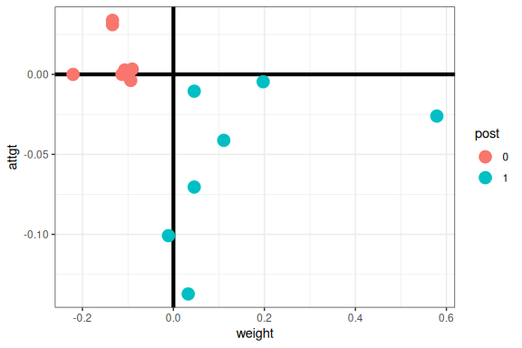
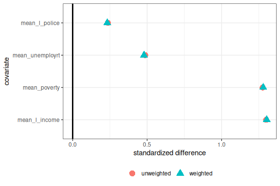

<!-- README.md is generated from README.Rmd. Please edit that file -->

# twfeweights

`twfeweights` computes the implicit weights that two-way fixed effects
(TWFE) regressions and other difference-in-differences estimators place
on underlying comparisons, so you can see how a regression combines them
into a single number. It covers two settings:

- **Staggered treatment adoption without covariates.** Recover the
  weights a TWFE regression places on each group-time average treatment
  effect, $ATT(g,t)$ (de Chaisemartin and D’Haultfoeuille, 2020;
  Goodman-Bacon, 2021), and compare them with the weights behind the
  overall average treatment effects of Callaway and Sant’Anna (2021).
- **Covariates.** Write TWFE regressions, augmented inverse probability
  weighting (AIPW) and regression adjustment as reweighting estimators,
  and check how well their implicit weights balance covariates (Caetano
  and Callaway, 2024).

## Installation

``` r
# from CRAN
install.packages("twfeweights")

# development version from GitHub
# install.packages("remotes")
remotes::install_github("bcallaway11/twfeweights")
```

## TWFE weights on group-time average treatment effects

Estimate the $ATT(g,t)$ with `did::att_gt()`, using the never-treated
group and a universal base period, then pass the result to
`twfe_weights()`:

``` r
library(twfeweights)
data(mpdta, package = "did")

attgt <- did::att_gt(
  yname = "lemp", tname = "year", idname = "countyreal",
  gname = "first.treat", data = mpdta,
  control_group = "nevertreated", base_period = "universal",
  bstrap = FALSE, cband = FALSE
)
tw <- twfe_weights(attgt)

# the weighted sum of ATT(g,t) is the TWFE coefficient
sum(tw$weights_df$weight * tw$weights_df$attgt)
#> [1] -0.03654894
mpdta$D <- 1 * (mpdta$year >= mpdta$first.treat & mpdta$first.treat > 0)
coef(fixest::feols(lemp ~ D | countyreal + year, data = mpdta))
#>           D 
#> -0.03654894

ggtwfeweights(tw)
```



Some post-treatment cells get negative weight, and pre-treatment cells
get non-zero weight. `attO_weights()` and `att_simple_weights()` give
the weights behind $ATT^o$ and $ATT^{simple}$ for comparison.

## Covariate balance

With covariates, `implicit_twfe_weights()` decomposes the TWFE
coefficient into weighted comparisons, and `twfe_cov_bal()` reports how
well the implicit weights balance covariates (here, for the effect of
stand-your-ground laws on homicides):

``` r
data(castle, package = "causaldata")
castle <- as.data.frame(castle)
castle$G <- BMisc::get_group(castle, "sid", tname = "year", treatname = "post")

twm <- implicit_twfe_weights(
  yname = "l_homicide", tname = "year", idname = "sid", gname = "G",
  xformula = ~ l_police + unemployrt, base_period = "gmin1", data = castle
)
twm <- twfe_cov_bal(twm, ~ l_police + unemployrt + poverty + l_income)
ggtwfeweights(twm)
```



`implicit_aipw_weights()` and `aipw_cov_bal()` do the same for AIPW and
regression adjustment; `two_period_reg_weights()` and
`two_period_aipw_weights()` cover the two-period case.

## Learn more

- `vignette("twfe-weights")`: TWFE weights without covariates.
- `vignette("covariate-balance")`: implicit weights and covariate
  balance with covariates.

## References

Caetano, Carolina and Brantly Callaway. “Difference-in-Differences when
Parallel Trends Holds Conditional on Covariates.” Working paper (2024).
[arXiv:2406.15288](https://arxiv.org/abs/2406.15288).

Callaway, Brantly and Pedro H. C. Sant’Anna. “Difference-in-Differences
with Multiple Time Periods.” *Journal of Econometrics* 225.2 (2021):
200-230.

de Chaisemartin, Clement and Xavier D’Haultfoeuille. “Two-Way Fixed
Effects Estimators with Heterogeneous Treatment Effects.” *American
Economic Review* 110.9 (2020): 2964-2996.

Goodman-Bacon, Andrew. “Difference-in-Differences with Variation in
Treatment Timing.” *Journal of Econometrics* 225.2 (2021): 254-277.
