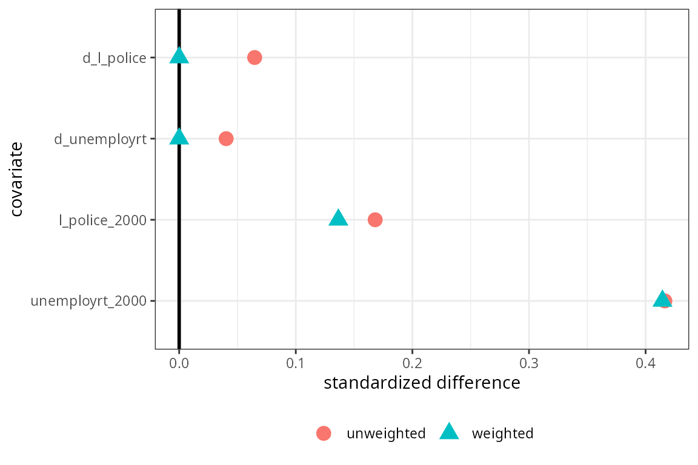
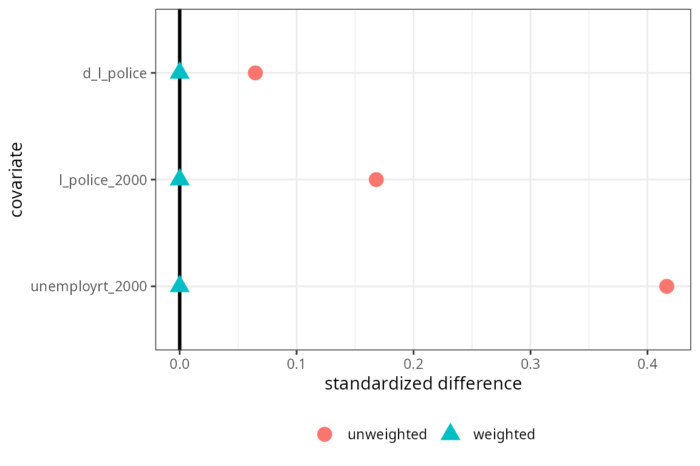
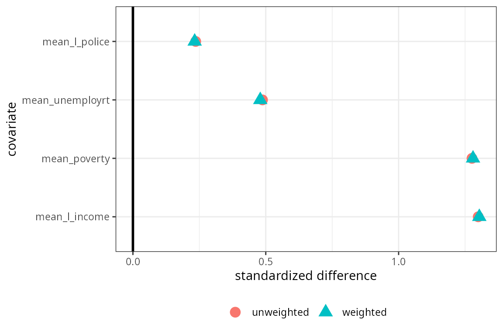
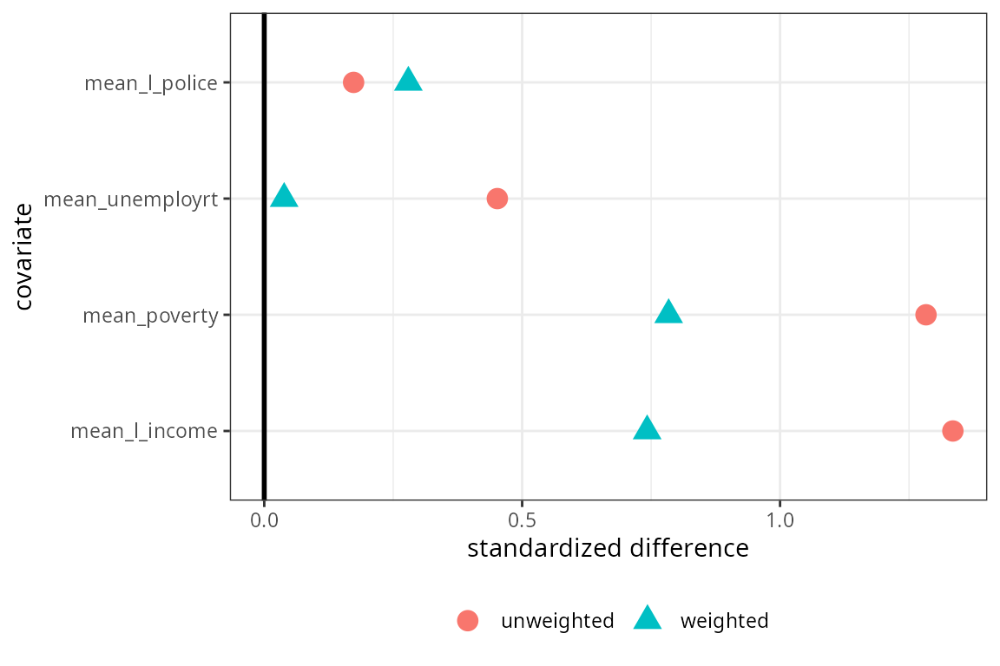

# Covariates: Implicit Weights and Covariate Balance

When parallel trends holds only conditional on covariates, researchers
often add the covariates to a TWFE regression. Caetano and Callaway
(2024) show that the TWFE coefficient can then be written as a
reweighting estimator: a weighted comparison of changes in outcomes
between treated and untreated units. The implicit weights balance the
covariates that enter the regression in the form they enter it (for
example, the change in a time-varying covariate), but not other
functions of them, such as their levels. If parallel trends depends on
covariates that the weights do not balance, the TWFE estimate can be
biased even when treatment effects are the same for everyone.

This suggests a diagnostic: compute the implicit weights and check how
well they balance the covariates that parallel trends is thought to
depend on. The same diagnostic applies to augmented inverse probability
weighting (AIPW) and regression adjustment, whose implicit weights
balance every covariate in the outcome model.

The example follows the application in Caetano and Callaway (2024): the
effect of stand-your-ground laws on homicides (Cheng and Hoekstra,
2013), using a state-level panel for 2000-2010 from the `causaldata`
package.

``` r
library(twfeweights)
data(castle, package = "causaldata")
castle <- as.data.frame(castle)
```

## Two periods

With two periods, take 2000 (before any state adopted a law) and 2010.
The group variable is 0 for states that had not adopted by 2010 and 2010
for those that had.

``` r
castle2 <- subset(castle, year %in% c(2000, 2010))
castle2$G <- BMisc::get_group(castle2, "sid", tname = "year", treatname = "post")
```

### TWFE regression

With two periods, a TWFE regression with time-varying covariates is a
regression of the change in log homicides on the treatment indicator and
the change in the covariates.
[`two_period_reg_weights()`](https://bcallaway11.github.io/twfeweights/reference/two_period_reg_weights.md)
returns its coefficient, the implicit weights and a balance table:

``` r
tw <- two_period_reg_weights(
  yname = "l_homicide", tname = "year", idname = "sid", gname = "G",
  xformula = ~ l_police + unemployrt, data = castle2
)
#> Warning in BMisc::makeBalancedPanel(data, idname, tname): 'BMisc::makeBalancedPanel' is deprecated.
#> Use 'make_balanced_panel' instead.
#> See help("Deprecated")
#> Warning in BMisc::rhs.vars(xformula): 'BMisc::rhs.vars' is deprecated.
#> Use 'rhs_vars' instead.
#> See help("Deprecated")
#> Warning in BMisc::rhs.vars(xformula): 'BMisc::rhs.vars' is deprecated.
#> Use 'rhs_vars' instead.
#> See help("Deprecated")
#> Warning in BMisc::rhs.vars(reg_xformula): 'BMisc::rhs.vars' is deprecated.
#> Use 'rhs_vars' instead.
#> See help("Deprecated")
#> Warning in BMisc::rhs.vars(reg_xformula): 'BMisc::rhs.vars' is deprecated.
#> Use 'rhs_vars' instead.
#> See help("Deprecated")
#> Warning in BMisc::rhs.vars(xformula): 'BMisc::rhs.vars' is deprecated.
#> Use 'rhs_vars' instead.
#> See help("Deprecated")
#> Warning in BMisc::rhs.vars(xformula): 'BMisc::rhs.vars' is deprecated.
#> Use 'rhs_vars' instead.
#> See help("Deprecated")
#> Warning in BMisc::getWeightedDf(est_weights[D == 0] * x[D == 0], weights = sampling_weights[D == : 'BMisc::getWeightedDf' is deprecated.
#> Use 'weighted_ecdf' instead.
#> See help("Deprecated")
#> Warning in BMisc::getWeightedDf(est_weights[D == 1] * x[D == 1], weights = sampling_weights[D == : 'BMisc::getWeightedDf' is deprecated.
#> Use 'weighted_ecdf' instead.
#> See help("Deprecated")
#> Warning in BMisc::getWeightedDf(est_weights[D == 0] * x[D == 0], weights = sampling_weights[D == : 'BMisc::getWeightedDf' is deprecated.
#> Use 'weighted_ecdf' instead.
#> See help("Deprecated")
#> Warning in BMisc::getWeightedDf(est_weights[D == 1] * x[D == 1], weights = sampling_weights[D == : 'BMisc::getWeightedDf' is deprecated.
#> Use 'weighted_ecdf' instead.
#> See help("Deprecated")
#> Warning in BMisc::getWeightedDf(est_weights[D == 0] * x[D == 0], weights = sampling_weights[D == : 'BMisc::getWeightedDf' is deprecated.
#> Use 'weighted_ecdf' instead.
#> See help("Deprecated")
#> Warning in BMisc::getWeightedDf(est_weights[D == 1] * x[D == 1], weights = sampling_weights[D == : 'BMisc::getWeightedDf' is deprecated.
#> Use 'weighted_ecdf' instead.
#> See help("Deprecated")
#> Warning in BMisc::getWeightedDf(est_weights[D == 0] * x[D == 0], weights = sampling_weights[D == : 'BMisc::getWeightedDf' is deprecated.
#> Use 'weighted_ecdf' instead.
#> See help("Deprecated")
#> Warning in BMisc::getWeightedDf(est_weights[D == 1] * x[D == 1], weights = sampling_weights[D == : 'BMisc::getWeightedDf' is deprecated.
#> Use 'weighted_ecdf' instead.
#> See help("Deprecated")
#> Warning in BMisc::getWeightedDf(est_weights[D == 0] * x[D == 0], weights = sampling_weights[D == : 'BMisc::getWeightedDf' is deprecated.
#> Use 'weighted_ecdf' instead.
#> See help("Deprecated")
#> Warning in BMisc::getWeightedDf(est_weights[D == 1] * x[D == 1], weights = sampling_weights[D == : 'BMisc::getWeightedDf' is deprecated.
#> Use 'weighted_ecdf' instead.
#> See help("Deprecated")
#> Warning in BMisc::getWeightedDf(est_weights[D == 0] * x[D == 0], weights = sampling_weights[D == : 'BMisc::getWeightedDf' is deprecated.
#> Use 'weighted_ecdf' instead.
#> See help("Deprecated")
#> Warning in BMisc::getWeightedDf(est_weights[D == 1] * x[D == 1], weights = sampling_weights[D == : 'BMisc::getWeightedDf' is deprecated.
#> Use 'weighted_ecdf' instead.
#> See help("Deprecated")
#> Warning in BMisc::getWeightedDf(est_weights[D == 0] * x[D == 0], weights = sampling_weights[D == : 'BMisc::getWeightedDf' is deprecated.
#> Use 'weighted_ecdf' instead.
#> See help("Deprecated")
#> Warning in BMisc::getWeightedDf(est_weights[D == 1] * x[D == 1], weights = sampling_weights[D == : 'BMisc::getWeightedDf' is deprecated.
#> Use 'weighted_ecdf' instead.
#> See help("Deprecated")
#> Warning in BMisc::getWeightedDf(est_weights[D == 0] * x[D == 0], weights = sampling_weights[D == : 'BMisc::getWeightedDf' is deprecated.
#> Use 'weighted_ecdf' instead.
#> See help("Deprecated")
#> Warning in BMisc::getWeightedDf(est_weights[D == 1] * x[D == 1], weights = sampling_weights[D == : 'BMisc::getWeightedDf' is deprecated.
#> Use 'weighted_ecdf' instead.
#> See help("Deprecated")
#> Warning in BMisc::getWeightedDf(est_weights[D == 0] * x[D == 0], weights = sampling_weights[D == : 'BMisc::getWeightedDf' is deprecated.
#> Use 'weighted_ecdf' instead.
#> See help("Deprecated")
#> Warning in BMisc::getWeightedDf(est_weights[D == 1] * x[D == 1], weights = sampling_weights[D == : 'BMisc::getWeightedDf' is deprecated.
#> Use 'weighted_ecdf' instead.
#> See help("Deprecated")
#> Warning in BMisc::getWeightedDf(est_weights[D == 0] * x[D == 0], weights = sampling_weights[D == : 'BMisc::getWeightedDf' is deprecated.
#> Use 'weighted_ecdf' instead.
#> See help("Deprecated")
#> Warning in BMisc::getWeightedDf(est_weights[D == 1] * x[D == 1], weights = sampling_weights[D == : 'BMisc::getWeightedDf' is deprecated.
#> Use 'weighted_ecdf' instead.
#> See help("Deprecated")
tw$est
#>        .D 
#> 0.1218008
tw$cov_balance_df[, c("covariate", "unweighted_diff", "weighted_diff")]
#>         covariate unweighted_diff weighted_diff
#> 1    d_l_homicide     0.118358801  1.218008e-01
#> 2      d_l_police    -0.006490046 -1.040834e-17
#> 3    d_unemployrt     0.078160863 -3.552714e-15
#> 4   l_police_2000     0.034479255  2.800713e-02
#> 5 unemployrt_2000     0.362725820  3.609457e-01
```

The first row is the outcome; its weighted difference is the TWFE
estimate. The weights balance the *changes* in police and unemployment
exactly, but the 2000 *levels* stay about as unbalanced as before
weighting. If trends in homicides depend on the level of these
covariates, TWFE does not adjust for it.
[`ggtwfeweights()`](https://bcallaway11.github.io/twfeweights/reference/ggtwfeweights.md)
plots standardized differences (differences divided by the pooled
standard deviation, see
[`pooled_sd()`](https://bcallaway11.github.io/twfeweights/reference/pooled_sd.md)):

``` r
ggtwfeweights(tw)
```



### AIPW and regression adjustment

[`two_period_aipw_weights()`](https://bcallaway11.github.io/twfeweights/reference/two_period_aipw_weights.md)
does the same for AIPW. The outcome model below includes the 2000 levels
of both covariates and the change in police; setting
`pscore_formula = ~1` and `pscore_d_covs_formula = ~1` (no covariates in
the propensity score) gives regression adjustment.

``` r
ra <- two_period_aipw_weights(
  yname = "l_homicide", tname = "year", idname = "sid", gname = "G",
  xformula = ~ l_police + unemployrt, d_covs_formula = ~l_police,
  pscore_formula = ~1, pscore_d_covs_formula = ~1, data = castle2
)
#> Warning in BMisc::makeBalancedPanel(data, idname, tname): 'BMisc::makeBalancedPanel' is deprecated.
#> Use 'make_balanced_panel' instead.
#> See help("Deprecated")
#> Warning in BMisc::rhs.vars(d_covs_formula): 'BMisc::rhs.vars' is deprecated.
#> Use 'rhs_vars' instead.
#> See help("Deprecated")
#> Warning in BMisc::rhs.vars(d_covs_formula): 'BMisc::rhs.vars' is deprecated.
#> Use 'rhs_vars' instead.
#> See help("Deprecated")
#> Warning in BMisc::addCovToFormla(colnames(.df_wide_temp), reg_xformula): 'BMisc::addCovToFormla' is deprecated.
#> Use 'add_cov_to_formula' instead.
#> See help("Deprecated")
#> Warning in BMisc::rhs.vars(pscore_xformula): 'BMisc::rhs.vars' is deprecated.
#> Use 'rhs_vars' instead.
#> See help("Deprecated")
#> Warning in BMisc::rhs.vars(reg_xformula): 'BMisc::rhs.vars' is deprecated.
#> Use 'rhs_vars' instead.
#> See help("Deprecated")
#> Warning in BMisc::rhs.vars(reg_xformula): 'BMisc::rhs.vars' is deprecated.
#> Use 'rhs_vars' instead.
#> See help("Deprecated")
#> Warning in BMisc::rhs.vars(reg_xformula): 'BMisc::rhs.vars' is deprecated.
#> Use 'rhs_vars' instead.
#> See help("Deprecated")
#> Warning in BMisc::rhs.vars(pscore_xformula): 'BMisc::rhs.vars' is deprecated.
#> Use 'rhs_vars' instead.
#> See help("Deprecated")
#> Warning in BMisc::addCovToFormla("-1", xformula): 'BMisc::addCovToFormla' is deprecated.
#> Use 'add_cov_to_formula' instead.
#> See help("Deprecated")
#> Warning in BMisc::getWeightedDf(est_weights[D == 0] * x[D == 0], weights = sampling_weights[D == : 'BMisc::getWeightedDf' is deprecated.
#> Use 'weighted_ecdf' instead.
#> See help("Deprecated")
#> Warning in BMisc::getWeightedDf(est_weights[D == 1] * x[D == 1], weights = sampling_weights[D == : 'BMisc::getWeightedDf' is deprecated.
#> Use 'weighted_ecdf' instead.
#> See help("Deprecated")
#> Warning in BMisc::getWeightedDf(est_weights[D == 0] * x[D == 0], weights = sampling_weights[D == : 'BMisc::getWeightedDf' is deprecated.
#> Use 'weighted_ecdf' instead.
#> See help("Deprecated")
#> Warning in BMisc::getWeightedDf(est_weights[D == 1] * x[D == 1], weights = sampling_weights[D == : 'BMisc::getWeightedDf' is deprecated.
#> Use 'weighted_ecdf' instead.
#> See help("Deprecated")
#> Warning in BMisc::getWeightedDf(est_weights[D == 0] * x[D == 0], weights = sampling_weights[D == : 'BMisc::getWeightedDf' is deprecated.
#> Use 'weighted_ecdf' instead.
#> See help("Deprecated")
#> Warning in BMisc::getWeightedDf(est_weights[D == 1] * x[D == 1], weights = sampling_weights[D == : 'BMisc::getWeightedDf' is deprecated.
#> Use 'weighted_ecdf' instead.
#> See help("Deprecated")
#> Warning in BMisc::getWeightedDf(est_weights[D == 0] * x[D == 0], weights = sampling_weights[D == : 'BMisc::getWeightedDf' is deprecated.
#> Use 'weighted_ecdf' instead.
#> See help("Deprecated")
#> Warning in BMisc::getWeightedDf(est_weights[D == 1] * x[D == 1], weights = sampling_weights[D == : 'BMisc::getWeightedDf' is deprecated.
#> Use 'weighted_ecdf' instead.
#> See help("Deprecated")
#> Warning in BMisc::getWeightedDf(est_weights[D == 0] * x[D == 0], weights = sampling_weights[D == : 'BMisc::getWeightedDf' is deprecated.
#> Use 'weighted_ecdf' instead.
#> See help("Deprecated")
#> Warning in BMisc::getWeightedDf(est_weights[D == 1] * x[D == 1], weights = sampling_weights[D == : 'BMisc::getWeightedDf' is deprecated.
#> Use 'weighted_ecdf' instead.
#> See help("Deprecated")
#> Warning in BMisc::getWeightedDf(est_weights[D == 0] * x[D == 0], weights = sampling_weights[D == : 'BMisc::getWeightedDf' is deprecated.
#> Use 'weighted_ecdf' instead.
#> See help("Deprecated")
#> Warning in BMisc::getWeightedDf(est_weights[D == 1] * x[D == 1], weights = sampling_weights[D == : 'BMisc::getWeightedDf' is deprecated.
#> Use 'weighted_ecdf' instead.
#> See help("Deprecated")
#> Warning in BMisc::getWeightedDf(est_weights[D == 0] * x[D == 0], weights = sampling_weights[D == : 'BMisc::getWeightedDf' is deprecated.
#> Use 'weighted_ecdf' instead.
#> See help("Deprecated")
#> Warning in BMisc::getWeightedDf(est_weights[D == 1] * x[D == 1], weights = sampling_weights[D == : 'BMisc::getWeightedDf' is deprecated.
#> Use 'weighted_ecdf' instead.
#> See help("Deprecated")
#> Warning in BMisc::getWeightedDf(est_weights[D == 0] * x[D == 0], weights = sampling_weights[D == : 'BMisc::getWeightedDf' is deprecated.
#> Use 'weighted_ecdf' instead.
#> See help("Deprecated")
#> Warning in BMisc::getWeightedDf(est_weights[D == 1] * x[D == 1], weights = sampling_weights[D == : 'BMisc::getWeightedDf' is deprecated.
#> Use 'weighted_ecdf' instead.
#> See help("Deprecated")
ra$est
#> [1] 0.1216572
ra$cov_balance_df[, c("covariate", "unweighted_diff", "weighted_diff")]
#>         covariate unweighted_diff weighted_diff
#> 1    d_l_homicide     0.118358801  1.216572e-01
#> 2      d_l_police    -0.006490046  6.158268e-17
#> 3   l_police_2000     0.034479255  0.000000e+00
#> 4 unemployrt_2000     0.362725820 -1.776357e-15
```

Every covariate in the outcome model is balanced exactly, in levels and
in changes. The `weightsname` argument adds sampling weights, and
`extra_balance_vars_formula` reports balance for covariates that are not
in the model.

``` r
ggtwfeweights(ra)
```



Two further diagnostics are worth reporting alongside balance. The `ess`
element is the effective sample size of the comparison group under the
implicit weights (see
[`effective_sample_size()`](https://bcallaway11.github.io/twfeweights/reference/effective_sample_size.md)):
the more the weights are concentrated on a few units, the smaller it is.
And `ggtwfeweights(..., plot_relative_to_target = TRUE)` shows whether
the weights also move the treated group away from its own covariate
distribution.

## Staggered adoption

States adopted stand-your-ground laws in different years, so the full
panel has staggered adoption. The group variable is now the first year a
state is treated (0 if never treated in the sample).

``` r
castle$G <- BMisc::get_group(castle, "sid", tname = "year", treatname = "post")
table(castle$G[castle$year == 2000])
#> 
#>    0 2006 2007 2008 2009 2010 
#>   29    1   13    4    2    1
```

### TWFE regression

[`implicit_twfe_weights()`](https://bcallaway11.github.io/twfeweights/reference/implicit_twfe_weights.md)
decomposes the TWFE coefficient into weighted comparisons between each
treated group and the never-treated group in each year. With
`base_period = "gmin1"`, each comparison uses the year before the group
was first treated as its base period, as in
[`did::att_gt()`](https://bcallaway11.github.io/did/reference/att_gt.html).

``` r
twm <- implicit_twfe_weights(
  yname = "l_homicide", tname = "year", idname = "sid", gname = "G",
  xformula = ~ l_police + unemployrt, base_period = "gmin1", data = castle
)
#> Warning in BMisc::makeBalancedPanel(data, idname = idname, tname = tname): 'BMisc::makeBalancedPanel' is deprecated.
#> Use 'make_balanced_panel' instead.
#> See help("Deprecated")
#> Warning in BMisc::addCovToFormla("-1", xformula): 'BMisc::addCovToFormla' is deprecated.
#> Use 'add_cov_to_formula' instead.
#> See help("Deprecated")
#> Warning in BMisc::addCovToFormla("-1", xformula): 'BMisc::addCovToFormla' is deprecated.
#> Use 'add_cov_to_formula' instead.
#> See help("Deprecated")
#> Warning in BMisc::addCovToFormla("-1", xformula): 'BMisc::addCovToFormla' is deprecated.
#> Use 'add_cov_to_formula' instead.
#> See help("Deprecated")
#> Warning in BMisc::addCovToFormla("-1", xformula): 'BMisc::addCovToFormla' is deprecated.
#> Use 'add_cov_to_formula' instead.
#> See help("Deprecated")
#> Warning in BMisc::addCovToFormla("-1", xformula): 'BMisc::addCovToFormla' is deprecated.
#> Use 'add_cov_to_formula' instead.
#> See help("Deprecated")
#> Warning in BMisc::addCovToFormla("-1", xformula): 'BMisc::addCovToFormla' is deprecated.
#> Use 'add_cov_to_formula' instead.
#> See help("Deprecated")
#> Warning in BMisc::addCovToFormla("-1", xformula): 'BMisc::addCovToFormla' is deprecated.
#> Use 'add_cov_to_formula' instead.
#> See help("Deprecated")
#> Warning in BMisc::addCovToFormla("-1", xformula): 'BMisc::addCovToFormla' is deprecated.
#> Use 'add_cov_to_formula' instead.
#> See help("Deprecated")
#> Warning in BMisc::addCovToFormla("-1", xformula): 'BMisc::addCovToFormla' is deprecated.
#> Use 'add_cov_to_formula' instead.
#> See help("Deprecated")
#> Warning in BMisc::addCovToFormla("-1", xformula): 'BMisc::addCovToFormla' is deprecated.
#> Use 'add_cov_to_formula' instead.
#> See help("Deprecated")
#> Warning in BMisc::addCovToFormla("-1", xformula): 'BMisc::addCovToFormla' is deprecated.
#> Use 'add_cov_to_formula' instead.
#> See help("Deprecated")
#> Warning in BMisc::addCovToFormla("-1", xformula): 'BMisc::addCovToFormla' is deprecated.
#> Use 'add_cov_to_formula' instead.
#> See help("Deprecated")
#> Warning in BMisc::addCovToFormla("-1", xformula): 'BMisc::addCovToFormla' is deprecated.
#> Use 'add_cov_to_formula' instead.
#> See help("Deprecated")
#> Warning in BMisc::addCovToFormla("-1", xformula): 'BMisc::addCovToFormla' is deprecated.
#> Use 'add_cov_to_formula' instead.
#> See help("Deprecated")
#> Warning in BMisc::addCovToFormla("-1", xformula): 'BMisc::addCovToFormla' is deprecated.
#> Use 'add_cov_to_formula' instead.
#> See help("Deprecated")
#> Warning in BMisc::addCovToFormla("-1", xformula): 'BMisc::addCovToFormla' is deprecated.
#> Use 'add_cov_to_formula' instead.
#> See help("Deprecated")
#> Warning in BMisc::addCovToFormla("-1", xformula): 'BMisc::addCovToFormla' is deprecated.
#> Use 'add_cov_to_formula' instead.
#> See help("Deprecated")
#> Warning in BMisc::addCovToFormla("-1", xformula): 'BMisc::addCovToFormla' is deprecated.
#> Use 'add_cov_to_formula' instead.
#> See help("Deprecated")
#> Warning in BMisc::addCovToFormla("-1", xformula): 'BMisc::addCovToFormla' is deprecated.
#> Use 'add_cov_to_formula' instead.
#> See help("Deprecated")
#> Warning in BMisc::addCovToFormla("-1", xformula): 'BMisc::addCovToFormla' is deprecated.
#> Use 'add_cov_to_formula' instead.
#> See help("Deprecated")
#> Warning in BMisc::addCovToFormla("-1", xformula): 'BMisc::addCovToFormla' is deprecated.
#> Use 'add_cov_to_formula' instead.
#> See help("Deprecated")
#> Warning in BMisc::addCovToFormla("-1", xformula): 'BMisc::addCovToFormla' is deprecated.
#> Use 'add_cov_to_formula' instead.
#> See help("Deprecated")
#> Warning in BMisc::addCovToFormla("-1", xformula): 'BMisc::addCovToFormla' is deprecated.
#> Use 'add_cov_to_formula' instead.
#> See help("Deprecated")
#> Warning in BMisc::addCovToFormla("-1", xformula): 'BMisc::addCovToFormla' is deprecated.
#> Use 'add_cov_to_formula' instead.
#> See help("Deprecated")
#> Warning in BMisc::addCovToFormla("-1", xformula): 'BMisc::addCovToFormla' is deprecated.
#> Use 'add_cov_to_formula' instead.
#> See help("Deprecated")
#> Warning in BMisc::addCovToFormla("-1", xformula): 'BMisc::addCovToFormla' is deprecated.
#> Use 'add_cov_to_formula' instead.
#> See help("Deprecated")
#> Warning in BMisc::addCovToFormla("-1", xformula): 'BMisc::addCovToFormla' is deprecated.
#> Use 'add_cov_to_formula' instead.
#> See help("Deprecated")
#> Warning in BMisc::addCovToFormla("-1", xformula): 'BMisc::addCovToFormla' is deprecated.
#> Use 'add_cov_to_formula' instead.
#> See help("Deprecated")
#> Warning in BMisc::addCovToFormla("-1", xformula): 'BMisc::addCovToFormla' is deprecated.
#> Use 'add_cov_to_formula' instead.
#> See help("Deprecated")
#> Warning in BMisc::addCovToFormla("-1", xformula): 'BMisc::addCovToFormla' is deprecated.
#> Use 'add_cov_to_formula' instead.
#> See help("Deprecated")
#> Warning in BMisc::addCovToFormla("-1", xformula): 'BMisc::addCovToFormla' is deprecated.
#> Use 'add_cov_to_formula' instead.
#> See help("Deprecated")
#> Warning in BMisc::addCovToFormla("-1", xformula): 'BMisc::addCovToFormla' is deprecated.
#> Use 'add_cov_to_formula' instead.
#> See help("Deprecated")
#> Warning in BMisc::addCovToFormla("-1", xformula): 'BMisc::addCovToFormla' is deprecated.
#> Use 'add_cov_to_formula' instead.
#> See help("Deprecated")
#> Warning in BMisc::addCovToFormla("-1", xformula): 'BMisc::addCovToFormla' is deprecated.
#> Use 'add_cov_to_formula' instead.
#> See help("Deprecated")
#> Warning in BMisc::addCovToFormla("-1", xformula): 'BMisc::addCovToFormla' is deprecated.
#> Use 'add_cov_to_formula' instead.
#> See help("Deprecated")
#> Warning in BMisc::addCovToFormla("-1", xformula): 'BMisc::addCovToFormla' is deprecated.
#> Use 'add_cov_to_formula' instead.
#> See help("Deprecated")
#> Warning in BMisc::addCovToFormla("-1", xformula): 'BMisc::addCovToFormla' is deprecated.
#> Use 'add_cov_to_formula' instead.
#> See help("Deprecated")
#> Warning in BMisc::addCovToFormla("-1", xformula): 'BMisc::addCovToFormla' is deprecated.
#> Use 'add_cov_to_formula' instead.
#> See help("Deprecated")
#> Warning in BMisc::addCovToFormla("-1", xformula): 'BMisc::addCovToFormla' is deprecated.
#> Use 'add_cov_to_formula' instead.
#> See help("Deprecated")
#> Warning in BMisc::addCovToFormla("-1", xformula): 'BMisc::addCovToFormla' is deprecated.
#> Use 'add_cov_to_formula' instead.
#> See help("Deprecated")
#> Warning in BMisc::addCovToFormla("-1", xformula): 'BMisc::addCovToFormla' is deprecated.
#> Use 'add_cov_to_formula' instead.
#> See help("Deprecated")
#> Warning in BMisc::addCovToFormla("-1", xformula): 'BMisc::addCovToFormla' is deprecated.
#> Use 'add_cov_to_formula' instead.
#> See help("Deprecated")
#> Warning in BMisc::addCovToFormla("-1", xformula): 'BMisc::addCovToFormla' is deprecated.
#> Use 'add_cov_to_formula' instead.
#> See help("Deprecated")
#> Warning in BMisc::addCovToFormla("-1", xformula): 'BMisc::addCovToFormla' is deprecated.
#> Use 'add_cov_to_formula' instead.
#> See help("Deprecated")
#> Warning in BMisc::addCovToFormla("-1", xformula): 'BMisc::addCovToFormla' is deprecated.
#> Use 'add_cov_to_formula' instead.
#> See help("Deprecated")
#> Warning in BMisc::addCovToFormla("-1", xformula): 'BMisc::addCovToFormla' is deprecated.
#> Use 'add_cov_to_formula' instead.
#> See help("Deprecated")
#> Warning in BMisc::addCovToFormla("-1", xformula): 'BMisc::addCovToFormla' is deprecated.
#> Use 'add_cov_to_formula' instead.
#> See help("Deprecated")
#> Warning in BMisc::addCovToFormla("-1", xformula): 'BMisc::addCovToFormla' is deprecated.
#> Use 'add_cov_to_formula' instead.
#> See help("Deprecated")
#> Warning in BMisc::addCovToFormla("-1", xformula): 'BMisc::addCovToFormla' is deprecated.
#> Use 'add_cov_to_formula' instead.
#> See help("Deprecated")
#> Warning in BMisc::addCovToFormla("-1", xformula): 'BMisc::addCovToFormla' is deprecated.
#> Use 'add_cov_to_formula' instead.
#> See help("Deprecated")
#> Warning in BMisc::addCovToFormla("-1", xformula): 'BMisc::addCovToFormla' is deprecated.
#> Use 'add_cov_to_formula' instead.
#> See help("Deprecated")
#> Warning in BMisc::addCovToFormla("-1", xformula): 'BMisc::addCovToFormla' is deprecated.
#> Use 'add_cov_to_formula' instead.
#> See help("Deprecated")
#> Warning in BMisc::addCovToFormla("-1", xformula): 'BMisc::addCovToFormla' is deprecated.
#> Use 'add_cov_to_formula' instead.
#> See help("Deprecated")
#> Warning in BMisc::addCovToFormla("-1", xformula): 'BMisc::addCovToFormla' is deprecated.
#> Use 'add_cov_to_formula' instead.
#> See help("Deprecated")
#> Warning in BMisc::addCovToFormla("-1", xformula): 'BMisc::addCovToFormla' is deprecated.
#> Use 'add_cov_to_formula' instead.
#> See help("Deprecated")
#> Warning in BMisc::addCovToFormla("-1", xformula): 'BMisc::addCovToFormla' is deprecated.
#> Use 'add_cov_to_formula' instead.
#> See help("Deprecated")
#> Warning in BMisc::addCovToFormla("-1", xformula): 'BMisc::addCovToFormla' is deprecated.
#> Use 'add_cov_to_formula' instead.
#> See help("Deprecated")
#> Warning in BMisc::addCovToFormla("-1", xformula): 'BMisc::addCovToFormla' is deprecated.
#> Use 'add_cov_to_formula' instead.
#> See help("Deprecated")
#> Warning in BMisc::addCovToFormla("-1", xformula): 'BMisc::addCovToFormla' is deprecated.
#> Use 'add_cov_to_formula' instead.
#> See help("Deprecated")
#> Warning in BMisc::addCovToFormla("-1", xformula): 'BMisc::addCovToFormla' is deprecated.
#> Use 'add_cov_to_formula' instead.
#> See help("Deprecated")
#> Warning in BMisc::addCovToFormla("-1", xformula): 'BMisc::addCovToFormla' is deprecated.
#> Use 'add_cov_to_formula' instead.
#> See help("Deprecated")
#> Warning in BMisc::addCovToFormla("-1", xformula): 'BMisc::addCovToFormla' is deprecated.
#> Use 'add_cov_to_formula' instead.
#> See help("Deprecated")
#> Warning in BMisc::addCovToFormla("-1", xformula): 'BMisc::addCovToFormla' is deprecated.
#> Use 'add_cov_to_formula' instead.
#> See help("Deprecated")
#> Warning in BMisc::addCovToFormla("-1", xformula): 'BMisc::addCovToFormla' is deprecated.
#> Use 'add_cov_to_formula' instead.
#> See help("Deprecated")
#> Warning in BMisc::addCovToFormla("-1", xformula): 'BMisc::addCovToFormla' is deprecated.
#> Use 'add_cov_to_formula' instead.
#> See help("Deprecated")
#> Warning in BMisc::addCovToFormla("-1", xformula): 'BMisc::addCovToFormla' is deprecated.
#> Use 'add_cov_to_formula' instead.
#> See help("Deprecated")
#> Warning in BMisc::addCovToFormla("-1", xformula): 'BMisc::addCovToFormla' is deprecated.
#> Use 'add_cov_to_formula' instead.
#> See help("Deprecated")
#> Warning in BMisc::addCovToFormla("-1", xformula): 'BMisc::addCovToFormla' is deprecated.
#> Use 'add_cov_to_formula' instead.
#> See help("Deprecated")
#> Warning in BMisc::addCovToFormla("-1", xformula): 'BMisc::addCovToFormla' is deprecated.
#> Use 'add_cov_to_formula' instead.
#> See help("Deprecated")
#> Warning in BMisc::addCovToFormla("-1", xformula): 'BMisc::addCovToFormla' is deprecated.
#> Use 'add_cov_to_formula' instead.
#> See help("Deprecated")
#> Warning in BMisc::addCovToFormla("-1", xformula): 'BMisc::addCovToFormla' is deprecated.
#> Use 'add_cov_to_formula' instead.
#> See help("Deprecated")
#> Warning in BMisc::addCovToFormla("-1", xformula): 'BMisc::addCovToFormla' is deprecated.
#> Use 'add_cov_to_formula' instead.
#> See help("Deprecated")
#> Warning in BMisc::addCovToFormla("-1", xformula): 'BMisc::addCovToFormla' is deprecated.
#> Use 'add_cov_to_formula' instead.
#> See help("Deprecated")
#> Warning in BMisc::addCovToFormla("-1", xformula): 'BMisc::addCovToFormla' is deprecated.
#> Use 'add_cov_to_formula' instead.
#> See help("Deprecated")
#> Warning in BMisc::addCovToFormla("-1", xformula): 'BMisc::addCovToFormla' is deprecated.
#> Use 'add_cov_to_formula' instead.
#> See help("Deprecated")
#> Warning in BMisc::addCovToFormla("-1", xformula): 'BMisc::addCovToFormla' is deprecated.
#> Use 'add_cov_to_formula' instead.
#> See help("Deprecated")
#> Warning in BMisc::addCovToFormla("-1", xformula): 'BMisc::addCovToFormla' is deprecated.
#> Use 'add_cov_to_formula' instead.
#> See help("Deprecated")
#> Warning in BMisc::addCovToFormla("-1", xformula): 'BMisc::addCovToFormla' is deprecated.
#> Use 'add_cov_to_formula' instead.
#> See help("Deprecated")
#> Warning in BMisc::addCovToFormla("-1", xformula): 'BMisc::addCovToFormla' is deprecated.
#> Use 'add_cov_to_formula' instead.
#> See help("Deprecated")
#> Warning in BMisc::addCovToFormla("-1", xformula): 'BMisc::addCovToFormla' is deprecated.
#> Use 'add_cov_to_formula' instead.
#> See help("Deprecated")
#> Warning in BMisc::addCovToFormla("-1", xformula): 'BMisc::addCovToFormla' is deprecated.
#> Use 'add_cov_to_formula' instead.
#> See help("Deprecated")
#> Warning in BMisc::addCovToFormla("-1", xformula): 'BMisc::addCovToFormla' is deprecated.
#> Use 'add_cov_to_formula' instead.
#> See help("Deprecated")
#> Warning in BMisc::addCovToFormla("-1", xformula): 'BMisc::addCovToFormla' is deprecated.
#> Use 'add_cov_to_formula' instead.
#> See help("Deprecated")
#> Warning in BMisc::addCovToFormla("-1", xformula): 'BMisc::addCovToFormla' is deprecated.
#> Use 'add_cov_to_formula' instead.
#> See help("Deprecated")
#> Warning in BMisc::addCovToFormla("-1", xformula): 'BMisc::addCovToFormla' is deprecated.
#> Use 'add_cov_to_formula' instead.
#> See help("Deprecated")
#> Warning in BMisc::addCovToFormla("-1", xformula): 'BMisc::addCovToFormla' is deprecated.
#> Use 'add_cov_to_formula' instead.
#> See help("Deprecated")
#> Warning in BMisc::addCovToFormla("-1", xformula): 'BMisc::addCovToFormla' is deprecated.
#> Use 'add_cov_to_formula' instead.
#> See help("Deprecated")
#> Warning in BMisc::addCovToFormla("-1", xformula): 'BMisc::addCovToFormla' is deprecated.
#> Use 'add_cov_to_formula' instead.
#> See help("Deprecated")
#> Warning in BMisc::addCovToFormla("-1", xformula): 'BMisc::addCovToFormla' is deprecated.
#> Use 'add_cov_to_formula' instead.
#> See help("Deprecated")
#> Warning in BMisc::addCovToFormla("-1", xformula): 'BMisc::addCovToFormla' is deprecated.
#> Use 'add_cov_to_formula' instead.
#> See help("Deprecated")
#> Warning in BMisc::addCovToFormla("-1", xformula): 'BMisc::addCovToFormla' is deprecated.
#> Use 'add_cov_to_formula' instead.
#> See help("Deprecated")
#> Warning in BMisc::addCovToFormla("-1", xformula): 'BMisc::addCovToFormla' is deprecated.
#> Use 'add_cov_to_formula' instead.
#> See help("Deprecated")
#> Warning in BMisc::addCovToFormla("-1", xformula): 'BMisc::addCovToFormla' is deprecated.
#> Use 'add_cov_to_formula' instead.
#> See help("Deprecated")
#> Warning in BMisc::addCovToFormla("-1", xformula): 'BMisc::addCovToFormla' is deprecated.
#> Use 'add_cov_to_formula' instead.
#> See help("Deprecated")
#> Warning in BMisc::addCovToFormla("-1", xformula): 'BMisc::addCovToFormla' is deprecated.
#> Use 'add_cov_to_formula' instead.
#> See help("Deprecated")
#> Warning in BMisc::addCovToFormla("-1", xformula): 'BMisc::addCovToFormla' is deprecated.
#> Use 'add_cov_to_formula' instead.
#> See help("Deprecated")
#> Warning in BMisc::addCovToFormla("-1", xformula): 'BMisc::addCovToFormla' is deprecated.
#> Use 'add_cov_to_formula' instead.
#> See help("Deprecated")
#> Warning in BMisc::addCovToFormla("-1", xformula): 'BMisc::addCovToFormla' is deprecated.
#> Use 'add_cov_to_formula' instead.
#> See help("Deprecated")
#> Warning in BMisc::addCovToFormla("-1", xformula): 'BMisc::addCovToFormla' is deprecated.
#> Use 'add_cov_to_formula' instead.
#> See help("Deprecated")
#> Warning in BMisc::addCovToFormla("-1", xformula): 'BMisc::addCovToFormla' is deprecated.
#> Use 'add_cov_to_formula' instead.
#> See help("Deprecated")
#> Warning in BMisc::addCovToFormla("-1", xformula): 'BMisc::addCovToFormla' is deprecated.
#> Use 'add_cov_to_formula' instead.
#> See help("Deprecated")
#> Warning in BMisc::addCovToFormla("-1", xformula): 'BMisc::addCovToFormla' is deprecated.
#> Use 'add_cov_to_formula' instead.
#> See help("Deprecated")
#> Warning in BMisc::addCovToFormla("-1", xformula): 'BMisc::addCovToFormla' is deprecated.
#> Use 'add_cov_to_formula' instead.
#> See help("Deprecated")
#> Warning in BMisc::addCovToFormla("-1", xformula): 'BMisc::addCovToFormla' is deprecated.
#> Use 'add_cov_to_formula' instead.
#> See help("Deprecated")
#> Warning in BMisc::addCovToFormla("-1", xformula): 'BMisc::addCovToFormla' is deprecated.
#> Use 'add_cov_to_formula' instead.
#> See help("Deprecated")
#> Warning in BMisc::addCovToFormla("-1", xformula): 'BMisc::addCovToFormla' is deprecated.
#> Use 'add_cov_to_formula' instead.
#> See help("Deprecated")
#> Warning in BMisc::addCovToFormla("-1", xformula): 'BMisc::addCovToFormla' is deprecated.
#> Use 'add_cov_to_formula' instead.
#> See help("Deprecated")
#> Warning in BMisc::addCovToFormla("-1", xformula): 'BMisc::addCovToFormla' is deprecated.
#> Use 'add_cov_to_formula' instead.
#> See help("Deprecated")
#> Warning in BMisc::addCovToFormla("-1", xformula): 'BMisc::addCovToFormla' is deprecated.
#> Use 'add_cov_to_formula' instead.
#> See help("Deprecated")
#> Warning in BMisc::addCovToFormla("-1", xformula): 'BMisc::addCovToFormla' is deprecated.
#> Use 'add_cov_to_formula' instead.
#> See help("Deprecated")
#> Warning in BMisc::getListElement(twfe_gt, "weighted_outcome_diff"): 'BMisc::getListElement' is deprecated.
#> Use 'get_list_element' instead.
#> See help("Deprecated")
#> Warning in BMisc::getListElement(twfe_gt, "g"): 'BMisc::getListElement' is deprecated.
#> Use 'get_list_element' instead.
#> See help("Deprecated")
#> Warning in BMisc::getListElement(twfe_gt, "tp"): 'BMisc::getListElement' is deprecated.
#> Use 'get_list_element' instead.
#> See help("Deprecated")
#> Warning in BMisc::getListElement(twfe_gt, "alpha_weight"): 'BMisc::getListElement' is deprecated.
#> Use 'get_list_element' instead.
#> See help("Deprecated")
#> Warning in BMisc::getListElement(twfe_gt, "remainder"): 'BMisc::getListElement' is deprecated.
#> Use 'get_list_element' instead.
#> See help("Deprecated")
twm$est
#> [1] 0.07016711
coef(fixest::feols(l_homicide ~ post + l_police + unemployrt | sid + year,
  data = castle
))["post"]
#>       post 
#> 0.07016711
```

[`summary()`](https://rdrr.io/r/base/summary.html) splits the estimate.
`alpha post only` is the part that comes from post-treatment
comparisons; `pta violations bias` is the part that comes from
pre-treatment comparisons, which should be close to zero if parallel
trends holds before treatment. Here most of the TWFE estimate comes from
pre-treatment comparisons.

``` r
s <- summary(twm)
#> Warning in BMisc::getListElement(object, "weighted_outcome_diff"): 'BMisc::getListElement' is deprecated.
#> Use 'get_list_element' instead.
#> See help("Deprecated")
#> Warning in BMisc::getListElement(object, "g"): 'BMisc::getListElement' is deprecated.
#> Use 'get_list_element' instead.
#> See help("Deprecated")
#> Warning in BMisc::getListElement(object, "tp"): 'BMisc::getListElement' is deprecated.
#> Use 'get_list_element' instead.
#> See help("Deprecated")
#> Warning in BMisc::getListElement(object, "alpha_weight"): 'BMisc::getListElement' is deprecated.
#> Use 'get_list_element' instead.
#> See help("Deprecated")
#> Warning in BMisc::getListElement(object, "remainder"): 'BMisc::getListElement' is deprecated.
#> Use 'get_list_element' instead.
#> See help("Deprecated")
#> Warning in BMisc::getListElement(object, "ess"): 'BMisc::getListElement' is deprecated.
#> Use 'get_list_element' instead.
#> See help("Deprecated")
#> alpha twfe:           0.0702 
#> alpha decomp:         0.0701 
#> alpha post only:      0.0181 
#> pta violations bias:  0.052 
#> remainders:           1e-04 
#> ess:                  434.8558 
#> 
#> summary of twfe decomposition
```

[`twfe_cov_bal()`](https://bcallaway11.github.io/twfeweights/reference/twfe_cov_bal.md)
adds balance statistics for any covariates, which are averaged over time
within each state first. The summary and plot average them over
post-treatment cells:

``` r
twm <- twfe_cov_bal(twm, ~ l_police + unemployrt + poverty + l_income)
#> Warning in BMisc::addCovToFormla("-1", extra_balance_vars_formula): 'BMisc::addCovToFormla' is deprecated.
#> Use 'add_cov_to_formula' instead.
#> See help("Deprecated")
#> Warning in BMisc::getListElement(decomposed_twfe$twfe_gt, "g"): 'BMisc::getListElement' is deprecated.
#> Use 'get_list_element' instead.
#> See help("Deprecated")
#> Warning in BMisc::getListElement(decomposed_twfe$twfe_gt, "tp"): 'BMisc::getListElement' is deprecated.
#> Use 'get_list_element' instead.
#> See help("Deprecated")
#> Warning in BMisc::getListElement(decomposed_twfe$twfe_gt, "g"): 'BMisc::getListElement' is deprecated.
#> Use 'get_list_element' instead.
#> See help("Deprecated")
#> Warning in BMisc::getListElement(decomposed_twfe$twfe_gt, "tp"): 'BMisc::getListElement' is deprecated.
#> Use 'get_list_element' instead.
#> See help("Deprecated")
#> Warning in BMisc::getWeightedDf(est_weights[D == 0] * x[D == 0], weights = sampling_weights[D == : 'BMisc::getWeightedDf' is deprecated.
#> Use 'weighted_ecdf' instead.
#> See help("Deprecated")
#> Warning in BMisc::getWeightedDf(est_weights[D == 1] * x[D == 1], weights = sampling_weights[D == : 'BMisc::getWeightedDf' is deprecated.
#> Use 'weighted_ecdf' instead.
#> See help("Deprecated")
#> Warning in BMisc::getWeightedDf(est_weights[D == 0] * x[D == 0], weights = sampling_weights[D == : 'BMisc::getWeightedDf' is deprecated.
#> Use 'weighted_ecdf' instead.
#> See help("Deprecated")
#> Warning in BMisc::getWeightedDf(est_weights[D == 1] * x[D == 1], weights = sampling_weights[D == : 'BMisc::getWeightedDf' is deprecated.
#> Use 'weighted_ecdf' instead.
#> See help("Deprecated")
#> Warning in BMisc::getWeightedDf(est_weights[D == 0] * x[D == 0], weights = sampling_weights[D == : 'BMisc::getWeightedDf' is deprecated.
#> Use 'weighted_ecdf' instead.
#> See help("Deprecated")
#> Warning in BMisc::getWeightedDf(est_weights[D == 1] * x[D == 1], weights = sampling_weights[D == : 'BMisc::getWeightedDf' is deprecated.
#> Use 'weighted_ecdf' instead.
#> See help("Deprecated")
#> Warning in BMisc::getWeightedDf(est_weights[D == 0] * x[D == 0], weights = sampling_weights[D == : 'BMisc::getWeightedDf' is deprecated.
#> Use 'weighted_ecdf' instead.
#> See help("Deprecated")
#> Warning in BMisc::getWeightedDf(est_weights[D == 1] * x[D == 1], weights = sampling_weights[D == : 'BMisc::getWeightedDf' is deprecated.
#> Use 'weighted_ecdf' instead.
#> See help("Deprecated")
#> Warning in BMisc::getWeightedDf(est_weights[D == 0] * x[D == 0], weights = sampling_weights[D == : 'BMisc::getWeightedDf' is deprecated.
#> Use 'weighted_ecdf' instead.
#> See help("Deprecated")
#> Warning in BMisc::getWeightedDf(est_weights[D == 1] * x[D == 1], weights = sampling_weights[D == : 'BMisc::getWeightedDf' is deprecated.
#> Use 'weighted_ecdf' instead.
#> See help("Deprecated")
#> Warning in BMisc::getWeightedDf(est_weights[D == 0] * x[D == 0], weights = sampling_weights[D == : 'BMisc::getWeightedDf' is deprecated.
#> Use 'weighted_ecdf' instead.
#> See help("Deprecated")
#> Warning in BMisc::getWeightedDf(est_weights[D == 1] * x[D == 1], weights = sampling_weights[D == : 'BMisc::getWeightedDf' is deprecated.
#> Use 'weighted_ecdf' instead.
#> See help("Deprecated")
#> Warning in BMisc::getWeightedDf(est_weights[D == 0] * x[D == 0], weights = sampling_weights[D == : 'BMisc::getWeightedDf' is deprecated.
#> Use 'weighted_ecdf' instead.
#> See help("Deprecated")
#> Warning in BMisc::getWeightedDf(est_weights[D == 1] * x[D == 1], weights = sampling_weights[D == : 'BMisc::getWeightedDf' is deprecated.
#> Use 'weighted_ecdf' instead.
#> See help("Deprecated")
#> Warning in BMisc::getWeightedDf(est_weights[D == 0] * x[D == 0], weights = sampling_weights[D == : 'BMisc::getWeightedDf' is deprecated.
#> Use 'weighted_ecdf' instead.
#> See help("Deprecated")
#> Warning in BMisc::getWeightedDf(est_weights[D == 1] * x[D == 1], weights = sampling_weights[D == : 'BMisc::getWeightedDf' is deprecated.
#> Use 'weighted_ecdf' instead.
#> See help("Deprecated")
#> Warning in BMisc::getListElement(decomposed_twfe$twfe_gt, "g"): 'BMisc::getListElement' is deprecated.
#> Use 'get_list_element' instead.
#> See help("Deprecated")
#> Warning in BMisc::getListElement(decomposed_twfe$twfe_gt, "tp"): 'BMisc::getListElement' is deprecated.
#> Use 'get_list_element' instead.
#> See help("Deprecated")
#> Warning in BMisc::getWeightedDf(est_weights[D == 0] * x[D == 0], weights = sampling_weights[D == : 'BMisc::getWeightedDf' is deprecated.
#> Use 'weighted_ecdf' instead.
#> See help("Deprecated")
#> Warning in BMisc::getWeightedDf(est_weights[D == 1] * x[D == 1], weights = sampling_weights[D == : 'BMisc::getWeightedDf' is deprecated.
#> Use 'weighted_ecdf' instead.
#> See help("Deprecated")
#> Warning in BMisc::getWeightedDf(est_weights[D == 0] * x[D == 0], weights = sampling_weights[D == : 'BMisc::getWeightedDf' is deprecated.
#> Use 'weighted_ecdf' instead.
#> See help("Deprecated")
#> Warning in BMisc::getWeightedDf(est_weights[D == 1] * x[D == 1], weights = sampling_weights[D == : 'BMisc::getWeightedDf' is deprecated.
#> Use 'weighted_ecdf' instead.
#> See help("Deprecated")
#> Warning in BMisc::getWeightedDf(est_weights[D == 0] * x[D == 0], weights = sampling_weights[D == : 'BMisc::getWeightedDf' is deprecated.
#> Use 'weighted_ecdf' instead.
#> See help("Deprecated")
#> Warning in BMisc::getWeightedDf(est_weights[D == 1] * x[D == 1], weights = sampling_weights[D == : 'BMisc::getWeightedDf' is deprecated.
#> Use 'weighted_ecdf' instead.
#> See help("Deprecated")
#> Warning in BMisc::getWeightedDf(est_weights[D == 0] * x[D == 0], weights = sampling_weights[D == : 'BMisc::getWeightedDf' is deprecated.
#> Use 'weighted_ecdf' instead.
#> See help("Deprecated")
#> Warning in BMisc::getWeightedDf(est_weights[D == 1] * x[D == 1], weights = sampling_weights[D == : 'BMisc::getWeightedDf' is deprecated.
#> Use 'weighted_ecdf' instead.
#> See help("Deprecated")
#> Warning in BMisc::getWeightedDf(est_weights[D == 0] * x[D == 0], weights = sampling_weights[D == : 'BMisc::getWeightedDf' is deprecated.
#> Use 'weighted_ecdf' instead.
#> See help("Deprecated")
#> Warning in BMisc::getWeightedDf(est_weights[D == 1] * x[D == 1], weights = sampling_weights[D == : 'BMisc::getWeightedDf' is deprecated.
#> Use 'weighted_ecdf' instead.
#> See help("Deprecated")
#> Warning in BMisc::getWeightedDf(est_weights[D == 0] * x[D == 0], weights = sampling_weights[D == : 'BMisc::getWeightedDf' is deprecated.
#> Use 'weighted_ecdf' instead.
#> See help("Deprecated")
#> Warning in BMisc::getWeightedDf(est_weights[D == 1] * x[D == 1], weights = sampling_weights[D == : 'BMisc::getWeightedDf' is deprecated.
#> Use 'weighted_ecdf' instead.
#> See help("Deprecated")
#> Warning in BMisc::getWeightedDf(est_weights[D == 0] * x[D == 0], weights = sampling_weights[D == : 'BMisc::getWeightedDf' is deprecated.
#> Use 'weighted_ecdf' instead.
#> See help("Deprecated")
#> Warning in BMisc::getWeightedDf(est_weights[D == 1] * x[D == 1], weights = sampling_weights[D == : 'BMisc::getWeightedDf' is deprecated.
#> Use 'weighted_ecdf' instead.
#> See help("Deprecated")
#> Warning in BMisc::getWeightedDf(est_weights[D == 0] * x[D == 0], weights = sampling_weights[D == : 'BMisc::getWeightedDf' is deprecated.
#> Use 'weighted_ecdf' instead.
#> See help("Deprecated")
#> Warning in BMisc::getWeightedDf(est_weights[D == 1] * x[D == 1], weights = sampling_weights[D == : 'BMisc::getWeightedDf' is deprecated.
#> Use 'weighted_ecdf' instead.
#> See help("Deprecated")
#> Warning in BMisc::getListElement(decomposed_twfe$twfe_gt, "g"): 'BMisc::getListElement' is deprecated.
#> Use 'get_list_element' instead.
#> See help("Deprecated")
#> Warning in BMisc::getListElement(decomposed_twfe$twfe_gt, "tp"): 'BMisc::getListElement' is deprecated.
#> Use 'get_list_element' instead.
#> See help("Deprecated")
#> Warning in BMisc::getWeightedDf(est_weights[D == 0] * x[D == 0], weights = sampling_weights[D == : 'BMisc::getWeightedDf' is deprecated.
#> Use 'weighted_ecdf' instead.
#> See help("Deprecated")
#> Warning in BMisc::getWeightedDf(est_weights[D == 1] * x[D == 1], weights = sampling_weights[D == : 'BMisc::getWeightedDf' is deprecated.
#> Use 'weighted_ecdf' instead.
#> See help("Deprecated")
#> Warning in BMisc::getWeightedDf(est_weights[D == 0] * x[D == 0], weights = sampling_weights[D == : 'BMisc::getWeightedDf' is deprecated.
#> Use 'weighted_ecdf' instead.
#> See help("Deprecated")
#> Warning in BMisc::getWeightedDf(est_weights[D == 1] * x[D == 1], weights = sampling_weights[D == : 'BMisc::getWeightedDf' is deprecated.
#> Use 'weighted_ecdf' instead.
#> See help("Deprecated")
#> Warning in BMisc::getWeightedDf(est_weights[D == 0] * x[D == 0], weights = sampling_weights[D == : 'BMisc::getWeightedDf' is deprecated.
#> Use 'weighted_ecdf' instead.
#> See help("Deprecated")
#> Warning in BMisc::getWeightedDf(est_weights[D == 1] * x[D == 1], weights = sampling_weights[D == : 'BMisc::getWeightedDf' is deprecated.
#> Use 'weighted_ecdf' instead.
#> See help("Deprecated")
#> Warning in BMisc::getWeightedDf(est_weights[D == 0] * x[D == 0], weights = sampling_weights[D == : 'BMisc::getWeightedDf' is deprecated.
#> Use 'weighted_ecdf' instead.
#> See help("Deprecated")
#> Warning in BMisc::getWeightedDf(est_weights[D == 1] * x[D == 1], weights = sampling_weights[D == : 'BMisc::getWeightedDf' is deprecated.
#> Use 'weighted_ecdf' instead.
#> See help("Deprecated")
#> Warning in BMisc::getWeightedDf(est_weights[D == 0] * x[D == 0], weights = sampling_weights[D == : 'BMisc::getWeightedDf' is deprecated.
#> Use 'weighted_ecdf' instead.
#> See help("Deprecated")
#> Warning in BMisc::getWeightedDf(est_weights[D == 1] * x[D == 1], weights = sampling_weights[D == : 'BMisc::getWeightedDf' is deprecated.
#> Use 'weighted_ecdf' instead.
#> See help("Deprecated")
#> Warning in BMisc::getWeightedDf(est_weights[D == 0] * x[D == 0], weights = sampling_weights[D == : 'BMisc::getWeightedDf' is deprecated.
#> Use 'weighted_ecdf' instead.
#> See help("Deprecated")
#> Warning in BMisc::getWeightedDf(est_weights[D == 1] * x[D == 1], weights = sampling_weights[D == : 'BMisc::getWeightedDf' is deprecated.
#> Use 'weighted_ecdf' instead.
#> See help("Deprecated")
#> Warning in BMisc::getWeightedDf(est_weights[D == 0] * x[D == 0], weights = sampling_weights[D == : 'BMisc::getWeightedDf' is deprecated.
#> Use 'weighted_ecdf' instead.
#> See help("Deprecated")
#> Warning in BMisc::getWeightedDf(est_weights[D == 1] * x[D == 1], weights = sampling_weights[D == : 'BMisc::getWeightedDf' is deprecated.
#> Use 'weighted_ecdf' instead.
#> See help("Deprecated")
#> Warning in BMisc::getWeightedDf(est_weights[D == 0] * x[D == 0], weights = sampling_weights[D == : 'BMisc::getWeightedDf' is deprecated.
#> Use 'weighted_ecdf' instead.
#> See help("Deprecated")
#> Warning in BMisc::getWeightedDf(est_weights[D == 1] * x[D == 1], weights = sampling_weights[D == : 'BMisc::getWeightedDf' is deprecated.
#> Use 'weighted_ecdf' instead.
#> See help("Deprecated")
#> Warning in BMisc::getListElement(decomposed_twfe$twfe_gt, "g"): 'BMisc::getListElement' is deprecated.
#> Use 'get_list_element' instead.
#> See help("Deprecated")
#> Warning in BMisc::getListElement(decomposed_twfe$twfe_gt, "tp"): 'BMisc::getListElement' is deprecated.
#> Use 'get_list_element' instead.
#> See help("Deprecated")
#> Warning in BMisc::getWeightedDf(est_weights[D == 0] * x[D == 0], weights = sampling_weights[D == : 'BMisc::getWeightedDf' is deprecated.
#> Use 'weighted_ecdf' instead.
#> See help("Deprecated")
#> Warning in BMisc::getWeightedDf(est_weights[D == 1] * x[D == 1], weights = sampling_weights[D == : 'BMisc::getWeightedDf' is deprecated.
#> Use 'weighted_ecdf' instead.
#> See help("Deprecated")
#> Warning in BMisc::getWeightedDf(est_weights[D == 0] * x[D == 0], weights = sampling_weights[D == : 'BMisc::getWeightedDf' is deprecated.
#> Use 'weighted_ecdf' instead.
#> See help("Deprecated")
#> Warning in BMisc::getWeightedDf(est_weights[D == 1] * x[D == 1], weights = sampling_weights[D == : 'BMisc::getWeightedDf' is deprecated.
#> Use 'weighted_ecdf' instead.
#> See help("Deprecated")
#> Warning in BMisc::getWeightedDf(est_weights[D == 0] * x[D == 0], weights = sampling_weights[D == : 'BMisc::getWeightedDf' is deprecated.
#> Use 'weighted_ecdf' instead.
#> See help("Deprecated")
#> Warning in BMisc::getWeightedDf(est_weights[D == 1] * x[D == 1], weights = sampling_weights[D == : 'BMisc::getWeightedDf' is deprecated.
#> Use 'weighted_ecdf' instead.
#> See help("Deprecated")
#> Warning in BMisc::getWeightedDf(est_weights[D == 0] * x[D == 0], weights = sampling_weights[D == : 'BMisc::getWeightedDf' is deprecated.
#> Use 'weighted_ecdf' instead.
#> See help("Deprecated")
#> Warning in BMisc::getWeightedDf(est_weights[D == 1] * x[D == 1], weights = sampling_weights[D == : 'BMisc::getWeightedDf' is deprecated.
#> Use 'weighted_ecdf' instead.
#> See help("Deprecated")
#> Warning in BMisc::getWeightedDf(est_weights[D == 0] * x[D == 0], weights = sampling_weights[D == : 'BMisc::getWeightedDf' is deprecated.
#> Use 'weighted_ecdf' instead.
#> See help("Deprecated")
#> Warning in BMisc::getWeightedDf(est_weights[D == 1] * x[D == 1], weights = sampling_weights[D == : 'BMisc::getWeightedDf' is deprecated.
#> Use 'weighted_ecdf' instead.
#> See help("Deprecated")
#> Warning in BMisc::getWeightedDf(est_weights[D == 0] * x[D == 0], weights = sampling_weights[D == : 'BMisc::getWeightedDf' is deprecated.
#> Use 'weighted_ecdf' instead.
#> See help("Deprecated")
#> Warning in BMisc::getWeightedDf(est_weights[D == 1] * x[D == 1], weights = sampling_weights[D == : 'BMisc::getWeightedDf' is deprecated.
#> Use 'weighted_ecdf' instead.
#> See help("Deprecated")
#> Warning in BMisc::getWeightedDf(est_weights[D == 0] * x[D == 0], weights = sampling_weights[D == : 'BMisc::getWeightedDf' is deprecated.
#> Use 'weighted_ecdf' instead.
#> See help("Deprecated")
#> Warning in BMisc::getWeightedDf(est_weights[D == 1] * x[D == 1], weights = sampling_weights[D == : 'BMisc::getWeightedDf' is deprecated.
#> Use 'weighted_ecdf' instead.
#> See help("Deprecated")
#> Warning in BMisc::getWeightedDf(est_weights[D == 0] * x[D == 0], weights = sampling_weights[D == : 'BMisc::getWeightedDf' is deprecated.
#> Use 'weighted_ecdf' instead.
#> See help("Deprecated")
#> Warning in BMisc::getWeightedDf(est_weights[D == 1] * x[D == 1], weights = sampling_weights[D == : 'BMisc::getWeightedDf' is deprecated.
#> Use 'weighted_ecdf' instead.
#> See help("Deprecated")
#> Warning in BMisc::getListElement(decomposed_twfe$twfe_gt, "g"): 'BMisc::getListElement' is deprecated.
#> Use 'get_list_element' instead.
#> See help("Deprecated")
#> Warning in BMisc::getListElement(decomposed_twfe$twfe_gt, "tp"): 'BMisc::getListElement' is deprecated.
#> Use 'get_list_element' instead.
#> See help("Deprecated")
#> Warning in BMisc::getWeightedDf(est_weights[D == 0] * x[D == 0], weights = sampling_weights[D == : 'BMisc::getWeightedDf' is deprecated.
#> Use 'weighted_ecdf' instead.
#> See help("Deprecated")
#> Warning in BMisc::getWeightedDf(est_weights[D == 1] * x[D == 1], weights = sampling_weights[D == : 'BMisc::getWeightedDf' is deprecated.
#> Use 'weighted_ecdf' instead.
#> See help("Deprecated")
#> Warning in BMisc::getWeightedDf(est_weights[D == 0] * x[D == 0], weights = sampling_weights[D == : 'BMisc::getWeightedDf' is deprecated.
#> Use 'weighted_ecdf' instead.
#> See help("Deprecated")
#> Warning in BMisc::getWeightedDf(est_weights[D == 1] * x[D == 1], weights = sampling_weights[D == : 'BMisc::getWeightedDf' is deprecated.
#> Use 'weighted_ecdf' instead.
#> See help("Deprecated")
#> Warning in BMisc::getWeightedDf(est_weights[D == 0] * x[D == 0], weights = sampling_weights[D == : 'BMisc::getWeightedDf' is deprecated.
#> Use 'weighted_ecdf' instead.
#> See help("Deprecated")
#> Warning in BMisc::getWeightedDf(est_weights[D == 1] * x[D == 1], weights = sampling_weights[D == : 'BMisc::getWeightedDf' is deprecated.
#> Use 'weighted_ecdf' instead.
#> See help("Deprecated")
#> Warning in BMisc::getWeightedDf(est_weights[D == 0] * x[D == 0], weights = sampling_weights[D == : 'BMisc::getWeightedDf' is deprecated.
#> Use 'weighted_ecdf' instead.
#> See help("Deprecated")
#> Warning in BMisc::getWeightedDf(est_weights[D == 1] * x[D == 1], weights = sampling_weights[D == : 'BMisc::getWeightedDf' is deprecated.
#> Use 'weighted_ecdf' instead.
#> See help("Deprecated")
#> Warning in BMisc::getWeightedDf(est_weights[D == 0] * x[D == 0], weights = sampling_weights[D == : 'BMisc::getWeightedDf' is deprecated.
#> Use 'weighted_ecdf' instead.
#> See help("Deprecated")
#> Warning in BMisc::getWeightedDf(est_weights[D == 1] * x[D == 1], weights = sampling_weights[D == : 'BMisc::getWeightedDf' is deprecated.
#> Use 'weighted_ecdf' instead.
#> See help("Deprecated")
#> Warning in BMisc::getWeightedDf(est_weights[D == 0] * x[D == 0], weights = sampling_weights[D == : 'BMisc::getWeightedDf' is deprecated.
#> Use 'weighted_ecdf' instead.
#> See help("Deprecated")
#> Warning in BMisc::getWeightedDf(est_weights[D == 1] * x[D == 1], weights = sampling_weights[D == : 'BMisc::getWeightedDf' is deprecated.
#> Use 'weighted_ecdf' instead.
#> See help("Deprecated")
#> Warning in BMisc::getWeightedDf(est_weights[D == 0] * x[D == 0], weights = sampling_weights[D == : 'BMisc::getWeightedDf' is deprecated.
#> Use 'weighted_ecdf' instead.
#> See help("Deprecated")
#> Warning in BMisc::getWeightedDf(est_weights[D == 1] * x[D == 1], weights = sampling_weights[D == : 'BMisc::getWeightedDf' is deprecated.
#> Use 'weighted_ecdf' instead.
#> See help("Deprecated")
#> Warning in BMisc::getWeightedDf(est_weights[D == 0] * x[D == 0], weights = sampling_weights[D == : 'BMisc::getWeightedDf' is deprecated.
#> Use 'weighted_ecdf' instead.
#> See help("Deprecated")
#> Warning in BMisc::getWeightedDf(est_weights[D == 1] * x[D == 1], weights = sampling_weights[D == : 'BMisc::getWeightedDf' is deprecated.
#> Use 'weighted_ecdf' instead.
#> See help("Deprecated")
#> Warning in BMisc::getListElement(decomposed_twfe$twfe_gt, "g"): 'BMisc::getListElement' is deprecated.
#> Use 'get_list_element' instead.
#> See help("Deprecated")
#> Warning in BMisc::getListElement(decomposed_twfe$twfe_gt, "tp"): 'BMisc::getListElement' is deprecated.
#> Use 'get_list_element' instead.
#> See help("Deprecated")
#> Warning in BMisc::getWeightedDf(est_weights[D == 0] * x[D == 0], weights = sampling_weights[D == : 'BMisc::getWeightedDf' is deprecated.
#> Use 'weighted_ecdf' instead.
#> See help("Deprecated")
#> Warning in BMisc::getWeightedDf(est_weights[D == 1] * x[D == 1], weights = sampling_weights[D == : 'BMisc::getWeightedDf' is deprecated.
#> Use 'weighted_ecdf' instead.
#> See help("Deprecated")
#> Warning in BMisc::getWeightedDf(est_weights[D == 0] * x[D == 0], weights = sampling_weights[D == : 'BMisc::getWeightedDf' is deprecated.
#> Use 'weighted_ecdf' instead.
#> See help("Deprecated")
#> Warning in BMisc::getWeightedDf(est_weights[D == 1] * x[D == 1], weights = sampling_weights[D == : 'BMisc::getWeightedDf' is deprecated.
#> Use 'weighted_ecdf' instead.
#> See help("Deprecated")
#> Warning in BMisc::getWeightedDf(est_weights[D == 0] * x[D == 0], weights = sampling_weights[D == : 'BMisc::getWeightedDf' is deprecated.
#> Use 'weighted_ecdf' instead.
#> See help("Deprecated")
#> Warning in BMisc::getWeightedDf(est_weights[D == 1] * x[D == 1], weights = sampling_weights[D == : 'BMisc::getWeightedDf' is deprecated.
#> Use 'weighted_ecdf' instead.
#> See help("Deprecated")
#> Warning in BMisc::getWeightedDf(est_weights[D == 0] * x[D == 0], weights = sampling_weights[D == : 'BMisc::getWeightedDf' is deprecated.
#> Use 'weighted_ecdf' instead.
#> See help("Deprecated")
#> Warning in BMisc::getWeightedDf(est_weights[D == 1] * x[D == 1], weights = sampling_weights[D == : 'BMisc::getWeightedDf' is deprecated.
#> Use 'weighted_ecdf' instead.
#> See help("Deprecated")
#> Warning in BMisc::getWeightedDf(est_weights[D == 0] * x[D == 0], weights = sampling_weights[D == : 'BMisc::getWeightedDf' is deprecated.
#> Use 'weighted_ecdf' instead.
#> See help("Deprecated")
#> Warning in BMisc::getWeightedDf(est_weights[D == 1] * x[D == 1], weights = sampling_weights[D == : 'BMisc::getWeightedDf' is deprecated.
#> Use 'weighted_ecdf' instead.
#> See help("Deprecated")
#> Warning in BMisc::getWeightedDf(est_weights[D == 0] * x[D == 0], weights = sampling_weights[D == : 'BMisc::getWeightedDf' is deprecated.
#> Use 'weighted_ecdf' instead.
#> See help("Deprecated")
#> Warning in BMisc::getWeightedDf(est_weights[D == 1] * x[D == 1], weights = sampling_weights[D == : 'BMisc::getWeightedDf' is deprecated.
#> Use 'weighted_ecdf' instead.
#> See help("Deprecated")
#> Warning in BMisc::getWeightedDf(est_weights[D == 0] * x[D == 0], weights = sampling_weights[D == : 'BMisc::getWeightedDf' is deprecated.
#> Use 'weighted_ecdf' instead.
#> See help("Deprecated")
#> Warning in BMisc::getWeightedDf(est_weights[D == 1] * x[D == 1], weights = sampling_weights[D == : 'BMisc::getWeightedDf' is deprecated.
#> Use 'weighted_ecdf' instead.
#> See help("Deprecated")
#> Warning in BMisc::getWeightedDf(est_weights[D == 0] * x[D == 0], weights = sampling_weights[D == : 'BMisc::getWeightedDf' is deprecated.
#> Use 'weighted_ecdf' instead.
#> See help("Deprecated")
#> Warning in BMisc::getWeightedDf(est_weights[D == 1] * x[D == 1], weights = sampling_weights[D == : 'BMisc::getWeightedDf' is deprecated.
#> Use 'weighted_ecdf' instead.
#> See help("Deprecated")
#> Warning in BMisc::getListElement(decomposed_twfe$twfe_gt, "g"): 'BMisc::getListElement' is deprecated.
#> Use 'get_list_element' instead.
#> See help("Deprecated")
#> Warning in BMisc::getListElement(decomposed_twfe$twfe_gt, "tp"): 'BMisc::getListElement' is deprecated.
#> Use 'get_list_element' instead.
#> See help("Deprecated")
#> Warning in BMisc::getWeightedDf(est_weights[D == 0] * x[D == 0], weights = sampling_weights[D == : 'BMisc::getWeightedDf' is deprecated.
#> Use 'weighted_ecdf' instead.
#> See help("Deprecated")
#> Warning in BMisc::getWeightedDf(est_weights[D == 1] * x[D == 1], weights = sampling_weights[D == : 'BMisc::getWeightedDf' is deprecated.
#> Use 'weighted_ecdf' instead.
#> See help("Deprecated")
#> Warning in BMisc::getWeightedDf(est_weights[D == 0] * x[D == 0], weights = sampling_weights[D == : 'BMisc::getWeightedDf' is deprecated.
#> Use 'weighted_ecdf' instead.
#> See help("Deprecated")
#> Warning in BMisc::getWeightedDf(est_weights[D == 1] * x[D == 1], weights = sampling_weights[D == : 'BMisc::getWeightedDf' is deprecated.
#> Use 'weighted_ecdf' instead.
#> See help("Deprecated")
#> Warning in BMisc::getWeightedDf(est_weights[D == 0] * x[D == 0], weights = sampling_weights[D == : 'BMisc::getWeightedDf' is deprecated.
#> Use 'weighted_ecdf' instead.
#> See help("Deprecated")
#> Warning in BMisc::getWeightedDf(est_weights[D == 1] * x[D == 1], weights = sampling_weights[D == : 'BMisc::getWeightedDf' is deprecated.
#> Use 'weighted_ecdf' instead.
#> See help("Deprecated")
#> Warning in BMisc::getWeightedDf(est_weights[D == 0] * x[D == 0], weights = sampling_weights[D == : 'BMisc::getWeightedDf' is deprecated.
#> Use 'weighted_ecdf' instead.
#> See help("Deprecated")
#> Warning in BMisc::getWeightedDf(est_weights[D == 1] * x[D == 1], weights = sampling_weights[D == : 'BMisc::getWeightedDf' is deprecated.
#> Use 'weighted_ecdf' instead.
#> See help("Deprecated")
#> Warning in BMisc::getWeightedDf(est_weights[D == 0] * x[D == 0], weights = sampling_weights[D == : 'BMisc::getWeightedDf' is deprecated.
#> Use 'weighted_ecdf' instead.
#> See help("Deprecated")
#> Warning in BMisc::getWeightedDf(est_weights[D == 1] * x[D == 1], weights = sampling_weights[D == : 'BMisc::getWeightedDf' is deprecated.
#> Use 'weighted_ecdf' instead.
#> See help("Deprecated")
#> Warning in BMisc::getWeightedDf(est_weights[D == 0] * x[D == 0], weights = sampling_weights[D == : 'BMisc::getWeightedDf' is deprecated.
#> Use 'weighted_ecdf' instead.
#> See help("Deprecated")
#> Warning in BMisc::getWeightedDf(est_weights[D == 1] * x[D == 1], weights = sampling_weights[D == : 'BMisc::getWeightedDf' is deprecated.
#> Use 'weighted_ecdf' instead.
#> See help("Deprecated")
#> Warning in BMisc::getWeightedDf(est_weights[D == 0] * x[D == 0], weights = sampling_weights[D == : 'BMisc::getWeightedDf' is deprecated.
#> Use 'weighted_ecdf' instead.
#> See help("Deprecated")
#> Warning in BMisc::getWeightedDf(est_weights[D == 1] * x[D == 1], weights = sampling_weights[D == : 'BMisc::getWeightedDf' is deprecated.
#> Use 'weighted_ecdf' instead.
#> See help("Deprecated")
#> Warning in BMisc::getWeightedDf(est_weights[D == 0] * x[D == 0], weights = sampling_weights[D == : 'BMisc::getWeightedDf' is deprecated.
#> Use 'weighted_ecdf' instead.
#> See help("Deprecated")
#> Warning in BMisc::getWeightedDf(est_weights[D == 1] * x[D == 1], weights = sampling_weights[D == : 'BMisc::getWeightedDf' is deprecated.
#> Use 'weighted_ecdf' instead.
#> See help("Deprecated")
#> Warning in BMisc::getListElement(decomposed_twfe$twfe_gt, "g"): 'BMisc::getListElement' is deprecated.
#> Use 'get_list_element' instead.
#> See help("Deprecated")
#> Warning in BMisc::getListElement(decomposed_twfe$twfe_gt, "tp"): 'BMisc::getListElement' is deprecated.
#> Use 'get_list_element' instead.
#> See help("Deprecated")
#> Warning in BMisc::getWeightedDf(est_weights[D == 0] * x[D == 0], weights = sampling_weights[D == : 'BMisc::getWeightedDf' is deprecated.
#> Use 'weighted_ecdf' instead.
#> See help("Deprecated")
#> Warning in BMisc::getWeightedDf(est_weights[D == 1] * x[D == 1], weights = sampling_weights[D == : 'BMisc::getWeightedDf' is deprecated.
#> Use 'weighted_ecdf' instead.
#> See help("Deprecated")
#> Warning in BMisc::getWeightedDf(est_weights[D == 0] * x[D == 0], weights = sampling_weights[D == : 'BMisc::getWeightedDf' is deprecated.
#> Use 'weighted_ecdf' instead.
#> See help("Deprecated")
#> Warning in BMisc::getWeightedDf(est_weights[D == 1] * x[D == 1], weights = sampling_weights[D == : 'BMisc::getWeightedDf' is deprecated.
#> Use 'weighted_ecdf' instead.
#> See help("Deprecated")
#> Warning in BMisc::getWeightedDf(est_weights[D == 0] * x[D == 0], weights = sampling_weights[D == : 'BMisc::getWeightedDf' is deprecated.
#> Use 'weighted_ecdf' instead.
#> See help("Deprecated")
#> Warning in BMisc::getWeightedDf(est_weights[D == 1] * x[D == 1], weights = sampling_weights[D == : 'BMisc::getWeightedDf' is deprecated.
#> Use 'weighted_ecdf' instead.
#> See help("Deprecated")
#> Warning in BMisc::getWeightedDf(est_weights[D == 0] * x[D == 0], weights = sampling_weights[D == : 'BMisc::getWeightedDf' is deprecated.
#> Use 'weighted_ecdf' instead.
#> See help("Deprecated")
#> Warning in BMisc::getWeightedDf(est_weights[D == 1] * x[D == 1], weights = sampling_weights[D == : 'BMisc::getWeightedDf' is deprecated.
#> Use 'weighted_ecdf' instead.
#> See help("Deprecated")
#> Warning in BMisc::getWeightedDf(est_weights[D == 0] * x[D == 0], weights = sampling_weights[D == : 'BMisc::getWeightedDf' is deprecated.
#> Use 'weighted_ecdf' instead.
#> See help("Deprecated")
#> Warning in BMisc::getWeightedDf(est_weights[D == 1] * x[D == 1], weights = sampling_weights[D == : 'BMisc::getWeightedDf' is deprecated.
#> Use 'weighted_ecdf' instead.
#> See help("Deprecated")
#> Warning in BMisc::getWeightedDf(est_weights[D == 0] * x[D == 0], weights = sampling_weights[D == : 'BMisc::getWeightedDf' is deprecated.
#> Use 'weighted_ecdf' instead.
#> See help("Deprecated")
#> Warning in BMisc::getWeightedDf(est_weights[D == 1] * x[D == 1], weights = sampling_weights[D == : 'BMisc::getWeightedDf' is deprecated.
#> Use 'weighted_ecdf' instead.
#> See help("Deprecated")
#> Warning in BMisc::getWeightedDf(est_weights[D == 0] * x[D == 0], weights = sampling_weights[D == : 'BMisc::getWeightedDf' is deprecated.
#> Use 'weighted_ecdf' instead.
#> See help("Deprecated")
#> Warning in BMisc::getWeightedDf(est_weights[D == 1] * x[D == 1], weights = sampling_weights[D == : 'BMisc::getWeightedDf' is deprecated.
#> Use 'weighted_ecdf' instead.
#> See help("Deprecated")
#> Warning in BMisc::getWeightedDf(est_weights[D == 0] * x[D == 0], weights = sampling_weights[D == : 'BMisc::getWeightedDf' is deprecated.
#> Use 'weighted_ecdf' instead.
#> See help("Deprecated")
#> Warning in BMisc::getWeightedDf(est_weights[D == 1] * x[D == 1], weights = sampling_weights[D == : 'BMisc::getWeightedDf' is deprecated.
#> Use 'weighted_ecdf' instead.
#> See help("Deprecated")
#> Warning in BMisc::getListElement(decomposed_twfe$twfe_gt, "g"): 'BMisc::getListElement' is deprecated.
#> Use 'get_list_element' instead.
#> See help("Deprecated")
#> Warning in BMisc::getListElement(decomposed_twfe$twfe_gt, "tp"): 'BMisc::getListElement' is deprecated.
#> Use 'get_list_element' instead.
#> See help("Deprecated")
#> Warning in BMisc::getWeightedDf(est_weights[D == 0] * x[D == 0], weights = sampling_weights[D == : 'BMisc::getWeightedDf' is deprecated.
#> Use 'weighted_ecdf' instead.
#> See help("Deprecated")
#> Warning in BMisc::getWeightedDf(est_weights[D == 1] * x[D == 1], weights = sampling_weights[D == : 'BMisc::getWeightedDf' is deprecated.
#> Use 'weighted_ecdf' instead.
#> See help("Deprecated")
#> Warning in BMisc::getWeightedDf(est_weights[D == 0] * x[D == 0], weights = sampling_weights[D == : 'BMisc::getWeightedDf' is deprecated.
#> Use 'weighted_ecdf' instead.
#> See help("Deprecated")
#> Warning in BMisc::getWeightedDf(est_weights[D == 1] * x[D == 1], weights = sampling_weights[D == : 'BMisc::getWeightedDf' is deprecated.
#> Use 'weighted_ecdf' instead.
#> See help("Deprecated")
#> Warning in BMisc::getWeightedDf(est_weights[D == 0] * x[D == 0], weights = sampling_weights[D == : 'BMisc::getWeightedDf' is deprecated.
#> Use 'weighted_ecdf' instead.
#> See help("Deprecated")
#> Warning in BMisc::getWeightedDf(est_weights[D == 1] * x[D == 1], weights = sampling_weights[D == : 'BMisc::getWeightedDf' is deprecated.
#> Use 'weighted_ecdf' instead.
#> See help("Deprecated")
#> Warning in BMisc::getWeightedDf(est_weights[D == 0] * x[D == 0], weights = sampling_weights[D == : 'BMisc::getWeightedDf' is deprecated.
#> Use 'weighted_ecdf' instead.
#> See help("Deprecated")
#> Warning in BMisc::getWeightedDf(est_weights[D == 1] * x[D == 1], weights = sampling_weights[D == : 'BMisc::getWeightedDf' is deprecated.
#> Use 'weighted_ecdf' instead.
#> See help("Deprecated")
#> Warning in BMisc::getWeightedDf(est_weights[D == 0] * x[D == 0], weights = sampling_weights[D == : 'BMisc::getWeightedDf' is deprecated.
#> Use 'weighted_ecdf' instead.
#> See help("Deprecated")
#> Warning in BMisc::getWeightedDf(est_weights[D == 1] * x[D == 1], weights = sampling_weights[D == : 'BMisc::getWeightedDf' is deprecated.
#> Use 'weighted_ecdf' instead.
#> See help("Deprecated")
#> Warning in BMisc::getWeightedDf(est_weights[D == 0] * x[D == 0], weights = sampling_weights[D == : 'BMisc::getWeightedDf' is deprecated.
#> Use 'weighted_ecdf' instead.
#> See help("Deprecated")
#> Warning in BMisc::getWeightedDf(est_weights[D == 1] * x[D == 1], weights = sampling_weights[D == : 'BMisc::getWeightedDf' is deprecated.
#> Use 'weighted_ecdf' instead.
#> See help("Deprecated")
#> Warning in BMisc::getWeightedDf(est_weights[D == 0] * x[D == 0], weights = sampling_weights[D == : 'BMisc::getWeightedDf' is deprecated.
#> Use 'weighted_ecdf' instead.
#> See help("Deprecated")
#> Warning in BMisc::getWeightedDf(est_weights[D == 1] * x[D == 1], weights = sampling_weights[D == : 'BMisc::getWeightedDf' is deprecated.
#> Use 'weighted_ecdf' instead.
#> See help("Deprecated")
#> Warning in BMisc::getWeightedDf(est_weights[D == 0] * x[D == 0], weights = sampling_weights[D == : 'BMisc::getWeightedDf' is deprecated.
#> Use 'weighted_ecdf' instead.
#> See help("Deprecated")
#> Warning in BMisc::getWeightedDf(est_weights[D == 1] * x[D == 1], weights = sampling_weights[D == : 'BMisc::getWeightedDf' is deprecated.
#> Use 'weighted_ecdf' instead.
#> See help("Deprecated")
#> Warning in BMisc::getListElement(decomposed_twfe$twfe_gt, "g"): 'BMisc::getListElement' is deprecated.
#> Use 'get_list_element' instead.
#> See help("Deprecated")
#> Warning in BMisc::getListElement(decomposed_twfe$twfe_gt, "tp"): 'BMisc::getListElement' is deprecated.
#> Use 'get_list_element' instead.
#> See help("Deprecated")
#> Warning in BMisc::getWeightedDf(est_weights[D == 0] * x[D == 0], weights = sampling_weights[D == : 'BMisc::getWeightedDf' is deprecated.
#> Use 'weighted_ecdf' instead.
#> See help("Deprecated")
#> Warning in BMisc::getWeightedDf(est_weights[D == 1] * x[D == 1], weights = sampling_weights[D == : 'BMisc::getWeightedDf' is deprecated.
#> Use 'weighted_ecdf' instead.
#> See help("Deprecated")
#> Warning in BMisc::getWeightedDf(est_weights[D == 0] * x[D == 0], weights = sampling_weights[D == : 'BMisc::getWeightedDf' is deprecated.
#> Use 'weighted_ecdf' instead.
#> See help("Deprecated")
#> Warning in BMisc::getWeightedDf(est_weights[D == 1] * x[D == 1], weights = sampling_weights[D == : 'BMisc::getWeightedDf' is deprecated.
#> Use 'weighted_ecdf' instead.
#> See help("Deprecated")
#> Warning in BMisc::getWeightedDf(est_weights[D == 0] * x[D == 0], weights = sampling_weights[D == : 'BMisc::getWeightedDf' is deprecated.
#> Use 'weighted_ecdf' instead.
#> See help("Deprecated")
#> Warning in BMisc::getWeightedDf(est_weights[D == 1] * x[D == 1], weights = sampling_weights[D == : 'BMisc::getWeightedDf' is deprecated.
#> Use 'weighted_ecdf' instead.
#> See help("Deprecated")
#> Warning in BMisc::getWeightedDf(est_weights[D == 0] * x[D == 0], weights = sampling_weights[D == : 'BMisc::getWeightedDf' is deprecated.
#> Use 'weighted_ecdf' instead.
#> See help("Deprecated")
#> Warning in BMisc::getWeightedDf(est_weights[D == 1] * x[D == 1], weights = sampling_weights[D == : 'BMisc::getWeightedDf' is deprecated.
#> Use 'weighted_ecdf' instead.
#> See help("Deprecated")
#> Warning in BMisc::getWeightedDf(est_weights[D == 0] * x[D == 0], weights = sampling_weights[D == : 'BMisc::getWeightedDf' is deprecated.
#> Use 'weighted_ecdf' instead.
#> See help("Deprecated")
#> Warning in BMisc::getWeightedDf(est_weights[D == 1] * x[D == 1], weights = sampling_weights[D == : 'BMisc::getWeightedDf' is deprecated.
#> Use 'weighted_ecdf' instead.
#> See help("Deprecated")
#> Warning in BMisc::getWeightedDf(est_weights[D == 0] * x[D == 0], weights = sampling_weights[D == : 'BMisc::getWeightedDf' is deprecated.
#> Use 'weighted_ecdf' instead.
#> See help("Deprecated")
#> Warning in BMisc::getWeightedDf(est_weights[D == 1] * x[D == 1], weights = sampling_weights[D == : 'BMisc::getWeightedDf' is deprecated.
#> Use 'weighted_ecdf' instead.
#> See help("Deprecated")
#> Warning in BMisc::getWeightedDf(est_weights[D == 0] * x[D == 0], weights = sampling_weights[D == : 'BMisc::getWeightedDf' is deprecated.
#> Use 'weighted_ecdf' instead.
#> See help("Deprecated")
#> Warning in BMisc::getWeightedDf(est_weights[D == 1] * x[D == 1], weights = sampling_weights[D == : 'BMisc::getWeightedDf' is deprecated.
#> Use 'weighted_ecdf' instead.
#> See help("Deprecated")
#> Warning in BMisc::getWeightedDf(est_weights[D == 0] * x[D == 0], weights = sampling_weights[D == : 'BMisc::getWeightedDf' is deprecated.
#> Use 'weighted_ecdf' instead.
#> See help("Deprecated")
#> Warning in BMisc::getWeightedDf(est_weights[D == 1] * x[D == 1], weights = sampling_weights[D == : 'BMisc::getWeightedDf' is deprecated.
#> Use 'weighted_ecdf' instead.
#> See help("Deprecated")
#> Warning in BMisc::getListElement(decomposed_twfe$twfe_gt, "g"): 'BMisc::getListElement' is deprecated.
#> Use 'get_list_element' instead.
#> See help("Deprecated")
#> Warning in BMisc::getListElement(decomposed_twfe$twfe_gt, "tp"): 'BMisc::getListElement' is deprecated.
#> Use 'get_list_element' instead.
#> See help("Deprecated")
#> Warning in BMisc::getWeightedDf(est_weights[D == 0] * x[D == 0], weights = sampling_weights[D == : 'BMisc::getWeightedDf' is deprecated.
#> Use 'weighted_ecdf' instead.
#> See help("Deprecated")
#> Warning in BMisc::getWeightedDf(est_weights[D == 1] * x[D == 1], weights = sampling_weights[D == : 'BMisc::getWeightedDf' is deprecated.
#> Use 'weighted_ecdf' instead.
#> See help("Deprecated")
#> Warning in BMisc::getWeightedDf(est_weights[D == 0] * x[D == 0], weights = sampling_weights[D == : 'BMisc::getWeightedDf' is deprecated.
#> Use 'weighted_ecdf' instead.
#> See help("Deprecated")
#> Warning in BMisc::getWeightedDf(est_weights[D == 1] * x[D == 1], weights = sampling_weights[D == : 'BMisc::getWeightedDf' is deprecated.
#> Use 'weighted_ecdf' instead.
#> See help("Deprecated")
#> Warning in BMisc::getWeightedDf(est_weights[D == 0] * x[D == 0], weights = sampling_weights[D == : 'BMisc::getWeightedDf' is deprecated.
#> Use 'weighted_ecdf' instead.
#> See help("Deprecated")
#> Warning in BMisc::getWeightedDf(est_weights[D == 1] * x[D == 1], weights = sampling_weights[D == : 'BMisc::getWeightedDf' is deprecated.
#> Use 'weighted_ecdf' instead.
#> See help("Deprecated")
#> Warning in BMisc::getWeightedDf(est_weights[D == 0] * x[D == 0], weights = sampling_weights[D == : 'BMisc::getWeightedDf' is deprecated.
#> Use 'weighted_ecdf' instead.
#> See help("Deprecated")
#> Warning in BMisc::getWeightedDf(est_weights[D == 1] * x[D == 1], weights = sampling_weights[D == : 'BMisc::getWeightedDf' is deprecated.
#> Use 'weighted_ecdf' instead.
#> See help("Deprecated")
#> Warning in BMisc::getWeightedDf(est_weights[D == 0] * x[D == 0], weights = sampling_weights[D == : 'BMisc::getWeightedDf' is deprecated.
#> Use 'weighted_ecdf' instead.
#> See help("Deprecated")
#> Warning in BMisc::getWeightedDf(est_weights[D == 1] * x[D == 1], weights = sampling_weights[D == : 'BMisc::getWeightedDf' is deprecated.
#> Use 'weighted_ecdf' instead.
#> See help("Deprecated")
#> Warning in BMisc::getWeightedDf(est_weights[D == 0] * x[D == 0], weights = sampling_weights[D == : 'BMisc::getWeightedDf' is deprecated.
#> Use 'weighted_ecdf' instead.
#> See help("Deprecated")
#> Warning in BMisc::getWeightedDf(est_weights[D == 1] * x[D == 1], weights = sampling_weights[D == : 'BMisc::getWeightedDf' is deprecated.
#> Use 'weighted_ecdf' instead.
#> See help("Deprecated")
#> Warning in BMisc::getWeightedDf(est_weights[D == 0] * x[D == 0], weights = sampling_weights[D == : 'BMisc::getWeightedDf' is deprecated.
#> Use 'weighted_ecdf' instead.
#> See help("Deprecated")
#> Warning in BMisc::getWeightedDf(est_weights[D == 1] * x[D == 1], weights = sampling_weights[D == : 'BMisc::getWeightedDf' is deprecated.
#> Use 'weighted_ecdf' instead.
#> See help("Deprecated")
#> Warning in BMisc::getWeightedDf(est_weights[D == 0] * x[D == 0], weights = sampling_weights[D == : 'BMisc::getWeightedDf' is deprecated.
#> Use 'weighted_ecdf' instead.
#> See help("Deprecated")
#> Warning in BMisc::getWeightedDf(est_weights[D == 1] * x[D == 1], weights = sampling_weights[D == : 'BMisc::getWeightedDf' is deprecated.
#> Use 'weighted_ecdf' instead.
#> See help("Deprecated")
#> Warning in BMisc::getListElement(decomposed_twfe$twfe_gt, "g"): 'BMisc::getListElement' is deprecated.
#> Use 'get_list_element' instead.
#> See help("Deprecated")
#> Warning in BMisc::getListElement(decomposed_twfe$twfe_gt, "tp"): 'BMisc::getListElement' is deprecated.
#> Use 'get_list_element' instead.
#> See help("Deprecated")
#> Warning in BMisc::getWeightedDf(est_weights[D == 0] * x[D == 0], weights = sampling_weights[D == : 'BMisc::getWeightedDf' is deprecated.
#> Use 'weighted_ecdf' instead.
#> See help("Deprecated")
#> Warning in BMisc::getWeightedDf(est_weights[D == 1] * x[D == 1], weights = sampling_weights[D == : 'BMisc::getWeightedDf' is deprecated.
#> Use 'weighted_ecdf' instead.
#> See help("Deprecated")
#> Warning in BMisc::getWeightedDf(est_weights[D == 0] * x[D == 0], weights = sampling_weights[D == : 'BMisc::getWeightedDf' is deprecated.
#> Use 'weighted_ecdf' instead.
#> See help("Deprecated")
#> Warning in BMisc::getWeightedDf(est_weights[D == 1] * x[D == 1], weights = sampling_weights[D == : 'BMisc::getWeightedDf' is deprecated.
#> Use 'weighted_ecdf' instead.
#> See help("Deprecated")
#> Warning in BMisc::getWeightedDf(est_weights[D == 0] * x[D == 0], weights = sampling_weights[D == : 'BMisc::getWeightedDf' is deprecated.
#> Use 'weighted_ecdf' instead.
#> See help("Deprecated")
#> Warning in BMisc::getWeightedDf(est_weights[D == 1] * x[D == 1], weights = sampling_weights[D == : 'BMisc::getWeightedDf' is deprecated.
#> Use 'weighted_ecdf' instead.
#> See help("Deprecated")
#> Warning in BMisc::getWeightedDf(est_weights[D == 0] * x[D == 0], weights = sampling_weights[D == : 'BMisc::getWeightedDf' is deprecated.
#> Use 'weighted_ecdf' instead.
#> See help("Deprecated")
#> Warning in BMisc::getWeightedDf(est_weights[D == 1] * x[D == 1], weights = sampling_weights[D == : 'BMisc::getWeightedDf' is deprecated.
#> Use 'weighted_ecdf' instead.
#> See help("Deprecated")
#> Warning in BMisc::getWeightedDf(est_weights[D == 0] * x[D == 0], weights = sampling_weights[D == : 'BMisc::getWeightedDf' is deprecated.
#> Use 'weighted_ecdf' instead.
#> See help("Deprecated")
#> Warning in BMisc::getWeightedDf(est_weights[D == 1] * x[D == 1], weights = sampling_weights[D == : 'BMisc::getWeightedDf' is deprecated.
#> Use 'weighted_ecdf' instead.
#> See help("Deprecated")
#> Warning in BMisc::getWeightedDf(est_weights[D == 0] * x[D == 0], weights = sampling_weights[D == : 'BMisc::getWeightedDf' is deprecated.
#> Use 'weighted_ecdf' instead.
#> See help("Deprecated")
#> Warning in BMisc::getWeightedDf(est_weights[D == 1] * x[D == 1], weights = sampling_weights[D == : 'BMisc::getWeightedDf' is deprecated.
#> Use 'weighted_ecdf' instead.
#> See help("Deprecated")
#> Warning in BMisc::getWeightedDf(est_weights[D == 0] * x[D == 0], weights = sampling_weights[D == : 'BMisc::getWeightedDf' is deprecated.
#> Use 'weighted_ecdf' instead.
#> See help("Deprecated")
#> Warning in BMisc::getWeightedDf(est_weights[D == 1] * x[D == 1], weights = sampling_weights[D == : 'BMisc::getWeightedDf' is deprecated.
#> Use 'weighted_ecdf' instead.
#> See help("Deprecated")
#> Warning in BMisc::getWeightedDf(est_weights[D == 0] * x[D == 0], weights = sampling_weights[D == : 'BMisc::getWeightedDf' is deprecated.
#> Use 'weighted_ecdf' instead.
#> See help("Deprecated")
#> Warning in BMisc::getWeightedDf(est_weights[D == 1] * x[D == 1], weights = sampling_weights[D == : 'BMisc::getWeightedDf' is deprecated.
#> Use 'weighted_ecdf' instead.
#> See help("Deprecated")
#> Warning in BMisc::getListElement(decomposed_twfe$twfe_gt, "g"): 'BMisc::getListElement' is deprecated.
#> Use 'get_list_element' instead.
#> See help("Deprecated")
#> Warning in BMisc::getListElement(decomposed_twfe$twfe_gt, "tp"): 'BMisc::getListElement' is deprecated.
#> Use 'get_list_element' instead.
#> See help("Deprecated")
#> Warning in BMisc::getWeightedDf(est_weights[D == 0] * x[D == 0], weights = sampling_weights[D == : 'BMisc::getWeightedDf' is deprecated.
#> Use 'weighted_ecdf' instead.
#> See help("Deprecated")
#> Warning in BMisc::getWeightedDf(est_weights[D == 1] * x[D == 1], weights = sampling_weights[D == : 'BMisc::getWeightedDf' is deprecated.
#> Use 'weighted_ecdf' instead.
#> See help("Deprecated")
#> Warning in BMisc::getWeightedDf(est_weights[D == 0] * x[D == 0], weights = sampling_weights[D == : 'BMisc::getWeightedDf' is deprecated.
#> Use 'weighted_ecdf' instead.
#> See help("Deprecated")
#> Warning in BMisc::getWeightedDf(est_weights[D == 1] * x[D == 1], weights = sampling_weights[D == : 'BMisc::getWeightedDf' is deprecated.
#> Use 'weighted_ecdf' instead.
#> See help("Deprecated")
#> Warning in BMisc::getWeightedDf(est_weights[D == 0] * x[D == 0], weights = sampling_weights[D == : 'BMisc::getWeightedDf' is deprecated.
#> Use 'weighted_ecdf' instead.
#> See help("Deprecated")
#> Warning in BMisc::getWeightedDf(est_weights[D == 1] * x[D == 1], weights = sampling_weights[D == : 'BMisc::getWeightedDf' is deprecated.
#> Use 'weighted_ecdf' instead.
#> See help("Deprecated")
#> Warning in BMisc::getWeightedDf(est_weights[D == 0] * x[D == 0], weights = sampling_weights[D == : 'BMisc::getWeightedDf' is deprecated.
#> Use 'weighted_ecdf' instead.
#> See help("Deprecated")
#> Warning in BMisc::getWeightedDf(est_weights[D == 1] * x[D == 1], weights = sampling_weights[D == : 'BMisc::getWeightedDf' is deprecated.
#> Use 'weighted_ecdf' instead.
#> See help("Deprecated")
#> Warning in BMisc::getWeightedDf(est_weights[D == 0] * x[D == 0], weights = sampling_weights[D == : 'BMisc::getWeightedDf' is deprecated.
#> Use 'weighted_ecdf' instead.
#> See help("Deprecated")
#> Warning in BMisc::getWeightedDf(est_weights[D == 1] * x[D == 1], weights = sampling_weights[D == : 'BMisc::getWeightedDf' is deprecated.
#> Use 'weighted_ecdf' instead.
#> See help("Deprecated")
#> Warning in BMisc::getWeightedDf(est_weights[D == 0] * x[D == 0], weights = sampling_weights[D == : 'BMisc::getWeightedDf' is deprecated.
#> Use 'weighted_ecdf' instead.
#> See help("Deprecated")
#> Warning in BMisc::getWeightedDf(est_weights[D == 1] * x[D == 1], weights = sampling_weights[D == : 'BMisc::getWeightedDf' is deprecated.
#> Use 'weighted_ecdf' instead.
#> See help("Deprecated")
#> Warning in BMisc::getWeightedDf(est_weights[D == 0] * x[D == 0], weights = sampling_weights[D == : 'BMisc::getWeightedDf' is deprecated.
#> Use 'weighted_ecdf' instead.
#> See help("Deprecated")
#> Warning in BMisc::getWeightedDf(est_weights[D == 1] * x[D == 1], weights = sampling_weights[D == : 'BMisc::getWeightedDf' is deprecated.
#> Use 'weighted_ecdf' instead.
#> See help("Deprecated")
#> Warning in BMisc::getWeightedDf(est_weights[D == 0] * x[D == 0], weights = sampling_weights[D == : 'BMisc::getWeightedDf' is deprecated.
#> Use 'weighted_ecdf' instead.
#> See help("Deprecated")
#> Warning in BMisc::getWeightedDf(est_weights[D == 1] * x[D == 1], weights = sampling_weights[D == : 'BMisc::getWeightedDf' is deprecated.
#> Use 'weighted_ecdf' instead.
#> See help("Deprecated")
#> Warning in BMisc::getListElement(decomposed_twfe$twfe_gt, "g"): 'BMisc::getListElement' is deprecated.
#> Use 'get_list_element' instead.
#> See help("Deprecated")
#> Warning in BMisc::getListElement(decomposed_twfe$twfe_gt, "tp"): 'BMisc::getListElement' is deprecated.
#> Use 'get_list_element' instead.
#> See help("Deprecated")
#> Warning in BMisc::getWeightedDf(est_weights[D == 0] * x[D == 0], weights = sampling_weights[D == : 'BMisc::getWeightedDf' is deprecated.
#> Use 'weighted_ecdf' instead.
#> See help("Deprecated")
#> Warning in BMisc::getWeightedDf(est_weights[D == 1] * x[D == 1], weights = sampling_weights[D == : 'BMisc::getWeightedDf' is deprecated.
#> Use 'weighted_ecdf' instead.
#> See help("Deprecated")
#> Warning in BMisc::getWeightedDf(est_weights[D == 0] * x[D == 0], weights = sampling_weights[D == : 'BMisc::getWeightedDf' is deprecated.
#> Use 'weighted_ecdf' instead.
#> See help("Deprecated")
#> Warning in BMisc::getWeightedDf(est_weights[D == 1] * x[D == 1], weights = sampling_weights[D == : 'BMisc::getWeightedDf' is deprecated.
#> Use 'weighted_ecdf' instead.
#> See help("Deprecated")
#> Warning in BMisc::getWeightedDf(est_weights[D == 0] * x[D == 0], weights = sampling_weights[D == : 'BMisc::getWeightedDf' is deprecated.
#> Use 'weighted_ecdf' instead.
#> See help("Deprecated")
#> Warning in BMisc::getWeightedDf(est_weights[D == 1] * x[D == 1], weights = sampling_weights[D == : 'BMisc::getWeightedDf' is deprecated.
#> Use 'weighted_ecdf' instead.
#> See help("Deprecated")
#> Warning in BMisc::getWeightedDf(est_weights[D == 0] * x[D == 0], weights = sampling_weights[D == : 'BMisc::getWeightedDf' is deprecated.
#> Use 'weighted_ecdf' instead.
#> See help("Deprecated")
#> Warning in BMisc::getWeightedDf(est_weights[D == 1] * x[D == 1], weights = sampling_weights[D == : 'BMisc::getWeightedDf' is deprecated.
#> Use 'weighted_ecdf' instead.
#> See help("Deprecated")
#> Warning in BMisc::getWeightedDf(est_weights[D == 0] * x[D == 0], weights = sampling_weights[D == : 'BMisc::getWeightedDf' is deprecated.
#> Use 'weighted_ecdf' instead.
#> See help("Deprecated")
#> Warning in BMisc::getWeightedDf(est_weights[D == 1] * x[D == 1], weights = sampling_weights[D == : 'BMisc::getWeightedDf' is deprecated.
#> Use 'weighted_ecdf' instead.
#> See help("Deprecated")
#> Warning in BMisc::getWeightedDf(est_weights[D == 0] * x[D == 0], weights = sampling_weights[D == : 'BMisc::getWeightedDf' is deprecated.
#> Use 'weighted_ecdf' instead.
#> See help("Deprecated")
#> Warning in BMisc::getWeightedDf(est_weights[D == 1] * x[D == 1], weights = sampling_weights[D == : 'BMisc::getWeightedDf' is deprecated.
#> Use 'weighted_ecdf' instead.
#> See help("Deprecated")
#> Warning in BMisc::getWeightedDf(est_weights[D == 0] * x[D == 0], weights = sampling_weights[D == : 'BMisc::getWeightedDf' is deprecated.
#> Use 'weighted_ecdf' instead.
#> See help("Deprecated")
#> Warning in BMisc::getWeightedDf(est_weights[D == 1] * x[D == 1], weights = sampling_weights[D == : 'BMisc::getWeightedDf' is deprecated.
#> Use 'weighted_ecdf' instead.
#> See help("Deprecated")
#> Warning in BMisc::getWeightedDf(est_weights[D == 0] * x[D == 0], weights = sampling_weights[D == : 'BMisc::getWeightedDf' is deprecated.
#> Use 'weighted_ecdf' instead.
#> See help("Deprecated")
#> Warning in BMisc::getWeightedDf(est_weights[D == 1] * x[D == 1], weights = sampling_weights[D == : 'BMisc::getWeightedDf' is deprecated.
#> Use 'weighted_ecdf' instead.
#> See help("Deprecated")
#> Warning in BMisc::getListElement(decomposed_twfe$twfe_gt, "g"): 'BMisc::getListElement' is deprecated.
#> Use 'get_list_element' instead.
#> See help("Deprecated")
#> Warning in BMisc::getListElement(decomposed_twfe$twfe_gt, "tp"): 'BMisc::getListElement' is deprecated.
#> Use 'get_list_element' instead.
#> See help("Deprecated")
#> Warning in BMisc::getWeightedDf(est_weights[D == 0] * x[D == 0], weights = sampling_weights[D == : 'BMisc::getWeightedDf' is deprecated.
#> Use 'weighted_ecdf' instead.
#> See help("Deprecated")
#> Warning in BMisc::getWeightedDf(est_weights[D == 1] * x[D == 1], weights = sampling_weights[D == : 'BMisc::getWeightedDf' is deprecated.
#> Use 'weighted_ecdf' instead.
#> See help("Deprecated")
#> Warning in BMisc::getWeightedDf(est_weights[D == 0] * x[D == 0], weights = sampling_weights[D == : 'BMisc::getWeightedDf' is deprecated.
#> Use 'weighted_ecdf' instead.
#> See help("Deprecated")
#> Warning in BMisc::getWeightedDf(est_weights[D == 1] * x[D == 1], weights = sampling_weights[D == : 'BMisc::getWeightedDf' is deprecated.
#> Use 'weighted_ecdf' instead.
#> See help("Deprecated")
#> Warning in BMisc::getWeightedDf(est_weights[D == 0] * x[D == 0], weights = sampling_weights[D == : 'BMisc::getWeightedDf' is deprecated.
#> Use 'weighted_ecdf' instead.
#> See help("Deprecated")
#> Warning in BMisc::getWeightedDf(est_weights[D == 1] * x[D == 1], weights = sampling_weights[D == : 'BMisc::getWeightedDf' is deprecated.
#> Use 'weighted_ecdf' instead.
#> See help("Deprecated")
#> Warning in BMisc::getWeightedDf(est_weights[D == 0] * x[D == 0], weights = sampling_weights[D == : 'BMisc::getWeightedDf' is deprecated.
#> Use 'weighted_ecdf' instead.
#> See help("Deprecated")
#> Warning in BMisc::getWeightedDf(est_weights[D == 1] * x[D == 1], weights = sampling_weights[D == : 'BMisc::getWeightedDf' is deprecated.
#> Use 'weighted_ecdf' instead.
#> See help("Deprecated")
#> Warning in BMisc::getWeightedDf(est_weights[D == 0] * x[D == 0], weights = sampling_weights[D == : 'BMisc::getWeightedDf' is deprecated.
#> Use 'weighted_ecdf' instead.
#> See help("Deprecated")
#> Warning in BMisc::getWeightedDf(est_weights[D == 1] * x[D == 1], weights = sampling_weights[D == : 'BMisc::getWeightedDf' is deprecated.
#> Use 'weighted_ecdf' instead.
#> See help("Deprecated")
#> Warning in BMisc::getWeightedDf(est_weights[D == 0] * x[D == 0], weights = sampling_weights[D == : 'BMisc::getWeightedDf' is deprecated.
#> Use 'weighted_ecdf' instead.
#> See help("Deprecated")
#> Warning in BMisc::getWeightedDf(est_weights[D == 1] * x[D == 1], weights = sampling_weights[D == : 'BMisc::getWeightedDf' is deprecated.
#> Use 'weighted_ecdf' instead.
#> See help("Deprecated")
#> Warning in BMisc::getWeightedDf(est_weights[D == 0] * x[D == 0], weights = sampling_weights[D == : 'BMisc::getWeightedDf' is deprecated.
#> Use 'weighted_ecdf' instead.
#> See help("Deprecated")
#> Warning in BMisc::getWeightedDf(est_weights[D == 1] * x[D == 1], weights = sampling_weights[D == : 'BMisc::getWeightedDf' is deprecated.
#> Use 'weighted_ecdf' instead.
#> See help("Deprecated")
#> Warning in BMisc::getWeightedDf(est_weights[D == 0] * x[D == 0], weights = sampling_weights[D == : 'BMisc::getWeightedDf' is deprecated.
#> Use 'weighted_ecdf' instead.
#> See help("Deprecated")
#> Warning in BMisc::getWeightedDf(est_weights[D == 1] * x[D == 1], weights = sampling_weights[D == : 'BMisc::getWeightedDf' is deprecated.
#> Use 'weighted_ecdf' instead.
#> See help("Deprecated")
#> Warning in BMisc::getListElement(decomposed_twfe$twfe_gt, "g"): 'BMisc::getListElement' is deprecated.
#> Use 'get_list_element' instead.
#> See help("Deprecated")
#> Warning in BMisc::getListElement(decomposed_twfe$twfe_gt, "tp"): 'BMisc::getListElement' is deprecated.
#> Use 'get_list_element' instead.
#> See help("Deprecated")
#> Warning in BMisc::getWeightedDf(est_weights[D == 0] * x[D == 0], weights = sampling_weights[D == : 'BMisc::getWeightedDf' is deprecated.
#> Use 'weighted_ecdf' instead.
#> See help("Deprecated")
#> Warning in BMisc::getWeightedDf(est_weights[D == 1] * x[D == 1], weights = sampling_weights[D == : 'BMisc::getWeightedDf' is deprecated.
#> Use 'weighted_ecdf' instead.
#> See help("Deprecated")
#> Warning in BMisc::getWeightedDf(est_weights[D == 0] * x[D == 0], weights = sampling_weights[D == : 'BMisc::getWeightedDf' is deprecated.
#> Use 'weighted_ecdf' instead.
#> See help("Deprecated")
#> Warning in BMisc::getWeightedDf(est_weights[D == 1] * x[D == 1], weights = sampling_weights[D == : 'BMisc::getWeightedDf' is deprecated.
#> Use 'weighted_ecdf' instead.
#> See help("Deprecated")
#> Warning in BMisc::getWeightedDf(est_weights[D == 0] * x[D == 0], weights = sampling_weights[D == : 'BMisc::getWeightedDf' is deprecated.
#> Use 'weighted_ecdf' instead.
#> See help("Deprecated")
#> Warning in BMisc::getWeightedDf(est_weights[D == 1] * x[D == 1], weights = sampling_weights[D == : 'BMisc::getWeightedDf' is deprecated.
#> Use 'weighted_ecdf' instead.
#> See help("Deprecated")
#> Warning in BMisc::getWeightedDf(est_weights[D == 0] * x[D == 0], weights = sampling_weights[D == : 'BMisc::getWeightedDf' is deprecated.
#> Use 'weighted_ecdf' instead.
#> See help("Deprecated")
#> Warning in BMisc::getWeightedDf(est_weights[D == 1] * x[D == 1], weights = sampling_weights[D == : 'BMisc::getWeightedDf' is deprecated.
#> Use 'weighted_ecdf' instead.
#> See help("Deprecated")
#> Warning in BMisc::getWeightedDf(est_weights[D == 0] * x[D == 0], weights = sampling_weights[D == : 'BMisc::getWeightedDf' is deprecated.
#> Use 'weighted_ecdf' instead.
#> See help("Deprecated")
#> Warning in BMisc::getWeightedDf(est_weights[D == 1] * x[D == 1], weights = sampling_weights[D == : 'BMisc::getWeightedDf' is deprecated.
#> Use 'weighted_ecdf' instead.
#> See help("Deprecated")
#> Warning in BMisc::getWeightedDf(est_weights[D == 0] * x[D == 0], weights = sampling_weights[D == : 'BMisc::getWeightedDf' is deprecated.
#> Use 'weighted_ecdf' instead.
#> See help("Deprecated")
#> Warning in BMisc::getWeightedDf(est_weights[D == 1] * x[D == 1], weights = sampling_weights[D == : 'BMisc::getWeightedDf' is deprecated.
#> Use 'weighted_ecdf' instead.
#> See help("Deprecated")
#> Warning in BMisc::getWeightedDf(est_weights[D == 0] * x[D == 0], weights = sampling_weights[D == : 'BMisc::getWeightedDf' is deprecated.
#> Use 'weighted_ecdf' instead.
#> See help("Deprecated")
#> Warning in BMisc::getWeightedDf(est_weights[D == 1] * x[D == 1], weights = sampling_weights[D == : 'BMisc::getWeightedDf' is deprecated.
#> Use 'weighted_ecdf' instead.
#> See help("Deprecated")
#> Warning in BMisc::getWeightedDf(est_weights[D == 0] * x[D == 0], weights = sampling_weights[D == : 'BMisc::getWeightedDf' is deprecated.
#> Use 'weighted_ecdf' instead.
#> See help("Deprecated")
#> Warning in BMisc::getWeightedDf(est_weights[D == 1] * x[D == 1], weights = sampling_weights[D == : 'BMisc::getWeightedDf' is deprecated.
#> Use 'weighted_ecdf' instead.
#> See help("Deprecated")
#> Warning in BMisc::getListElement(decomposed_twfe$twfe_gt, "g"): 'BMisc::getListElement' is deprecated.
#> Use 'get_list_element' instead.
#> See help("Deprecated")
#> Warning in BMisc::getListElement(decomposed_twfe$twfe_gt, "tp"): 'BMisc::getListElement' is deprecated.
#> Use 'get_list_element' instead.
#> See help("Deprecated")
#> Warning in BMisc::getWeightedDf(est_weights[D == 0] * x[D == 0], weights = sampling_weights[D == : 'BMisc::getWeightedDf' is deprecated.
#> Use 'weighted_ecdf' instead.
#> See help("Deprecated")
#> Warning in BMisc::getWeightedDf(est_weights[D == 1] * x[D == 1], weights = sampling_weights[D == : 'BMisc::getWeightedDf' is deprecated.
#> Use 'weighted_ecdf' instead.
#> See help("Deprecated")
#> Warning in BMisc::getWeightedDf(est_weights[D == 0] * x[D == 0], weights = sampling_weights[D == : 'BMisc::getWeightedDf' is deprecated.
#> Use 'weighted_ecdf' instead.
#> See help("Deprecated")
#> Warning in BMisc::getWeightedDf(est_weights[D == 1] * x[D == 1], weights = sampling_weights[D == : 'BMisc::getWeightedDf' is deprecated.
#> Use 'weighted_ecdf' instead.
#> See help("Deprecated")
#> Warning in BMisc::getWeightedDf(est_weights[D == 0] * x[D == 0], weights = sampling_weights[D == : 'BMisc::getWeightedDf' is deprecated.
#> Use 'weighted_ecdf' instead.
#> See help("Deprecated")
#> Warning in BMisc::getWeightedDf(est_weights[D == 1] * x[D == 1], weights = sampling_weights[D == : 'BMisc::getWeightedDf' is deprecated.
#> Use 'weighted_ecdf' instead.
#> See help("Deprecated")
#> Warning in BMisc::getWeightedDf(est_weights[D == 0] * x[D == 0], weights = sampling_weights[D == : 'BMisc::getWeightedDf' is deprecated.
#> Use 'weighted_ecdf' instead.
#> See help("Deprecated")
#> Warning in BMisc::getWeightedDf(est_weights[D == 1] * x[D == 1], weights = sampling_weights[D == : 'BMisc::getWeightedDf' is deprecated.
#> Use 'weighted_ecdf' instead.
#> See help("Deprecated")
#> Warning in BMisc::getWeightedDf(est_weights[D == 0] * x[D == 0], weights = sampling_weights[D == : 'BMisc::getWeightedDf' is deprecated.
#> Use 'weighted_ecdf' instead.
#> See help("Deprecated")
#> Warning in BMisc::getWeightedDf(est_weights[D == 1] * x[D == 1], weights = sampling_weights[D == : 'BMisc::getWeightedDf' is deprecated.
#> Use 'weighted_ecdf' instead.
#> See help("Deprecated")
#> Warning in BMisc::getWeightedDf(est_weights[D == 0] * x[D == 0], weights = sampling_weights[D == : 'BMisc::getWeightedDf' is deprecated.
#> Use 'weighted_ecdf' instead.
#> See help("Deprecated")
#> Warning in BMisc::getWeightedDf(est_weights[D == 1] * x[D == 1], weights = sampling_weights[D == : 'BMisc::getWeightedDf' is deprecated.
#> Use 'weighted_ecdf' instead.
#> See help("Deprecated")
#> Warning in BMisc::getWeightedDf(est_weights[D == 0] * x[D == 0], weights = sampling_weights[D == : 'BMisc::getWeightedDf' is deprecated.
#> Use 'weighted_ecdf' instead.
#> See help("Deprecated")
#> Warning in BMisc::getWeightedDf(est_weights[D == 1] * x[D == 1], weights = sampling_weights[D == : 'BMisc::getWeightedDf' is deprecated.
#> Use 'weighted_ecdf' instead.
#> See help("Deprecated")
#> Warning in BMisc::getWeightedDf(est_weights[D == 0] * x[D == 0], weights = sampling_weights[D == : 'BMisc::getWeightedDf' is deprecated.
#> Use 'weighted_ecdf' instead.
#> See help("Deprecated")
#> Warning in BMisc::getWeightedDf(est_weights[D == 1] * x[D == 1], weights = sampling_weights[D == : 'BMisc::getWeightedDf' is deprecated.
#> Use 'weighted_ecdf' instead.
#> See help("Deprecated")
#> Warning in BMisc::getListElement(decomposed_twfe$twfe_gt, "g"): 'BMisc::getListElement' is deprecated.
#> Use 'get_list_element' instead.
#> See help("Deprecated")
#> Warning in BMisc::getListElement(decomposed_twfe$twfe_gt, "tp"): 'BMisc::getListElement' is deprecated.
#> Use 'get_list_element' instead.
#> See help("Deprecated")
#> Warning in BMisc::getWeightedDf(est_weights[D == 0] * x[D == 0], weights = sampling_weights[D == : 'BMisc::getWeightedDf' is deprecated.
#> Use 'weighted_ecdf' instead.
#> See help("Deprecated")
#> Warning in BMisc::getWeightedDf(est_weights[D == 1] * x[D == 1], weights = sampling_weights[D == : 'BMisc::getWeightedDf' is deprecated.
#> Use 'weighted_ecdf' instead.
#> See help("Deprecated")
#> Warning in BMisc::getWeightedDf(est_weights[D == 0] * x[D == 0], weights = sampling_weights[D == : 'BMisc::getWeightedDf' is deprecated.
#> Use 'weighted_ecdf' instead.
#> See help("Deprecated")
#> Warning in BMisc::getWeightedDf(est_weights[D == 1] * x[D == 1], weights = sampling_weights[D == : 'BMisc::getWeightedDf' is deprecated.
#> Use 'weighted_ecdf' instead.
#> See help("Deprecated")
#> Warning in BMisc::getWeightedDf(est_weights[D == 0] * x[D == 0], weights = sampling_weights[D == : 'BMisc::getWeightedDf' is deprecated.
#> Use 'weighted_ecdf' instead.
#> See help("Deprecated")
#> Warning in BMisc::getWeightedDf(est_weights[D == 1] * x[D == 1], weights = sampling_weights[D == : 'BMisc::getWeightedDf' is deprecated.
#> Use 'weighted_ecdf' instead.
#> See help("Deprecated")
#> Warning in BMisc::getWeightedDf(est_weights[D == 0] * x[D == 0], weights = sampling_weights[D == : 'BMisc::getWeightedDf' is deprecated.
#> Use 'weighted_ecdf' instead.
#> See help("Deprecated")
#> Warning in BMisc::getWeightedDf(est_weights[D == 1] * x[D == 1], weights = sampling_weights[D == : 'BMisc::getWeightedDf' is deprecated.
#> Use 'weighted_ecdf' instead.
#> See help("Deprecated")
#> Warning in BMisc::getWeightedDf(est_weights[D == 0] * x[D == 0], weights = sampling_weights[D == : 'BMisc::getWeightedDf' is deprecated.
#> Use 'weighted_ecdf' instead.
#> See help("Deprecated")
#> Warning in BMisc::getWeightedDf(est_weights[D == 1] * x[D == 1], weights = sampling_weights[D == : 'BMisc::getWeightedDf' is deprecated.
#> Use 'weighted_ecdf' instead.
#> See help("Deprecated")
#> Warning in BMisc::getWeightedDf(est_weights[D == 0] * x[D == 0], weights = sampling_weights[D == : 'BMisc::getWeightedDf' is deprecated.
#> Use 'weighted_ecdf' instead.
#> See help("Deprecated")
#> Warning in BMisc::getWeightedDf(est_weights[D == 1] * x[D == 1], weights = sampling_weights[D == : 'BMisc::getWeightedDf' is deprecated.
#> Use 'weighted_ecdf' instead.
#> See help("Deprecated")
#> Warning in BMisc::getWeightedDf(est_weights[D == 0] * x[D == 0], weights = sampling_weights[D == : 'BMisc::getWeightedDf' is deprecated.
#> Use 'weighted_ecdf' instead.
#> See help("Deprecated")
#> Warning in BMisc::getWeightedDf(est_weights[D == 1] * x[D == 1], weights = sampling_weights[D == : 'BMisc::getWeightedDf' is deprecated.
#> Use 'weighted_ecdf' instead.
#> See help("Deprecated")
#> Warning in BMisc::getWeightedDf(est_weights[D == 0] * x[D == 0], weights = sampling_weights[D == : 'BMisc::getWeightedDf' is deprecated.
#> Use 'weighted_ecdf' instead.
#> See help("Deprecated")
#> Warning in BMisc::getWeightedDf(est_weights[D == 1] * x[D == 1], weights = sampling_weights[D == : 'BMisc::getWeightedDf' is deprecated.
#> Use 'weighted_ecdf' instead.
#> See help("Deprecated")
#> Warning in BMisc::getListElement(decomposed_twfe$twfe_gt, "g"): 'BMisc::getListElement' is deprecated.
#> Use 'get_list_element' instead.
#> See help("Deprecated")
#> Warning in BMisc::getListElement(decomposed_twfe$twfe_gt, "tp"): 'BMisc::getListElement' is deprecated.
#> Use 'get_list_element' instead.
#> See help("Deprecated")
#> Warning in BMisc::getWeightedDf(est_weights[D == 0] * x[D == 0], weights = sampling_weights[D == : 'BMisc::getWeightedDf' is deprecated.
#> Use 'weighted_ecdf' instead.
#> See help("Deprecated")
#> Warning in BMisc::getWeightedDf(est_weights[D == 1] * x[D == 1], weights = sampling_weights[D == : 'BMisc::getWeightedDf' is deprecated.
#> Use 'weighted_ecdf' instead.
#> See help("Deprecated")
#> Warning in BMisc::getWeightedDf(est_weights[D == 0] * x[D == 0], weights = sampling_weights[D == : 'BMisc::getWeightedDf' is deprecated.
#> Use 'weighted_ecdf' instead.
#> See help("Deprecated")
#> Warning in BMisc::getWeightedDf(est_weights[D == 1] * x[D == 1], weights = sampling_weights[D == : 'BMisc::getWeightedDf' is deprecated.
#> Use 'weighted_ecdf' instead.
#> See help("Deprecated")
#> Warning in BMisc::getWeightedDf(est_weights[D == 0] * x[D == 0], weights = sampling_weights[D == : 'BMisc::getWeightedDf' is deprecated.
#> Use 'weighted_ecdf' instead.
#> See help("Deprecated")
#> Warning in BMisc::getWeightedDf(est_weights[D == 1] * x[D == 1], weights = sampling_weights[D == : 'BMisc::getWeightedDf' is deprecated.
#> Use 'weighted_ecdf' instead.
#> See help("Deprecated")
#> Warning in BMisc::getWeightedDf(est_weights[D == 0] * x[D == 0], weights = sampling_weights[D == : 'BMisc::getWeightedDf' is deprecated.
#> Use 'weighted_ecdf' instead.
#> See help("Deprecated")
#> Warning in BMisc::getWeightedDf(est_weights[D == 1] * x[D == 1], weights = sampling_weights[D == : 'BMisc::getWeightedDf' is deprecated.
#> Use 'weighted_ecdf' instead.
#> See help("Deprecated")
#> Warning in BMisc::getWeightedDf(est_weights[D == 0] * x[D == 0], weights = sampling_weights[D == : 'BMisc::getWeightedDf' is deprecated.
#> Use 'weighted_ecdf' instead.
#> See help("Deprecated")
#> Warning in BMisc::getWeightedDf(est_weights[D == 1] * x[D == 1], weights = sampling_weights[D == : 'BMisc::getWeightedDf' is deprecated.
#> Use 'weighted_ecdf' instead.
#> See help("Deprecated")
#> Warning in BMisc::getWeightedDf(est_weights[D == 0] * x[D == 0], weights = sampling_weights[D == : 'BMisc::getWeightedDf' is deprecated.
#> Use 'weighted_ecdf' instead.
#> See help("Deprecated")
#> Warning in BMisc::getWeightedDf(est_weights[D == 1] * x[D == 1], weights = sampling_weights[D == : 'BMisc::getWeightedDf' is deprecated.
#> Use 'weighted_ecdf' instead.
#> See help("Deprecated")
#> Warning in BMisc::getWeightedDf(est_weights[D == 0] * x[D == 0], weights = sampling_weights[D == : 'BMisc::getWeightedDf' is deprecated.
#> Use 'weighted_ecdf' instead.
#> See help("Deprecated")
#> Warning in BMisc::getWeightedDf(est_weights[D == 1] * x[D == 1], weights = sampling_weights[D == : 'BMisc::getWeightedDf' is deprecated.
#> Use 'weighted_ecdf' instead.
#> See help("Deprecated")
#> Warning in BMisc::getWeightedDf(est_weights[D == 0] * x[D == 0], weights = sampling_weights[D == : 'BMisc::getWeightedDf' is deprecated.
#> Use 'weighted_ecdf' instead.
#> See help("Deprecated")
#> Warning in BMisc::getWeightedDf(est_weights[D == 1] * x[D == 1], weights = sampling_weights[D == : 'BMisc::getWeightedDf' is deprecated.
#> Use 'weighted_ecdf' instead.
#> See help("Deprecated")
#> Warning in BMisc::getListElement(decomposed_twfe$twfe_gt, "g"): 'BMisc::getListElement' is deprecated.
#> Use 'get_list_element' instead.
#> See help("Deprecated")
#> Warning in BMisc::getListElement(decomposed_twfe$twfe_gt, "tp"): 'BMisc::getListElement' is deprecated.
#> Use 'get_list_element' instead.
#> See help("Deprecated")
#> Warning in BMisc::getWeightedDf(est_weights[D == 0] * x[D == 0], weights = sampling_weights[D == : 'BMisc::getWeightedDf' is deprecated.
#> Use 'weighted_ecdf' instead.
#> See help("Deprecated")
#> Warning in BMisc::getWeightedDf(est_weights[D == 1] * x[D == 1], weights = sampling_weights[D == : 'BMisc::getWeightedDf' is deprecated.
#> Use 'weighted_ecdf' instead.
#> See help("Deprecated")
#> Warning in BMisc::getWeightedDf(est_weights[D == 0] * x[D == 0], weights = sampling_weights[D == : 'BMisc::getWeightedDf' is deprecated.
#> Use 'weighted_ecdf' instead.
#> See help("Deprecated")
#> Warning in BMisc::getWeightedDf(est_weights[D == 1] * x[D == 1], weights = sampling_weights[D == : 'BMisc::getWeightedDf' is deprecated.
#> Use 'weighted_ecdf' instead.
#> See help("Deprecated")
#> Warning in BMisc::getWeightedDf(est_weights[D == 0] * x[D == 0], weights = sampling_weights[D == : 'BMisc::getWeightedDf' is deprecated.
#> Use 'weighted_ecdf' instead.
#> See help("Deprecated")
#> Warning in BMisc::getWeightedDf(est_weights[D == 1] * x[D == 1], weights = sampling_weights[D == : 'BMisc::getWeightedDf' is deprecated.
#> Use 'weighted_ecdf' instead.
#> See help("Deprecated")
#> Warning in BMisc::getWeightedDf(est_weights[D == 0] * x[D == 0], weights = sampling_weights[D == : 'BMisc::getWeightedDf' is deprecated.
#> Use 'weighted_ecdf' instead.
#> See help("Deprecated")
#> Warning in BMisc::getWeightedDf(est_weights[D == 1] * x[D == 1], weights = sampling_weights[D == : 'BMisc::getWeightedDf' is deprecated.
#> Use 'weighted_ecdf' instead.
#> See help("Deprecated")
#> Warning in BMisc::getWeightedDf(est_weights[D == 0] * x[D == 0], weights = sampling_weights[D == : 'BMisc::getWeightedDf' is deprecated.
#> Use 'weighted_ecdf' instead.
#> See help("Deprecated")
#> Warning in BMisc::getWeightedDf(est_weights[D == 1] * x[D == 1], weights = sampling_weights[D == : 'BMisc::getWeightedDf' is deprecated.
#> Use 'weighted_ecdf' instead.
#> See help("Deprecated")
#> Warning in BMisc::getWeightedDf(est_weights[D == 0] * x[D == 0], weights = sampling_weights[D == : 'BMisc::getWeightedDf' is deprecated.
#> Use 'weighted_ecdf' instead.
#> See help("Deprecated")
#> Warning in BMisc::getWeightedDf(est_weights[D == 1] * x[D == 1], weights = sampling_weights[D == : 'BMisc::getWeightedDf' is deprecated.
#> Use 'weighted_ecdf' instead.
#> See help("Deprecated")
#> Warning in BMisc::getWeightedDf(est_weights[D == 0] * x[D == 0], weights = sampling_weights[D == : 'BMisc::getWeightedDf' is deprecated.
#> Use 'weighted_ecdf' instead.
#> See help("Deprecated")
#> Warning in BMisc::getWeightedDf(est_weights[D == 1] * x[D == 1], weights = sampling_weights[D == : 'BMisc::getWeightedDf' is deprecated.
#> Use 'weighted_ecdf' instead.
#> See help("Deprecated")
#> Warning in BMisc::getWeightedDf(est_weights[D == 0] * x[D == 0], weights = sampling_weights[D == : 'BMisc::getWeightedDf' is deprecated.
#> Use 'weighted_ecdf' instead.
#> See help("Deprecated")
#> Warning in BMisc::getWeightedDf(est_weights[D == 1] * x[D == 1], weights = sampling_weights[D == : 'BMisc::getWeightedDf' is deprecated.
#> Use 'weighted_ecdf' instead.
#> See help("Deprecated")
#> Warning in BMisc::getListElement(decomposed_twfe$twfe_gt, "g"): 'BMisc::getListElement' is deprecated.
#> Use 'get_list_element' instead.
#> See help("Deprecated")
#> Warning in BMisc::getListElement(decomposed_twfe$twfe_gt, "tp"): 'BMisc::getListElement' is deprecated.
#> Use 'get_list_element' instead.
#> See help("Deprecated")
#> Warning in BMisc::getWeightedDf(est_weights[D == 0] * x[D == 0], weights = sampling_weights[D == : 'BMisc::getWeightedDf' is deprecated.
#> Use 'weighted_ecdf' instead.
#> See help("Deprecated")
#> Warning in BMisc::getWeightedDf(est_weights[D == 1] * x[D == 1], weights = sampling_weights[D == : 'BMisc::getWeightedDf' is deprecated.
#> Use 'weighted_ecdf' instead.
#> See help("Deprecated")
#> Warning in BMisc::getWeightedDf(est_weights[D == 0] * x[D == 0], weights = sampling_weights[D == : 'BMisc::getWeightedDf' is deprecated.
#> Use 'weighted_ecdf' instead.
#> See help("Deprecated")
#> Warning in BMisc::getWeightedDf(est_weights[D == 1] * x[D == 1], weights = sampling_weights[D == : 'BMisc::getWeightedDf' is deprecated.
#> Use 'weighted_ecdf' instead.
#> See help("Deprecated")
#> Warning in BMisc::getWeightedDf(est_weights[D == 0] * x[D == 0], weights = sampling_weights[D == : 'BMisc::getWeightedDf' is deprecated.
#> Use 'weighted_ecdf' instead.
#> See help("Deprecated")
#> Warning in BMisc::getWeightedDf(est_weights[D == 1] * x[D == 1], weights = sampling_weights[D == : 'BMisc::getWeightedDf' is deprecated.
#> Use 'weighted_ecdf' instead.
#> See help("Deprecated")
#> Warning in BMisc::getWeightedDf(est_weights[D == 0] * x[D == 0], weights = sampling_weights[D == : 'BMisc::getWeightedDf' is deprecated.
#> Use 'weighted_ecdf' instead.
#> See help("Deprecated")
#> Warning in BMisc::getWeightedDf(est_weights[D == 1] * x[D == 1], weights = sampling_weights[D == : 'BMisc::getWeightedDf' is deprecated.
#> Use 'weighted_ecdf' instead.
#> See help("Deprecated")
#> Warning in BMisc::getWeightedDf(est_weights[D == 0] * x[D == 0], weights = sampling_weights[D == : 'BMisc::getWeightedDf' is deprecated.
#> Use 'weighted_ecdf' instead.
#> See help("Deprecated")
#> Warning in BMisc::getWeightedDf(est_weights[D == 1] * x[D == 1], weights = sampling_weights[D == : 'BMisc::getWeightedDf' is deprecated.
#> Use 'weighted_ecdf' instead.
#> See help("Deprecated")
#> Warning in BMisc::getWeightedDf(est_weights[D == 0] * x[D == 0], weights = sampling_weights[D == : 'BMisc::getWeightedDf' is deprecated.
#> Use 'weighted_ecdf' instead.
#> See help("Deprecated")
#> Warning in BMisc::getWeightedDf(est_weights[D == 1] * x[D == 1], weights = sampling_weights[D == : 'BMisc::getWeightedDf' is deprecated.
#> Use 'weighted_ecdf' instead.
#> See help("Deprecated")
#> Warning in BMisc::getWeightedDf(est_weights[D == 0] * x[D == 0], weights = sampling_weights[D == : 'BMisc::getWeightedDf' is deprecated.
#> Use 'weighted_ecdf' instead.
#> See help("Deprecated")
#> Warning in BMisc::getWeightedDf(est_weights[D == 1] * x[D == 1], weights = sampling_weights[D == : 'BMisc::getWeightedDf' is deprecated.
#> Use 'weighted_ecdf' instead.
#> See help("Deprecated")
#> Warning in BMisc::getWeightedDf(est_weights[D == 0] * x[D == 0], weights = sampling_weights[D == : 'BMisc::getWeightedDf' is deprecated.
#> Use 'weighted_ecdf' instead.
#> See help("Deprecated")
#> Warning in BMisc::getWeightedDf(est_weights[D == 1] * x[D == 1], weights = sampling_weights[D == : 'BMisc::getWeightedDf' is deprecated.
#> Use 'weighted_ecdf' instead.
#> See help("Deprecated")
#> Warning in BMisc::getListElement(decomposed_twfe$twfe_gt, "g"): 'BMisc::getListElement' is deprecated.
#> Use 'get_list_element' instead.
#> See help("Deprecated")
#> Warning in BMisc::getListElement(decomposed_twfe$twfe_gt, "tp"): 'BMisc::getListElement' is deprecated.
#> Use 'get_list_element' instead.
#> See help("Deprecated")
#> Warning in BMisc::getWeightedDf(est_weights[D == 0] * x[D == 0], weights = sampling_weights[D == : 'BMisc::getWeightedDf' is deprecated.
#> Use 'weighted_ecdf' instead.
#> See help("Deprecated")
#> Warning in BMisc::getWeightedDf(est_weights[D == 1] * x[D == 1], weights = sampling_weights[D == : 'BMisc::getWeightedDf' is deprecated.
#> Use 'weighted_ecdf' instead.
#> See help("Deprecated")
#> Warning in BMisc::getWeightedDf(est_weights[D == 0] * x[D == 0], weights = sampling_weights[D == : 'BMisc::getWeightedDf' is deprecated.
#> Use 'weighted_ecdf' instead.
#> See help("Deprecated")
#> Warning in BMisc::getWeightedDf(est_weights[D == 1] * x[D == 1], weights = sampling_weights[D == : 'BMisc::getWeightedDf' is deprecated.
#> Use 'weighted_ecdf' instead.
#> See help("Deprecated")
#> Warning in BMisc::getWeightedDf(est_weights[D == 0] * x[D == 0], weights = sampling_weights[D == : 'BMisc::getWeightedDf' is deprecated.
#> Use 'weighted_ecdf' instead.
#> See help("Deprecated")
#> Warning in BMisc::getWeightedDf(est_weights[D == 1] * x[D == 1], weights = sampling_weights[D == : 'BMisc::getWeightedDf' is deprecated.
#> Use 'weighted_ecdf' instead.
#> See help("Deprecated")
#> Warning in BMisc::getWeightedDf(est_weights[D == 0] * x[D == 0], weights = sampling_weights[D == : 'BMisc::getWeightedDf' is deprecated.
#> Use 'weighted_ecdf' instead.
#> See help("Deprecated")
#> Warning in BMisc::getWeightedDf(est_weights[D == 1] * x[D == 1], weights = sampling_weights[D == : 'BMisc::getWeightedDf' is deprecated.
#> Use 'weighted_ecdf' instead.
#> See help("Deprecated")
#> Warning in BMisc::getWeightedDf(est_weights[D == 0] * x[D == 0], weights = sampling_weights[D == : 'BMisc::getWeightedDf' is deprecated.
#> Use 'weighted_ecdf' instead.
#> See help("Deprecated")
#> Warning in BMisc::getWeightedDf(est_weights[D == 1] * x[D == 1], weights = sampling_weights[D == : 'BMisc::getWeightedDf' is deprecated.
#> Use 'weighted_ecdf' instead.
#> See help("Deprecated")
#> Warning in BMisc::getWeightedDf(est_weights[D == 0] * x[D == 0], weights = sampling_weights[D == : 'BMisc::getWeightedDf' is deprecated.
#> Use 'weighted_ecdf' instead.
#> See help("Deprecated")
#> Warning in BMisc::getWeightedDf(est_weights[D == 1] * x[D == 1], weights = sampling_weights[D == : 'BMisc::getWeightedDf' is deprecated.
#> Use 'weighted_ecdf' instead.
#> See help("Deprecated")
#> Warning in BMisc::getWeightedDf(est_weights[D == 0] * x[D == 0], weights = sampling_weights[D == : 'BMisc::getWeightedDf' is deprecated.
#> Use 'weighted_ecdf' instead.
#> See help("Deprecated")
#> Warning in BMisc::getWeightedDf(est_weights[D == 1] * x[D == 1], weights = sampling_weights[D == : 'BMisc::getWeightedDf' is deprecated.
#> Use 'weighted_ecdf' instead.
#> See help("Deprecated")
#> Warning in BMisc::getWeightedDf(est_weights[D == 0] * x[D == 0], weights = sampling_weights[D == : 'BMisc::getWeightedDf' is deprecated.
#> Use 'weighted_ecdf' instead.
#> See help("Deprecated")
#> Warning in BMisc::getWeightedDf(est_weights[D == 1] * x[D == 1], weights = sampling_weights[D == : 'BMisc::getWeightedDf' is deprecated.
#> Use 'weighted_ecdf' instead.
#> See help("Deprecated")
#> Warning in BMisc::getListElement(decomposed_twfe$twfe_gt, "g"): 'BMisc::getListElement' is deprecated.
#> Use 'get_list_element' instead.
#> See help("Deprecated")
#> Warning in BMisc::getListElement(decomposed_twfe$twfe_gt, "tp"): 'BMisc::getListElement' is deprecated.
#> Use 'get_list_element' instead.
#> See help("Deprecated")
#> Warning in BMisc::getWeightedDf(est_weights[D == 0] * x[D == 0], weights = sampling_weights[D == : 'BMisc::getWeightedDf' is deprecated.
#> Use 'weighted_ecdf' instead.
#> See help("Deprecated")
#> Warning in BMisc::getWeightedDf(est_weights[D == 1] * x[D == 1], weights = sampling_weights[D == : 'BMisc::getWeightedDf' is deprecated.
#> Use 'weighted_ecdf' instead.
#> See help("Deprecated")
#> Warning in BMisc::getWeightedDf(est_weights[D == 0] * x[D == 0], weights = sampling_weights[D == : 'BMisc::getWeightedDf' is deprecated.
#> Use 'weighted_ecdf' instead.
#> See help("Deprecated")
#> Warning in BMisc::getWeightedDf(est_weights[D == 1] * x[D == 1], weights = sampling_weights[D == : 'BMisc::getWeightedDf' is deprecated.
#> Use 'weighted_ecdf' instead.
#> See help("Deprecated")
#> Warning in BMisc::getWeightedDf(est_weights[D == 0] * x[D == 0], weights = sampling_weights[D == : 'BMisc::getWeightedDf' is deprecated.
#> Use 'weighted_ecdf' instead.
#> See help("Deprecated")
#> Warning in BMisc::getWeightedDf(est_weights[D == 1] * x[D == 1], weights = sampling_weights[D == : 'BMisc::getWeightedDf' is deprecated.
#> Use 'weighted_ecdf' instead.
#> See help("Deprecated")
#> Warning in BMisc::getWeightedDf(est_weights[D == 0] * x[D == 0], weights = sampling_weights[D == : 'BMisc::getWeightedDf' is deprecated.
#> Use 'weighted_ecdf' instead.
#> See help("Deprecated")
#> Warning in BMisc::getWeightedDf(est_weights[D == 1] * x[D == 1], weights = sampling_weights[D == : 'BMisc::getWeightedDf' is deprecated.
#> Use 'weighted_ecdf' instead.
#> See help("Deprecated")
#> Warning in BMisc::getWeightedDf(est_weights[D == 0] * x[D == 0], weights = sampling_weights[D == : 'BMisc::getWeightedDf' is deprecated.
#> Use 'weighted_ecdf' instead.
#> See help("Deprecated")
#> Warning in BMisc::getWeightedDf(est_weights[D == 1] * x[D == 1], weights = sampling_weights[D == : 'BMisc::getWeightedDf' is deprecated.
#> Use 'weighted_ecdf' instead.
#> See help("Deprecated")
#> Warning in BMisc::getWeightedDf(est_weights[D == 0] * x[D == 0], weights = sampling_weights[D == : 'BMisc::getWeightedDf' is deprecated.
#> Use 'weighted_ecdf' instead.
#> See help("Deprecated")
#> Warning in BMisc::getWeightedDf(est_weights[D == 1] * x[D == 1], weights = sampling_weights[D == : 'BMisc::getWeightedDf' is deprecated.
#> Use 'weighted_ecdf' instead.
#> See help("Deprecated")
#> Warning in BMisc::getWeightedDf(est_weights[D == 0] * x[D == 0], weights = sampling_weights[D == : 'BMisc::getWeightedDf' is deprecated.
#> Use 'weighted_ecdf' instead.
#> See help("Deprecated")
#> Warning in BMisc::getWeightedDf(est_weights[D == 1] * x[D == 1], weights = sampling_weights[D == : 'BMisc::getWeightedDf' is deprecated.
#> Use 'weighted_ecdf' instead.
#> See help("Deprecated")
#> Warning in BMisc::getWeightedDf(est_weights[D == 0] * x[D == 0], weights = sampling_weights[D == : 'BMisc::getWeightedDf' is deprecated.
#> Use 'weighted_ecdf' instead.
#> See help("Deprecated")
#> Warning in BMisc::getWeightedDf(est_weights[D == 1] * x[D == 1], weights = sampling_weights[D == : 'BMisc::getWeightedDf' is deprecated.
#> Use 'weighted_ecdf' instead.
#> See help("Deprecated")
#> Warning in BMisc::getListElement(decomposed_twfe$twfe_gt, "g"): 'BMisc::getListElement' is deprecated.
#> Use 'get_list_element' instead.
#> See help("Deprecated")
#> Warning in BMisc::getListElement(decomposed_twfe$twfe_gt, "tp"): 'BMisc::getListElement' is deprecated.
#> Use 'get_list_element' instead.
#> See help("Deprecated")
#> Warning in BMisc::getWeightedDf(est_weights[D == 0] * x[D == 0], weights = sampling_weights[D == : 'BMisc::getWeightedDf' is deprecated.
#> Use 'weighted_ecdf' instead.
#> See help("Deprecated")
#> Warning in BMisc::getWeightedDf(est_weights[D == 1] * x[D == 1], weights = sampling_weights[D == : 'BMisc::getWeightedDf' is deprecated.
#> Use 'weighted_ecdf' instead.
#> See help("Deprecated")
#> Warning in BMisc::getWeightedDf(est_weights[D == 0] * x[D == 0], weights = sampling_weights[D == : 'BMisc::getWeightedDf' is deprecated.
#> Use 'weighted_ecdf' instead.
#> See help("Deprecated")
#> Warning in BMisc::getWeightedDf(est_weights[D == 1] * x[D == 1], weights = sampling_weights[D == : 'BMisc::getWeightedDf' is deprecated.
#> Use 'weighted_ecdf' instead.
#> See help("Deprecated")
#> Warning in BMisc::getWeightedDf(est_weights[D == 0] * x[D == 0], weights = sampling_weights[D == : 'BMisc::getWeightedDf' is deprecated.
#> Use 'weighted_ecdf' instead.
#> See help("Deprecated")
#> Warning in BMisc::getWeightedDf(est_weights[D == 1] * x[D == 1], weights = sampling_weights[D == : 'BMisc::getWeightedDf' is deprecated.
#> Use 'weighted_ecdf' instead.
#> See help("Deprecated")
#> Warning in BMisc::getWeightedDf(est_weights[D == 0] * x[D == 0], weights = sampling_weights[D == : 'BMisc::getWeightedDf' is deprecated.
#> Use 'weighted_ecdf' instead.
#> See help("Deprecated")
#> Warning in BMisc::getWeightedDf(est_weights[D == 1] * x[D == 1], weights = sampling_weights[D == : 'BMisc::getWeightedDf' is deprecated.
#> Use 'weighted_ecdf' instead.
#> See help("Deprecated")
#> Warning in BMisc::getWeightedDf(est_weights[D == 0] * x[D == 0], weights = sampling_weights[D == : 'BMisc::getWeightedDf' is deprecated.
#> Use 'weighted_ecdf' instead.
#> See help("Deprecated")
#> Warning in BMisc::getWeightedDf(est_weights[D == 1] * x[D == 1], weights = sampling_weights[D == : 'BMisc::getWeightedDf' is deprecated.
#> Use 'weighted_ecdf' instead.
#> See help("Deprecated")
#> Warning in BMisc::getWeightedDf(est_weights[D == 0] * x[D == 0], weights = sampling_weights[D == : 'BMisc::getWeightedDf' is deprecated.
#> Use 'weighted_ecdf' instead.
#> See help("Deprecated")
#> Warning in BMisc::getWeightedDf(est_weights[D == 1] * x[D == 1], weights = sampling_weights[D == : 'BMisc::getWeightedDf' is deprecated.
#> Use 'weighted_ecdf' instead.
#> See help("Deprecated")
#> Warning in BMisc::getWeightedDf(est_weights[D == 0] * x[D == 0], weights = sampling_weights[D == : 'BMisc::getWeightedDf' is deprecated.
#> Use 'weighted_ecdf' instead.
#> See help("Deprecated")
#> Warning in BMisc::getWeightedDf(est_weights[D == 1] * x[D == 1], weights = sampling_weights[D == : 'BMisc::getWeightedDf' is deprecated.
#> Use 'weighted_ecdf' instead.
#> See help("Deprecated")
#> Warning in BMisc::getWeightedDf(est_weights[D == 0] * x[D == 0], weights = sampling_weights[D == : 'BMisc::getWeightedDf' is deprecated.
#> Use 'weighted_ecdf' instead.
#> See help("Deprecated")
#> Warning in BMisc::getWeightedDf(est_weights[D == 1] * x[D == 1], weights = sampling_weights[D == : 'BMisc::getWeightedDf' is deprecated.
#> Use 'weighted_ecdf' instead.
#> See help("Deprecated")
#> Warning in BMisc::getListElement(decomposed_twfe$twfe_gt, "g"): 'BMisc::getListElement' is deprecated.
#> Use 'get_list_element' instead.
#> See help("Deprecated")
#> Warning in BMisc::getListElement(decomposed_twfe$twfe_gt, "tp"): 'BMisc::getListElement' is deprecated.
#> Use 'get_list_element' instead.
#> See help("Deprecated")
#> Warning in BMisc::getWeightedDf(est_weights[D == 0] * x[D == 0], weights = sampling_weights[D == : 'BMisc::getWeightedDf' is deprecated.
#> Use 'weighted_ecdf' instead.
#> See help("Deprecated")
#> Warning in BMisc::getWeightedDf(est_weights[D == 1] * x[D == 1], weights = sampling_weights[D == : 'BMisc::getWeightedDf' is deprecated.
#> Use 'weighted_ecdf' instead.
#> See help("Deprecated")
#> Warning in BMisc::getWeightedDf(est_weights[D == 0] * x[D == 0], weights = sampling_weights[D == : 'BMisc::getWeightedDf' is deprecated.
#> Use 'weighted_ecdf' instead.
#> See help("Deprecated")
#> Warning in BMisc::getWeightedDf(est_weights[D == 1] * x[D == 1], weights = sampling_weights[D == : 'BMisc::getWeightedDf' is deprecated.
#> Use 'weighted_ecdf' instead.
#> See help("Deprecated")
#> Warning in BMisc::getWeightedDf(est_weights[D == 0] * x[D == 0], weights = sampling_weights[D == : 'BMisc::getWeightedDf' is deprecated.
#> Use 'weighted_ecdf' instead.
#> See help("Deprecated")
#> Warning in BMisc::getWeightedDf(est_weights[D == 1] * x[D == 1], weights = sampling_weights[D == : 'BMisc::getWeightedDf' is deprecated.
#> Use 'weighted_ecdf' instead.
#> See help("Deprecated")
#> Warning in BMisc::getWeightedDf(est_weights[D == 0] * x[D == 0], weights = sampling_weights[D == : 'BMisc::getWeightedDf' is deprecated.
#> Use 'weighted_ecdf' instead.
#> See help("Deprecated")
#> Warning in BMisc::getWeightedDf(est_weights[D == 1] * x[D == 1], weights = sampling_weights[D == : 'BMisc::getWeightedDf' is deprecated.
#> Use 'weighted_ecdf' instead.
#> See help("Deprecated")
#> Warning in BMisc::getWeightedDf(est_weights[D == 0] * x[D == 0], weights = sampling_weights[D == : 'BMisc::getWeightedDf' is deprecated.
#> Use 'weighted_ecdf' instead.
#> See help("Deprecated")
#> Warning in BMisc::getWeightedDf(est_weights[D == 1] * x[D == 1], weights = sampling_weights[D == : 'BMisc::getWeightedDf' is deprecated.
#> Use 'weighted_ecdf' instead.
#> See help("Deprecated")
#> Warning in BMisc::getWeightedDf(est_weights[D == 0] * x[D == 0], weights = sampling_weights[D == : 'BMisc::getWeightedDf' is deprecated.
#> Use 'weighted_ecdf' instead.
#> See help("Deprecated")
#> Warning in BMisc::getWeightedDf(est_weights[D == 1] * x[D == 1], weights = sampling_weights[D == : 'BMisc::getWeightedDf' is deprecated.
#> Use 'weighted_ecdf' instead.
#> See help("Deprecated")
#> Warning in BMisc::getWeightedDf(est_weights[D == 0] * x[D == 0], weights = sampling_weights[D == : 'BMisc::getWeightedDf' is deprecated.
#> Use 'weighted_ecdf' instead.
#> See help("Deprecated")
#> Warning in BMisc::getWeightedDf(est_weights[D == 1] * x[D == 1], weights = sampling_weights[D == : 'BMisc::getWeightedDf' is deprecated.
#> Use 'weighted_ecdf' instead.
#> See help("Deprecated")
#> Warning in BMisc::getWeightedDf(est_weights[D == 0] * x[D == 0], weights = sampling_weights[D == : 'BMisc::getWeightedDf' is deprecated.
#> Use 'weighted_ecdf' instead.
#> See help("Deprecated")
#> Warning in BMisc::getWeightedDf(est_weights[D == 1] * x[D == 1], weights = sampling_weights[D == : 'BMisc::getWeightedDf' is deprecated.
#> Use 'weighted_ecdf' instead.
#> See help("Deprecated")
#> Warning in BMisc::getListElement(decomposed_twfe$twfe_gt, "g"): 'BMisc::getListElement' is deprecated.
#> Use 'get_list_element' instead.
#> See help("Deprecated")
#> Warning in BMisc::getListElement(decomposed_twfe$twfe_gt, "tp"): 'BMisc::getListElement' is deprecated.
#> Use 'get_list_element' instead.
#> See help("Deprecated")
#> Warning in BMisc::getWeightedDf(est_weights[D == 0] * x[D == 0], weights = sampling_weights[D == : 'BMisc::getWeightedDf' is deprecated.
#> Use 'weighted_ecdf' instead.
#> See help("Deprecated")
#> Warning in BMisc::getWeightedDf(est_weights[D == 1] * x[D == 1], weights = sampling_weights[D == : 'BMisc::getWeightedDf' is deprecated.
#> Use 'weighted_ecdf' instead.
#> See help("Deprecated")
#> Warning in BMisc::getWeightedDf(est_weights[D == 0] * x[D == 0], weights = sampling_weights[D == : 'BMisc::getWeightedDf' is deprecated.
#> Use 'weighted_ecdf' instead.
#> See help("Deprecated")
#> Warning in BMisc::getWeightedDf(est_weights[D == 1] * x[D == 1], weights = sampling_weights[D == : 'BMisc::getWeightedDf' is deprecated.
#> Use 'weighted_ecdf' instead.
#> See help("Deprecated")
#> Warning in BMisc::getWeightedDf(est_weights[D == 0] * x[D == 0], weights = sampling_weights[D == : 'BMisc::getWeightedDf' is deprecated.
#> Use 'weighted_ecdf' instead.
#> See help("Deprecated")
#> Warning in BMisc::getWeightedDf(est_weights[D == 1] * x[D == 1], weights = sampling_weights[D == : 'BMisc::getWeightedDf' is deprecated.
#> Use 'weighted_ecdf' instead.
#> See help("Deprecated")
#> Warning in BMisc::getWeightedDf(est_weights[D == 0] * x[D == 0], weights = sampling_weights[D == : 'BMisc::getWeightedDf' is deprecated.
#> Use 'weighted_ecdf' instead.
#> See help("Deprecated")
#> Warning in BMisc::getWeightedDf(est_weights[D == 1] * x[D == 1], weights = sampling_weights[D == : 'BMisc::getWeightedDf' is deprecated.
#> Use 'weighted_ecdf' instead.
#> See help("Deprecated")
#> Warning in BMisc::getWeightedDf(est_weights[D == 0] * x[D == 0], weights = sampling_weights[D == : 'BMisc::getWeightedDf' is deprecated.
#> Use 'weighted_ecdf' instead.
#> See help("Deprecated")
#> Warning in BMisc::getWeightedDf(est_weights[D == 1] * x[D == 1], weights = sampling_weights[D == : 'BMisc::getWeightedDf' is deprecated.
#> Use 'weighted_ecdf' instead.
#> See help("Deprecated")
#> Warning in BMisc::getWeightedDf(est_weights[D == 0] * x[D == 0], weights = sampling_weights[D == : 'BMisc::getWeightedDf' is deprecated.
#> Use 'weighted_ecdf' instead.
#> See help("Deprecated")
#> Warning in BMisc::getWeightedDf(est_weights[D == 1] * x[D == 1], weights = sampling_weights[D == : 'BMisc::getWeightedDf' is deprecated.
#> Use 'weighted_ecdf' instead.
#> See help("Deprecated")
#> Warning in BMisc::getWeightedDf(est_weights[D == 0] * x[D == 0], weights = sampling_weights[D == : 'BMisc::getWeightedDf' is deprecated.
#> Use 'weighted_ecdf' instead.
#> See help("Deprecated")
#> Warning in BMisc::getWeightedDf(est_weights[D == 1] * x[D == 1], weights = sampling_weights[D == : 'BMisc::getWeightedDf' is deprecated.
#> Use 'weighted_ecdf' instead.
#> See help("Deprecated")
#> Warning in BMisc::getWeightedDf(est_weights[D == 0] * x[D == 0], weights = sampling_weights[D == : 'BMisc::getWeightedDf' is deprecated.
#> Use 'weighted_ecdf' instead.
#> See help("Deprecated")
#> Warning in BMisc::getWeightedDf(est_weights[D == 1] * x[D == 1], weights = sampling_weights[D == : 'BMisc::getWeightedDf' is deprecated.
#> Use 'weighted_ecdf' instead.
#> See help("Deprecated")
#> Warning in BMisc::getListElement(decomposed_twfe$twfe_gt, "g"): 'BMisc::getListElement' is deprecated.
#> Use 'get_list_element' instead.
#> See help("Deprecated")
#> Warning in BMisc::getListElement(decomposed_twfe$twfe_gt, "tp"): 'BMisc::getListElement' is deprecated.
#> Use 'get_list_element' instead.
#> See help("Deprecated")
#> Warning in BMisc::getWeightedDf(est_weights[D == 0] * x[D == 0], weights = sampling_weights[D == : 'BMisc::getWeightedDf' is deprecated.
#> Use 'weighted_ecdf' instead.
#> See help("Deprecated")
#> Warning in BMisc::getWeightedDf(est_weights[D == 1] * x[D == 1], weights = sampling_weights[D == : 'BMisc::getWeightedDf' is deprecated.
#> Use 'weighted_ecdf' instead.
#> See help("Deprecated")
#> Warning in BMisc::getWeightedDf(est_weights[D == 0] * x[D == 0], weights = sampling_weights[D == : 'BMisc::getWeightedDf' is deprecated.
#> Use 'weighted_ecdf' instead.
#> See help("Deprecated")
#> Warning in BMisc::getWeightedDf(est_weights[D == 1] * x[D == 1], weights = sampling_weights[D == : 'BMisc::getWeightedDf' is deprecated.
#> Use 'weighted_ecdf' instead.
#> See help("Deprecated")
#> Warning in BMisc::getWeightedDf(est_weights[D == 0] * x[D == 0], weights = sampling_weights[D == : 'BMisc::getWeightedDf' is deprecated.
#> Use 'weighted_ecdf' instead.
#> See help("Deprecated")
#> Warning in BMisc::getWeightedDf(est_weights[D == 1] * x[D == 1], weights = sampling_weights[D == : 'BMisc::getWeightedDf' is deprecated.
#> Use 'weighted_ecdf' instead.
#> See help("Deprecated")
#> Warning in BMisc::getWeightedDf(est_weights[D == 0] * x[D == 0], weights = sampling_weights[D == : 'BMisc::getWeightedDf' is deprecated.
#> Use 'weighted_ecdf' instead.
#> See help("Deprecated")
#> Warning in BMisc::getWeightedDf(est_weights[D == 1] * x[D == 1], weights = sampling_weights[D == : 'BMisc::getWeightedDf' is deprecated.
#> Use 'weighted_ecdf' instead.
#> See help("Deprecated")
#> Warning in BMisc::getWeightedDf(est_weights[D == 0] * x[D == 0], weights = sampling_weights[D == : 'BMisc::getWeightedDf' is deprecated.
#> Use 'weighted_ecdf' instead.
#> See help("Deprecated")
#> Warning in BMisc::getWeightedDf(est_weights[D == 1] * x[D == 1], weights = sampling_weights[D == : 'BMisc::getWeightedDf' is deprecated.
#> Use 'weighted_ecdf' instead.
#> See help("Deprecated")
#> Warning in BMisc::getWeightedDf(est_weights[D == 0] * x[D == 0], weights = sampling_weights[D == : 'BMisc::getWeightedDf' is deprecated.
#> Use 'weighted_ecdf' instead.
#> See help("Deprecated")
#> Warning in BMisc::getWeightedDf(est_weights[D == 1] * x[D == 1], weights = sampling_weights[D == : 'BMisc::getWeightedDf' is deprecated.
#> Use 'weighted_ecdf' instead.
#> See help("Deprecated")
#> Warning in BMisc::getWeightedDf(est_weights[D == 0] * x[D == 0], weights = sampling_weights[D == : 'BMisc::getWeightedDf' is deprecated.
#> Use 'weighted_ecdf' instead.
#> See help("Deprecated")
#> Warning in BMisc::getWeightedDf(est_weights[D == 1] * x[D == 1], weights = sampling_weights[D == : 'BMisc::getWeightedDf' is deprecated.
#> Use 'weighted_ecdf' instead.
#> See help("Deprecated")
#> Warning in BMisc::getWeightedDf(est_weights[D == 0] * x[D == 0], weights = sampling_weights[D == : 'BMisc::getWeightedDf' is deprecated.
#> Use 'weighted_ecdf' instead.
#> See help("Deprecated")
#> Warning in BMisc::getWeightedDf(est_weights[D == 1] * x[D == 1], weights = sampling_weights[D == : 'BMisc::getWeightedDf' is deprecated.
#> Use 'weighted_ecdf' instead.
#> See help("Deprecated")
#> Warning in BMisc::getListElement(decomposed_twfe$twfe_gt, "g"): 'BMisc::getListElement' is deprecated.
#> Use 'get_list_element' instead.
#> See help("Deprecated")
#> Warning in BMisc::getListElement(decomposed_twfe$twfe_gt, "tp"): 'BMisc::getListElement' is deprecated.
#> Use 'get_list_element' instead.
#> See help("Deprecated")
#> Warning in BMisc::getWeightedDf(est_weights[D == 0] * x[D == 0], weights = sampling_weights[D == : 'BMisc::getWeightedDf' is deprecated.
#> Use 'weighted_ecdf' instead.
#> See help("Deprecated")
#> Warning in BMisc::getWeightedDf(est_weights[D == 1] * x[D == 1], weights = sampling_weights[D == : 'BMisc::getWeightedDf' is deprecated.
#> Use 'weighted_ecdf' instead.
#> See help("Deprecated")
#> Warning in BMisc::getWeightedDf(est_weights[D == 0] * x[D == 0], weights = sampling_weights[D == : 'BMisc::getWeightedDf' is deprecated.
#> Use 'weighted_ecdf' instead.
#> See help("Deprecated")
#> Warning in BMisc::getWeightedDf(est_weights[D == 1] * x[D == 1], weights = sampling_weights[D == : 'BMisc::getWeightedDf' is deprecated.
#> Use 'weighted_ecdf' instead.
#> See help("Deprecated")
#> Warning in BMisc::getWeightedDf(est_weights[D == 0] * x[D == 0], weights = sampling_weights[D == : 'BMisc::getWeightedDf' is deprecated.
#> Use 'weighted_ecdf' instead.
#> See help("Deprecated")
#> Warning in BMisc::getWeightedDf(est_weights[D == 1] * x[D == 1], weights = sampling_weights[D == : 'BMisc::getWeightedDf' is deprecated.
#> Use 'weighted_ecdf' instead.
#> See help("Deprecated")
#> Warning in BMisc::getWeightedDf(est_weights[D == 0] * x[D == 0], weights = sampling_weights[D == : 'BMisc::getWeightedDf' is deprecated.
#> Use 'weighted_ecdf' instead.
#> See help("Deprecated")
#> Warning in BMisc::getWeightedDf(est_weights[D == 1] * x[D == 1], weights = sampling_weights[D == : 'BMisc::getWeightedDf' is deprecated.
#> Use 'weighted_ecdf' instead.
#> See help("Deprecated")
#> Warning in BMisc::getWeightedDf(est_weights[D == 0] * x[D == 0], weights = sampling_weights[D == : 'BMisc::getWeightedDf' is deprecated.
#> Use 'weighted_ecdf' instead.
#> See help("Deprecated")
#> Warning in BMisc::getWeightedDf(est_weights[D == 1] * x[D == 1], weights = sampling_weights[D == : 'BMisc::getWeightedDf' is deprecated.
#> Use 'weighted_ecdf' instead.
#> See help("Deprecated")
#> Warning in BMisc::getWeightedDf(est_weights[D == 0] * x[D == 0], weights = sampling_weights[D == : 'BMisc::getWeightedDf' is deprecated.
#> Use 'weighted_ecdf' instead.
#> See help("Deprecated")
#> Warning in BMisc::getWeightedDf(est_weights[D == 1] * x[D == 1], weights = sampling_weights[D == : 'BMisc::getWeightedDf' is deprecated.
#> Use 'weighted_ecdf' instead.
#> See help("Deprecated")
#> Warning in BMisc::getWeightedDf(est_weights[D == 0] * x[D == 0], weights = sampling_weights[D == : 'BMisc::getWeightedDf' is deprecated.
#> Use 'weighted_ecdf' instead.
#> See help("Deprecated")
#> Warning in BMisc::getWeightedDf(est_weights[D == 1] * x[D == 1], weights = sampling_weights[D == : 'BMisc::getWeightedDf' is deprecated.
#> Use 'weighted_ecdf' instead.
#> See help("Deprecated")
#> Warning in BMisc::getWeightedDf(est_weights[D == 0] * x[D == 0], weights = sampling_weights[D == : 'BMisc::getWeightedDf' is deprecated.
#> Use 'weighted_ecdf' instead.
#> See help("Deprecated")
#> Warning in BMisc::getWeightedDf(est_weights[D == 1] * x[D == 1], weights = sampling_weights[D == : 'BMisc::getWeightedDf' is deprecated.
#> Use 'weighted_ecdf' instead.
#> See help("Deprecated")
#> Warning in BMisc::getListElement(decomposed_twfe$twfe_gt, "g"): 'BMisc::getListElement' is deprecated.
#> Use 'get_list_element' instead.
#> See help("Deprecated")
#> Warning in BMisc::getListElement(decomposed_twfe$twfe_gt, "tp"): 'BMisc::getListElement' is deprecated.
#> Use 'get_list_element' instead.
#> See help("Deprecated")
#> Warning in BMisc::getWeightedDf(est_weights[D == 0] * x[D == 0], weights = sampling_weights[D == : 'BMisc::getWeightedDf' is deprecated.
#> Use 'weighted_ecdf' instead.
#> See help("Deprecated")
#> Warning in BMisc::getWeightedDf(est_weights[D == 1] * x[D == 1], weights = sampling_weights[D == : 'BMisc::getWeightedDf' is deprecated.
#> Use 'weighted_ecdf' instead.
#> See help("Deprecated")
#> Warning in BMisc::getWeightedDf(est_weights[D == 0] * x[D == 0], weights = sampling_weights[D == : 'BMisc::getWeightedDf' is deprecated.
#> Use 'weighted_ecdf' instead.
#> See help("Deprecated")
#> Warning in BMisc::getWeightedDf(est_weights[D == 1] * x[D == 1], weights = sampling_weights[D == : 'BMisc::getWeightedDf' is deprecated.
#> Use 'weighted_ecdf' instead.
#> See help("Deprecated")
#> Warning in BMisc::getWeightedDf(est_weights[D == 0] * x[D == 0], weights = sampling_weights[D == : 'BMisc::getWeightedDf' is deprecated.
#> Use 'weighted_ecdf' instead.
#> See help("Deprecated")
#> Warning in BMisc::getWeightedDf(est_weights[D == 1] * x[D == 1], weights = sampling_weights[D == : 'BMisc::getWeightedDf' is deprecated.
#> Use 'weighted_ecdf' instead.
#> See help("Deprecated")
#> Warning in BMisc::getWeightedDf(est_weights[D == 0] * x[D == 0], weights = sampling_weights[D == : 'BMisc::getWeightedDf' is deprecated.
#> Use 'weighted_ecdf' instead.
#> See help("Deprecated")
#> Warning in BMisc::getWeightedDf(est_weights[D == 1] * x[D == 1], weights = sampling_weights[D == : 'BMisc::getWeightedDf' is deprecated.
#> Use 'weighted_ecdf' instead.
#> See help("Deprecated")
#> Warning in BMisc::getWeightedDf(est_weights[D == 0] * x[D == 0], weights = sampling_weights[D == : 'BMisc::getWeightedDf' is deprecated.
#> Use 'weighted_ecdf' instead.
#> See help("Deprecated")
#> Warning in BMisc::getWeightedDf(est_weights[D == 1] * x[D == 1], weights = sampling_weights[D == : 'BMisc::getWeightedDf' is deprecated.
#> Use 'weighted_ecdf' instead.
#> See help("Deprecated")
#> Warning in BMisc::getWeightedDf(est_weights[D == 0] * x[D == 0], weights = sampling_weights[D == : 'BMisc::getWeightedDf' is deprecated.
#> Use 'weighted_ecdf' instead.
#> See help("Deprecated")
#> Warning in BMisc::getWeightedDf(est_weights[D == 1] * x[D == 1], weights = sampling_weights[D == : 'BMisc::getWeightedDf' is deprecated.
#> Use 'weighted_ecdf' instead.
#> See help("Deprecated")
#> Warning in BMisc::getWeightedDf(est_weights[D == 0] * x[D == 0], weights = sampling_weights[D == : 'BMisc::getWeightedDf' is deprecated.
#> Use 'weighted_ecdf' instead.
#> See help("Deprecated")
#> Warning in BMisc::getWeightedDf(est_weights[D == 1] * x[D == 1], weights = sampling_weights[D == : 'BMisc::getWeightedDf' is deprecated.
#> Use 'weighted_ecdf' instead.
#> See help("Deprecated")
#> Warning in BMisc::getWeightedDf(est_weights[D == 0] * x[D == 0], weights = sampling_weights[D == : 'BMisc::getWeightedDf' is deprecated.
#> Use 'weighted_ecdf' instead.
#> See help("Deprecated")
#> Warning in BMisc::getWeightedDf(est_weights[D == 1] * x[D == 1], weights = sampling_weights[D == : 'BMisc::getWeightedDf' is deprecated.
#> Use 'weighted_ecdf' instead.
#> See help("Deprecated")
#> Warning in BMisc::getListElement(decomposed_twfe$twfe_gt, "g"): 'BMisc::getListElement' is deprecated.
#> Use 'get_list_element' instead.
#> See help("Deprecated")
#> Warning in BMisc::getListElement(decomposed_twfe$twfe_gt, "tp"): 'BMisc::getListElement' is deprecated.
#> Use 'get_list_element' instead.
#> See help("Deprecated")
#> Warning in BMisc::getWeightedDf(est_weights[D == 0] * x[D == 0], weights = sampling_weights[D == : 'BMisc::getWeightedDf' is deprecated.
#> Use 'weighted_ecdf' instead.
#> See help("Deprecated")
#> Warning in BMisc::getWeightedDf(est_weights[D == 1] * x[D == 1], weights = sampling_weights[D == : 'BMisc::getWeightedDf' is deprecated.
#> Use 'weighted_ecdf' instead.
#> See help("Deprecated")
#> Warning in BMisc::getWeightedDf(est_weights[D == 0] * x[D == 0], weights = sampling_weights[D == : 'BMisc::getWeightedDf' is deprecated.
#> Use 'weighted_ecdf' instead.
#> See help("Deprecated")
#> Warning in BMisc::getWeightedDf(est_weights[D == 1] * x[D == 1], weights = sampling_weights[D == : 'BMisc::getWeightedDf' is deprecated.
#> Use 'weighted_ecdf' instead.
#> See help("Deprecated")
#> Warning in BMisc::getWeightedDf(est_weights[D == 0] * x[D == 0], weights = sampling_weights[D == : 'BMisc::getWeightedDf' is deprecated.
#> Use 'weighted_ecdf' instead.
#> See help("Deprecated")
#> Warning in BMisc::getWeightedDf(est_weights[D == 1] * x[D == 1], weights = sampling_weights[D == : 'BMisc::getWeightedDf' is deprecated.
#> Use 'weighted_ecdf' instead.
#> See help("Deprecated")
#> Warning in BMisc::getWeightedDf(est_weights[D == 0] * x[D == 0], weights = sampling_weights[D == : 'BMisc::getWeightedDf' is deprecated.
#> Use 'weighted_ecdf' instead.
#> See help("Deprecated")
#> Warning in BMisc::getWeightedDf(est_weights[D == 1] * x[D == 1], weights = sampling_weights[D == : 'BMisc::getWeightedDf' is deprecated.
#> Use 'weighted_ecdf' instead.
#> See help("Deprecated")
#> Warning in BMisc::getWeightedDf(est_weights[D == 0] * x[D == 0], weights = sampling_weights[D == : 'BMisc::getWeightedDf' is deprecated.
#> Use 'weighted_ecdf' instead.
#> See help("Deprecated")
#> Warning in BMisc::getWeightedDf(est_weights[D == 1] * x[D == 1], weights = sampling_weights[D == : 'BMisc::getWeightedDf' is deprecated.
#> Use 'weighted_ecdf' instead.
#> See help("Deprecated")
#> Warning in BMisc::getWeightedDf(est_weights[D == 0] * x[D == 0], weights = sampling_weights[D == : 'BMisc::getWeightedDf' is deprecated.
#> Use 'weighted_ecdf' instead.
#> See help("Deprecated")
#> Warning in BMisc::getWeightedDf(est_weights[D == 1] * x[D == 1], weights = sampling_weights[D == : 'BMisc::getWeightedDf' is deprecated.
#> Use 'weighted_ecdf' instead.
#> See help("Deprecated")
#> Warning in BMisc::getWeightedDf(est_weights[D == 0] * x[D == 0], weights = sampling_weights[D == : 'BMisc::getWeightedDf' is deprecated.
#> Use 'weighted_ecdf' instead.
#> See help("Deprecated")
#> Warning in BMisc::getWeightedDf(est_weights[D == 1] * x[D == 1], weights = sampling_weights[D == : 'BMisc::getWeightedDf' is deprecated.
#> Use 'weighted_ecdf' instead.
#> See help("Deprecated")
#> Warning in BMisc::getWeightedDf(est_weights[D == 0] * x[D == 0], weights = sampling_weights[D == : 'BMisc::getWeightedDf' is deprecated.
#> Use 'weighted_ecdf' instead.
#> See help("Deprecated")
#> Warning in BMisc::getWeightedDf(est_weights[D == 1] * x[D == 1], weights = sampling_weights[D == : 'BMisc::getWeightedDf' is deprecated.
#> Use 'weighted_ecdf' instead.
#> See help("Deprecated")
#> Warning in BMisc::getListElement(decomposed_twfe$twfe_gt, "g"): 'BMisc::getListElement' is deprecated.
#> Use 'get_list_element' instead.
#> See help("Deprecated")
#> Warning in BMisc::getListElement(decomposed_twfe$twfe_gt, "tp"): 'BMisc::getListElement' is deprecated.
#> Use 'get_list_element' instead.
#> See help("Deprecated")
#> Warning in BMisc::getWeightedDf(est_weights[D == 0] * x[D == 0], weights = sampling_weights[D == : 'BMisc::getWeightedDf' is deprecated.
#> Use 'weighted_ecdf' instead.
#> See help("Deprecated")
#> Warning in BMisc::getWeightedDf(est_weights[D == 1] * x[D == 1], weights = sampling_weights[D == : 'BMisc::getWeightedDf' is deprecated.
#> Use 'weighted_ecdf' instead.
#> See help("Deprecated")
#> Warning in BMisc::getWeightedDf(est_weights[D == 0] * x[D == 0], weights = sampling_weights[D == : 'BMisc::getWeightedDf' is deprecated.
#> Use 'weighted_ecdf' instead.
#> See help("Deprecated")
#> Warning in BMisc::getWeightedDf(est_weights[D == 1] * x[D == 1], weights = sampling_weights[D == : 'BMisc::getWeightedDf' is deprecated.
#> Use 'weighted_ecdf' instead.
#> See help("Deprecated")
#> Warning in BMisc::getWeightedDf(est_weights[D == 0] * x[D == 0], weights = sampling_weights[D == : 'BMisc::getWeightedDf' is deprecated.
#> Use 'weighted_ecdf' instead.
#> See help("Deprecated")
#> Warning in BMisc::getWeightedDf(est_weights[D == 1] * x[D == 1], weights = sampling_weights[D == : 'BMisc::getWeightedDf' is deprecated.
#> Use 'weighted_ecdf' instead.
#> See help("Deprecated")
#> Warning in BMisc::getWeightedDf(est_weights[D == 0] * x[D == 0], weights = sampling_weights[D == : 'BMisc::getWeightedDf' is deprecated.
#> Use 'weighted_ecdf' instead.
#> See help("Deprecated")
#> Warning in BMisc::getWeightedDf(est_weights[D == 1] * x[D == 1], weights = sampling_weights[D == : 'BMisc::getWeightedDf' is deprecated.
#> Use 'weighted_ecdf' instead.
#> See help("Deprecated")
#> Warning in BMisc::getWeightedDf(est_weights[D == 0] * x[D == 0], weights = sampling_weights[D == : 'BMisc::getWeightedDf' is deprecated.
#> Use 'weighted_ecdf' instead.
#> See help("Deprecated")
#> Warning in BMisc::getWeightedDf(est_weights[D == 1] * x[D == 1], weights = sampling_weights[D == : 'BMisc::getWeightedDf' is deprecated.
#> Use 'weighted_ecdf' instead.
#> See help("Deprecated")
#> Warning in BMisc::getWeightedDf(est_weights[D == 0] * x[D == 0], weights = sampling_weights[D == : 'BMisc::getWeightedDf' is deprecated.
#> Use 'weighted_ecdf' instead.
#> See help("Deprecated")
#> Warning in BMisc::getWeightedDf(est_weights[D == 1] * x[D == 1], weights = sampling_weights[D == : 'BMisc::getWeightedDf' is deprecated.
#> Use 'weighted_ecdf' instead.
#> See help("Deprecated")
#> Warning in BMisc::getWeightedDf(est_weights[D == 0] * x[D == 0], weights = sampling_weights[D == : 'BMisc::getWeightedDf' is deprecated.
#> Use 'weighted_ecdf' instead.
#> See help("Deprecated")
#> Warning in BMisc::getWeightedDf(est_weights[D == 1] * x[D == 1], weights = sampling_weights[D == : 'BMisc::getWeightedDf' is deprecated.
#> Use 'weighted_ecdf' instead.
#> See help("Deprecated")
#> Warning in BMisc::getWeightedDf(est_weights[D == 0] * x[D == 0], weights = sampling_weights[D == : 'BMisc::getWeightedDf' is deprecated.
#> Use 'weighted_ecdf' instead.
#> See help("Deprecated")
#> Warning in BMisc::getWeightedDf(est_weights[D == 1] * x[D == 1], weights = sampling_weights[D == : 'BMisc::getWeightedDf' is deprecated.
#> Use 'weighted_ecdf' instead.
#> See help("Deprecated")
#> Warning in BMisc::getListElement(decomposed_twfe$twfe_gt, "g"): 'BMisc::getListElement' is deprecated.
#> Use 'get_list_element' instead.
#> See help("Deprecated")
#> Warning in BMisc::getListElement(decomposed_twfe$twfe_gt, "tp"): 'BMisc::getListElement' is deprecated.
#> Use 'get_list_element' instead.
#> See help("Deprecated")
#> Warning in BMisc::getWeightedDf(est_weights[D == 0] * x[D == 0], weights = sampling_weights[D == : 'BMisc::getWeightedDf' is deprecated.
#> Use 'weighted_ecdf' instead.
#> See help("Deprecated")
#> Warning in BMisc::getWeightedDf(est_weights[D == 1] * x[D == 1], weights = sampling_weights[D == : 'BMisc::getWeightedDf' is deprecated.
#> Use 'weighted_ecdf' instead.
#> See help("Deprecated")
#> Warning in BMisc::getWeightedDf(est_weights[D == 0] * x[D == 0], weights = sampling_weights[D == : 'BMisc::getWeightedDf' is deprecated.
#> Use 'weighted_ecdf' instead.
#> See help("Deprecated")
#> Warning in BMisc::getWeightedDf(est_weights[D == 1] * x[D == 1], weights = sampling_weights[D == : 'BMisc::getWeightedDf' is deprecated.
#> Use 'weighted_ecdf' instead.
#> See help("Deprecated")
#> Warning in BMisc::getWeightedDf(est_weights[D == 0] * x[D == 0], weights = sampling_weights[D == : 'BMisc::getWeightedDf' is deprecated.
#> Use 'weighted_ecdf' instead.
#> See help("Deprecated")
#> Warning in BMisc::getWeightedDf(est_weights[D == 1] * x[D == 1], weights = sampling_weights[D == : 'BMisc::getWeightedDf' is deprecated.
#> Use 'weighted_ecdf' instead.
#> See help("Deprecated")
#> Warning in BMisc::getWeightedDf(est_weights[D == 0] * x[D == 0], weights = sampling_weights[D == : 'BMisc::getWeightedDf' is deprecated.
#> Use 'weighted_ecdf' instead.
#> See help("Deprecated")
#> Warning in BMisc::getWeightedDf(est_weights[D == 1] * x[D == 1], weights = sampling_weights[D == : 'BMisc::getWeightedDf' is deprecated.
#> Use 'weighted_ecdf' instead.
#> See help("Deprecated")
#> Warning in BMisc::getWeightedDf(est_weights[D == 0] * x[D == 0], weights = sampling_weights[D == : 'BMisc::getWeightedDf' is deprecated.
#> Use 'weighted_ecdf' instead.
#> See help("Deprecated")
#> Warning in BMisc::getWeightedDf(est_weights[D == 1] * x[D == 1], weights = sampling_weights[D == : 'BMisc::getWeightedDf' is deprecated.
#> Use 'weighted_ecdf' instead.
#> See help("Deprecated")
#> Warning in BMisc::getWeightedDf(est_weights[D == 0] * x[D == 0], weights = sampling_weights[D == : 'BMisc::getWeightedDf' is deprecated.
#> Use 'weighted_ecdf' instead.
#> See help("Deprecated")
#> Warning in BMisc::getWeightedDf(est_weights[D == 1] * x[D == 1], weights = sampling_weights[D == : 'BMisc::getWeightedDf' is deprecated.
#> Use 'weighted_ecdf' instead.
#> See help("Deprecated")
#> Warning in BMisc::getWeightedDf(est_weights[D == 0] * x[D == 0], weights = sampling_weights[D == : 'BMisc::getWeightedDf' is deprecated.
#> Use 'weighted_ecdf' instead.
#> See help("Deprecated")
#> Warning in BMisc::getWeightedDf(est_weights[D == 1] * x[D == 1], weights = sampling_weights[D == : 'BMisc::getWeightedDf' is deprecated.
#> Use 'weighted_ecdf' instead.
#> See help("Deprecated")
#> Warning in BMisc::getWeightedDf(est_weights[D == 0] * x[D == 0], weights = sampling_weights[D == : 'BMisc::getWeightedDf' is deprecated.
#> Use 'weighted_ecdf' instead.
#> See help("Deprecated")
#> Warning in BMisc::getWeightedDf(est_weights[D == 1] * x[D == 1], weights = sampling_weights[D == : 'BMisc::getWeightedDf' is deprecated.
#> Use 'weighted_ecdf' instead.
#> See help("Deprecated")
#> Warning in BMisc::getListElement(decomposed_twfe$twfe_gt, "g"): 'BMisc::getListElement' is deprecated.
#> Use 'get_list_element' instead.
#> See help("Deprecated")
#> Warning in BMisc::getListElement(decomposed_twfe$twfe_gt, "tp"): 'BMisc::getListElement' is deprecated.
#> Use 'get_list_element' instead.
#> See help("Deprecated")
#> Warning in BMisc::getWeightedDf(est_weights[D == 0] * x[D == 0], weights = sampling_weights[D == : 'BMisc::getWeightedDf' is deprecated.
#> Use 'weighted_ecdf' instead.
#> See help("Deprecated")
#> Warning in BMisc::getWeightedDf(est_weights[D == 1] * x[D == 1], weights = sampling_weights[D == : 'BMisc::getWeightedDf' is deprecated.
#> Use 'weighted_ecdf' instead.
#> See help("Deprecated")
#> Warning in BMisc::getWeightedDf(est_weights[D == 0] * x[D == 0], weights = sampling_weights[D == : 'BMisc::getWeightedDf' is deprecated.
#> Use 'weighted_ecdf' instead.
#> See help("Deprecated")
#> Warning in BMisc::getWeightedDf(est_weights[D == 1] * x[D == 1], weights = sampling_weights[D == : 'BMisc::getWeightedDf' is deprecated.
#> Use 'weighted_ecdf' instead.
#> See help("Deprecated")
#> Warning in BMisc::getWeightedDf(est_weights[D == 0] * x[D == 0], weights = sampling_weights[D == : 'BMisc::getWeightedDf' is deprecated.
#> Use 'weighted_ecdf' instead.
#> See help("Deprecated")
#> Warning in BMisc::getWeightedDf(est_weights[D == 1] * x[D == 1], weights = sampling_weights[D == : 'BMisc::getWeightedDf' is deprecated.
#> Use 'weighted_ecdf' instead.
#> See help("Deprecated")
#> Warning in BMisc::getWeightedDf(est_weights[D == 0] * x[D == 0], weights = sampling_weights[D == : 'BMisc::getWeightedDf' is deprecated.
#> Use 'weighted_ecdf' instead.
#> See help("Deprecated")
#> Warning in BMisc::getWeightedDf(est_weights[D == 1] * x[D == 1], weights = sampling_weights[D == : 'BMisc::getWeightedDf' is deprecated.
#> Use 'weighted_ecdf' instead.
#> See help("Deprecated")
#> Warning in BMisc::getWeightedDf(est_weights[D == 0] * x[D == 0], weights = sampling_weights[D == : 'BMisc::getWeightedDf' is deprecated.
#> Use 'weighted_ecdf' instead.
#> See help("Deprecated")
#> Warning in BMisc::getWeightedDf(est_weights[D == 1] * x[D == 1], weights = sampling_weights[D == : 'BMisc::getWeightedDf' is deprecated.
#> Use 'weighted_ecdf' instead.
#> See help("Deprecated")
#> Warning in BMisc::getWeightedDf(est_weights[D == 0] * x[D == 0], weights = sampling_weights[D == : 'BMisc::getWeightedDf' is deprecated.
#> Use 'weighted_ecdf' instead.
#> See help("Deprecated")
#> Warning in BMisc::getWeightedDf(est_weights[D == 1] * x[D == 1], weights = sampling_weights[D == : 'BMisc::getWeightedDf' is deprecated.
#> Use 'weighted_ecdf' instead.
#> See help("Deprecated")
#> Warning in BMisc::getWeightedDf(est_weights[D == 0] * x[D == 0], weights = sampling_weights[D == : 'BMisc::getWeightedDf' is deprecated.
#> Use 'weighted_ecdf' instead.
#> See help("Deprecated")
#> Warning in BMisc::getWeightedDf(est_weights[D == 1] * x[D == 1], weights = sampling_weights[D == : 'BMisc::getWeightedDf' is deprecated.
#> Use 'weighted_ecdf' instead.
#> See help("Deprecated")
#> Warning in BMisc::getWeightedDf(est_weights[D == 0] * x[D == 0], weights = sampling_weights[D == : 'BMisc::getWeightedDf' is deprecated.
#> Use 'weighted_ecdf' instead.
#> See help("Deprecated")
#> Warning in BMisc::getWeightedDf(est_weights[D == 1] * x[D == 1], weights = sampling_weights[D == : 'BMisc::getWeightedDf' is deprecated.
#> Use 'weighted_ecdf' instead.
#> See help("Deprecated")
#> Warning in BMisc::getListElement(decomposed_twfe$twfe_gt, "g"): 'BMisc::getListElement' is deprecated.
#> Use 'get_list_element' instead.
#> See help("Deprecated")
#> Warning in BMisc::getListElement(decomposed_twfe$twfe_gt, "tp"): 'BMisc::getListElement' is deprecated.
#> Use 'get_list_element' instead.
#> See help("Deprecated")
#> Warning in BMisc::getWeightedDf(est_weights[D == 0] * x[D == 0], weights = sampling_weights[D == : 'BMisc::getWeightedDf' is deprecated.
#> Use 'weighted_ecdf' instead.
#> See help("Deprecated")
#> Warning in BMisc::getWeightedDf(est_weights[D == 1] * x[D == 1], weights = sampling_weights[D == : 'BMisc::getWeightedDf' is deprecated.
#> Use 'weighted_ecdf' instead.
#> See help("Deprecated")
#> Warning in BMisc::getWeightedDf(est_weights[D == 0] * x[D == 0], weights = sampling_weights[D == : 'BMisc::getWeightedDf' is deprecated.
#> Use 'weighted_ecdf' instead.
#> See help("Deprecated")
#> Warning in BMisc::getWeightedDf(est_weights[D == 1] * x[D == 1], weights = sampling_weights[D == : 'BMisc::getWeightedDf' is deprecated.
#> Use 'weighted_ecdf' instead.
#> See help("Deprecated")
#> Warning in BMisc::getWeightedDf(est_weights[D == 0] * x[D == 0], weights = sampling_weights[D == : 'BMisc::getWeightedDf' is deprecated.
#> Use 'weighted_ecdf' instead.
#> See help("Deprecated")
#> Warning in BMisc::getWeightedDf(est_weights[D == 1] * x[D == 1], weights = sampling_weights[D == : 'BMisc::getWeightedDf' is deprecated.
#> Use 'weighted_ecdf' instead.
#> See help("Deprecated")
#> Warning in BMisc::getWeightedDf(est_weights[D == 0] * x[D == 0], weights = sampling_weights[D == : 'BMisc::getWeightedDf' is deprecated.
#> Use 'weighted_ecdf' instead.
#> See help("Deprecated")
#> Warning in BMisc::getWeightedDf(est_weights[D == 1] * x[D == 1], weights = sampling_weights[D == : 'BMisc::getWeightedDf' is deprecated.
#> Use 'weighted_ecdf' instead.
#> See help("Deprecated")
#> Warning in BMisc::getWeightedDf(est_weights[D == 0] * x[D == 0], weights = sampling_weights[D == : 'BMisc::getWeightedDf' is deprecated.
#> Use 'weighted_ecdf' instead.
#> See help("Deprecated")
#> Warning in BMisc::getWeightedDf(est_weights[D == 1] * x[D == 1], weights = sampling_weights[D == : 'BMisc::getWeightedDf' is deprecated.
#> Use 'weighted_ecdf' instead.
#> See help("Deprecated")
#> Warning in BMisc::getWeightedDf(est_weights[D == 0] * x[D == 0], weights = sampling_weights[D == : 'BMisc::getWeightedDf' is deprecated.
#> Use 'weighted_ecdf' instead.
#> See help("Deprecated")
#> Warning in BMisc::getWeightedDf(est_weights[D == 1] * x[D == 1], weights = sampling_weights[D == : 'BMisc::getWeightedDf' is deprecated.
#> Use 'weighted_ecdf' instead.
#> See help("Deprecated")
#> Warning in BMisc::getWeightedDf(est_weights[D == 0] * x[D == 0], weights = sampling_weights[D == : 'BMisc::getWeightedDf' is deprecated.
#> Use 'weighted_ecdf' instead.
#> See help("Deprecated")
#> Warning in BMisc::getWeightedDf(est_weights[D == 1] * x[D == 1], weights = sampling_weights[D == : 'BMisc::getWeightedDf' is deprecated.
#> Use 'weighted_ecdf' instead.
#> See help("Deprecated")
#> Warning in BMisc::getWeightedDf(est_weights[D == 0] * x[D == 0], weights = sampling_weights[D == : 'BMisc::getWeightedDf' is deprecated.
#> Use 'weighted_ecdf' instead.
#> See help("Deprecated")
#> Warning in BMisc::getWeightedDf(est_weights[D == 1] * x[D == 1], weights = sampling_weights[D == : 'BMisc::getWeightedDf' is deprecated.
#> Use 'weighted_ecdf' instead.
#> See help("Deprecated")
#> Warning in BMisc::getListElement(decomposed_twfe$twfe_gt, "g"): 'BMisc::getListElement' is deprecated.
#> Use 'get_list_element' instead.
#> See help("Deprecated")
#> Warning in BMisc::getListElement(decomposed_twfe$twfe_gt, "tp"): 'BMisc::getListElement' is deprecated.
#> Use 'get_list_element' instead.
#> See help("Deprecated")
#> Warning in BMisc::getWeightedDf(est_weights[D == 0] * x[D == 0], weights = sampling_weights[D == : 'BMisc::getWeightedDf' is deprecated.
#> Use 'weighted_ecdf' instead.
#> See help("Deprecated")
#> Warning in BMisc::getWeightedDf(est_weights[D == 1] * x[D == 1], weights = sampling_weights[D == : 'BMisc::getWeightedDf' is deprecated.
#> Use 'weighted_ecdf' instead.
#> See help("Deprecated")
#> Warning in BMisc::getWeightedDf(est_weights[D == 0] * x[D == 0], weights = sampling_weights[D == : 'BMisc::getWeightedDf' is deprecated.
#> Use 'weighted_ecdf' instead.
#> See help("Deprecated")
#> Warning in BMisc::getWeightedDf(est_weights[D == 1] * x[D == 1], weights = sampling_weights[D == : 'BMisc::getWeightedDf' is deprecated.
#> Use 'weighted_ecdf' instead.
#> See help("Deprecated")
#> Warning in BMisc::getWeightedDf(est_weights[D == 0] * x[D == 0], weights = sampling_weights[D == : 'BMisc::getWeightedDf' is deprecated.
#> Use 'weighted_ecdf' instead.
#> See help("Deprecated")
#> Warning in BMisc::getWeightedDf(est_weights[D == 1] * x[D == 1], weights = sampling_weights[D == : 'BMisc::getWeightedDf' is deprecated.
#> Use 'weighted_ecdf' instead.
#> See help("Deprecated")
#> Warning in BMisc::getWeightedDf(est_weights[D == 0] * x[D == 0], weights = sampling_weights[D == : 'BMisc::getWeightedDf' is deprecated.
#> Use 'weighted_ecdf' instead.
#> See help("Deprecated")
#> Warning in BMisc::getWeightedDf(est_weights[D == 1] * x[D == 1], weights = sampling_weights[D == : 'BMisc::getWeightedDf' is deprecated.
#> Use 'weighted_ecdf' instead.
#> See help("Deprecated")
#> Warning in BMisc::getWeightedDf(est_weights[D == 0] * x[D == 0], weights = sampling_weights[D == : 'BMisc::getWeightedDf' is deprecated.
#> Use 'weighted_ecdf' instead.
#> See help("Deprecated")
#> Warning in BMisc::getWeightedDf(est_weights[D == 1] * x[D == 1], weights = sampling_weights[D == : 'BMisc::getWeightedDf' is deprecated.
#> Use 'weighted_ecdf' instead.
#> See help("Deprecated")
#> Warning in BMisc::getWeightedDf(est_weights[D == 0] * x[D == 0], weights = sampling_weights[D == : 'BMisc::getWeightedDf' is deprecated.
#> Use 'weighted_ecdf' instead.
#> See help("Deprecated")
#> Warning in BMisc::getWeightedDf(est_weights[D == 1] * x[D == 1], weights = sampling_weights[D == : 'BMisc::getWeightedDf' is deprecated.
#> Use 'weighted_ecdf' instead.
#> See help("Deprecated")
#> Warning in BMisc::getWeightedDf(est_weights[D == 0] * x[D == 0], weights = sampling_weights[D == : 'BMisc::getWeightedDf' is deprecated.
#> Use 'weighted_ecdf' instead.
#> See help("Deprecated")
#> Warning in BMisc::getWeightedDf(est_weights[D == 1] * x[D == 1], weights = sampling_weights[D == : 'BMisc::getWeightedDf' is deprecated.
#> Use 'weighted_ecdf' instead.
#> See help("Deprecated")
#> Warning in BMisc::getWeightedDf(est_weights[D == 0] * x[D == 0], weights = sampling_weights[D == : 'BMisc::getWeightedDf' is deprecated.
#> Use 'weighted_ecdf' instead.
#> See help("Deprecated")
#> Warning in BMisc::getWeightedDf(est_weights[D == 1] * x[D == 1], weights = sampling_weights[D == : 'BMisc::getWeightedDf' is deprecated.
#> Use 'weighted_ecdf' instead.
#> See help("Deprecated")
#> Warning in BMisc::getListElement(decomposed_twfe$twfe_gt, "g"): 'BMisc::getListElement' is deprecated.
#> Use 'get_list_element' instead.
#> See help("Deprecated")
#> Warning in BMisc::getListElement(decomposed_twfe$twfe_gt, "tp"): 'BMisc::getListElement' is deprecated.
#> Use 'get_list_element' instead.
#> See help("Deprecated")
#> Warning in BMisc::getWeightedDf(est_weights[D == 0] * x[D == 0], weights = sampling_weights[D == : 'BMisc::getWeightedDf' is deprecated.
#> Use 'weighted_ecdf' instead.
#> See help("Deprecated")
#> Warning in BMisc::getWeightedDf(est_weights[D == 1] * x[D == 1], weights = sampling_weights[D == : 'BMisc::getWeightedDf' is deprecated.
#> Use 'weighted_ecdf' instead.
#> See help("Deprecated")
#> Warning in BMisc::getWeightedDf(est_weights[D == 0] * x[D == 0], weights = sampling_weights[D == : 'BMisc::getWeightedDf' is deprecated.
#> Use 'weighted_ecdf' instead.
#> See help("Deprecated")
#> Warning in BMisc::getWeightedDf(est_weights[D == 1] * x[D == 1], weights = sampling_weights[D == : 'BMisc::getWeightedDf' is deprecated.
#> Use 'weighted_ecdf' instead.
#> See help("Deprecated")
#> Warning in BMisc::getWeightedDf(est_weights[D == 0] * x[D == 0], weights = sampling_weights[D == : 'BMisc::getWeightedDf' is deprecated.
#> Use 'weighted_ecdf' instead.
#> See help("Deprecated")
#> Warning in BMisc::getWeightedDf(est_weights[D == 1] * x[D == 1], weights = sampling_weights[D == : 'BMisc::getWeightedDf' is deprecated.
#> Use 'weighted_ecdf' instead.
#> See help("Deprecated")
#> Warning in BMisc::getWeightedDf(est_weights[D == 0] * x[D == 0], weights = sampling_weights[D == : 'BMisc::getWeightedDf' is deprecated.
#> Use 'weighted_ecdf' instead.
#> See help("Deprecated")
#> Warning in BMisc::getWeightedDf(est_weights[D == 1] * x[D == 1], weights = sampling_weights[D == : 'BMisc::getWeightedDf' is deprecated.
#> Use 'weighted_ecdf' instead.
#> See help("Deprecated")
#> Warning in BMisc::getWeightedDf(est_weights[D == 0] * x[D == 0], weights = sampling_weights[D == : 'BMisc::getWeightedDf' is deprecated.
#> Use 'weighted_ecdf' instead.
#> See help("Deprecated")
#> Warning in BMisc::getWeightedDf(est_weights[D == 1] * x[D == 1], weights = sampling_weights[D == : 'BMisc::getWeightedDf' is deprecated.
#> Use 'weighted_ecdf' instead.
#> See help("Deprecated")
#> Warning in BMisc::getWeightedDf(est_weights[D == 0] * x[D == 0], weights = sampling_weights[D == : 'BMisc::getWeightedDf' is deprecated.
#> Use 'weighted_ecdf' instead.
#> See help("Deprecated")
#> Warning in BMisc::getWeightedDf(est_weights[D == 1] * x[D == 1], weights = sampling_weights[D == : 'BMisc::getWeightedDf' is deprecated.
#> Use 'weighted_ecdf' instead.
#> See help("Deprecated")
#> Warning in BMisc::getWeightedDf(est_weights[D == 0] * x[D == 0], weights = sampling_weights[D == : 'BMisc::getWeightedDf' is deprecated.
#> Use 'weighted_ecdf' instead.
#> See help("Deprecated")
#> Warning in BMisc::getWeightedDf(est_weights[D == 1] * x[D == 1], weights = sampling_weights[D == : 'BMisc::getWeightedDf' is deprecated.
#> Use 'weighted_ecdf' instead.
#> See help("Deprecated")
#> Warning in BMisc::getWeightedDf(est_weights[D == 0] * x[D == 0], weights = sampling_weights[D == : 'BMisc::getWeightedDf' is deprecated.
#> Use 'weighted_ecdf' instead.
#> See help("Deprecated")
#> Warning in BMisc::getWeightedDf(est_weights[D == 1] * x[D == 1], weights = sampling_weights[D == : 'BMisc::getWeightedDf' is deprecated.
#> Use 'weighted_ecdf' instead.
#> See help("Deprecated")
#> Warning in BMisc::getListElement(decomposed_twfe$twfe_gt, "g"): 'BMisc::getListElement' is deprecated.
#> Use 'get_list_element' instead.
#> See help("Deprecated")
#> Warning in BMisc::getListElement(decomposed_twfe$twfe_gt, "tp"): 'BMisc::getListElement' is deprecated.
#> Use 'get_list_element' instead.
#> See help("Deprecated")
#> Warning in BMisc::getWeightedDf(est_weights[D == 0] * x[D == 0], weights = sampling_weights[D == : 'BMisc::getWeightedDf' is deprecated.
#> Use 'weighted_ecdf' instead.
#> See help("Deprecated")
#> Warning in BMisc::getWeightedDf(est_weights[D == 1] * x[D == 1], weights = sampling_weights[D == : 'BMisc::getWeightedDf' is deprecated.
#> Use 'weighted_ecdf' instead.
#> See help("Deprecated")
#> Warning in BMisc::getWeightedDf(est_weights[D == 0] * x[D == 0], weights = sampling_weights[D == : 'BMisc::getWeightedDf' is deprecated.
#> Use 'weighted_ecdf' instead.
#> See help("Deprecated")
#> Warning in BMisc::getWeightedDf(est_weights[D == 1] * x[D == 1], weights = sampling_weights[D == : 'BMisc::getWeightedDf' is deprecated.
#> Use 'weighted_ecdf' instead.
#> See help("Deprecated")
#> Warning in BMisc::getWeightedDf(est_weights[D == 0] * x[D == 0], weights = sampling_weights[D == : 'BMisc::getWeightedDf' is deprecated.
#> Use 'weighted_ecdf' instead.
#> See help("Deprecated")
#> Warning in BMisc::getWeightedDf(est_weights[D == 1] * x[D == 1], weights = sampling_weights[D == : 'BMisc::getWeightedDf' is deprecated.
#> Use 'weighted_ecdf' instead.
#> See help("Deprecated")
#> Warning in BMisc::getWeightedDf(est_weights[D == 0] * x[D == 0], weights = sampling_weights[D == : 'BMisc::getWeightedDf' is deprecated.
#> Use 'weighted_ecdf' instead.
#> See help("Deprecated")
#> Warning in BMisc::getWeightedDf(est_weights[D == 1] * x[D == 1], weights = sampling_weights[D == : 'BMisc::getWeightedDf' is deprecated.
#> Use 'weighted_ecdf' instead.
#> See help("Deprecated")
#> Warning in BMisc::getWeightedDf(est_weights[D == 0] * x[D == 0], weights = sampling_weights[D == : 'BMisc::getWeightedDf' is deprecated.
#> Use 'weighted_ecdf' instead.
#> See help("Deprecated")
#> Warning in BMisc::getWeightedDf(est_weights[D == 1] * x[D == 1], weights = sampling_weights[D == : 'BMisc::getWeightedDf' is deprecated.
#> Use 'weighted_ecdf' instead.
#> See help("Deprecated")
#> Warning in BMisc::getWeightedDf(est_weights[D == 0] * x[D == 0], weights = sampling_weights[D == : 'BMisc::getWeightedDf' is deprecated.
#> Use 'weighted_ecdf' instead.
#> See help("Deprecated")
#> Warning in BMisc::getWeightedDf(est_weights[D == 1] * x[D == 1], weights = sampling_weights[D == : 'BMisc::getWeightedDf' is deprecated.
#> Use 'weighted_ecdf' instead.
#> See help("Deprecated")
#> Warning in BMisc::getWeightedDf(est_weights[D == 0] * x[D == 0], weights = sampling_weights[D == : 'BMisc::getWeightedDf' is deprecated.
#> Use 'weighted_ecdf' instead.
#> See help("Deprecated")
#> Warning in BMisc::getWeightedDf(est_weights[D == 1] * x[D == 1], weights = sampling_weights[D == : 'BMisc::getWeightedDf' is deprecated.
#> Use 'weighted_ecdf' instead.
#> See help("Deprecated")
#> Warning in BMisc::getWeightedDf(est_weights[D == 0] * x[D == 0], weights = sampling_weights[D == : 'BMisc::getWeightedDf' is deprecated.
#> Use 'weighted_ecdf' instead.
#> See help("Deprecated")
#> Warning in BMisc::getWeightedDf(est_weights[D == 1] * x[D == 1], weights = sampling_weights[D == : 'BMisc::getWeightedDf' is deprecated.
#> Use 'weighted_ecdf' instead.
#> See help("Deprecated")
#> Warning in BMisc::getListElement(decomposed_twfe$twfe_gt, "g"): 'BMisc::getListElement' is deprecated.
#> Use 'get_list_element' instead.
#> See help("Deprecated")
#> Warning in BMisc::getListElement(decomposed_twfe$twfe_gt, "tp"): 'BMisc::getListElement' is deprecated.
#> Use 'get_list_element' instead.
#> See help("Deprecated")
#> Warning in BMisc::getWeightedDf(est_weights[D == 0] * x[D == 0], weights = sampling_weights[D == : 'BMisc::getWeightedDf' is deprecated.
#> Use 'weighted_ecdf' instead.
#> See help("Deprecated")
#> Warning in BMisc::getWeightedDf(est_weights[D == 1] * x[D == 1], weights = sampling_weights[D == : 'BMisc::getWeightedDf' is deprecated.
#> Use 'weighted_ecdf' instead.
#> See help("Deprecated")
#> Warning in BMisc::getWeightedDf(est_weights[D == 0] * x[D == 0], weights = sampling_weights[D == : 'BMisc::getWeightedDf' is deprecated.
#> Use 'weighted_ecdf' instead.
#> See help("Deprecated")
#> Warning in BMisc::getWeightedDf(est_weights[D == 1] * x[D == 1], weights = sampling_weights[D == : 'BMisc::getWeightedDf' is deprecated.
#> Use 'weighted_ecdf' instead.
#> See help("Deprecated")
#> Warning in BMisc::getWeightedDf(est_weights[D == 0] * x[D == 0], weights = sampling_weights[D == : 'BMisc::getWeightedDf' is deprecated.
#> Use 'weighted_ecdf' instead.
#> See help("Deprecated")
#> Warning in BMisc::getWeightedDf(est_weights[D == 1] * x[D == 1], weights = sampling_weights[D == : 'BMisc::getWeightedDf' is deprecated.
#> Use 'weighted_ecdf' instead.
#> See help("Deprecated")
#> Warning in BMisc::getWeightedDf(est_weights[D == 0] * x[D == 0], weights = sampling_weights[D == : 'BMisc::getWeightedDf' is deprecated.
#> Use 'weighted_ecdf' instead.
#> See help("Deprecated")
#> Warning in BMisc::getWeightedDf(est_weights[D == 1] * x[D == 1], weights = sampling_weights[D == : 'BMisc::getWeightedDf' is deprecated.
#> Use 'weighted_ecdf' instead.
#> See help("Deprecated")
#> Warning in BMisc::getWeightedDf(est_weights[D == 0] * x[D == 0], weights = sampling_weights[D == : 'BMisc::getWeightedDf' is deprecated.
#> Use 'weighted_ecdf' instead.
#> See help("Deprecated")
#> Warning in BMisc::getWeightedDf(est_weights[D == 1] * x[D == 1], weights = sampling_weights[D == : 'BMisc::getWeightedDf' is deprecated.
#> Use 'weighted_ecdf' instead.
#> See help("Deprecated")
#> Warning in BMisc::getWeightedDf(est_weights[D == 0] * x[D == 0], weights = sampling_weights[D == : 'BMisc::getWeightedDf' is deprecated.
#> Use 'weighted_ecdf' instead.
#> See help("Deprecated")
#> Warning in BMisc::getWeightedDf(est_weights[D == 1] * x[D == 1], weights = sampling_weights[D == : 'BMisc::getWeightedDf' is deprecated.
#> Use 'weighted_ecdf' instead.
#> See help("Deprecated")
#> Warning in BMisc::getWeightedDf(est_weights[D == 0] * x[D == 0], weights = sampling_weights[D == : 'BMisc::getWeightedDf' is deprecated.
#> Use 'weighted_ecdf' instead.
#> See help("Deprecated")
#> Warning in BMisc::getWeightedDf(est_weights[D == 1] * x[D == 1], weights = sampling_weights[D == : 'BMisc::getWeightedDf' is deprecated.
#> Use 'weighted_ecdf' instead.
#> See help("Deprecated")
#> Warning in BMisc::getWeightedDf(est_weights[D == 0] * x[D == 0], weights = sampling_weights[D == : 'BMisc::getWeightedDf' is deprecated.
#> Use 'weighted_ecdf' instead.
#> See help("Deprecated")
#> Warning in BMisc::getWeightedDf(est_weights[D == 1] * x[D == 1], weights = sampling_weights[D == : 'BMisc::getWeightedDf' is deprecated.
#> Use 'weighted_ecdf' instead.
#> See help("Deprecated")
#> Warning in BMisc::getListElement(decomposed_twfe$twfe_gt, "g"): 'BMisc::getListElement' is deprecated.
#> Use 'get_list_element' instead.
#> See help("Deprecated")
#> Warning in BMisc::getListElement(decomposed_twfe$twfe_gt, "tp"): 'BMisc::getListElement' is deprecated.
#> Use 'get_list_element' instead.
#> See help("Deprecated")
#> Warning in BMisc::getWeightedDf(est_weights[D == 0] * x[D == 0], weights = sampling_weights[D == : 'BMisc::getWeightedDf' is deprecated.
#> Use 'weighted_ecdf' instead.
#> See help("Deprecated")
#> Warning in BMisc::getWeightedDf(est_weights[D == 1] * x[D == 1], weights = sampling_weights[D == : 'BMisc::getWeightedDf' is deprecated.
#> Use 'weighted_ecdf' instead.
#> See help("Deprecated")
#> Warning in BMisc::getWeightedDf(est_weights[D == 0] * x[D == 0], weights = sampling_weights[D == : 'BMisc::getWeightedDf' is deprecated.
#> Use 'weighted_ecdf' instead.
#> See help("Deprecated")
#> Warning in BMisc::getWeightedDf(est_weights[D == 1] * x[D == 1], weights = sampling_weights[D == : 'BMisc::getWeightedDf' is deprecated.
#> Use 'weighted_ecdf' instead.
#> See help("Deprecated")
#> Warning in BMisc::getWeightedDf(est_weights[D == 0] * x[D == 0], weights = sampling_weights[D == : 'BMisc::getWeightedDf' is deprecated.
#> Use 'weighted_ecdf' instead.
#> See help("Deprecated")
#> Warning in BMisc::getWeightedDf(est_weights[D == 1] * x[D == 1], weights = sampling_weights[D == : 'BMisc::getWeightedDf' is deprecated.
#> Use 'weighted_ecdf' instead.
#> See help("Deprecated")
#> Warning in BMisc::getWeightedDf(est_weights[D == 0] * x[D == 0], weights = sampling_weights[D == : 'BMisc::getWeightedDf' is deprecated.
#> Use 'weighted_ecdf' instead.
#> See help("Deprecated")
#> Warning in BMisc::getWeightedDf(est_weights[D == 1] * x[D == 1], weights = sampling_weights[D == : 'BMisc::getWeightedDf' is deprecated.
#> Use 'weighted_ecdf' instead.
#> See help("Deprecated")
#> Warning in BMisc::getWeightedDf(est_weights[D == 0] * x[D == 0], weights = sampling_weights[D == : 'BMisc::getWeightedDf' is deprecated.
#> Use 'weighted_ecdf' instead.
#> See help("Deprecated")
#> Warning in BMisc::getWeightedDf(est_weights[D == 1] * x[D == 1], weights = sampling_weights[D == : 'BMisc::getWeightedDf' is deprecated.
#> Use 'weighted_ecdf' instead.
#> See help("Deprecated")
#> Warning in BMisc::getWeightedDf(est_weights[D == 0] * x[D == 0], weights = sampling_weights[D == : 'BMisc::getWeightedDf' is deprecated.
#> Use 'weighted_ecdf' instead.
#> See help("Deprecated")
#> Warning in BMisc::getWeightedDf(est_weights[D == 1] * x[D == 1], weights = sampling_weights[D == : 'BMisc::getWeightedDf' is deprecated.
#> Use 'weighted_ecdf' instead.
#> See help("Deprecated")
#> Warning in BMisc::getWeightedDf(est_weights[D == 0] * x[D == 0], weights = sampling_weights[D == : 'BMisc::getWeightedDf' is deprecated.
#> Use 'weighted_ecdf' instead.
#> See help("Deprecated")
#> Warning in BMisc::getWeightedDf(est_weights[D == 1] * x[D == 1], weights = sampling_weights[D == : 'BMisc::getWeightedDf' is deprecated.
#> Use 'weighted_ecdf' instead.
#> See help("Deprecated")
#> Warning in BMisc::getWeightedDf(est_weights[D == 0] * x[D == 0], weights = sampling_weights[D == : 'BMisc::getWeightedDf' is deprecated.
#> Use 'weighted_ecdf' instead.
#> See help("Deprecated")
#> Warning in BMisc::getWeightedDf(est_weights[D == 1] * x[D == 1], weights = sampling_weights[D == : 'BMisc::getWeightedDf' is deprecated.
#> Use 'weighted_ecdf' instead.
#> See help("Deprecated")
#> Warning in BMisc::getListElement(decomposed_twfe$twfe_gt, "g"): 'BMisc::getListElement' is deprecated.
#> Use 'get_list_element' instead.
#> See help("Deprecated")
#> Warning in BMisc::getListElement(decomposed_twfe$twfe_gt, "tp"): 'BMisc::getListElement' is deprecated.
#> Use 'get_list_element' instead.
#> See help("Deprecated")
#> Warning in BMisc::getWeightedDf(est_weights[D == 0] * x[D == 0], weights = sampling_weights[D == : 'BMisc::getWeightedDf' is deprecated.
#> Use 'weighted_ecdf' instead.
#> See help("Deprecated")
#> Warning in BMisc::getWeightedDf(est_weights[D == 1] * x[D == 1], weights = sampling_weights[D == : 'BMisc::getWeightedDf' is deprecated.
#> Use 'weighted_ecdf' instead.
#> See help("Deprecated")
#> Warning in BMisc::getWeightedDf(est_weights[D == 0] * x[D == 0], weights = sampling_weights[D == : 'BMisc::getWeightedDf' is deprecated.
#> Use 'weighted_ecdf' instead.
#> See help("Deprecated")
#> Warning in BMisc::getWeightedDf(est_weights[D == 1] * x[D == 1], weights = sampling_weights[D == : 'BMisc::getWeightedDf' is deprecated.
#> Use 'weighted_ecdf' instead.
#> See help("Deprecated")
#> Warning in BMisc::getWeightedDf(est_weights[D == 0] * x[D == 0], weights = sampling_weights[D == : 'BMisc::getWeightedDf' is deprecated.
#> Use 'weighted_ecdf' instead.
#> See help("Deprecated")
#> Warning in BMisc::getWeightedDf(est_weights[D == 1] * x[D == 1], weights = sampling_weights[D == : 'BMisc::getWeightedDf' is deprecated.
#> Use 'weighted_ecdf' instead.
#> See help("Deprecated")
#> Warning in BMisc::getWeightedDf(est_weights[D == 0] * x[D == 0], weights = sampling_weights[D == : 'BMisc::getWeightedDf' is deprecated.
#> Use 'weighted_ecdf' instead.
#> See help("Deprecated")
#> Warning in BMisc::getWeightedDf(est_weights[D == 1] * x[D == 1], weights = sampling_weights[D == : 'BMisc::getWeightedDf' is deprecated.
#> Use 'weighted_ecdf' instead.
#> See help("Deprecated")
#> Warning in BMisc::getWeightedDf(est_weights[D == 0] * x[D == 0], weights = sampling_weights[D == : 'BMisc::getWeightedDf' is deprecated.
#> Use 'weighted_ecdf' instead.
#> See help("Deprecated")
#> Warning in BMisc::getWeightedDf(est_weights[D == 1] * x[D == 1], weights = sampling_weights[D == : 'BMisc::getWeightedDf' is deprecated.
#> Use 'weighted_ecdf' instead.
#> See help("Deprecated")
#> Warning in BMisc::getWeightedDf(est_weights[D == 0] * x[D == 0], weights = sampling_weights[D == : 'BMisc::getWeightedDf' is deprecated.
#> Use 'weighted_ecdf' instead.
#> See help("Deprecated")
#> Warning in BMisc::getWeightedDf(est_weights[D == 1] * x[D == 1], weights = sampling_weights[D == : 'BMisc::getWeightedDf' is deprecated.
#> Use 'weighted_ecdf' instead.
#> See help("Deprecated")
#> Warning in BMisc::getWeightedDf(est_weights[D == 0] * x[D == 0], weights = sampling_weights[D == : 'BMisc::getWeightedDf' is deprecated.
#> Use 'weighted_ecdf' instead.
#> See help("Deprecated")
#> Warning in BMisc::getWeightedDf(est_weights[D == 1] * x[D == 1], weights = sampling_weights[D == : 'BMisc::getWeightedDf' is deprecated.
#> Use 'weighted_ecdf' instead.
#> See help("Deprecated")
#> Warning in BMisc::getWeightedDf(est_weights[D == 0] * x[D == 0], weights = sampling_weights[D == : 'BMisc::getWeightedDf' is deprecated.
#> Use 'weighted_ecdf' instead.
#> See help("Deprecated")
#> Warning in BMisc::getWeightedDf(est_weights[D == 1] * x[D == 1], weights = sampling_weights[D == : 'BMisc::getWeightedDf' is deprecated.
#> Use 'weighted_ecdf' instead.
#> See help("Deprecated")
#> Warning in BMisc::getListElement(decomposed_twfe$twfe_gt, "g"): 'BMisc::getListElement' is deprecated.
#> Use 'get_list_element' instead.
#> See help("Deprecated")
#> Warning in BMisc::getListElement(decomposed_twfe$twfe_gt, "tp"): 'BMisc::getListElement' is deprecated.
#> Use 'get_list_element' instead.
#> See help("Deprecated")
#> Warning in BMisc::getWeightedDf(est_weights[D == 0] * x[D == 0], weights = sampling_weights[D == : 'BMisc::getWeightedDf' is deprecated.
#> Use 'weighted_ecdf' instead.
#> See help("Deprecated")
#> Warning in BMisc::getWeightedDf(est_weights[D == 1] * x[D == 1], weights = sampling_weights[D == : 'BMisc::getWeightedDf' is deprecated.
#> Use 'weighted_ecdf' instead.
#> See help("Deprecated")
#> Warning in BMisc::getWeightedDf(est_weights[D == 0] * x[D == 0], weights = sampling_weights[D == : 'BMisc::getWeightedDf' is deprecated.
#> Use 'weighted_ecdf' instead.
#> See help("Deprecated")
#> Warning in BMisc::getWeightedDf(est_weights[D == 1] * x[D == 1], weights = sampling_weights[D == : 'BMisc::getWeightedDf' is deprecated.
#> Use 'weighted_ecdf' instead.
#> See help("Deprecated")
#> Warning in BMisc::getWeightedDf(est_weights[D == 0] * x[D == 0], weights = sampling_weights[D == : 'BMisc::getWeightedDf' is deprecated.
#> Use 'weighted_ecdf' instead.
#> See help("Deprecated")
#> Warning in BMisc::getWeightedDf(est_weights[D == 1] * x[D == 1], weights = sampling_weights[D == : 'BMisc::getWeightedDf' is deprecated.
#> Use 'weighted_ecdf' instead.
#> See help("Deprecated")
#> Warning in BMisc::getWeightedDf(est_weights[D == 0] * x[D == 0], weights = sampling_weights[D == : 'BMisc::getWeightedDf' is deprecated.
#> Use 'weighted_ecdf' instead.
#> See help("Deprecated")
#> Warning in BMisc::getWeightedDf(est_weights[D == 1] * x[D == 1], weights = sampling_weights[D == : 'BMisc::getWeightedDf' is deprecated.
#> Use 'weighted_ecdf' instead.
#> See help("Deprecated")
#> Warning in BMisc::getWeightedDf(est_weights[D == 0] * x[D == 0], weights = sampling_weights[D == : 'BMisc::getWeightedDf' is deprecated.
#> Use 'weighted_ecdf' instead.
#> See help("Deprecated")
#> Warning in BMisc::getWeightedDf(est_weights[D == 1] * x[D == 1], weights = sampling_weights[D == : 'BMisc::getWeightedDf' is deprecated.
#> Use 'weighted_ecdf' instead.
#> See help("Deprecated")
#> Warning in BMisc::getWeightedDf(est_weights[D == 0] * x[D == 0], weights = sampling_weights[D == : 'BMisc::getWeightedDf' is deprecated.
#> Use 'weighted_ecdf' instead.
#> See help("Deprecated")
#> Warning in BMisc::getWeightedDf(est_weights[D == 1] * x[D == 1], weights = sampling_weights[D == : 'BMisc::getWeightedDf' is deprecated.
#> Use 'weighted_ecdf' instead.
#> See help("Deprecated")
#> Warning in BMisc::getWeightedDf(est_weights[D == 0] * x[D == 0], weights = sampling_weights[D == : 'BMisc::getWeightedDf' is deprecated.
#> Use 'weighted_ecdf' instead.
#> See help("Deprecated")
#> Warning in BMisc::getWeightedDf(est_weights[D == 1] * x[D == 1], weights = sampling_weights[D == : 'BMisc::getWeightedDf' is deprecated.
#> Use 'weighted_ecdf' instead.
#> See help("Deprecated")
#> Warning in BMisc::getWeightedDf(est_weights[D == 0] * x[D == 0], weights = sampling_weights[D == : 'BMisc::getWeightedDf' is deprecated.
#> Use 'weighted_ecdf' instead.
#> See help("Deprecated")
#> Warning in BMisc::getWeightedDf(est_weights[D == 1] * x[D == 1], weights = sampling_weights[D == : 'BMisc::getWeightedDf' is deprecated.
#> Use 'weighted_ecdf' instead.
#> See help("Deprecated")
#> Warning in BMisc::getListElement(decomposed_twfe$twfe_gt, "g"): 'BMisc::getListElement' is deprecated.
#> Use 'get_list_element' instead.
#> See help("Deprecated")
#> Warning in BMisc::getListElement(decomposed_twfe$twfe_gt, "tp"): 'BMisc::getListElement' is deprecated.
#> Use 'get_list_element' instead.
#> See help("Deprecated")
#> Warning in BMisc::getWeightedDf(est_weights[D == 0] * x[D == 0], weights = sampling_weights[D == : 'BMisc::getWeightedDf' is deprecated.
#> Use 'weighted_ecdf' instead.
#> See help("Deprecated")
#> Warning in BMisc::getWeightedDf(est_weights[D == 1] * x[D == 1], weights = sampling_weights[D == : 'BMisc::getWeightedDf' is deprecated.
#> Use 'weighted_ecdf' instead.
#> See help("Deprecated")
#> Warning in BMisc::getWeightedDf(est_weights[D == 0] * x[D == 0], weights = sampling_weights[D == : 'BMisc::getWeightedDf' is deprecated.
#> Use 'weighted_ecdf' instead.
#> See help("Deprecated")
#> Warning in BMisc::getWeightedDf(est_weights[D == 1] * x[D == 1], weights = sampling_weights[D == : 'BMisc::getWeightedDf' is deprecated.
#> Use 'weighted_ecdf' instead.
#> See help("Deprecated")
#> Warning in BMisc::getWeightedDf(est_weights[D == 0] * x[D == 0], weights = sampling_weights[D == : 'BMisc::getWeightedDf' is deprecated.
#> Use 'weighted_ecdf' instead.
#> See help("Deprecated")
#> Warning in BMisc::getWeightedDf(est_weights[D == 1] * x[D == 1], weights = sampling_weights[D == : 'BMisc::getWeightedDf' is deprecated.
#> Use 'weighted_ecdf' instead.
#> See help("Deprecated")
#> Warning in BMisc::getWeightedDf(est_weights[D == 0] * x[D == 0], weights = sampling_weights[D == : 'BMisc::getWeightedDf' is deprecated.
#> Use 'weighted_ecdf' instead.
#> See help("Deprecated")
#> Warning in BMisc::getWeightedDf(est_weights[D == 1] * x[D == 1], weights = sampling_weights[D == : 'BMisc::getWeightedDf' is deprecated.
#> Use 'weighted_ecdf' instead.
#> See help("Deprecated")
#> Warning in BMisc::getWeightedDf(est_weights[D == 0] * x[D == 0], weights = sampling_weights[D == : 'BMisc::getWeightedDf' is deprecated.
#> Use 'weighted_ecdf' instead.
#> See help("Deprecated")
#> Warning in BMisc::getWeightedDf(est_weights[D == 1] * x[D == 1], weights = sampling_weights[D == : 'BMisc::getWeightedDf' is deprecated.
#> Use 'weighted_ecdf' instead.
#> See help("Deprecated")
#> Warning in BMisc::getWeightedDf(est_weights[D == 0] * x[D == 0], weights = sampling_weights[D == : 'BMisc::getWeightedDf' is deprecated.
#> Use 'weighted_ecdf' instead.
#> See help("Deprecated")
#> Warning in BMisc::getWeightedDf(est_weights[D == 1] * x[D == 1], weights = sampling_weights[D == : 'BMisc::getWeightedDf' is deprecated.
#> Use 'weighted_ecdf' instead.
#> See help("Deprecated")
#> Warning in BMisc::getWeightedDf(est_weights[D == 0] * x[D == 0], weights = sampling_weights[D == : 'BMisc::getWeightedDf' is deprecated.
#> Use 'weighted_ecdf' instead.
#> See help("Deprecated")
#> Warning in BMisc::getWeightedDf(est_weights[D == 1] * x[D == 1], weights = sampling_weights[D == : 'BMisc::getWeightedDf' is deprecated.
#> Use 'weighted_ecdf' instead.
#> See help("Deprecated")
#> Warning in BMisc::getWeightedDf(est_weights[D == 0] * x[D == 0], weights = sampling_weights[D == : 'BMisc::getWeightedDf' is deprecated.
#> Use 'weighted_ecdf' instead.
#> See help("Deprecated")
#> Warning in BMisc::getWeightedDf(est_weights[D == 1] * x[D == 1], weights = sampling_weights[D == : 'BMisc::getWeightedDf' is deprecated.
#> Use 'weighted_ecdf' instead.
#> See help("Deprecated")
#> Warning in BMisc::getListElement(decomposed_twfe$twfe_gt, "g"): 'BMisc::getListElement' is deprecated.
#> Use 'get_list_element' instead.
#> See help("Deprecated")
#> Warning in BMisc::getListElement(decomposed_twfe$twfe_gt, "tp"): 'BMisc::getListElement' is deprecated.
#> Use 'get_list_element' instead.
#> See help("Deprecated")
#> Warning in BMisc::getWeightedDf(est_weights[D == 0] * x[D == 0], weights = sampling_weights[D == : 'BMisc::getWeightedDf' is deprecated.
#> Use 'weighted_ecdf' instead.
#> See help("Deprecated")
#> Warning in BMisc::getWeightedDf(est_weights[D == 1] * x[D == 1], weights = sampling_weights[D == : 'BMisc::getWeightedDf' is deprecated.
#> Use 'weighted_ecdf' instead.
#> See help("Deprecated")
#> Warning in BMisc::getWeightedDf(est_weights[D == 0] * x[D == 0], weights = sampling_weights[D == : 'BMisc::getWeightedDf' is deprecated.
#> Use 'weighted_ecdf' instead.
#> See help("Deprecated")
#> Warning in BMisc::getWeightedDf(est_weights[D == 1] * x[D == 1], weights = sampling_weights[D == : 'BMisc::getWeightedDf' is deprecated.
#> Use 'weighted_ecdf' instead.
#> See help("Deprecated")
#> Warning in BMisc::getWeightedDf(est_weights[D == 0] * x[D == 0], weights = sampling_weights[D == : 'BMisc::getWeightedDf' is deprecated.
#> Use 'weighted_ecdf' instead.
#> See help("Deprecated")
#> Warning in BMisc::getWeightedDf(est_weights[D == 1] * x[D == 1], weights = sampling_weights[D == : 'BMisc::getWeightedDf' is deprecated.
#> Use 'weighted_ecdf' instead.
#> See help("Deprecated")
#> Warning in BMisc::getWeightedDf(est_weights[D == 0] * x[D == 0], weights = sampling_weights[D == : 'BMisc::getWeightedDf' is deprecated.
#> Use 'weighted_ecdf' instead.
#> See help("Deprecated")
#> Warning in BMisc::getWeightedDf(est_weights[D == 1] * x[D == 1], weights = sampling_weights[D == : 'BMisc::getWeightedDf' is deprecated.
#> Use 'weighted_ecdf' instead.
#> See help("Deprecated")
#> Warning in BMisc::getWeightedDf(est_weights[D == 0] * x[D == 0], weights = sampling_weights[D == : 'BMisc::getWeightedDf' is deprecated.
#> Use 'weighted_ecdf' instead.
#> See help("Deprecated")
#> Warning in BMisc::getWeightedDf(est_weights[D == 1] * x[D == 1], weights = sampling_weights[D == : 'BMisc::getWeightedDf' is deprecated.
#> Use 'weighted_ecdf' instead.
#> See help("Deprecated")
#> Warning in BMisc::getWeightedDf(est_weights[D == 0] * x[D == 0], weights = sampling_weights[D == : 'BMisc::getWeightedDf' is deprecated.
#> Use 'weighted_ecdf' instead.
#> See help("Deprecated")
#> Warning in BMisc::getWeightedDf(est_weights[D == 1] * x[D == 1], weights = sampling_weights[D == : 'BMisc::getWeightedDf' is deprecated.
#> Use 'weighted_ecdf' instead.
#> See help("Deprecated")
#> Warning in BMisc::getWeightedDf(est_weights[D == 0] * x[D == 0], weights = sampling_weights[D == : 'BMisc::getWeightedDf' is deprecated.
#> Use 'weighted_ecdf' instead.
#> See help("Deprecated")
#> Warning in BMisc::getWeightedDf(est_weights[D == 1] * x[D == 1], weights = sampling_weights[D == : 'BMisc::getWeightedDf' is deprecated.
#> Use 'weighted_ecdf' instead.
#> See help("Deprecated")
#> Warning in BMisc::getWeightedDf(est_weights[D == 0] * x[D == 0], weights = sampling_weights[D == : 'BMisc::getWeightedDf' is deprecated.
#> Use 'weighted_ecdf' instead.
#> See help("Deprecated")
#> Warning in BMisc::getWeightedDf(est_weights[D == 1] * x[D == 1], weights = sampling_weights[D == : 'BMisc::getWeightedDf' is deprecated.
#> Use 'weighted_ecdf' instead.
#> See help("Deprecated")
#> Warning in BMisc::getListElement(decomposed_twfe$twfe_gt, "g"): 'BMisc::getListElement' is deprecated.
#> Use 'get_list_element' instead.
#> See help("Deprecated")
#> Warning in BMisc::getListElement(decomposed_twfe$twfe_gt, "tp"): 'BMisc::getListElement' is deprecated.
#> Use 'get_list_element' instead.
#> See help("Deprecated")
#> Warning in BMisc::getWeightedDf(est_weights[D == 0] * x[D == 0], weights = sampling_weights[D == : 'BMisc::getWeightedDf' is deprecated.
#> Use 'weighted_ecdf' instead.
#> See help("Deprecated")
#> Warning in BMisc::getWeightedDf(est_weights[D == 1] * x[D == 1], weights = sampling_weights[D == : 'BMisc::getWeightedDf' is deprecated.
#> Use 'weighted_ecdf' instead.
#> See help("Deprecated")
#> Warning in BMisc::getWeightedDf(est_weights[D == 0] * x[D == 0], weights = sampling_weights[D == : 'BMisc::getWeightedDf' is deprecated.
#> Use 'weighted_ecdf' instead.
#> See help("Deprecated")
#> Warning in BMisc::getWeightedDf(est_weights[D == 1] * x[D == 1], weights = sampling_weights[D == : 'BMisc::getWeightedDf' is deprecated.
#> Use 'weighted_ecdf' instead.
#> See help("Deprecated")
#> Warning in BMisc::getWeightedDf(est_weights[D == 0] * x[D == 0], weights = sampling_weights[D == : 'BMisc::getWeightedDf' is deprecated.
#> Use 'weighted_ecdf' instead.
#> See help("Deprecated")
#> Warning in BMisc::getWeightedDf(est_weights[D == 1] * x[D == 1], weights = sampling_weights[D == : 'BMisc::getWeightedDf' is deprecated.
#> Use 'weighted_ecdf' instead.
#> See help("Deprecated")
#> Warning in BMisc::getWeightedDf(est_weights[D == 0] * x[D == 0], weights = sampling_weights[D == : 'BMisc::getWeightedDf' is deprecated.
#> Use 'weighted_ecdf' instead.
#> See help("Deprecated")
#> Warning in BMisc::getWeightedDf(est_weights[D == 1] * x[D == 1], weights = sampling_weights[D == : 'BMisc::getWeightedDf' is deprecated.
#> Use 'weighted_ecdf' instead.
#> See help("Deprecated")
#> Warning in BMisc::getWeightedDf(est_weights[D == 0] * x[D == 0], weights = sampling_weights[D == : 'BMisc::getWeightedDf' is deprecated.
#> Use 'weighted_ecdf' instead.
#> See help("Deprecated")
#> Warning in BMisc::getWeightedDf(est_weights[D == 1] * x[D == 1], weights = sampling_weights[D == : 'BMisc::getWeightedDf' is deprecated.
#> Use 'weighted_ecdf' instead.
#> See help("Deprecated")
#> Warning in BMisc::getWeightedDf(est_weights[D == 0] * x[D == 0], weights = sampling_weights[D == : 'BMisc::getWeightedDf' is deprecated.
#> Use 'weighted_ecdf' instead.
#> See help("Deprecated")
#> Warning in BMisc::getWeightedDf(est_weights[D == 1] * x[D == 1], weights = sampling_weights[D == : 'BMisc::getWeightedDf' is deprecated.
#> Use 'weighted_ecdf' instead.
#> See help("Deprecated")
#> Warning in BMisc::getWeightedDf(est_weights[D == 0] * x[D == 0], weights = sampling_weights[D == : 'BMisc::getWeightedDf' is deprecated.
#> Use 'weighted_ecdf' instead.
#> See help("Deprecated")
#> Warning in BMisc::getWeightedDf(est_weights[D == 1] * x[D == 1], weights = sampling_weights[D == : 'BMisc::getWeightedDf' is deprecated.
#> Use 'weighted_ecdf' instead.
#> See help("Deprecated")
#> Warning in BMisc::getWeightedDf(est_weights[D == 0] * x[D == 0], weights = sampling_weights[D == : 'BMisc::getWeightedDf' is deprecated.
#> Use 'weighted_ecdf' instead.
#> See help("Deprecated")
#> Warning in BMisc::getWeightedDf(est_weights[D == 1] * x[D == 1], weights = sampling_weights[D == : 'BMisc::getWeightedDf' is deprecated.
#> Use 'weighted_ecdf' instead.
#> See help("Deprecated")
#> Warning in BMisc::getListElement(decomposed_twfe$twfe_gt, "g"): 'BMisc::getListElement' is deprecated.
#> Use 'get_list_element' instead.
#> See help("Deprecated")
#> Warning in BMisc::getListElement(decomposed_twfe$twfe_gt, "tp"): 'BMisc::getListElement' is deprecated.
#> Use 'get_list_element' instead.
#> See help("Deprecated")
#> Warning in BMisc::getWeightedDf(est_weights[D == 0] * x[D == 0], weights = sampling_weights[D == : 'BMisc::getWeightedDf' is deprecated.
#> Use 'weighted_ecdf' instead.
#> See help("Deprecated")
#> Warning in BMisc::getWeightedDf(est_weights[D == 1] * x[D == 1], weights = sampling_weights[D == : 'BMisc::getWeightedDf' is deprecated.
#> Use 'weighted_ecdf' instead.
#> See help("Deprecated")
#> Warning in BMisc::getWeightedDf(est_weights[D == 0] * x[D == 0], weights = sampling_weights[D == : 'BMisc::getWeightedDf' is deprecated.
#> Use 'weighted_ecdf' instead.
#> See help("Deprecated")
#> Warning in BMisc::getWeightedDf(est_weights[D == 1] * x[D == 1], weights = sampling_weights[D == : 'BMisc::getWeightedDf' is deprecated.
#> Use 'weighted_ecdf' instead.
#> See help("Deprecated")
#> Warning in BMisc::getWeightedDf(est_weights[D == 0] * x[D == 0], weights = sampling_weights[D == : 'BMisc::getWeightedDf' is deprecated.
#> Use 'weighted_ecdf' instead.
#> See help("Deprecated")
#> Warning in BMisc::getWeightedDf(est_weights[D == 1] * x[D == 1], weights = sampling_weights[D == : 'BMisc::getWeightedDf' is deprecated.
#> Use 'weighted_ecdf' instead.
#> See help("Deprecated")
#> Warning in BMisc::getWeightedDf(est_weights[D == 0] * x[D == 0], weights = sampling_weights[D == : 'BMisc::getWeightedDf' is deprecated.
#> Use 'weighted_ecdf' instead.
#> See help("Deprecated")
#> Warning in BMisc::getWeightedDf(est_weights[D == 1] * x[D == 1], weights = sampling_weights[D == : 'BMisc::getWeightedDf' is deprecated.
#> Use 'weighted_ecdf' instead.
#> See help("Deprecated")
#> Warning in BMisc::getWeightedDf(est_weights[D == 0] * x[D == 0], weights = sampling_weights[D == : 'BMisc::getWeightedDf' is deprecated.
#> Use 'weighted_ecdf' instead.
#> See help("Deprecated")
#> Warning in BMisc::getWeightedDf(est_weights[D == 1] * x[D == 1], weights = sampling_weights[D == : 'BMisc::getWeightedDf' is deprecated.
#> Use 'weighted_ecdf' instead.
#> See help("Deprecated")
#> Warning in BMisc::getWeightedDf(est_weights[D == 0] * x[D == 0], weights = sampling_weights[D == : 'BMisc::getWeightedDf' is deprecated.
#> Use 'weighted_ecdf' instead.
#> See help("Deprecated")
#> Warning in BMisc::getWeightedDf(est_weights[D == 1] * x[D == 1], weights = sampling_weights[D == : 'BMisc::getWeightedDf' is deprecated.
#> Use 'weighted_ecdf' instead.
#> See help("Deprecated")
#> Warning in BMisc::getWeightedDf(est_weights[D == 0] * x[D == 0], weights = sampling_weights[D == : 'BMisc::getWeightedDf' is deprecated.
#> Use 'weighted_ecdf' instead.
#> See help("Deprecated")
#> Warning in BMisc::getWeightedDf(est_weights[D == 1] * x[D == 1], weights = sampling_weights[D == : 'BMisc::getWeightedDf' is deprecated.
#> Use 'weighted_ecdf' instead.
#> See help("Deprecated")
#> Warning in BMisc::getWeightedDf(est_weights[D == 0] * x[D == 0], weights = sampling_weights[D == : 'BMisc::getWeightedDf' is deprecated.
#> Use 'weighted_ecdf' instead.
#> See help("Deprecated")
#> Warning in BMisc::getWeightedDf(est_weights[D == 1] * x[D == 1], weights = sampling_weights[D == : 'BMisc::getWeightedDf' is deprecated.
#> Use 'weighted_ecdf' instead.
#> See help("Deprecated")
#> Warning in BMisc::getListElement(decomposed_twfe$twfe_gt, "g"): 'BMisc::getListElement' is deprecated.
#> Use 'get_list_element' instead.
#> See help("Deprecated")
#> Warning in BMisc::getListElement(decomposed_twfe$twfe_gt, "tp"): 'BMisc::getListElement' is deprecated.
#> Use 'get_list_element' instead.
#> See help("Deprecated")
#> Warning in BMisc::getWeightedDf(est_weights[D == 0] * x[D == 0], weights = sampling_weights[D == : 'BMisc::getWeightedDf' is deprecated.
#> Use 'weighted_ecdf' instead.
#> See help("Deprecated")
#> Warning in BMisc::getWeightedDf(est_weights[D == 1] * x[D == 1], weights = sampling_weights[D == : 'BMisc::getWeightedDf' is deprecated.
#> Use 'weighted_ecdf' instead.
#> See help("Deprecated")
#> Warning in BMisc::getWeightedDf(est_weights[D == 0] * x[D == 0], weights = sampling_weights[D == : 'BMisc::getWeightedDf' is deprecated.
#> Use 'weighted_ecdf' instead.
#> See help("Deprecated")
#> Warning in BMisc::getWeightedDf(est_weights[D == 1] * x[D == 1], weights = sampling_weights[D == : 'BMisc::getWeightedDf' is deprecated.
#> Use 'weighted_ecdf' instead.
#> See help("Deprecated")
#> Warning in BMisc::getWeightedDf(est_weights[D == 0] * x[D == 0], weights = sampling_weights[D == : 'BMisc::getWeightedDf' is deprecated.
#> Use 'weighted_ecdf' instead.
#> See help("Deprecated")
#> Warning in BMisc::getWeightedDf(est_weights[D == 1] * x[D == 1], weights = sampling_weights[D == : 'BMisc::getWeightedDf' is deprecated.
#> Use 'weighted_ecdf' instead.
#> See help("Deprecated")
#> Warning in BMisc::getWeightedDf(est_weights[D == 0] * x[D == 0], weights = sampling_weights[D == : 'BMisc::getWeightedDf' is deprecated.
#> Use 'weighted_ecdf' instead.
#> See help("Deprecated")
#> Warning in BMisc::getWeightedDf(est_weights[D == 1] * x[D == 1], weights = sampling_weights[D == : 'BMisc::getWeightedDf' is deprecated.
#> Use 'weighted_ecdf' instead.
#> See help("Deprecated")
#> Warning in BMisc::getWeightedDf(est_weights[D == 0] * x[D == 0], weights = sampling_weights[D == : 'BMisc::getWeightedDf' is deprecated.
#> Use 'weighted_ecdf' instead.
#> See help("Deprecated")
#> Warning in BMisc::getWeightedDf(est_weights[D == 1] * x[D == 1], weights = sampling_weights[D == : 'BMisc::getWeightedDf' is deprecated.
#> Use 'weighted_ecdf' instead.
#> See help("Deprecated")
#> Warning in BMisc::getWeightedDf(est_weights[D == 0] * x[D == 0], weights = sampling_weights[D == : 'BMisc::getWeightedDf' is deprecated.
#> Use 'weighted_ecdf' instead.
#> See help("Deprecated")
#> Warning in BMisc::getWeightedDf(est_weights[D == 1] * x[D == 1], weights = sampling_weights[D == : 'BMisc::getWeightedDf' is deprecated.
#> Use 'weighted_ecdf' instead.
#> See help("Deprecated")
#> Warning in BMisc::getWeightedDf(est_weights[D == 0] * x[D == 0], weights = sampling_weights[D == : 'BMisc::getWeightedDf' is deprecated.
#> Use 'weighted_ecdf' instead.
#> See help("Deprecated")
#> Warning in BMisc::getWeightedDf(est_weights[D == 1] * x[D == 1], weights = sampling_weights[D == : 'BMisc::getWeightedDf' is deprecated.
#> Use 'weighted_ecdf' instead.
#> See help("Deprecated")
#> Warning in BMisc::getWeightedDf(est_weights[D == 0] * x[D == 0], weights = sampling_weights[D == : 'BMisc::getWeightedDf' is deprecated.
#> Use 'weighted_ecdf' instead.
#> See help("Deprecated")
#> Warning in BMisc::getWeightedDf(est_weights[D == 1] * x[D == 1], weights = sampling_weights[D == : 'BMisc::getWeightedDf' is deprecated.
#> Use 'weighted_ecdf' instead.
#> See help("Deprecated")
#> Warning in BMisc::getListElement(decomposed_twfe$twfe_gt, "g"): 'BMisc::getListElement' is deprecated.
#> Use 'get_list_element' instead.
#> See help("Deprecated")
#> Warning in BMisc::getListElement(decomposed_twfe$twfe_gt, "tp"): 'BMisc::getListElement' is deprecated.
#> Use 'get_list_element' instead.
#> See help("Deprecated")
#> Warning in BMisc::getWeightedDf(est_weights[D == 0] * x[D == 0], weights = sampling_weights[D == : 'BMisc::getWeightedDf' is deprecated.
#> Use 'weighted_ecdf' instead.
#> See help("Deprecated")
#> Warning in BMisc::getWeightedDf(est_weights[D == 1] * x[D == 1], weights = sampling_weights[D == : 'BMisc::getWeightedDf' is deprecated.
#> Use 'weighted_ecdf' instead.
#> See help("Deprecated")
#> Warning in BMisc::getWeightedDf(est_weights[D == 0] * x[D == 0], weights = sampling_weights[D == : 'BMisc::getWeightedDf' is deprecated.
#> Use 'weighted_ecdf' instead.
#> See help("Deprecated")
#> Warning in BMisc::getWeightedDf(est_weights[D == 1] * x[D == 1], weights = sampling_weights[D == : 'BMisc::getWeightedDf' is deprecated.
#> Use 'weighted_ecdf' instead.
#> See help("Deprecated")
#> Warning in BMisc::getWeightedDf(est_weights[D == 0] * x[D == 0], weights = sampling_weights[D == : 'BMisc::getWeightedDf' is deprecated.
#> Use 'weighted_ecdf' instead.
#> See help("Deprecated")
#> Warning in BMisc::getWeightedDf(est_weights[D == 1] * x[D == 1], weights = sampling_weights[D == : 'BMisc::getWeightedDf' is deprecated.
#> Use 'weighted_ecdf' instead.
#> See help("Deprecated")
#> Warning in BMisc::getWeightedDf(est_weights[D == 0] * x[D == 0], weights = sampling_weights[D == : 'BMisc::getWeightedDf' is deprecated.
#> Use 'weighted_ecdf' instead.
#> See help("Deprecated")
#> Warning in BMisc::getWeightedDf(est_weights[D == 1] * x[D == 1], weights = sampling_weights[D == : 'BMisc::getWeightedDf' is deprecated.
#> Use 'weighted_ecdf' instead.
#> See help("Deprecated")
#> Warning in BMisc::getWeightedDf(est_weights[D == 0] * x[D == 0], weights = sampling_weights[D == : 'BMisc::getWeightedDf' is deprecated.
#> Use 'weighted_ecdf' instead.
#> See help("Deprecated")
#> Warning in BMisc::getWeightedDf(est_weights[D == 1] * x[D == 1], weights = sampling_weights[D == : 'BMisc::getWeightedDf' is deprecated.
#> Use 'weighted_ecdf' instead.
#> See help("Deprecated")
#> Warning in BMisc::getWeightedDf(est_weights[D == 0] * x[D == 0], weights = sampling_weights[D == : 'BMisc::getWeightedDf' is deprecated.
#> Use 'weighted_ecdf' instead.
#> See help("Deprecated")
#> Warning in BMisc::getWeightedDf(est_weights[D == 1] * x[D == 1], weights = sampling_weights[D == : 'BMisc::getWeightedDf' is deprecated.
#> Use 'weighted_ecdf' instead.
#> See help("Deprecated")
#> Warning in BMisc::getWeightedDf(est_weights[D == 0] * x[D == 0], weights = sampling_weights[D == : 'BMisc::getWeightedDf' is deprecated.
#> Use 'weighted_ecdf' instead.
#> See help("Deprecated")
#> Warning in BMisc::getWeightedDf(est_weights[D == 1] * x[D == 1], weights = sampling_weights[D == : 'BMisc::getWeightedDf' is deprecated.
#> Use 'weighted_ecdf' instead.
#> See help("Deprecated")
#> Warning in BMisc::getWeightedDf(est_weights[D == 0] * x[D == 0], weights = sampling_weights[D == : 'BMisc::getWeightedDf' is deprecated.
#> Use 'weighted_ecdf' instead.
#> See help("Deprecated")
#> Warning in BMisc::getWeightedDf(est_weights[D == 1] * x[D == 1], weights = sampling_weights[D == : 'BMisc::getWeightedDf' is deprecated.
#> Use 'weighted_ecdf' instead.
#> See help("Deprecated")
#> Warning in BMisc::getListElement(decomposed_twfe$twfe_gt, "g"): 'BMisc::getListElement' is deprecated.
#> Use 'get_list_element' instead.
#> See help("Deprecated")
#> Warning in BMisc::getListElement(decomposed_twfe$twfe_gt, "tp"): 'BMisc::getListElement' is deprecated.
#> Use 'get_list_element' instead.
#> See help("Deprecated")
#> Warning in BMisc::getWeightedDf(est_weights[D == 0] * x[D == 0], weights = sampling_weights[D == : 'BMisc::getWeightedDf' is deprecated.
#> Use 'weighted_ecdf' instead.
#> See help("Deprecated")
#> Warning in BMisc::getWeightedDf(est_weights[D == 1] * x[D == 1], weights = sampling_weights[D == : 'BMisc::getWeightedDf' is deprecated.
#> Use 'weighted_ecdf' instead.
#> See help("Deprecated")
#> Warning in BMisc::getWeightedDf(est_weights[D == 0] * x[D == 0], weights = sampling_weights[D == : 'BMisc::getWeightedDf' is deprecated.
#> Use 'weighted_ecdf' instead.
#> See help("Deprecated")
#> Warning in BMisc::getWeightedDf(est_weights[D == 1] * x[D == 1], weights = sampling_weights[D == : 'BMisc::getWeightedDf' is deprecated.
#> Use 'weighted_ecdf' instead.
#> See help("Deprecated")
#> Warning in BMisc::getWeightedDf(est_weights[D == 0] * x[D == 0], weights = sampling_weights[D == : 'BMisc::getWeightedDf' is deprecated.
#> Use 'weighted_ecdf' instead.
#> See help("Deprecated")
#> Warning in BMisc::getWeightedDf(est_weights[D == 1] * x[D == 1], weights = sampling_weights[D == : 'BMisc::getWeightedDf' is deprecated.
#> Use 'weighted_ecdf' instead.
#> See help("Deprecated")
#> Warning in BMisc::getWeightedDf(est_weights[D == 0] * x[D == 0], weights = sampling_weights[D == : 'BMisc::getWeightedDf' is deprecated.
#> Use 'weighted_ecdf' instead.
#> See help("Deprecated")
#> Warning in BMisc::getWeightedDf(est_weights[D == 1] * x[D == 1], weights = sampling_weights[D == : 'BMisc::getWeightedDf' is deprecated.
#> Use 'weighted_ecdf' instead.
#> See help("Deprecated")
#> Warning in BMisc::getWeightedDf(est_weights[D == 0] * x[D == 0], weights = sampling_weights[D == : 'BMisc::getWeightedDf' is deprecated.
#> Use 'weighted_ecdf' instead.
#> See help("Deprecated")
#> Warning in BMisc::getWeightedDf(est_weights[D == 1] * x[D == 1], weights = sampling_weights[D == : 'BMisc::getWeightedDf' is deprecated.
#> Use 'weighted_ecdf' instead.
#> See help("Deprecated")
#> Warning in BMisc::getWeightedDf(est_weights[D == 0] * x[D == 0], weights = sampling_weights[D == : 'BMisc::getWeightedDf' is deprecated.
#> Use 'weighted_ecdf' instead.
#> See help("Deprecated")
#> Warning in BMisc::getWeightedDf(est_weights[D == 1] * x[D == 1], weights = sampling_weights[D == : 'BMisc::getWeightedDf' is deprecated.
#> Use 'weighted_ecdf' instead.
#> See help("Deprecated")
#> Warning in BMisc::getWeightedDf(est_weights[D == 0] * x[D == 0], weights = sampling_weights[D == : 'BMisc::getWeightedDf' is deprecated.
#> Use 'weighted_ecdf' instead.
#> See help("Deprecated")
#> Warning in BMisc::getWeightedDf(est_weights[D == 1] * x[D == 1], weights = sampling_weights[D == : 'BMisc::getWeightedDf' is deprecated.
#> Use 'weighted_ecdf' instead.
#> See help("Deprecated")
#> Warning in BMisc::getWeightedDf(est_weights[D == 0] * x[D == 0], weights = sampling_weights[D == : 'BMisc::getWeightedDf' is deprecated.
#> Use 'weighted_ecdf' instead.
#> See help("Deprecated")
#> Warning in BMisc::getWeightedDf(est_weights[D == 1] * x[D == 1], weights = sampling_weights[D == : 'BMisc::getWeightedDf' is deprecated.
#> Use 'weighted_ecdf' instead.
#> See help("Deprecated")
#> Warning in BMisc::getListElement(decomposed_twfe$twfe_gt, "g"): 'BMisc::getListElement' is deprecated.
#> Use 'get_list_element' instead.
#> See help("Deprecated")
#> Warning in BMisc::getListElement(decomposed_twfe$twfe_gt, "tp"): 'BMisc::getListElement' is deprecated.
#> Use 'get_list_element' instead.
#> See help("Deprecated")
#> Warning in BMisc::getWeightedDf(est_weights[D == 0] * x[D == 0], weights = sampling_weights[D == : 'BMisc::getWeightedDf' is deprecated.
#> Use 'weighted_ecdf' instead.
#> See help("Deprecated")
#> Warning in BMisc::getWeightedDf(est_weights[D == 1] * x[D == 1], weights = sampling_weights[D == : 'BMisc::getWeightedDf' is deprecated.
#> Use 'weighted_ecdf' instead.
#> See help("Deprecated")
#> Warning in BMisc::getWeightedDf(est_weights[D == 0] * x[D == 0], weights = sampling_weights[D == : 'BMisc::getWeightedDf' is deprecated.
#> Use 'weighted_ecdf' instead.
#> See help("Deprecated")
#> Warning in BMisc::getWeightedDf(est_weights[D == 1] * x[D == 1], weights = sampling_weights[D == : 'BMisc::getWeightedDf' is deprecated.
#> Use 'weighted_ecdf' instead.
#> See help("Deprecated")
#> Warning in BMisc::getWeightedDf(est_weights[D == 0] * x[D == 0], weights = sampling_weights[D == : 'BMisc::getWeightedDf' is deprecated.
#> Use 'weighted_ecdf' instead.
#> See help("Deprecated")
#> Warning in BMisc::getWeightedDf(est_weights[D == 1] * x[D == 1], weights = sampling_weights[D == : 'BMisc::getWeightedDf' is deprecated.
#> Use 'weighted_ecdf' instead.
#> See help("Deprecated")
#> Warning in BMisc::getWeightedDf(est_weights[D == 0] * x[D == 0], weights = sampling_weights[D == : 'BMisc::getWeightedDf' is deprecated.
#> Use 'weighted_ecdf' instead.
#> See help("Deprecated")
#> Warning in BMisc::getWeightedDf(est_weights[D == 1] * x[D == 1], weights = sampling_weights[D == : 'BMisc::getWeightedDf' is deprecated.
#> Use 'weighted_ecdf' instead.
#> See help("Deprecated")
#> Warning in BMisc::getWeightedDf(est_weights[D == 0] * x[D == 0], weights = sampling_weights[D == : 'BMisc::getWeightedDf' is deprecated.
#> Use 'weighted_ecdf' instead.
#> See help("Deprecated")
#> Warning in BMisc::getWeightedDf(est_weights[D == 1] * x[D == 1], weights = sampling_weights[D == : 'BMisc::getWeightedDf' is deprecated.
#> Use 'weighted_ecdf' instead.
#> See help("Deprecated")
#> Warning in BMisc::getWeightedDf(est_weights[D == 0] * x[D == 0], weights = sampling_weights[D == : 'BMisc::getWeightedDf' is deprecated.
#> Use 'weighted_ecdf' instead.
#> See help("Deprecated")
#> Warning in BMisc::getWeightedDf(est_weights[D == 1] * x[D == 1], weights = sampling_weights[D == : 'BMisc::getWeightedDf' is deprecated.
#> Use 'weighted_ecdf' instead.
#> See help("Deprecated")
#> Warning in BMisc::getWeightedDf(est_weights[D == 0] * x[D == 0], weights = sampling_weights[D == : 'BMisc::getWeightedDf' is deprecated.
#> Use 'weighted_ecdf' instead.
#> See help("Deprecated")
#> Warning in BMisc::getWeightedDf(est_weights[D == 1] * x[D == 1], weights = sampling_weights[D == : 'BMisc::getWeightedDf' is deprecated.
#> Use 'weighted_ecdf' instead.
#> See help("Deprecated")
#> Warning in BMisc::getWeightedDf(est_weights[D == 0] * x[D == 0], weights = sampling_weights[D == : 'BMisc::getWeightedDf' is deprecated.
#> Use 'weighted_ecdf' instead.
#> See help("Deprecated")
#> Warning in BMisc::getWeightedDf(est_weights[D == 1] * x[D == 1], weights = sampling_weights[D == : 'BMisc::getWeightedDf' is deprecated.
#> Use 'weighted_ecdf' instead.
#> See help("Deprecated")
#> Warning in BMisc::getListElement(decomposed_twfe$twfe_gt, "g"): 'BMisc::getListElement' is deprecated.
#> Use 'get_list_element' instead.
#> See help("Deprecated")
#> Warning in BMisc::getListElement(decomposed_twfe$twfe_gt, "tp"): 'BMisc::getListElement' is deprecated.
#> Use 'get_list_element' instead.
#> See help("Deprecated")
#> Warning in BMisc::getWeightedDf(est_weights[D == 0] * x[D == 0], weights = sampling_weights[D == : 'BMisc::getWeightedDf' is deprecated.
#> Use 'weighted_ecdf' instead.
#> See help("Deprecated")
#> Warning in BMisc::getWeightedDf(est_weights[D == 1] * x[D == 1], weights = sampling_weights[D == : 'BMisc::getWeightedDf' is deprecated.
#> Use 'weighted_ecdf' instead.
#> See help("Deprecated")
#> Warning in BMisc::getWeightedDf(est_weights[D == 0] * x[D == 0], weights = sampling_weights[D == : 'BMisc::getWeightedDf' is deprecated.
#> Use 'weighted_ecdf' instead.
#> See help("Deprecated")
#> Warning in BMisc::getWeightedDf(est_weights[D == 1] * x[D == 1], weights = sampling_weights[D == : 'BMisc::getWeightedDf' is deprecated.
#> Use 'weighted_ecdf' instead.
#> See help("Deprecated")
#> Warning in BMisc::getWeightedDf(est_weights[D == 0] * x[D == 0], weights = sampling_weights[D == : 'BMisc::getWeightedDf' is deprecated.
#> Use 'weighted_ecdf' instead.
#> See help("Deprecated")
#> Warning in BMisc::getWeightedDf(est_weights[D == 1] * x[D == 1], weights = sampling_weights[D == : 'BMisc::getWeightedDf' is deprecated.
#> Use 'weighted_ecdf' instead.
#> See help("Deprecated")
#> Warning in BMisc::getWeightedDf(est_weights[D == 0] * x[D == 0], weights = sampling_weights[D == : 'BMisc::getWeightedDf' is deprecated.
#> Use 'weighted_ecdf' instead.
#> See help("Deprecated")
#> Warning in BMisc::getWeightedDf(est_weights[D == 1] * x[D == 1], weights = sampling_weights[D == : 'BMisc::getWeightedDf' is deprecated.
#> Use 'weighted_ecdf' instead.
#> See help("Deprecated")
#> Warning in BMisc::getWeightedDf(est_weights[D == 0] * x[D == 0], weights = sampling_weights[D == : 'BMisc::getWeightedDf' is deprecated.
#> Use 'weighted_ecdf' instead.
#> See help("Deprecated")
#> Warning in BMisc::getWeightedDf(est_weights[D == 1] * x[D == 1], weights = sampling_weights[D == : 'BMisc::getWeightedDf' is deprecated.
#> Use 'weighted_ecdf' instead.
#> See help("Deprecated")
#> Warning in BMisc::getWeightedDf(est_weights[D == 0] * x[D == 0], weights = sampling_weights[D == : 'BMisc::getWeightedDf' is deprecated.
#> Use 'weighted_ecdf' instead.
#> See help("Deprecated")
#> Warning in BMisc::getWeightedDf(est_weights[D == 1] * x[D == 1], weights = sampling_weights[D == : 'BMisc::getWeightedDf' is deprecated.
#> Use 'weighted_ecdf' instead.
#> See help("Deprecated")
#> Warning in BMisc::getWeightedDf(est_weights[D == 0] * x[D == 0], weights = sampling_weights[D == : 'BMisc::getWeightedDf' is deprecated.
#> Use 'weighted_ecdf' instead.
#> See help("Deprecated")
#> Warning in BMisc::getWeightedDf(est_weights[D == 1] * x[D == 1], weights = sampling_weights[D == : 'BMisc::getWeightedDf' is deprecated.
#> Use 'weighted_ecdf' instead.
#> See help("Deprecated")
#> Warning in BMisc::getWeightedDf(est_weights[D == 0] * x[D == 0], weights = sampling_weights[D == : 'BMisc::getWeightedDf' is deprecated.
#> Use 'weighted_ecdf' instead.
#> See help("Deprecated")
#> Warning in BMisc::getWeightedDf(est_weights[D == 1] * x[D == 1], weights = sampling_weights[D == : 'BMisc::getWeightedDf' is deprecated.
#> Use 'weighted_ecdf' instead.
#> See help("Deprecated")
#> Warning in BMisc::getListElement(decomposed_twfe$twfe_gt, "g"): 'BMisc::getListElement' is deprecated.
#> Use 'get_list_element' instead.
#> See help("Deprecated")
#> Warning in BMisc::getListElement(decomposed_twfe$twfe_gt, "tp"): 'BMisc::getListElement' is deprecated.
#> Use 'get_list_element' instead.
#> See help("Deprecated")
#> Warning in BMisc::getWeightedDf(est_weights[D == 0] * x[D == 0], weights = sampling_weights[D == : 'BMisc::getWeightedDf' is deprecated.
#> Use 'weighted_ecdf' instead.
#> See help("Deprecated")
#> Warning in BMisc::getWeightedDf(est_weights[D == 1] * x[D == 1], weights = sampling_weights[D == : 'BMisc::getWeightedDf' is deprecated.
#> Use 'weighted_ecdf' instead.
#> See help("Deprecated")
#> Warning in BMisc::getWeightedDf(est_weights[D == 0] * x[D == 0], weights = sampling_weights[D == : 'BMisc::getWeightedDf' is deprecated.
#> Use 'weighted_ecdf' instead.
#> See help("Deprecated")
#> Warning in BMisc::getWeightedDf(est_weights[D == 1] * x[D == 1], weights = sampling_weights[D == : 'BMisc::getWeightedDf' is deprecated.
#> Use 'weighted_ecdf' instead.
#> See help("Deprecated")
#> Warning in BMisc::getWeightedDf(est_weights[D == 0] * x[D == 0], weights = sampling_weights[D == : 'BMisc::getWeightedDf' is deprecated.
#> Use 'weighted_ecdf' instead.
#> See help("Deprecated")
#> Warning in BMisc::getWeightedDf(est_weights[D == 1] * x[D == 1], weights = sampling_weights[D == : 'BMisc::getWeightedDf' is deprecated.
#> Use 'weighted_ecdf' instead.
#> See help("Deprecated")
#> Warning in BMisc::getWeightedDf(est_weights[D == 0] * x[D == 0], weights = sampling_weights[D == : 'BMisc::getWeightedDf' is deprecated.
#> Use 'weighted_ecdf' instead.
#> See help("Deprecated")
#> Warning in BMisc::getWeightedDf(est_weights[D == 1] * x[D == 1], weights = sampling_weights[D == : 'BMisc::getWeightedDf' is deprecated.
#> Use 'weighted_ecdf' instead.
#> See help("Deprecated")
#> Warning in BMisc::getWeightedDf(est_weights[D == 0] * x[D == 0], weights = sampling_weights[D == : 'BMisc::getWeightedDf' is deprecated.
#> Use 'weighted_ecdf' instead.
#> See help("Deprecated")
#> Warning in BMisc::getWeightedDf(est_weights[D == 1] * x[D == 1], weights = sampling_weights[D == : 'BMisc::getWeightedDf' is deprecated.
#> Use 'weighted_ecdf' instead.
#> See help("Deprecated")
#> Warning in BMisc::getWeightedDf(est_weights[D == 0] * x[D == 0], weights = sampling_weights[D == : 'BMisc::getWeightedDf' is deprecated.
#> Use 'weighted_ecdf' instead.
#> See help("Deprecated")
#> Warning in BMisc::getWeightedDf(est_weights[D == 1] * x[D == 1], weights = sampling_weights[D == : 'BMisc::getWeightedDf' is deprecated.
#> Use 'weighted_ecdf' instead.
#> See help("Deprecated")
#> Warning in BMisc::getWeightedDf(est_weights[D == 0] * x[D == 0], weights = sampling_weights[D == : 'BMisc::getWeightedDf' is deprecated.
#> Use 'weighted_ecdf' instead.
#> See help("Deprecated")
#> Warning in BMisc::getWeightedDf(est_weights[D == 1] * x[D == 1], weights = sampling_weights[D == : 'BMisc::getWeightedDf' is deprecated.
#> Use 'weighted_ecdf' instead.
#> See help("Deprecated")
#> Warning in BMisc::getWeightedDf(est_weights[D == 0] * x[D == 0], weights = sampling_weights[D == : 'BMisc::getWeightedDf' is deprecated.
#> Use 'weighted_ecdf' instead.
#> See help("Deprecated")
#> Warning in BMisc::getWeightedDf(est_weights[D == 1] * x[D == 1], weights = sampling_weights[D == : 'BMisc::getWeightedDf' is deprecated.
#> Use 'weighted_ecdf' instead.
#> See help("Deprecated")
#> Warning in BMisc::getListElement(decomposed_twfe$twfe_gt, "g"): 'BMisc::getListElement' is deprecated.
#> Use 'get_list_element' instead.
#> See help("Deprecated")
#> Warning in BMisc::getListElement(decomposed_twfe$twfe_gt, "tp"): 'BMisc::getListElement' is deprecated.
#> Use 'get_list_element' instead.
#> See help("Deprecated")
#> Warning in BMisc::getWeightedDf(est_weights[D == 0] * x[D == 0], weights = sampling_weights[D == : 'BMisc::getWeightedDf' is deprecated.
#> Use 'weighted_ecdf' instead.
#> See help("Deprecated")
#> Warning in BMisc::getWeightedDf(est_weights[D == 1] * x[D == 1], weights = sampling_weights[D == : 'BMisc::getWeightedDf' is deprecated.
#> Use 'weighted_ecdf' instead.
#> See help("Deprecated")
#> Warning in BMisc::getWeightedDf(est_weights[D == 0] * x[D == 0], weights = sampling_weights[D == : 'BMisc::getWeightedDf' is deprecated.
#> Use 'weighted_ecdf' instead.
#> See help("Deprecated")
#> Warning in BMisc::getWeightedDf(est_weights[D == 1] * x[D == 1], weights = sampling_weights[D == : 'BMisc::getWeightedDf' is deprecated.
#> Use 'weighted_ecdf' instead.
#> See help("Deprecated")
#> Warning in BMisc::getWeightedDf(est_weights[D == 0] * x[D == 0], weights = sampling_weights[D == : 'BMisc::getWeightedDf' is deprecated.
#> Use 'weighted_ecdf' instead.
#> See help("Deprecated")
#> Warning in BMisc::getWeightedDf(est_weights[D == 1] * x[D == 1], weights = sampling_weights[D == : 'BMisc::getWeightedDf' is deprecated.
#> Use 'weighted_ecdf' instead.
#> See help("Deprecated")
#> Warning in BMisc::getWeightedDf(est_weights[D == 0] * x[D == 0], weights = sampling_weights[D == : 'BMisc::getWeightedDf' is deprecated.
#> Use 'weighted_ecdf' instead.
#> See help("Deprecated")
#> Warning in BMisc::getWeightedDf(est_weights[D == 1] * x[D == 1], weights = sampling_weights[D == : 'BMisc::getWeightedDf' is deprecated.
#> Use 'weighted_ecdf' instead.
#> See help("Deprecated")
#> Warning in BMisc::getWeightedDf(est_weights[D == 0] * x[D == 0], weights = sampling_weights[D == : 'BMisc::getWeightedDf' is deprecated.
#> Use 'weighted_ecdf' instead.
#> See help("Deprecated")
#> Warning in BMisc::getWeightedDf(est_weights[D == 1] * x[D == 1], weights = sampling_weights[D == : 'BMisc::getWeightedDf' is deprecated.
#> Use 'weighted_ecdf' instead.
#> See help("Deprecated")
#> Warning in BMisc::getWeightedDf(est_weights[D == 0] * x[D == 0], weights = sampling_weights[D == : 'BMisc::getWeightedDf' is deprecated.
#> Use 'weighted_ecdf' instead.
#> See help("Deprecated")
#> Warning in BMisc::getWeightedDf(est_weights[D == 1] * x[D == 1], weights = sampling_weights[D == : 'BMisc::getWeightedDf' is deprecated.
#> Use 'weighted_ecdf' instead.
#> See help("Deprecated")
#> Warning in BMisc::getWeightedDf(est_weights[D == 0] * x[D == 0], weights = sampling_weights[D == : 'BMisc::getWeightedDf' is deprecated.
#> Use 'weighted_ecdf' instead.
#> See help("Deprecated")
#> Warning in BMisc::getWeightedDf(est_weights[D == 1] * x[D == 1], weights = sampling_weights[D == : 'BMisc::getWeightedDf' is deprecated.
#> Use 'weighted_ecdf' instead.
#> See help("Deprecated")
#> Warning in BMisc::getWeightedDf(est_weights[D == 0] * x[D == 0], weights = sampling_weights[D == : 'BMisc::getWeightedDf' is deprecated.
#> Use 'weighted_ecdf' instead.
#> See help("Deprecated")
#> Warning in BMisc::getWeightedDf(est_weights[D == 1] * x[D == 1], weights = sampling_weights[D == : 'BMisc::getWeightedDf' is deprecated.
#> Use 'weighted_ecdf' instead.
#> See help("Deprecated")
#> Warning in BMisc::getListElement(decomposed_twfe$twfe_gt, "g"): 'BMisc::getListElement' is deprecated.
#> Use 'get_list_element' instead.
#> See help("Deprecated")
#> Warning in BMisc::getListElement(decomposed_twfe$twfe_gt, "tp"): 'BMisc::getListElement' is deprecated.
#> Use 'get_list_element' instead.
#> See help("Deprecated")
#> Warning in BMisc::getWeightedDf(est_weights[D == 0] * x[D == 0], weights = sampling_weights[D == : 'BMisc::getWeightedDf' is deprecated.
#> Use 'weighted_ecdf' instead.
#> See help("Deprecated")
#> Warning in BMisc::getWeightedDf(est_weights[D == 1] * x[D == 1], weights = sampling_weights[D == : 'BMisc::getWeightedDf' is deprecated.
#> Use 'weighted_ecdf' instead.
#> See help("Deprecated")
#> Warning in BMisc::getWeightedDf(est_weights[D == 0] * x[D == 0], weights = sampling_weights[D == : 'BMisc::getWeightedDf' is deprecated.
#> Use 'weighted_ecdf' instead.
#> See help("Deprecated")
#> Warning in BMisc::getWeightedDf(est_weights[D == 1] * x[D == 1], weights = sampling_weights[D == : 'BMisc::getWeightedDf' is deprecated.
#> Use 'weighted_ecdf' instead.
#> See help("Deprecated")
#> Warning in BMisc::getWeightedDf(est_weights[D == 0] * x[D == 0], weights = sampling_weights[D == : 'BMisc::getWeightedDf' is deprecated.
#> Use 'weighted_ecdf' instead.
#> See help("Deprecated")
#> Warning in BMisc::getWeightedDf(est_weights[D == 1] * x[D == 1], weights = sampling_weights[D == : 'BMisc::getWeightedDf' is deprecated.
#> Use 'weighted_ecdf' instead.
#> See help("Deprecated")
#> Warning in BMisc::getWeightedDf(est_weights[D == 0] * x[D == 0], weights = sampling_weights[D == : 'BMisc::getWeightedDf' is deprecated.
#> Use 'weighted_ecdf' instead.
#> See help("Deprecated")
#> Warning in BMisc::getWeightedDf(est_weights[D == 1] * x[D == 1], weights = sampling_weights[D == : 'BMisc::getWeightedDf' is deprecated.
#> Use 'weighted_ecdf' instead.
#> See help("Deprecated")
#> Warning in BMisc::getWeightedDf(est_weights[D == 0] * x[D == 0], weights = sampling_weights[D == : 'BMisc::getWeightedDf' is deprecated.
#> Use 'weighted_ecdf' instead.
#> See help("Deprecated")
#> Warning in BMisc::getWeightedDf(est_weights[D == 1] * x[D == 1], weights = sampling_weights[D == : 'BMisc::getWeightedDf' is deprecated.
#> Use 'weighted_ecdf' instead.
#> See help("Deprecated")
#> Warning in BMisc::getWeightedDf(est_weights[D == 0] * x[D == 0], weights = sampling_weights[D == : 'BMisc::getWeightedDf' is deprecated.
#> Use 'weighted_ecdf' instead.
#> See help("Deprecated")
#> Warning in BMisc::getWeightedDf(est_weights[D == 1] * x[D == 1], weights = sampling_weights[D == : 'BMisc::getWeightedDf' is deprecated.
#> Use 'weighted_ecdf' instead.
#> See help("Deprecated")
#> Warning in BMisc::getWeightedDf(est_weights[D == 0] * x[D == 0], weights = sampling_weights[D == : 'BMisc::getWeightedDf' is deprecated.
#> Use 'weighted_ecdf' instead.
#> See help("Deprecated")
#> Warning in BMisc::getWeightedDf(est_weights[D == 1] * x[D == 1], weights = sampling_weights[D == : 'BMisc::getWeightedDf' is deprecated.
#> Use 'weighted_ecdf' instead.
#> See help("Deprecated")
#> Warning in BMisc::getWeightedDf(est_weights[D == 0] * x[D == 0], weights = sampling_weights[D == : 'BMisc::getWeightedDf' is deprecated.
#> Use 'weighted_ecdf' instead.
#> See help("Deprecated")
#> Warning in BMisc::getWeightedDf(est_weights[D == 1] * x[D == 1], weights = sampling_weights[D == : 'BMisc::getWeightedDf' is deprecated.
#> Use 'weighted_ecdf' instead.
#> See help("Deprecated")
#> Warning in BMisc::getListElement(decomposed_twfe$twfe_gt, "g"): 'BMisc::getListElement' is deprecated.
#> Use 'get_list_element' instead.
#> See help("Deprecated")
#> Warning in BMisc::getListElement(decomposed_twfe$twfe_gt, "tp"): 'BMisc::getListElement' is deprecated.
#> Use 'get_list_element' instead.
#> See help("Deprecated")
#> Warning in BMisc::getWeightedDf(est_weights[D == 0] * x[D == 0], weights = sampling_weights[D == : 'BMisc::getWeightedDf' is deprecated.
#> Use 'weighted_ecdf' instead.
#> See help("Deprecated")
#> Warning in BMisc::getWeightedDf(est_weights[D == 1] * x[D == 1], weights = sampling_weights[D == : 'BMisc::getWeightedDf' is deprecated.
#> Use 'weighted_ecdf' instead.
#> See help("Deprecated")
#> Warning in BMisc::getWeightedDf(est_weights[D == 0] * x[D == 0], weights = sampling_weights[D == : 'BMisc::getWeightedDf' is deprecated.
#> Use 'weighted_ecdf' instead.
#> See help("Deprecated")
#> Warning in BMisc::getWeightedDf(est_weights[D == 1] * x[D == 1], weights = sampling_weights[D == : 'BMisc::getWeightedDf' is deprecated.
#> Use 'weighted_ecdf' instead.
#> See help("Deprecated")
#> Warning in BMisc::getWeightedDf(est_weights[D == 0] * x[D == 0], weights = sampling_weights[D == : 'BMisc::getWeightedDf' is deprecated.
#> Use 'weighted_ecdf' instead.
#> See help("Deprecated")
#> Warning in BMisc::getWeightedDf(est_weights[D == 1] * x[D == 1], weights = sampling_weights[D == : 'BMisc::getWeightedDf' is deprecated.
#> Use 'weighted_ecdf' instead.
#> See help("Deprecated")
#> Warning in BMisc::getWeightedDf(est_weights[D == 0] * x[D == 0], weights = sampling_weights[D == : 'BMisc::getWeightedDf' is deprecated.
#> Use 'weighted_ecdf' instead.
#> See help("Deprecated")
#> Warning in BMisc::getWeightedDf(est_weights[D == 1] * x[D == 1], weights = sampling_weights[D == : 'BMisc::getWeightedDf' is deprecated.
#> Use 'weighted_ecdf' instead.
#> See help("Deprecated")
#> Warning in BMisc::getWeightedDf(est_weights[D == 0] * x[D == 0], weights = sampling_weights[D == : 'BMisc::getWeightedDf' is deprecated.
#> Use 'weighted_ecdf' instead.
#> See help("Deprecated")
#> Warning in BMisc::getWeightedDf(est_weights[D == 1] * x[D == 1], weights = sampling_weights[D == : 'BMisc::getWeightedDf' is deprecated.
#> Use 'weighted_ecdf' instead.
#> See help("Deprecated")
#> Warning in BMisc::getWeightedDf(est_weights[D == 0] * x[D == 0], weights = sampling_weights[D == : 'BMisc::getWeightedDf' is deprecated.
#> Use 'weighted_ecdf' instead.
#> See help("Deprecated")
#> Warning in BMisc::getWeightedDf(est_weights[D == 1] * x[D == 1], weights = sampling_weights[D == : 'BMisc::getWeightedDf' is deprecated.
#> Use 'weighted_ecdf' instead.
#> See help("Deprecated")
#> Warning in BMisc::getWeightedDf(est_weights[D == 0] * x[D == 0], weights = sampling_weights[D == : 'BMisc::getWeightedDf' is deprecated.
#> Use 'weighted_ecdf' instead.
#> See help("Deprecated")
#> Warning in BMisc::getWeightedDf(est_weights[D == 1] * x[D == 1], weights = sampling_weights[D == : 'BMisc::getWeightedDf' is deprecated.
#> Use 'weighted_ecdf' instead.
#> See help("Deprecated")
#> Warning in BMisc::getWeightedDf(est_weights[D == 0] * x[D == 0], weights = sampling_weights[D == : 'BMisc::getWeightedDf' is deprecated.
#> Use 'weighted_ecdf' instead.
#> See help("Deprecated")
#> Warning in BMisc::getWeightedDf(est_weights[D == 1] * x[D == 1], weights = sampling_weights[D == : 'BMisc::getWeightedDf' is deprecated.
#> Use 'weighted_ecdf' instead.
#> See help("Deprecated")
#> Warning in BMisc::getListElement(decomposed_twfe$twfe_gt, "g"): 'BMisc::getListElement' is deprecated.
#> Use 'get_list_element' instead.
#> See help("Deprecated")
#> Warning in BMisc::getListElement(decomposed_twfe$twfe_gt, "tp"): 'BMisc::getListElement' is deprecated.
#> Use 'get_list_element' instead.
#> See help("Deprecated")
#> Warning in BMisc::getWeightedDf(est_weights[D == 0] * x[D == 0], weights = sampling_weights[D == : 'BMisc::getWeightedDf' is deprecated.
#> Use 'weighted_ecdf' instead.
#> See help("Deprecated")
#> Warning in BMisc::getWeightedDf(est_weights[D == 1] * x[D == 1], weights = sampling_weights[D == : 'BMisc::getWeightedDf' is deprecated.
#> Use 'weighted_ecdf' instead.
#> See help("Deprecated")
#> Warning in BMisc::getWeightedDf(est_weights[D == 0] * x[D == 0], weights = sampling_weights[D == : 'BMisc::getWeightedDf' is deprecated.
#> Use 'weighted_ecdf' instead.
#> See help("Deprecated")
#> Warning in BMisc::getWeightedDf(est_weights[D == 1] * x[D == 1], weights = sampling_weights[D == : 'BMisc::getWeightedDf' is deprecated.
#> Use 'weighted_ecdf' instead.
#> See help("Deprecated")
#> Warning in BMisc::getWeightedDf(est_weights[D == 0] * x[D == 0], weights = sampling_weights[D == : 'BMisc::getWeightedDf' is deprecated.
#> Use 'weighted_ecdf' instead.
#> See help("Deprecated")
#> Warning in BMisc::getWeightedDf(est_weights[D == 1] * x[D == 1], weights = sampling_weights[D == : 'BMisc::getWeightedDf' is deprecated.
#> Use 'weighted_ecdf' instead.
#> See help("Deprecated")
#> Warning in BMisc::getWeightedDf(est_weights[D == 0] * x[D == 0], weights = sampling_weights[D == : 'BMisc::getWeightedDf' is deprecated.
#> Use 'weighted_ecdf' instead.
#> See help("Deprecated")
#> Warning in BMisc::getWeightedDf(est_weights[D == 1] * x[D == 1], weights = sampling_weights[D == : 'BMisc::getWeightedDf' is deprecated.
#> Use 'weighted_ecdf' instead.
#> See help("Deprecated")
#> Warning in BMisc::getWeightedDf(est_weights[D == 0] * x[D == 0], weights = sampling_weights[D == : 'BMisc::getWeightedDf' is deprecated.
#> Use 'weighted_ecdf' instead.
#> See help("Deprecated")
#> Warning in BMisc::getWeightedDf(est_weights[D == 1] * x[D == 1], weights = sampling_weights[D == : 'BMisc::getWeightedDf' is deprecated.
#> Use 'weighted_ecdf' instead.
#> See help("Deprecated")
#> Warning in BMisc::getWeightedDf(est_weights[D == 0] * x[D == 0], weights = sampling_weights[D == : 'BMisc::getWeightedDf' is deprecated.
#> Use 'weighted_ecdf' instead.
#> See help("Deprecated")
#> Warning in BMisc::getWeightedDf(est_weights[D == 1] * x[D == 1], weights = sampling_weights[D == : 'BMisc::getWeightedDf' is deprecated.
#> Use 'weighted_ecdf' instead.
#> See help("Deprecated")
#> Warning in BMisc::getWeightedDf(est_weights[D == 0] * x[D == 0], weights = sampling_weights[D == : 'BMisc::getWeightedDf' is deprecated.
#> Use 'weighted_ecdf' instead.
#> See help("Deprecated")
#> Warning in BMisc::getWeightedDf(est_weights[D == 1] * x[D == 1], weights = sampling_weights[D == : 'BMisc::getWeightedDf' is deprecated.
#> Use 'weighted_ecdf' instead.
#> See help("Deprecated")
#> Warning in BMisc::getWeightedDf(est_weights[D == 0] * x[D == 0], weights = sampling_weights[D == : 'BMisc::getWeightedDf' is deprecated.
#> Use 'weighted_ecdf' instead.
#> See help("Deprecated")
#> Warning in BMisc::getWeightedDf(est_weights[D == 1] * x[D == 1], weights = sampling_weights[D == : 'BMisc::getWeightedDf' is deprecated.
#> Use 'weighted_ecdf' instead.
#> See help("Deprecated")
ggtwfeweights(twm)
#> Warning in BMisc::getListElement(decomposed_twfe_obj, "g"): 'BMisc::getListElement' is deprecated.
#> Use 'get_list_element' instead.
#> See help("Deprecated")
#> Warning in BMisc::getListElement(decomposed_twfe_obj, "tp"): 'BMisc::getListElement' is deprecated.
#> Use 'get_list_element' instead.
#> See help("Deprecated")
#> Warning in BMisc::getListElement(decomposed_twfe_obj, est_name): 'BMisc::getListElement' is deprecated.
#> Use 'get_list_element' instead.
#> See help("Deprecated")
#> Warning in BMisc::getListElement(decomposed_twfe_obj, "cov_bal_df"): 'BMisc::getListElement' is deprecated.
#> Use 'get_list_element' instead.
#> See help("Deprecated")
```



### Regression adjustment

[`implicit_aipw_weights()`](https://bcallaway11.github.io/twfeweights/reference/implicit_aipw_weights.md)
estimates the overall average treatment effect on the treated,
$`ATT^o`$, by AIPW or regression adjustment for each group and
post-treatment year, and combines them as in Callaway and Sant’Anna
(2021). With few states in each timing group, the propensity score is
hard to estimate, so regression adjustment is a natural choice here.
Covariates in `xformula` enter through their level in the base period
($`g-1`$), as in
[`did::att_gt()`](https://bcallaway11.github.io/did/reference/att_gt.html);
`d_covs_formula` adds their change since the base period.

``` r
ram <- implicit_aipw_weights(
  yname = "l_homicide", tname = "year", idname = "sid", gname = "G",
  xformula = ~ l_police + unemployrt, d_covs_formula = ~ l_police + unemployrt,
  pscore_formula = ~1, pscore_d_covs_formula = ~1, data = castle
)
#> Warning in BMisc::makeBalancedPanel(data, idname = idname, tname = tname): 'BMisc::makeBalancedPanel' is deprecated.
#> Use 'make_balanced_panel' instead.
#> See help("Deprecated")
#> Warning in BMisc::makeBalancedPanel(data, idname, tname): 'BMisc::makeBalancedPanel' is deprecated.
#> Use 'make_balanced_panel' instead.
#> See help("Deprecated")
#> Warning in BMisc::rhs.vars(d_covs_formula): 'BMisc::rhs.vars' is deprecated.
#> Use 'rhs_vars' instead.
#> See help("Deprecated")
#> Warning in BMisc::rhs.vars(d_covs_formula): 'BMisc::rhs.vars' is deprecated.
#> Use 'rhs_vars' instead.
#> See help("Deprecated")
#> Warning in BMisc::addCovToFormla(colnames(.df_wide_temp), reg_xformula): 'BMisc::addCovToFormla' is deprecated.
#> Use 'add_cov_to_formula' instead.
#> See help("Deprecated")
#> Warning in BMisc::rhs.vars(pscore_xformula): 'BMisc::rhs.vars' is deprecated.
#> Use 'rhs_vars' instead.
#> See help("Deprecated")
#> Warning in BMisc::rhs.vars(reg_xformula): 'BMisc::rhs.vars' is deprecated.
#> Use 'rhs_vars' instead.
#> See help("Deprecated")
#> Warning in BMisc::rhs.vars(reg_xformula): 'BMisc::rhs.vars' is deprecated.
#> Use 'rhs_vars' instead.
#> See help("Deprecated")
#> Warning in BMisc::rhs.vars(reg_xformula): 'BMisc::rhs.vars' is deprecated.
#> Use 'rhs_vars' instead.
#> See help("Deprecated")
#> Warning in BMisc::rhs.vars(pscore_xformula): 'BMisc::rhs.vars' is deprecated.
#> Use 'rhs_vars' instead.
#> See help("Deprecated")
#> Warning in BMisc::addCovToFormla("-1", xformula): 'BMisc::addCovToFormla' is deprecated.
#> Use 'add_cov_to_formula' instead.
#> See help("Deprecated")
#> Warning in BMisc::getWeightedDf(est_weights[D == 0] * x[D == 0], weights = sampling_weights[D == : 'BMisc::getWeightedDf' is deprecated.
#> Use 'weighted_ecdf' instead.
#> See help("Deprecated")
#> Warning in BMisc::getWeightedDf(est_weights[D == 1] * x[D == 1], weights = sampling_weights[D == : 'BMisc::getWeightedDf' is deprecated.
#> Use 'weighted_ecdf' instead.
#> See help("Deprecated")
#> Warning in BMisc::getWeightedDf(est_weights[D == 0] * x[D == 0], weights = sampling_weights[D == : 'BMisc::getWeightedDf' is deprecated.
#> Use 'weighted_ecdf' instead.
#> See help("Deprecated")
#> Warning in BMisc::getWeightedDf(est_weights[D == 1] * x[D == 1], weights = sampling_weights[D == : 'BMisc::getWeightedDf' is deprecated.
#> Use 'weighted_ecdf' instead.
#> See help("Deprecated")
#> Warning in BMisc::getWeightedDf(est_weights[D == 0] * x[D == 0], weights = sampling_weights[D == : 'BMisc::getWeightedDf' is deprecated.
#> Use 'weighted_ecdf' instead.
#> See help("Deprecated")
#> Warning in BMisc::getWeightedDf(est_weights[D == 1] * x[D == 1], weights = sampling_weights[D == : 'BMisc::getWeightedDf' is deprecated.
#> Use 'weighted_ecdf' instead.
#> See help("Deprecated")
#> Warning in BMisc::getWeightedDf(est_weights[D == 0] * x[D == 0], weights = sampling_weights[D == : 'BMisc::getWeightedDf' is deprecated.
#> Use 'weighted_ecdf' instead.
#> See help("Deprecated")
#> Warning in BMisc::getWeightedDf(est_weights[D == 1] * x[D == 1], weights = sampling_weights[D == : 'BMisc::getWeightedDf' is deprecated.
#> Use 'weighted_ecdf' instead.
#> See help("Deprecated")
#> Warning in BMisc::getWeightedDf(est_weights[D == 0] * x[D == 0], weights = sampling_weights[D == : 'BMisc::getWeightedDf' is deprecated.
#> Use 'weighted_ecdf' instead.
#> See help("Deprecated")
#> Warning in BMisc::getWeightedDf(est_weights[D == 1] * x[D == 1], weights = sampling_weights[D == : 'BMisc::getWeightedDf' is deprecated.
#> Use 'weighted_ecdf' instead.
#> See help("Deprecated")
#> Warning in BMisc::getWeightedDf(est_weights[D == 0] * x[D == 0], weights = sampling_weights[D == : 'BMisc::getWeightedDf' is deprecated.
#> Use 'weighted_ecdf' instead.
#> See help("Deprecated")
#> Warning in BMisc::getWeightedDf(est_weights[D == 1] * x[D == 1], weights = sampling_weights[D == : 'BMisc::getWeightedDf' is deprecated.
#> Use 'weighted_ecdf' instead.
#> See help("Deprecated")
#> Warning in BMisc::getWeightedDf(est_weights[D == 0] * x[D == 0], weights = sampling_weights[D == : 'BMisc::getWeightedDf' is deprecated.
#> Use 'weighted_ecdf' instead.
#> See help("Deprecated")
#> Warning in BMisc::getWeightedDf(est_weights[D == 1] * x[D == 1], weights = sampling_weights[D == : 'BMisc::getWeightedDf' is deprecated.
#> Use 'weighted_ecdf' instead.
#> See help("Deprecated")
#> Warning in BMisc::getWeightedDf(est_weights[D == 0] * x[D == 0], weights = sampling_weights[D == : 'BMisc::getWeightedDf' is deprecated.
#> Use 'weighted_ecdf' instead.
#> See help("Deprecated")
#> Warning in BMisc::getWeightedDf(est_weights[D == 1] * x[D == 1], weights = sampling_weights[D == : 'BMisc::getWeightedDf' is deprecated.
#> Use 'weighted_ecdf' instead.
#> See help("Deprecated")
#> Warning in BMisc::getWeightedDf(est_weights[D == 0] * x[D == 0], weights = sampling_weights[D == : 'BMisc::getWeightedDf' is deprecated.
#> Use 'weighted_ecdf' instead.
#> See help("Deprecated")
#> Warning in BMisc::getWeightedDf(est_weights[D == 1] * x[D == 1], weights = sampling_weights[D == : 'BMisc::getWeightedDf' is deprecated.
#> Use 'weighted_ecdf' instead.
#> See help("Deprecated")
#> Warning in BMisc::getWeightedDf(est_weights[D == 0] * x[D == 0], weights = sampling_weights[D == : 'BMisc::getWeightedDf' is deprecated.
#> Use 'weighted_ecdf' instead.
#> See help("Deprecated")
#> Warning in BMisc::getWeightedDf(est_weights[D == 1] * x[D == 1], weights = sampling_weights[D == : 'BMisc::getWeightedDf' is deprecated.
#> Use 'weighted_ecdf' instead.
#> See help("Deprecated")
#> Warning in BMisc::makeBalancedPanel(data, idname, tname): 'BMisc::makeBalancedPanel' is deprecated.
#> Use 'make_balanced_panel' instead.
#> See help("Deprecated")
#> Warning in BMisc::rhs.vars(d_covs_formula): 'BMisc::rhs.vars' is deprecated.
#> Use 'rhs_vars' instead.
#> See help("Deprecated")
#> Warning in BMisc::rhs.vars(d_covs_formula): 'BMisc::rhs.vars' is deprecated.
#> Use 'rhs_vars' instead.
#> See help("Deprecated")
#> Warning in BMisc::addCovToFormla(colnames(.df_wide_temp), reg_xformula): 'BMisc::addCovToFormla' is deprecated.
#> Use 'add_cov_to_formula' instead.
#> See help("Deprecated")
#> Warning in BMisc::rhs.vars(pscore_xformula): 'BMisc::rhs.vars' is deprecated.
#> Use 'rhs_vars' instead.
#> See help("Deprecated")
#> Warning in BMisc::rhs.vars(reg_xformula): 'BMisc::rhs.vars' is deprecated.
#> Use 'rhs_vars' instead.
#> See help("Deprecated")
#> Warning in BMisc::rhs.vars(reg_xformula): 'BMisc::rhs.vars' is deprecated.
#> Use 'rhs_vars' instead.
#> See help("Deprecated")
#> Warning in BMisc::rhs.vars(reg_xformula): 'BMisc::rhs.vars' is deprecated.
#> Use 'rhs_vars' instead.
#> See help("Deprecated")
#> Warning in BMisc::rhs.vars(pscore_xformula): 'BMisc::rhs.vars' is deprecated.
#> Use 'rhs_vars' instead.
#> See help("Deprecated")
#> Warning in BMisc::addCovToFormla("-1", xformula): 'BMisc::addCovToFormla' is deprecated.
#> Use 'add_cov_to_formula' instead.
#> See help("Deprecated")
#> Warning in BMisc::getWeightedDf(est_weights[D == 0] * x[D == 0], weights = sampling_weights[D == : 'BMisc::getWeightedDf' is deprecated.
#> Use 'weighted_ecdf' instead.
#> See help("Deprecated")
#> Warning in BMisc::getWeightedDf(est_weights[D == 1] * x[D == 1], weights = sampling_weights[D == : 'BMisc::getWeightedDf' is deprecated.
#> Use 'weighted_ecdf' instead.
#> See help("Deprecated")
#> Warning in BMisc::getWeightedDf(est_weights[D == 0] * x[D == 0], weights = sampling_weights[D == : 'BMisc::getWeightedDf' is deprecated.
#> Use 'weighted_ecdf' instead.
#> See help("Deprecated")
#> Warning in BMisc::getWeightedDf(est_weights[D == 1] * x[D == 1], weights = sampling_weights[D == : 'BMisc::getWeightedDf' is deprecated.
#> Use 'weighted_ecdf' instead.
#> See help("Deprecated")
#> Warning in BMisc::getWeightedDf(est_weights[D == 0] * x[D == 0], weights = sampling_weights[D == : 'BMisc::getWeightedDf' is deprecated.
#> Use 'weighted_ecdf' instead.
#> See help("Deprecated")
#> Warning in BMisc::getWeightedDf(est_weights[D == 1] * x[D == 1], weights = sampling_weights[D == : 'BMisc::getWeightedDf' is deprecated.
#> Use 'weighted_ecdf' instead.
#> See help("Deprecated")
#> Warning in BMisc::getWeightedDf(est_weights[D == 0] * x[D == 0], weights = sampling_weights[D == : 'BMisc::getWeightedDf' is deprecated.
#> Use 'weighted_ecdf' instead.
#> See help("Deprecated")
#> Warning in BMisc::getWeightedDf(est_weights[D == 1] * x[D == 1], weights = sampling_weights[D == : 'BMisc::getWeightedDf' is deprecated.
#> Use 'weighted_ecdf' instead.
#> See help("Deprecated")
#> Warning in BMisc::getWeightedDf(est_weights[D == 0] * x[D == 0], weights = sampling_weights[D == : 'BMisc::getWeightedDf' is deprecated.
#> Use 'weighted_ecdf' instead.
#> See help("Deprecated")
#> Warning in BMisc::getWeightedDf(est_weights[D == 1] * x[D == 1], weights = sampling_weights[D == : 'BMisc::getWeightedDf' is deprecated.
#> Use 'weighted_ecdf' instead.
#> See help("Deprecated")
#> Warning in BMisc::getWeightedDf(est_weights[D == 0] * x[D == 0], weights = sampling_weights[D == : 'BMisc::getWeightedDf' is deprecated.
#> Use 'weighted_ecdf' instead.
#> See help("Deprecated")
#> Warning in BMisc::getWeightedDf(est_weights[D == 1] * x[D == 1], weights = sampling_weights[D == : 'BMisc::getWeightedDf' is deprecated.
#> Use 'weighted_ecdf' instead.
#> See help("Deprecated")
#> Warning in BMisc::getWeightedDf(est_weights[D == 0] * x[D == 0], weights = sampling_weights[D == : 'BMisc::getWeightedDf' is deprecated.
#> Use 'weighted_ecdf' instead.
#> See help("Deprecated")
#> Warning in BMisc::getWeightedDf(est_weights[D == 1] * x[D == 1], weights = sampling_weights[D == : 'BMisc::getWeightedDf' is deprecated.
#> Use 'weighted_ecdf' instead.
#> See help("Deprecated")
#> Warning in BMisc::getWeightedDf(est_weights[D == 0] * x[D == 0], weights = sampling_weights[D == : 'BMisc::getWeightedDf' is deprecated.
#> Use 'weighted_ecdf' instead.
#> See help("Deprecated")
#> Warning in BMisc::getWeightedDf(est_weights[D == 1] * x[D == 1], weights = sampling_weights[D == : 'BMisc::getWeightedDf' is deprecated.
#> Use 'weighted_ecdf' instead.
#> See help("Deprecated")
#> Warning in BMisc::getWeightedDf(est_weights[D == 0] * x[D == 0], weights = sampling_weights[D == : 'BMisc::getWeightedDf' is deprecated.
#> Use 'weighted_ecdf' instead.
#> See help("Deprecated")
#> Warning in BMisc::getWeightedDf(est_weights[D == 1] * x[D == 1], weights = sampling_weights[D == : 'BMisc::getWeightedDf' is deprecated.
#> Use 'weighted_ecdf' instead.
#> See help("Deprecated")
#> Warning in BMisc::getWeightedDf(est_weights[D == 0] * x[D == 0], weights = sampling_weights[D == : 'BMisc::getWeightedDf' is deprecated.
#> Use 'weighted_ecdf' instead.
#> See help("Deprecated")
#> Warning in BMisc::getWeightedDf(est_weights[D == 1] * x[D == 1], weights = sampling_weights[D == : 'BMisc::getWeightedDf' is deprecated.
#> Use 'weighted_ecdf' instead.
#> See help("Deprecated")
#> Warning in BMisc::makeBalancedPanel(data, idname, tname): 'BMisc::makeBalancedPanel' is deprecated.
#> Use 'make_balanced_panel' instead.
#> See help("Deprecated")
#> Warning in BMisc::rhs.vars(d_covs_formula): 'BMisc::rhs.vars' is deprecated.
#> Use 'rhs_vars' instead.
#> See help("Deprecated")
#> Warning in BMisc::rhs.vars(d_covs_formula): 'BMisc::rhs.vars' is deprecated.
#> Use 'rhs_vars' instead.
#> See help("Deprecated")
#> Warning in BMisc::addCovToFormla(colnames(.df_wide_temp), reg_xformula): 'BMisc::addCovToFormla' is deprecated.
#> Use 'add_cov_to_formula' instead.
#> See help("Deprecated")
#> Warning in BMisc::rhs.vars(pscore_xformula): 'BMisc::rhs.vars' is deprecated.
#> Use 'rhs_vars' instead.
#> See help("Deprecated")
#> Warning in BMisc::rhs.vars(reg_xformula): 'BMisc::rhs.vars' is deprecated.
#> Use 'rhs_vars' instead.
#> See help("Deprecated")
#> Warning in BMisc::rhs.vars(reg_xformula): 'BMisc::rhs.vars' is deprecated.
#> Use 'rhs_vars' instead.
#> See help("Deprecated")
#> Warning in BMisc::rhs.vars(reg_xformula): 'BMisc::rhs.vars' is deprecated.
#> Use 'rhs_vars' instead.
#> See help("Deprecated")
#> Warning in BMisc::rhs.vars(pscore_xformula): 'BMisc::rhs.vars' is deprecated.
#> Use 'rhs_vars' instead.
#> See help("Deprecated")
#> Warning in BMisc::addCovToFormla("-1", xformula): 'BMisc::addCovToFormla' is deprecated.
#> Use 'add_cov_to_formula' instead.
#> See help("Deprecated")
#> Warning in BMisc::getWeightedDf(est_weights[D == 0] * x[D == 0], weights = sampling_weights[D == : 'BMisc::getWeightedDf' is deprecated.
#> Use 'weighted_ecdf' instead.
#> See help("Deprecated")
#> Warning in BMisc::getWeightedDf(est_weights[D == 1] * x[D == 1], weights = sampling_weights[D == : 'BMisc::getWeightedDf' is deprecated.
#> Use 'weighted_ecdf' instead.
#> See help("Deprecated")
#> Warning in BMisc::getWeightedDf(est_weights[D == 0] * x[D == 0], weights = sampling_weights[D == : 'BMisc::getWeightedDf' is deprecated.
#> Use 'weighted_ecdf' instead.
#> See help("Deprecated")
#> Warning in BMisc::getWeightedDf(est_weights[D == 1] * x[D == 1], weights = sampling_weights[D == : 'BMisc::getWeightedDf' is deprecated.
#> Use 'weighted_ecdf' instead.
#> See help("Deprecated")
#> Warning in BMisc::getWeightedDf(est_weights[D == 0] * x[D == 0], weights = sampling_weights[D == : 'BMisc::getWeightedDf' is deprecated.
#> Use 'weighted_ecdf' instead.
#> See help("Deprecated")
#> Warning in BMisc::getWeightedDf(est_weights[D == 1] * x[D == 1], weights = sampling_weights[D == : 'BMisc::getWeightedDf' is deprecated.
#> Use 'weighted_ecdf' instead.
#> See help("Deprecated")
#> Warning in BMisc::getWeightedDf(est_weights[D == 0] * x[D == 0], weights = sampling_weights[D == : 'BMisc::getWeightedDf' is deprecated.
#> Use 'weighted_ecdf' instead.
#> See help("Deprecated")
#> Warning in BMisc::getWeightedDf(est_weights[D == 1] * x[D == 1], weights = sampling_weights[D == : 'BMisc::getWeightedDf' is deprecated.
#> Use 'weighted_ecdf' instead.
#> See help("Deprecated")
#> Warning in BMisc::getWeightedDf(est_weights[D == 0] * x[D == 0], weights = sampling_weights[D == : 'BMisc::getWeightedDf' is deprecated.
#> Use 'weighted_ecdf' instead.
#> See help("Deprecated")
#> Warning in BMisc::getWeightedDf(est_weights[D == 1] * x[D == 1], weights = sampling_weights[D == : 'BMisc::getWeightedDf' is deprecated.
#> Use 'weighted_ecdf' instead.
#> See help("Deprecated")
#> Warning in BMisc::getWeightedDf(est_weights[D == 0] * x[D == 0], weights = sampling_weights[D == : 'BMisc::getWeightedDf' is deprecated.
#> Use 'weighted_ecdf' instead.
#> See help("Deprecated")
#> Warning in BMisc::getWeightedDf(est_weights[D == 1] * x[D == 1], weights = sampling_weights[D == : 'BMisc::getWeightedDf' is deprecated.
#> Use 'weighted_ecdf' instead.
#> See help("Deprecated")
#> Warning in BMisc::getWeightedDf(est_weights[D == 0] * x[D == 0], weights = sampling_weights[D == : 'BMisc::getWeightedDf' is deprecated.
#> Use 'weighted_ecdf' instead.
#> See help("Deprecated")
#> Warning in BMisc::getWeightedDf(est_weights[D == 1] * x[D == 1], weights = sampling_weights[D == : 'BMisc::getWeightedDf' is deprecated.
#> Use 'weighted_ecdf' instead.
#> See help("Deprecated")
#> Warning in BMisc::getWeightedDf(est_weights[D == 0] * x[D == 0], weights = sampling_weights[D == : 'BMisc::getWeightedDf' is deprecated.
#> Use 'weighted_ecdf' instead.
#> See help("Deprecated")
#> Warning in BMisc::getWeightedDf(est_weights[D == 1] * x[D == 1], weights = sampling_weights[D == : 'BMisc::getWeightedDf' is deprecated.
#> Use 'weighted_ecdf' instead.
#> See help("Deprecated")
#> Warning in BMisc::getWeightedDf(est_weights[D == 0] * x[D == 0], weights = sampling_weights[D == : 'BMisc::getWeightedDf' is deprecated.
#> Use 'weighted_ecdf' instead.
#> See help("Deprecated")
#> Warning in BMisc::getWeightedDf(est_weights[D == 1] * x[D == 1], weights = sampling_weights[D == : 'BMisc::getWeightedDf' is deprecated.
#> Use 'weighted_ecdf' instead.
#> See help("Deprecated")
#> Warning in BMisc::getWeightedDf(est_weights[D == 0] * x[D == 0], weights = sampling_weights[D == : 'BMisc::getWeightedDf' is deprecated.
#> Use 'weighted_ecdf' instead.
#> See help("Deprecated")
#> Warning in BMisc::getWeightedDf(est_weights[D == 1] * x[D == 1], weights = sampling_weights[D == : 'BMisc::getWeightedDf' is deprecated.
#> Use 'weighted_ecdf' instead.
#> See help("Deprecated")
#> Warning in BMisc::makeBalancedPanel(data, idname, tname): 'BMisc::makeBalancedPanel' is deprecated.
#> Use 'make_balanced_panel' instead.
#> See help("Deprecated")
#> Warning in BMisc::rhs.vars(d_covs_formula): 'BMisc::rhs.vars' is deprecated.
#> Use 'rhs_vars' instead.
#> See help("Deprecated")
#> Warning in BMisc::rhs.vars(d_covs_formula): 'BMisc::rhs.vars' is deprecated.
#> Use 'rhs_vars' instead.
#> See help("Deprecated")
#> Warning in BMisc::addCovToFormla(colnames(.df_wide_temp), reg_xformula): 'BMisc::addCovToFormla' is deprecated.
#> Use 'add_cov_to_formula' instead.
#> See help("Deprecated")
#> Warning in BMisc::rhs.vars(pscore_xformula): 'BMisc::rhs.vars' is deprecated.
#> Use 'rhs_vars' instead.
#> See help("Deprecated")
#> Warning in BMisc::rhs.vars(reg_xformula): 'BMisc::rhs.vars' is deprecated.
#> Use 'rhs_vars' instead.
#> See help("Deprecated")
#> Warning in BMisc::rhs.vars(reg_xformula): 'BMisc::rhs.vars' is deprecated.
#> Use 'rhs_vars' instead.
#> See help("Deprecated")
#> Warning in BMisc::rhs.vars(reg_xformula): 'BMisc::rhs.vars' is deprecated.
#> Use 'rhs_vars' instead.
#> See help("Deprecated")
#> Warning in BMisc::rhs.vars(pscore_xformula): 'BMisc::rhs.vars' is deprecated.
#> Use 'rhs_vars' instead.
#> See help("Deprecated")
#> Warning in BMisc::addCovToFormla("-1", xformula): 'BMisc::addCovToFormla' is deprecated.
#> Use 'add_cov_to_formula' instead.
#> See help("Deprecated")
#> Warning in BMisc::getWeightedDf(est_weights[D == 0] * x[D == 0], weights = sampling_weights[D == : 'BMisc::getWeightedDf' is deprecated.
#> Use 'weighted_ecdf' instead.
#> See help("Deprecated")
#> Warning in BMisc::getWeightedDf(est_weights[D == 1] * x[D == 1], weights = sampling_weights[D == : 'BMisc::getWeightedDf' is deprecated.
#> Use 'weighted_ecdf' instead.
#> See help("Deprecated")
#> Warning in BMisc::getWeightedDf(est_weights[D == 0] * x[D == 0], weights = sampling_weights[D == : 'BMisc::getWeightedDf' is deprecated.
#> Use 'weighted_ecdf' instead.
#> See help("Deprecated")
#> Warning in BMisc::getWeightedDf(est_weights[D == 1] * x[D == 1], weights = sampling_weights[D == : 'BMisc::getWeightedDf' is deprecated.
#> Use 'weighted_ecdf' instead.
#> See help("Deprecated")
#> Warning in BMisc::getWeightedDf(est_weights[D == 0] * x[D == 0], weights = sampling_weights[D == : 'BMisc::getWeightedDf' is deprecated.
#> Use 'weighted_ecdf' instead.
#> See help("Deprecated")
#> Warning in BMisc::getWeightedDf(est_weights[D == 1] * x[D == 1], weights = sampling_weights[D == : 'BMisc::getWeightedDf' is deprecated.
#> Use 'weighted_ecdf' instead.
#> See help("Deprecated")
#> Warning in BMisc::getWeightedDf(est_weights[D == 0] * x[D == 0], weights = sampling_weights[D == : 'BMisc::getWeightedDf' is deprecated.
#> Use 'weighted_ecdf' instead.
#> See help("Deprecated")
#> Warning in BMisc::getWeightedDf(est_weights[D == 1] * x[D == 1], weights = sampling_weights[D == : 'BMisc::getWeightedDf' is deprecated.
#> Use 'weighted_ecdf' instead.
#> See help("Deprecated")
#> Warning in BMisc::getWeightedDf(est_weights[D == 0] * x[D == 0], weights = sampling_weights[D == : 'BMisc::getWeightedDf' is deprecated.
#> Use 'weighted_ecdf' instead.
#> See help("Deprecated")
#> Warning in BMisc::getWeightedDf(est_weights[D == 1] * x[D == 1], weights = sampling_weights[D == : 'BMisc::getWeightedDf' is deprecated.
#> Use 'weighted_ecdf' instead.
#> See help("Deprecated")
#> Warning in BMisc::getWeightedDf(est_weights[D == 0] * x[D == 0], weights = sampling_weights[D == : 'BMisc::getWeightedDf' is deprecated.
#> Use 'weighted_ecdf' instead.
#> See help("Deprecated")
#> Warning in BMisc::getWeightedDf(est_weights[D == 1] * x[D == 1], weights = sampling_weights[D == : 'BMisc::getWeightedDf' is deprecated.
#> Use 'weighted_ecdf' instead.
#> See help("Deprecated")
#> Warning in BMisc::getWeightedDf(est_weights[D == 0] * x[D == 0], weights = sampling_weights[D == : 'BMisc::getWeightedDf' is deprecated.
#> Use 'weighted_ecdf' instead.
#> See help("Deprecated")
#> Warning in BMisc::getWeightedDf(est_weights[D == 1] * x[D == 1], weights = sampling_weights[D == : 'BMisc::getWeightedDf' is deprecated.
#> Use 'weighted_ecdf' instead.
#> See help("Deprecated")
#> Warning in BMisc::getWeightedDf(est_weights[D == 0] * x[D == 0], weights = sampling_weights[D == : 'BMisc::getWeightedDf' is deprecated.
#> Use 'weighted_ecdf' instead.
#> See help("Deprecated")
#> Warning in BMisc::getWeightedDf(est_weights[D == 1] * x[D == 1], weights = sampling_weights[D == : 'BMisc::getWeightedDf' is deprecated.
#> Use 'weighted_ecdf' instead.
#> See help("Deprecated")
#> Warning in BMisc::getWeightedDf(est_weights[D == 0] * x[D == 0], weights = sampling_weights[D == : 'BMisc::getWeightedDf' is deprecated.
#> Use 'weighted_ecdf' instead.
#> See help("Deprecated")
#> Warning in BMisc::getWeightedDf(est_weights[D == 1] * x[D == 1], weights = sampling_weights[D == : 'BMisc::getWeightedDf' is deprecated.
#> Use 'weighted_ecdf' instead.
#> See help("Deprecated")
#> Warning in BMisc::getWeightedDf(est_weights[D == 0] * x[D == 0], weights = sampling_weights[D == : 'BMisc::getWeightedDf' is deprecated.
#> Use 'weighted_ecdf' instead.
#> See help("Deprecated")
#> Warning in BMisc::getWeightedDf(est_weights[D == 1] * x[D == 1], weights = sampling_weights[D == : 'BMisc::getWeightedDf' is deprecated.
#> Use 'weighted_ecdf' instead.
#> See help("Deprecated")
#> Warning in BMisc::makeBalancedPanel(data, idname, tname): 'BMisc::makeBalancedPanel' is deprecated.
#> Use 'make_balanced_panel' instead.
#> See help("Deprecated")
#> Warning in BMisc::rhs.vars(d_covs_formula): 'BMisc::rhs.vars' is deprecated.
#> Use 'rhs_vars' instead.
#> See help("Deprecated")
#> Warning in BMisc::rhs.vars(d_covs_formula): 'BMisc::rhs.vars' is deprecated.
#> Use 'rhs_vars' instead.
#> See help("Deprecated")
#> Warning in BMisc::addCovToFormla(colnames(.df_wide_temp), reg_xformula): 'BMisc::addCovToFormla' is deprecated.
#> Use 'add_cov_to_formula' instead.
#> See help("Deprecated")
#> Warning in BMisc::rhs.vars(pscore_xformula): 'BMisc::rhs.vars' is deprecated.
#> Use 'rhs_vars' instead.
#> See help("Deprecated")
#> Warning in BMisc::rhs.vars(reg_xformula): 'BMisc::rhs.vars' is deprecated.
#> Use 'rhs_vars' instead.
#> See help("Deprecated")
#> Warning in BMisc::rhs.vars(reg_xformula): 'BMisc::rhs.vars' is deprecated.
#> Use 'rhs_vars' instead.
#> See help("Deprecated")
#> Warning in BMisc::rhs.vars(reg_xformula): 'BMisc::rhs.vars' is deprecated.
#> Use 'rhs_vars' instead.
#> See help("Deprecated")
#> Warning in BMisc::rhs.vars(pscore_xformula): 'BMisc::rhs.vars' is deprecated.
#> Use 'rhs_vars' instead.
#> See help("Deprecated")
#> Warning in BMisc::addCovToFormla("-1", xformula): 'BMisc::addCovToFormla' is deprecated.
#> Use 'add_cov_to_formula' instead.
#> See help("Deprecated")
#> Warning in BMisc::getWeightedDf(est_weights[D == 0] * x[D == 0], weights = sampling_weights[D == : 'BMisc::getWeightedDf' is deprecated.
#> Use 'weighted_ecdf' instead.
#> See help("Deprecated")
#> Warning in BMisc::getWeightedDf(est_weights[D == 1] * x[D == 1], weights = sampling_weights[D == : 'BMisc::getWeightedDf' is deprecated.
#> Use 'weighted_ecdf' instead.
#> See help("Deprecated")
#> Warning in BMisc::getWeightedDf(est_weights[D == 0] * x[D == 0], weights = sampling_weights[D == : 'BMisc::getWeightedDf' is deprecated.
#> Use 'weighted_ecdf' instead.
#> See help("Deprecated")
#> Warning in BMisc::getWeightedDf(est_weights[D == 1] * x[D == 1], weights = sampling_weights[D == : 'BMisc::getWeightedDf' is deprecated.
#> Use 'weighted_ecdf' instead.
#> See help("Deprecated")
#> Warning in BMisc::getWeightedDf(est_weights[D == 0] * x[D == 0], weights = sampling_weights[D == : 'BMisc::getWeightedDf' is deprecated.
#> Use 'weighted_ecdf' instead.
#> See help("Deprecated")
#> Warning in BMisc::getWeightedDf(est_weights[D == 1] * x[D == 1], weights = sampling_weights[D == : 'BMisc::getWeightedDf' is deprecated.
#> Use 'weighted_ecdf' instead.
#> See help("Deprecated")
#> Warning in BMisc::getWeightedDf(est_weights[D == 0] * x[D == 0], weights = sampling_weights[D == : 'BMisc::getWeightedDf' is deprecated.
#> Use 'weighted_ecdf' instead.
#> See help("Deprecated")
#> Warning in BMisc::getWeightedDf(est_weights[D == 1] * x[D == 1], weights = sampling_weights[D == : 'BMisc::getWeightedDf' is deprecated.
#> Use 'weighted_ecdf' instead.
#> See help("Deprecated")
#> Warning in BMisc::getWeightedDf(est_weights[D == 0] * x[D == 0], weights = sampling_weights[D == : 'BMisc::getWeightedDf' is deprecated.
#> Use 'weighted_ecdf' instead.
#> See help("Deprecated")
#> Warning in BMisc::getWeightedDf(est_weights[D == 1] * x[D == 1], weights = sampling_weights[D == : 'BMisc::getWeightedDf' is deprecated.
#> Use 'weighted_ecdf' instead.
#> See help("Deprecated")
#> Warning in BMisc::getWeightedDf(est_weights[D == 0] * x[D == 0], weights = sampling_weights[D == : 'BMisc::getWeightedDf' is deprecated.
#> Use 'weighted_ecdf' instead.
#> See help("Deprecated")
#> Warning in BMisc::getWeightedDf(est_weights[D == 1] * x[D == 1], weights = sampling_weights[D == : 'BMisc::getWeightedDf' is deprecated.
#> Use 'weighted_ecdf' instead.
#> See help("Deprecated")
#> Warning in BMisc::getWeightedDf(est_weights[D == 0] * x[D == 0], weights = sampling_weights[D == : 'BMisc::getWeightedDf' is deprecated.
#> Use 'weighted_ecdf' instead.
#> See help("Deprecated")
#> Warning in BMisc::getWeightedDf(est_weights[D == 1] * x[D == 1], weights = sampling_weights[D == : 'BMisc::getWeightedDf' is deprecated.
#> Use 'weighted_ecdf' instead.
#> See help("Deprecated")
#> Warning in BMisc::getWeightedDf(est_weights[D == 0] * x[D == 0], weights = sampling_weights[D == : 'BMisc::getWeightedDf' is deprecated.
#> Use 'weighted_ecdf' instead.
#> See help("Deprecated")
#> Warning in BMisc::getWeightedDf(est_weights[D == 1] * x[D == 1], weights = sampling_weights[D == : 'BMisc::getWeightedDf' is deprecated.
#> Use 'weighted_ecdf' instead.
#> See help("Deprecated")
#> Warning in BMisc::getWeightedDf(est_weights[D == 0] * x[D == 0], weights = sampling_weights[D == : 'BMisc::getWeightedDf' is deprecated.
#> Use 'weighted_ecdf' instead.
#> See help("Deprecated")
#> Warning in BMisc::getWeightedDf(est_weights[D == 1] * x[D == 1], weights = sampling_weights[D == : 'BMisc::getWeightedDf' is deprecated.
#> Use 'weighted_ecdf' instead.
#> See help("Deprecated")
#> Warning in BMisc::getWeightedDf(est_weights[D == 0] * x[D == 0], weights = sampling_weights[D == : 'BMisc::getWeightedDf' is deprecated.
#> Use 'weighted_ecdf' instead.
#> See help("Deprecated")
#> Warning in BMisc::getWeightedDf(est_weights[D == 1] * x[D == 1], weights = sampling_weights[D == : 'BMisc::getWeightedDf' is deprecated.
#> Use 'weighted_ecdf' instead.
#> See help("Deprecated")
#> Warning in BMisc::makeBalancedPanel(data, idname, tname): 'BMisc::makeBalancedPanel' is deprecated.
#> Use 'make_balanced_panel' instead.
#> See help("Deprecated")
#> Warning in BMisc::rhs.vars(d_covs_formula): 'BMisc::rhs.vars' is deprecated.
#> Use 'rhs_vars' instead.
#> See help("Deprecated")
#> Warning in BMisc::rhs.vars(d_covs_formula): 'BMisc::rhs.vars' is deprecated.
#> Use 'rhs_vars' instead.
#> See help("Deprecated")
#> Warning in BMisc::addCovToFormla(colnames(.df_wide_temp), reg_xformula): 'BMisc::addCovToFormla' is deprecated.
#> Use 'add_cov_to_formula' instead.
#> See help("Deprecated")
#> Warning in BMisc::rhs.vars(pscore_xformula): 'BMisc::rhs.vars' is deprecated.
#> Use 'rhs_vars' instead.
#> See help("Deprecated")
#> Warning in BMisc::rhs.vars(reg_xformula): 'BMisc::rhs.vars' is deprecated.
#> Use 'rhs_vars' instead.
#> See help("Deprecated")
#> Warning in BMisc::rhs.vars(reg_xformula): 'BMisc::rhs.vars' is deprecated.
#> Use 'rhs_vars' instead.
#> See help("Deprecated")
#> Warning in BMisc::rhs.vars(reg_xformula): 'BMisc::rhs.vars' is deprecated.
#> Use 'rhs_vars' instead.
#> See help("Deprecated")
#> Warning in BMisc::rhs.vars(pscore_xformula): 'BMisc::rhs.vars' is deprecated.
#> Use 'rhs_vars' instead.
#> See help("Deprecated")
#> Warning in BMisc::addCovToFormla("-1", xformula): 'BMisc::addCovToFormla' is deprecated.
#> Use 'add_cov_to_formula' instead.
#> See help("Deprecated")
#> Warning in BMisc::getWeightedDf(est_weights[D == 0] * x[D == 0], weights = sampling_weights[D == : 'BMisc::getWeightedDf' is deprecated.
#> Use 'weighted_ecdf' instead.
#> See help("Deprecated")
#> Warning in BMisc::getWeightedDf(est_weights[D == 1] * x[D == 1], weights = sampling_weights[D == : 'BMisc::getWeightedDf' is deprecated.
#> Use 'weighted_ecdf' instead.
#> See help("Deprecated")
#> Warning in BMisc::getWeightedDf(est_weights[D == 0] * x[D == 0], weights = sampling_weights[D == : 'BMisc::getWeightedDf' is deprecated.
#> Use 'weighted_ecdf' instead.
#> See help("Deprecated")
#> Warning in BMisc::getWeightedDf(est_weights[D == 1] * x[D == 1], weights = sampling_weights[D == : 'BMisc::getWeightedDf' is deprecated.
#> Use 'weighted_ecdf' instead.
#> See help("Deprecated")
#> Warning in BMisc::getWeightedDf(est_weights[D == 0] * x[D == 0], weights = sampling_weights[D == : 'BMisc::getWeightedDf' is deprecated.
#> Use 'weighted_ecdf' instead.
#> See help("Deprecated")
#> Warning in BMisc::getWeightedDf(est_weights[D == 1] * x[D == 1], weights = sampling_weights[D == : 'BMisc::getWeightedDf' is deprecated.
#> Use 'weighted_ecdf' instead.
#> See help("Deprecated")
#> Warning in BMisc::getWeightedDf(est_weights[D == 0] * x[D == 0], weights = sampling_weights[D == : 'BMisc::getWeightedDf' is deprecated.
#> Use 'weighted_ecdf' instead.
#> See help("Deprecated")
#> Warning in BMisc::getWeightedDf(est_weights[D == 1] * x[D == 1], weights = sampling_weights[D == : 'BMisc::getWeightedDf' is deprecated.
#> Use 'weighted_ecdf' instead.
#> See help("Deprecated")
#> Warning in BMisc::getWeightedDf(est_weights[D == 0] * x[D == 0], weights = sampling_weights[D == : 'BMisc::getWeightedDf' is deprecated.
#> Use 'weighted_ecdf' instead.
#> See help("Deprecated")
#> Warning in BMisc::getWeightedDf(est_weights[D == 1] * x[D == 1], weights = sampling_weights[D == : 'BMisc::getWeightedDf' is deprecated.
#> Use 'weighted_ecdf' instead.
#> See help("Deprecated")
#> Warning in BMisc::getWeightedDf(est_weights[D == 0] * x[D == 0], weights = sampling_weights[D == : 'BMisc::getWeightedDf' is deprecated.
#> Use 'weighted_ecdf' instead.
#> See help("Deprecated")
#> Warning in BMisc::getWeightedDf(est_weights[D == 1] * x[D == 1], weights = sampling_weights[D == : 'BMisc::getWeightedDf' is deprecated.
#> Use 'weighted_ecdf' instead.
#> See help("Deprecated")
#> Warning in BMisc::getWeightedDf(est_weights[D == 0] * x[D == 0], weights = sampling_weights[D == : 'BMisc::getWeightedDf' is deprecated.
#> Use 'weighted_ecdf' instead.
#> See help("Deprecated")
#> Warning in BMisc::getWeightedDf(est_weights[D == 1] * x[D == 1], weights = sampling_weights[D == : 'BMisc::getWeightedDf' is deprecated.
#> Use 'weighted_ecdf' instead.
#> See help("Deprecated")
#> Warning in BMisc::getWeightedDf(est_weights[D == 0] * x[D == 0], weights = sampling_weights[D == : 'BMisc::getWeightedDf' is deprecated.
#> Use 'weighted_ecdf' instead.
#> See help("Deprecated")
#> Warning in BMisc::getWeightedDf(est_weights[D == 1] * x[D == 1], weights = sampling_weights[D == : 'BMisc::getWeightedDf' is deprecated.
#> Use 'weighted_ecdf' instead.
#> See help("Deprecated")
#> Warning in BMisc::getWeightedDf(est_weights[D == 0] * x[D == 0], weights = sampling_weights[D == : 'BMisc::getWeightedDf' is deprecated.
#> Use 'weighted_ecdf' instead.
#> See help("Deprecated")
#> Warning in BMisc::getWeightedDf(est_weights[D == 1] * x[D == 1], weights = sampling_weights[D == : 'BMisc::getWeightedDf' is deprecated.
#> Use 'weighted_ecdf' instead.
#> See help("Deprecated")
#> Warning in BMisc::getWeightedDf(est_weights[D == 0] * x[D == 0], weights = sampling_weights[D == : 'BMisc::getWeightedDf' is deprecated.
#> Use 'weighted_ecdf' instead.
#> See help("Deprecated")
#> Warning in BMisc::getWeightedDf(est_weights[D == 1] * x[D == 1], weights = sampling_weights[D == : 'BMisc::getWeightedDf' is deprecated.
#> Use 'weighted_ecdf' instead.
#> See help("Deprecated")
#> Warning in BMisc::makeBalancedPanel(data, idname, tname): 'BMisc::makeBalancedPanel' is deprecated.
#> Use 'make_balanced_panel' instead.
#> See help("Deprecated")
#> Warning in BMisc::rhs.vars(d_covs_formula): 'BMisc::rhs.vars' is deprecated.
#> Use 'rhs_vars' instead.
#> See help("Deprecated")
#> Warning in BMisc::rhs.vars(d_covs_formula): 'BMisc::rhs.vars' is deprecated.
#> Use 'rhs_vars' instead.
#> See help("Deprecated")
#> Warning in BMisc::addCovToFormla(colnames(.df_wide_temp), reg_xformula): 'BMisc::addCovToFormla' is deprecated.
#> Use 'add_cov_to_formula' instead.
#> See help("Deprecated")
#> Warning in BMisc::rhs.vars(pscore_xformula): 'BMisc::rhs.vars' is deprecated.
#> Use 'rhs_vars' instead.
#> See help("Deprecated")
#> Warning in BMisc::rhs.vars(reg_xformula): 'BMisc::rhs.vars' is deprecated.
#> Use 'rhs_vars' instead.
#> See help("Deprecated")
#> Warning in BMisc::rhs.vars(reg_xformula): 'BMisc::rhs.vars' is deprecated.
#> Use 'rhs_vars' instead.
#> See help("Deprecated")
#> Warning in BMisc::rhs.vars(reg_xformula): 'BMisc::rhs.vars' is deprecated.
#> Use 'rhs_vars' instead.
#> See help("Deprecated")
#> Warning in BMisc::rhs.vars(pscore_xformula): 'BMisc::rhs.vars' is deprecated.
#> Use 'rhs_vars' instead.
#> See help("Deprecated")
#> Warning in BMisc::addCovToFormla("-1", xformula): 'BMisc::addCovToFormla' is deprecated.
#> Use 'add_cov_to_formula' instead.
#> See help("Deprecated")
#> Warning in BMisc::getWeightedDf(est_weights[D == 0] * x[D == 0], weights = sampling_weights[D == : 'BMisc::getWeightedDf' is deprecated.
#> Use 'weighted_ecdf' instead.
#> See help("Deprecated")
#> Warning in BMisc::getWeightedDf(est_weights[D == 1] * x[D == 1], weights = sampling_weights[D == : 'BMisc::getWeightedDf' is deprecated.
#> Use 'weighted_ecdf' instead.
#> See help("Deprecated")
#> Warning in BMisc::getWeightedDf(est_weights[D == 0] * x[D == 0], weights = sampling_weights[D == : 'BMisc::getWeightedDf' is deprecated.
#> Use 'weighted_ecdf' instead.
#> See help("Deprecated")
#> Warning in BMisc::getWeightedDf(est_weights[D == 1] * x[D == 1], weights = sampling_weights[D == : 'BMisc::getWeightedDf' is deprecated.
#> Use 'weighted_ecdf' instead.
#> See help("Deprecated")
#> Warning in BMisc::getWeightedDf(est_weights[D == 0] * x[D == 0], weights = sampling_weights[D == : 'BMisc::getWeightedDf' is deprecated.
#> Use 'weighted_ecdf' instead.
#> See help("Deprecated")
#> Warning in BMisc::getWeightedDf(est_weights[D == 1] * x[D == 1], weights = sampling_weights[D == : 'BMisc::getWeightedDf' is deprecated.
#> Use 'weighted_ecdf' instead.
#> See help("Deprecated")
#> Warning in BMisc::getWeightedDf(est_weights[D == 0] * x[D == 0], weights = sampling_weights[D == : 'BMisc::getWeightedDf' is deprecated.
#> Use 'weighted_ecdf' instead.
#> See help("Deprecated")
#> Warning in BMisc::getWeightedDf(est_weights[D == 1] * x[D == 1], weights = sampling_weights[D == : 'BMisc::getWeightedDf' is deprecated.
#> Use 'weighted_ecdf' instead.
#> See help("Deprecated")
#> Warning in BMisc::getWeightedDf(est_weights[D == 0] * x[D == 0], weights = sampling_weights[D == : 'BMisc::getWeightedDf' is deprecated.
#> Use 'weighted_ecdf' instead.
#> See help("Deprecated")
#> Warning in BMisc::getWeightedDf(est_weights[D == 1] * x[D == 1], weights = sampling_weights[D == : 'BMisc::getWeightedDf' is deprecated.
#> Use 'weighted_ecdf' instead.
#> See help("Deprecated")
#> Warning in BMisc::getWeightedDf(est_weights[D == 0] * x[D == 0], weights = sampling_weights[D == : 'BMisc::getWeightedDf' is deprecated.
#> Use 'weighted_ecdf' instead.
#> See help("Deprecated")
#> Warning in BMisc::getWeightedDf(est_weights[D == 1] * x[D == 1], weights = sampling_weights[D == : 'BMisc::getWeightedDf' is deprecated.
#> Use 'weighted_ecdf' instead.
#> See help("Deprecated")
#> Warning in BMisc::getWeightedDf(est_weights[D == 0] * x[D == 0], weights = sampling_weights[D == : 'BMisc::getWeightedDf' is deprecated.
#> Use 'weighted_ecdf' instead.
#> See help("Deprecated")
#> Warning in BMisc::getWeightedDf(est_weights[D == 1] * x[D == 1], weights = sampling_weights[D == : 'BMisc::getWeightedDf' is deprecated.
#> Use 'weighted_ecdf' instead.
#> See help("Deprecated")
#> Warning in BMisc::getWeightedDf(est_weights[D == 0] * x[D == 0], weights = sampling_weights[D == : 'BMisc::getWeightedDf' is deprecated.
#> Use 'weighted_ecdf' instead.
#> See help("Deprecated")
#> Warning in BMisc::getWeightedDf(est_weights[D == 1] * x[D == 1], weights = sampling_weights[D == : 'BMisc::getWeightedDf' is deprecated.
#> Use 'weighted_ecdf' instead.
#> See help("Deprecated")
#> Warning in BMisc::getWeightedDf(est_weights[D == 0] * x[D == 0], weights = sampling_weights[D == : 'BMisc::getWeightedDf' is deprecated.
#> Use 'weighted_ecdf' instead.
#> See help("Deprecated")
#> Warning in BMisc::getWeightedDf(est_weights[D == 1] * x[D == 1], weights = sampling_weights[D == : 'BMisc::getWeightedDf' is deprecated.
#> Use 'weighted_ecdf' instead.
#> See help("Deprecated")
#> Warning in BMisc::getWeightedDf(est_weights[D == 0] * x[D == 0], weights = sampling_weights[D == : 'BMisc::getWeightedDf' is deprecated.
#> Use 'weighted_ecdf' instead.
#> See help("Deprecated")
#> Warning in BMisc::getWeightedDf(est_weights[D == 1] * x[D == 1], weights = sampling_weights[D == : 'BMisc::getWeightedDf' is deprecated.
#> Use 'weighted_ecdf' instead.
#> See help("Deprecated")
#> Warning in BMisc::makeBalancedPanel(data, idname, tname): 'BMisc::makeBalancedPanel' is deprecated.
#> Use 'make_balanced_panel' instead.
#> See help("Deprecated")
#> Warning in BMisc::rhs.vars(d_covs_formula): 'BMisc::rhs.vars' is deprecated.
#> Use 'rhs_vars' instead.
#> See help("Deprecated")
#> Warning in BMisc::rhs.vars(d_covs_formula): 'BMisc::rhs.vars' is deprecated.
#> Use 'rhs_vars' instead.
#> See help("Deprecated")
#> Warning in BMisc::addCovToFormla(colnames(.df_wide_temp), reg_xformula): 'BMisc::addCovToFormla' is deprecated.
#> Use 'add_cov_to_formula' instead.
#> See help("Deprecated")
#> Warning in BMisc::rhs.vars(pscore_xformula): 'BMisc::rhs.vars' is deprecated.
#> Use 'rhs_vars' instead.
#> See help("Deprecated")
#> Warning in BMisc::rhs.vars(reg_xformula): 'BMisc::rhs.vars' is deprecated.
#> Use 'rhs_vars' instead.
#> See help("Deprecated")
#> Warning in BMisc::rhs.vars(reg_xformula): 'BMisc::rhs.vars' is deprecated.
#> Use 'rhs_vars' instead.
#> See help("Deprecated")
#> Warning in BMisc::rhs.vars(reg_xformula): 'BMisc::rhs.vars' is deprecated.
#> Use 'rhs_vars' instead.
#> See help("Deprecated")
#> Warning in BMisc::rhs.vars(pscore_xformula): 'BMisc::rhs.vars' is deprecated.
#> Use 'rhs_vars' instead.
#> See help("Deprecated")
#> Warning in BMisc::addCovToFormla("-1", xformula): 'BMisc::addCovToFormla' is deprecated.
#> Use 'add_cov_to_formula' instead.
#> See help("Deprecated")
#> Warning in BMisc::getWeightedDf(est_weights[D == 0] * x[D == 0], weights = sampling_weights[D == : 'BMisc::getWeightedDf' is deprecated.
#> Use 'weighted_ecdf' instead.
#> See help("Deprecated")
#> Warning in BMisc::getWeightedDf(est_weights[D == 1] * x[D == 1], weights = sampling_weights[D == : 'BMisc::getWeightedDf' is deprecated.
#> Use 'weighted_ecdf' instead.
#> See help("Deprecated")
#> Warning in BMisc::getWeightedDf(est_weights[D == 0] * x[D == 0], weights = sampling_weights[D == : 'BMisc::getWeightedDf' is deprecated.
#> Use 'weighted_ecdf' instead.
#> See help("Deprecated")
#> Warning in BMisc::getWeightedDf(est_weights[D == 1] * x[D == 1], weights = sampling_weights[D == : 'BMisc::getWeightedDf' is deprecated.
#> Use 'weighted_ecdf' instead.
#> See help("Deprecated")
#> Warning in BMisc::getWeightedDf(est_weights[D == 0] * x[D == 0], weights = sampling_weights[D == : 'BMisc::getWeightedDf' is deprecated.
#> Use 'weighted_ecdf' instead.
#> See help("Deprecated")
#> Warning in BMisc::getWeightedDf(est_weights[D == 1] * x[D == 1], weights = sampling_weights[D == : 'BMisc::getWeightedDf' is deprecated.
#> Use 'weighted_ecdf' instead.
#> See help("Deprecated")
#> Warning in BMisc::getWeightedDf(est_weights[D == 0] * x[D == 0], weights = sampling_weights[D == : 'BMisc::getWeightedDf' is deprecated.
#> Use 'weighted_ecdf' instead.
#> See help("Deprecated")
#> Warning in BMisc::getWeightedDf(est_weights[D == 1] * x[D == 1], weights = sampling_weights[D == : 'BMisc::getWeightedDf' is deprecated.
#> Use 'weighted_ecdf' instead.
#> See help("Deprecated")
#> Warning in BMisc::getWeightedDf(est_weights[D == 0] * x[D == 0], weights = sampling_weights[D == : 'BMisc::getWeightedDf' is deprecated.
#> Use 'weighted_ecdf' instead.
#> See help("Deprecated")
#> Warning in BMisc::getWeightedDf(est_weights[D == 1] * x[D == 1], weights = sampling_weights[D == : 'BMisc::getWeightedDf' is deprecated.
#> Use 'weighted_ecdf' instead.
#> See help("Deprecated")
#> Warning in BMisc::getWeightedDf(est_weights[D == 0] * x[D == 0], weights = sampling_weights[D == : 'BMisc::getWeightedDf' is deprecated.
#> Use 'weighted_ecdf' instead.
#> See help("Deprecated")
#> Warning in BMisc::getWeightedDf(est_weights[D == 1] * x[D == 1], weights = sampling_weights[D == : 'BMisc::getWeightedDf' is deprecated.
#> Use 'weighted_ecdf' instead.
#> See help("Deprecated")
#> Warning in BMisc::getWeightedDf(est_weights[D == 0] * x[D == 0], weights = sampling_weights[D == : 'BMisc::getWeightedDf' is deprecated.
#> Use 'weighted_ecdf' instead.
#> See help("Deprecated")
#> Warning in BMisc::getWeightedDf(est_weights[D == 1] * x[D == 1], weights = sampling_weights[D == : 'BMisc::getWeightedDf' is deprecated.
#> Use 'weighted_ecdf' instead.
#> See help("Deprecated")
#> Warning in BMisc::getWeightedDf(est_weights[D == 0] * x[D == 0], weights = sampling_weights[D == : 'BMisc::getWeightedDf' is deprecated.
#> Use 'weighted_ecdf' instead.
#> See help("Deprecated")
#> Warning in BMisc::getWeightedDf(est_weights[D == 1] * x[D == 1], weights = sampling_weights[D == : 'BMisc::getWeightedDf' is deprecated.
#> Use 'weighted_ecdf' instead.
#> See help("Deprecated")
#> Warning in BMisc::getWeightedDf(est_weights[D == 0] * x[D == 0], weights = sampling_weights[D == : 'BMisc::getWeightedDf' is deprecated.
#> Use 'weighted_ecdf' instead.
#> See help("Deprecated")
#> Warning in BMisc::getWeightedDf(est_weights[D == 1] * x[D == 1], weights = sampling_weights[D == : 'BMisc::getWeightedDf' is deprecated.
#> Use 'weighted_ecdf' instead.
#> See help("Deprecated")
#> Warning in BMisc::getWeightedDf(est_weights[D == 0] * x[D == 0], weights = sampling_weights[D == : 'BMisc::getWeightedDf' is deprecated.
#> Use 'weighted_ecdf' instead.
#> See help("Deprecated")
#> Warning in BMisc::getWeightedDf(est_weights[D == 1] * x[D == 1], weights = sampling_weights[D == : 'BMisc::getWeightedDf' is deprecated.
#> Use 'weighted_ecdf' instead.
#> See help("Deprecated")
#> Warning in BMisc::makeBalancedPanel(data, idname, tname): 'BMisc::makeBalancedPanel' is deprecated.
#> Use 'make_balanced_panel' instead.
#> See help("Deprecated")
#> Warning in BMisc::rhs.vars(d_covs_formula): 'BMisc::rhs.vars' is deprecated.
#> Use 'rhs_vars' instead.
#> See help("Deprecated")
#> Warning in BMisc::rhs.vars(d_covs_formula): 'BMisc::rhs.vars' is deprecated.
#> Use 'rhs_vars' instead.
#> See help("Deprecated")
#> Warning in BMisc::addCovToFormla(colnames(.df_wide_temp), reg_xformula): 'BMisc::addCovToFormla' is deprecated.
#> Use 'add_cov_to_formula' instead.
#> See help("Deprecated")
#> Warning in BMisc::rhs.vars(pscore_xformula): 'BMisc::rhs.vars' is deprecated.
#> Use 'rhs_vars' instead.
#> See help("Deprecated")
#> Warning in BMisc::rhs.vars(reg_xformula): 'BMisc::rhs.vars' is deprecated.
#> Use 'rhs_vars' instead.
#> See help("Deprecated")
#> Warning in BMisc::rhs.vars(reg_xformula): 'BMisc::rhs.vars' is deprecated.
#> Use 'rhs_vars' instead.
#> See help("Deprecated")
#> Warning in BMisc::rhs.vars(reg_xformula): 'BMisc::rhs.vars' is deprecated.
#> Use 'rhs_vars' instead.
#> See help("Deprecated")
#> Warning in BMisc::rhs.vars(pscore_xformula): 'BMisc::rhs.vars' is deprecated.
#> Use 'rhs_vars' instead.
#> See help("Deprecated")
#> Warning in BMisc::addCovToFormla("-1", xformula): 'BMisc::addCovToFormla' is deprecated.
#> Use 'add_cov_to_formula' instead.
#> See help("Deprecated")
#> Warning in BMisc::getWeightedDf(est_weights[D == 0] * x[D == 0], weights = sampling_weights[D == : 'BMisc::getWeightedDf' is deprecated.
#> Use 'weighted_ecdf' instead.
#> See help("Deprecated")
#> Warning in BMisc::getWeightedDf(est_weights[D == 1] * x[D == 1], weights = sampling_weights[D == : 'BMisc::getWeightedDf' is deprecated.
#> Use 'weighted_ecdf' instead.
#> See help("Deprecated")
#> Warning in BMisc::getWeightedDf(est_weights[D == 0] * x[D == 0], weights = sampling_weights[D == : 'BMisc::getWeightedDf' is deprecated.
#> Use 'weighted_ecdf' instead.
#> See help("Deprecated")
#> Warning in BMisc::getWeightedDf(est_weights[D == 1] * x[D == 1], weights = sampling_weights[D == : 'BMisc::getWeightedDf' is deprecated.
#> Use 'weighted_ecdf' instead.
#> See help("Deprecated")
#> Warning in BMisc::getWeightedDf(est_weights[D == 0] * x[D == 0], weights = sampling_weights[D == : 'BMisc::getWeightedDf' is deprecated.
#> Use 'weighted_ecdf' instead.
#> See help("Deprecated")
#> Warning in BMisc::getWeightedDf(est_weights[D == 1] * x[D == 1], weights = sampling_weights[D == : 'BMisc::getWeightedDf' is deprecated.
#> Use 'weighted_ecdf' instead.
#> See help("Deprecated")
#> Warning in BMisc::getWeightedDf(est_weights[D == 0] * x[D == 0], weights = sampling_weights[D == : 'BMisc::getWeightedDf' is deprecated.
#> Use 'weighted_ecdf' instead.
#> See help("Deprecated")
#> Warning in BMisc::getWeightedDf(est_weights[D == 1] * x[D == 1], weights = sampling_weights[D == : 'BMisc::getWeightedDf' is deprecated.
#> Use 'weighted_ecdf' instead.
#> See help("Deprecated")
#> Warning in BMisc::getWeightedDf(est_weights[D == 0] * x[D == 0], weights = sampling_weights[D == : 'BMisc::getWeightedDf' is deprecated.
#> Use 'weighted_ecdf' instead.
#> See help("Deprecated")
#> Warning in BMisc::getWeightedDf(est_weights[D == 1] * x[D == 1], weights = sampling_weights[D == : 'BMisc::getWeightedDf' is deprecated.
#> Use 'weighted_ecdf' instead.
#> See help("Deprecated")
#> Warning in BMisc::getWeightedDf(est_weights[D == 0] * x[D == 0], weights = sampling_weights[D == : 'BMisc::getWeightedDf' is deprecated.
#> Use 'weighted_ecdf' instead.
#> See help("Deprecated")
#> Warning in BMisc::getWeightedDf(est_weights[D == 1] * x[D == 1], weights = sampling_weights[D == : 'BMisc::getWeightedDf' is deprecated.
#> Use 'weighted_ecdf' instead.
#> See help("Deprecated")
#> Warning in BMisc::getWeightedDf(est_weights[D == 0] * x[D == 0], weights = sampling_weights[D == : 'BMisc::getWeightedDf' is deprecated.
#> Use 'weighted_ecdf' instead.
#> See help("Deprecated")
#> Warning in BMisc::getWeightedDf(est_weights[D == 1] * x[D == 1], weights = sampling_weights[D == : 'BMisc::getWeightedDf' is deprecated.
#> Use 'weighted_ecdf' instead.
#> See help("Deprecated")
#> Warning in BMisc::getWeightedDf(est_weights[D == 0] * x[D == 0], weights = sampling_weights[D == : 'BMisc::getWeightedDf' is deprecated.
#> Use 'weighted_ecdf' instead.
#> See help("Deprecated")
#> Warning in BMisc::getWeightedDf(est_weights[D == 1] * x[D == 1], weights = sampling_weights[D == : 'BMisc::getWeightedDf' is deprecated.
#> Use 'weighted_ecdf' instead.
#> See help("Deprecated")
#> Warning in BMisc::getWeightedDf(est_weights[D == 0] * x[D == 0], weights = sampling_weights[D == : 'BMisc::getWeightedDf' is deprecated.
#> Use 'weighted_ecdf' instead.
#> See help("Deprecated")
#> Warning in BMisc::getWeightedDf(est_weights[D == 1] * x[D == 1], weights = sampling_weights[D == : 'BMisc::getWeightedDf' is deprecated.
#> Use 'weighted_ecdf' instead.
#> See help("Deprecated")
#> Warning in BMisc::getWeightedDf(est_weights[D == 0] * x[D == 0], weights = sampling_weights[D == : 'BMisc::getWeightedDf' is deprecated.
#> Use 'weighted_ecdf' instead.
#> See help("Deprecated")
#> Warning in BMisc::getWeightedDf(est_weights[D == 1] * x[D == 1], weights = sampling_weights[D == : 'BMisc::getWeightedDf' is deprecated.
#> Use 'weighted_ecdf' instead.
#> See help("Deprecated")
#> Warning in BMisc::makeBalancedPanel(data, idname, tname): 'BMisc::makeBalancedPanel' is deprecated.
#> Use 'make_balanced_panel' instead.
#> See help("Deprecated")
#> Warning in BMisc::rhs.vars(d_covs_formula): 'BMisc::rhs.vars' is deprecated.
#> Use 'rhs_vars' instead.
#> See help("Deprecated")
#> Warning in BMisc::rhs.vars(d_covs_formula): 'BMisc::rhs.vars' is deprecated.
#> Use 'rhs_vars' instead.
#> See help("Deprecated")
#> Warning in BMisc::addCovToFormla(colnames(.df_wide_temp), reg_xformula): 'BMisc::addCovToFormla' is deprecated.
#> Use 'add_cov_to_formula' instead.
#> See help("Deprecated")
#> Warning in BMisc::rhs.vars(pscore_xformula): 'BMisc::rhs.vars' is deprecated.
#> Use 'rhs_vars' instead.
#> See help("Deprecated")
#> Warning in BMisc::rhs.vars(reg_xformula): 'BMisc::rhs.vars' is deprecated.
#> Use 'rhs_vars' instead.
#> See help("Deprecated")
#> Warning in BMisc::rhs.vars(reg_xformula): 'BMisc::rhs.vars' is deprecated.
#> Use 'rhs_vars' instead.
#> See help("Deprecated")
#> Warning in BMisc::rhs.vars(reg_xformula): 'BMisc::rhs.vars' is deprecated.
#> Use 'rhs_vars' instead.
#> See help("Deprecated")
#> Warning in BMisc::rhs.vars(pscore_xformula): 'BMisc::rhs.vars' is deprecated.
#> Use 'rhs_vars' instead.
#> See help("Deprecated")
#> Warning in BMisc::addCovToFormla("-1", xformula): 'BMisc::addCovToFormla' is deprecated.
#> Use 'add_cov_to_formula' instead.
#> See help("Deprecated")
#> Warning in BMisc::getWeightedDf(est_weights[D == 0] * x[D == 0], weights = sampling_weights[D == : 'BMisc::getWeightedDf' is deprecated.
#> Use 'weighted_ecdf' instead.
#> See help("Deprecated")
#> Warning in BMisc::getWeightedDf(est_weights[D == 1] * x[D == 1], weights = sampling_weights[D == : 'BMisc::getWeightedDf' is deprecated.
#> Use 'weighted_ecdf' instead.
#> See help("Deprecated")
#> Warning in BMisc::getWeightedDf(est_weights[D == 0] * x[D == 0], weights = sampling_weights[D == : 'BMisc::getWeightedDf' is deprecated.
#> Use 'weighted_ecdf' instead.
#> See help("Deprecated")
#> Warning in BMisc::getWeightedDf(est_weights[D == 1] * x[D == 1], weights = sampling_weights[D == : 'BMisc::getWeightedDf' is deprecated.
#> Use 'weighted_ecdf' instead.
#> See help("Deprecated")
#> Warning in BMisc::getWeightedDf(est_weights[D == 0] * x[D == 0], weights = sampling_weights[D == : 'BMisc::getWeightedDf' is deprecated.
#> Use 'weighted_ecdf' instead.
#> See help("Deprecated")
#> Warning in BMisc::getWeightedDf(est_weights[D == 1] * x[D == 1], weights = sampling_weights[D == : 'BMisc::getWeightedDf' is deprecated.
#> Use 'weighted_ecdf' instead.
#> See help("Deprecated")
#> Warning in BMisc::getWeightedDf(est_weights[D == 0] * x[D == 0], weights = sampling_weights[D == : 'BMisc::getWeightedDf' is deprecated.
#> Use 'weighted_ecdf' instead.
#> See help("Deprecated")
#> Warning in BMisc::getWeightedDf(est_weights[D == 1] * x[D == 1], weights = sampling_weights[D == : 'BMisc::getWeightedDf' is deprecated.
#> Use 'weighted_ecdf' instead.
#> See help("Deprecated")
#> Warning in BMisc::getWeightedDf(est_weights[D == 0] * x[D == 0], weights = sampling_weights[D == : 'BMisc::getWeightedDf' is deprecated.
#> Use 'weighted_ecdf' instead.
#> See help("Deprecated")
#> Warning in BMisc::getWeightedDf(est_weights[D == 1] * x[D == 1], weights = sampling_weights[D == : 'BMisc::getWeightedDf' is deprecated.
#> Use 'weighted_ecdf' instead.
#> See help("Deprecated")
#> Warning in BMisc::getWeightedDf(est_weights[D == 0] * x[D == 0], weights = sampling_weights[D == : 'BMisc::getWeightedDf' is deprecated.
#> Use 'weighted_ecdf' instead.
#> See help("Deprecated")
#> Warning in BMisc::getWeightedDf(est_weights[D == 1] * x[D == 1], weights = sampling_weights[D == : 'BMisc::getWeightedDf' is deprecated.
#> Use 'weighted_ecdf' instead.
#> See help("Deprecated")
#> Warning in BMisc::getWeightedDf(est_weights[D == 0] * x[D == 0], weights = sampling_weights[D == : 'BMisc::getWeightedDf' is deprecated.
#> Use 'weighted_ecdf' instead.
#> See help("Deprecated")
#> Warning in BMisc::getWeightedDf(est_weights[D == 1] * x[D == 1], weights = sampling_weights[D == : 'BMisc::getWeightedDf' is deprecated.
#> Use 'weighted_ecdf' instead.
#> See help("Deprecated")
#> Warning in BMisc::getWeightedDf(est_weights[D == 0] * x[D == 0], weights = sampling_weights[D == : 'BMisc::getWeightedDf' is deprecated.
#> Use 'weighted_ecdf' instead.
#> See help("Deprecated")
#> Warning in BMisc::getWeightedDf(est_weights[D == 1] * x[D == 1], weights = sampling_weights[D == : 'BMisc::getWeightedDf' is deprecated.
#> Use 'weighted_ecdf' instead.
#> See help("Deprecated")
#> Warning in BMisc::getWeightedDf(est_weights[D == 0] * x[D == 0], weights = sampling_weights[D == : 'BMisc::getWeightedDf' is deprecated.
#> Use 'weighted_ecdf' instead.
#> See help("Deprecated")
#> Warning in BMisc::getWeightedDf(est_weights[D == 1] * x[D == 1], weights = sampling_weights[D == : 'BMisc::getWeightedDf' is deprecated.
#> Use 'weighted_ecdf' instead.
#> See help("Deprecated")
#> Warning in BMisc::getWeightedDf(est_weights[D == 0] * x[D == 0], weights = sampling_weights[D == : 'BMisc::getWeightedDf' is deprecated.
#> Use 'weighted_ecdf' instead.
#> See help("Deprecated")
#> Warning in BMisc::getWeightedDf(est_weights[D == 1] * x[D == 1], weights = sampling_weights[D == : 'BMisc::getWeightedDf' is deprecated.
#> Use 'weighted_ecdf' instead.
#> See help("Deprecated")
#> Warning in BMisc::makeBalancedPanel(data, idname, tname): 'BMisc::makeBalancedPanel' is deprecated.
#> Use 'make_balanced_panel' instead.
#> See help("Deprecated")
#> Warning in BMisc::rhs.vars(d_covs_formula): 'BMisc::rhs.vars' is deprecated.
#> Use 'rhs_vars' instead.
#> See help("Deprecated")
#> Warning in BMisc::rhs.vars(d_covs_formula): 'BMisc::rhs.vars' is deprecated.
#> Use 'rhs_vars' instead.
#> See help("Deprecated")
#> Warning in BMisc::addCovToFormla(colnames(.df_wide_temp), reg_xformula): 'BMisc::addCovToFormla' is deprecated.
#> Use 'add_cov_to_formula' instead.
#> See help("Deprecated")
#> Warning in BMisc::rhs.vars(pscore_xformula): 'BMisc::rhs.vars' is deprecated.
#> Use 'rhs_vars' instead.
#> See help("Deprecated")
#> Warning in BMisc::rhs.vars(reg_xformula): 'BMisc::rhs.vars' is deprecated.
#> Use 'rhs_vars' instead.
#> See help("Deprecated")
#> Warning in BMisc::rhs.vars(reg_xformula): 'BMisc::rhs.vars' is deprecated.
#> Use 'rhs_vars' instead.
#> See help("Deprecated")
#> Warning in BMisc::rhs.vars(reg_xformula): 'BMisc::rhs.vars' is deprecated.
#> Use 'rhs_vars' instead.
#> See help("Deprecated")
#> Warning in BMisc::rhs.vars(pscore_xformula): 'BMisc::rhs.vars' is deprecated.
#> Use 'rhs_vars' instead.
#> See help("Deprecated")
#> Warning in BMisc::addCovToFormla("-1", xformula): 'BMisc::addCovToFormla' is deprecated.
#> Use 'add_cov_to_formula' instead.
#> See help("Deprecated")
#> Warning in BMisc::getWeightedDf(est_weights[D == 0] * x[D == 0], weights = sampling_weights[D == : 'BMisc::getWeightedDf' is deprecated.
#> Use 'weighted_ecdf' instead.
#> See help("Deprecated")
#> Warning in BMisc::getWeightedDf(est_weights[D == 1] * x[D == 1], weights = sampling_weights[D == : 'BMisc::getWeightedDf' is deprecated.
#> Use 'weighted_ecdf' instead.
#> See help("Deprecated")
#> Warning in BMisc::getWeightedDf(est_weights[D == 0] * x[D == 0], weights = sampling_weights[D == : 'BMisc::getWeightedDf' is deprecated.
#> Use 'weighted_ecdf' instead.
#> See help("Deprecated")
#> Warning in BMisc::getWeightedDf(est_weights[D == 1] * x[D == 1], weights = sampling_weights[D == : 'BMisc::getWeightedDf' is deprecated.
#> Use 'weighted_ecdf' instead.
#> See help("Deprecated")
#> Warning in BMisc::getWeightedDf(est_weights[D == 0] * x[D == 0], weights = sampling_weights[D == : 'BMisc::getWeightedDf' is deprecated.
#> Use 'weighted_ecdf' instead.
#> See help("Deprecated")
#> Warning in BMisc::getWeightedDf(est_weights[D == 1] * x[D == 1], weights = sampling_weights[D == : 'BMisc::getWeightedDf' is deprecated.
#> Use 'weighted_ecdf' instead.
#> See help("Deprecated")
#> Warning in BMisc::getWeightedDf(est_weights[D == 0] * x[D == 0], weights = sampling_weights[D == : 'BMisc::getWeightedDf' is deprecated.
#> Use 'weighted_ecdf' instead.
#> See help("Deprecated")
#> Warning in BMisc::getWeightedDf(est_weights[D == 1] * x[D == 1], weights = sampling_weights[D == : 'BMisc::getWeightedDf' is deprecated.
#> Use 'weighted_ecdf' instead.
#> See help("Deprecated")
#> Warning in BMisc::getWeightedDf(est_weights[D == 0] * x[D == 0], weights = sampling_weights[D == : 'BMisc::getWeightedDf' is deprecated.
#> Use 'weighted_ecdf' instead.
#> See help("Deprecated")
#> Warning in BMisc::getWeightedDf(est_weights[D == 1] * x[D == 1], weights = sampling_weights[D == : 'BMisc::getWeightedDf' is deprecated.
#> Use 'weighted_ecdf' instead.
#> See help("Deprecated")
#> Warning in BMisc::getWeightedDf(est_weights[D == 0] * x[D == 0], weights = sampling_weights[D == : 'BMisc::getWeightedDf' is deprecated.
#> Use 'weighted_ecdf' instead.
#> See help("Deprecated")
#> Warning in BMisc::getWeightedDf(est_weights[D == 1] * x[D == 1], weights = sampling_weights[D == : 'BMisc::getWeightedDf' is deprecated.
#> Use 'weighted_ecdf' instead.
#> See help("Deprecated")
#> Warning in BMisc::getWeightedDf(est_weights[D == 0] * x[D == 0], weights = sampling_weights[D == : 'BMisc::getWeightedDf' is deprecated.
#> Use 'weighted_ecdf' instead.
#> See help("Deprecated")
#> Warning in BMisc::getWeightedDf(est_weights[D == 1] * x[D == 1], weights = sampling_weights[D == : 'BMisc::getWeightedDf' is deprecated.
#> Use 'weighted_ecdf' instead.
#> See help("Deprecated")
#> Warning in BMisc::getWeightedDf(est_weights[D == 0] * x[D == 0], weights = sampling_weights[D == : 'BMisc::getWeightedDf' is deprecated.
#> Use 'weighted_ecdf' instead.
#> See help("Deprecated")
#> Warning in BMisc::getWeightedDf(est_weights[D == 1] * x[D == 1], weights = sampling_weights[D == : 'BMisc::getWeightedDf' is deprecated.
#> Use 'weighted_ecdf' instead.
#> See help("Deprecated")
#> Warning in BMisc::getWeightedDf(est_weights[D == 0] * x[D == 0], weights = sampling_weights[D == : 'BMisc::getWeightedDf' is deprecated.
#> Use 'weighted_ecdf' instead.
#> See help("Deprecated")
#> Warning in BMisc::getWeightedDf(est_weights[D == 1] * x[D == 1], weights = sampling_weights[D == : 'BMisc::getWeightedDf' is deprecated.
#> Use 'weighted_ecdf' instead.
#> See help("Deprecated")
#> Warning in BMisc::getWeightedDf(est_weights[D == 0] * x[D == 0], weights = sampling_weights[D == : 'BMisc::getWeightedDf' is deprecated.
#> Use 'weighted_ecdf' instead.
#> See help("Deprecated")
#> Warning in BMisc::getWeightedDf(est_weights[D == 1] * x[D == 1], weights = sampling_weights[D == : 'BMisc::getWeightedDf' is deprecated.
#> Use 'weighted_ecdf' instead.
#> See help("Deprecated")
#> Warning in BMisc::makeBalancedPanel(data, idname, tname): 'BMisc::makeBalancedPanel' is deprecated.
#> Use 'make_balanced_panel' instead.
#> See help("Deprecated")
#> Warning in BMisc::rhs.vars(d_covs_formula): 'BMisc::rhs.vars' is deprecated.
#> Use 'rhs_vars' instead.
#> See help("Deprecated")
#> Warning in BMisc::rhs.vars(d_covs_formula): 'BMisc::rhs.vars' is deprecated.
#> Use 'rhs_vars' instead.
#> See help("Deprecated")
#> Warning in BMisc::addCovToFormla(colnames(.df_wide_temp), reg_xformula): 'BMisc::addCovToFormla' is deprecated.
#> Use 'add_cov_to_formula' instead.
#> See help("Deprecated")
#> Warning in BMisc::rhs.vars(pscore_xformula): 'BMisc::rhs.vars' is deprecated.
#> Use 'rhs_vars' instead.
#> See help("Deprecated")
#> Warning in BMisc::rhs.vars(reg_xformula): 'BMisc::rhs.vars' is deprecated.
#> Use 'rhs_vars' instead.
#> See help("Deprecated")
#> Warning in BMisc::rhs.vars(reg_xformula): 'BMisc::rhs.vars' is deprecated.
#> Use 'rhs_vars' instead.
#> See help("Deprecated")
#> Warning in BMisc::rhs.vars(reg_xformula): 'BMisc::rhs.vars' is deprecated.
#> Use 'rhs_vars' instead.
#> See help("Deprecated")
#> Warning in BMisc::rhs.vars(pscore_xformula): 'BMisc::rhs.vars' is deprecated.
#> Use 'rhs_vars' instead.
#> See help("Deprecated")
#> Warning in BMisc::addCovToFormla("-1", xformula): 'BMisc::addCovToFormla' is deprecated.
#> Use 'add_cov_to_formula' instead.
#> See help("Deprecated")
#> Warning in BMisc::getWeightedDf(est_weights[D == 0] * x[D == 0], weights = sampling_weights[D == : 'BMisc::getWeightedDf' is deprecated.
#> Use 'weighted_ecdf' instead.
#> See help("Deprecated")
#> Warning in BMisc::getWeightedDf(est_weights[D == 1] * x[D == 1], weights = sampling_weights[D == : 'BMisc::getWeightedDf' is deprecated.
#> Use 'weighted_ecdf' instead.
#> See help("Deprecated")
#> Warning in BMisc::getWeightedDf(est_weights[D == 0] * x[D == 0], weights = sampling_weights[D == : 'BMisc::getWeightedDf' is deprecated.
#> Use 'weighted_ecdf' instead.
#> See help("Deprecated")
#> Warning in BMisc::getWeightedDf(est_weights[D == 1] * x[D == 1], weights = sampling_weights[D == : 'BMisc::getWeightedDf' is deprecated.
#> Use 'weighted_ecdf' instead.
#> See help("Deprecated")
#> Warning in BMisc::getWeightedDf(est_weights[D == 0] * x[D == 0], weights = sampling_weights[D == : 'BMisc::getWeightedDf' is deprecated.
#> Use 'weighted_ecdf' instead.
#> See help("Deprecated")
#> Warning in BMisc::getWeightedDf(est_weights[D == 1] * x[D == 1], weights = sampling_weights[D == : 'BMisc::getWeightedDf' is deprecated.
#> Use 'weighted_ecdf' instead.
#> See help("Deprecated")
#> Warning in BMisc::getWeightedDf(est_weights[D == 0] * x[D == 0], weights = sampling_weights[D == : 'BMisc::getWeightedDf' is deprecated.
#> Use 'weighted_ecdf' instead.
#> See help("Deprecated")
#> Warning in BMisc::getWeightedDf(est_weights[D == 1] * x[D == 1], weights = sampling_weights[D == : 'BMisc::getWeightedDf' is deprecated.
#> Use 'weighted_ecdf' instead.
#> See help("Deprecated")
#> Warning in BMisc::getWeightedDf(est_weights[D == 0] * x[D == 0], weights = sampling_weights[D == : 'BMisc::getWeightedDf' is deprecated.
#> Use 'weighted_ecdf' instead.
#> See help("Deprecated")
#> Warning in BMisc::getWeightedDf(est_weights[D == 1] * x[D == 1], weights = sampling_weights[D == : 'BMisc::getWeightedDf' is deprecated.
#> Use 'weighted_ecdf' instead.
#> See help("Deprecated")
#> Warning in BMisc::getWeightedDf(est_weights[D == 0] * x[D == 0], weights = sampling_weights[D == : 'BMisc::getWeightedDf' is deprecated.
#> Use 'weighted_ecdf' instead.
#> See help("Deprecated")
#> Warning in BMisc::getWeightedDf(est_weights[D == 1] * x[D == 1], weights = sampling_weights[D == : 'BMisc::getWeightedDf' is deprecated.
#> Use 'weighted_ecdf' instead.
#> See help("Deprecated")
#> Warning in BMisc::getWeightedDf(est_weights[D == 0] * x[D == 0], weights = sampling_weights[D == : 'BMisc::getWeightedDf' is deprecated.
#> Use 'weighted_ecdf' instead.
#> See help("Deprecated")
#> Warning in BMisc::getWeightedDf(est_weights[D == 1] * x[D == 1], weights = sampling_weights[D == : 'BMisc::getWeightedDf' is deprecated.
#> Use 'weighted_ecdf' instead.
#> See help("Deprecated")
#> Warning in BMisc::getWeightedDf(est_weights[D == 0] * x[D == 0], weights = sampling_weights[D == : 'BMisc::getWeightedDf' is deprecated.
#> Use 'weighted_ecdf' instead.
#> See help("Deprecated")
#> Warning in BMisc::getWeightedDf(est_weights[D == 1] * x[D == 1], weights = sampling_weights[D == : 'BMisc::getWeightedDf' is deprecated.
#> Use 'weighted_ecdf' instead.
#> See help("Deprecated")
#> Warning in BMisc::getWeightedDf(est_weights[D == 0] * x[D == 0], weights = sampling_weights[D == : 'BMisc::getWeightedDf' is deprecated.
#> Use 'weighted_ecdf' instead.
#> See help("Deprecated")
#> Warning in BMisc::getWeightedDf(est_weights[D == 1] * x[D == 1], weights = sampling_weights[D == : 'BMisc::getWeightedDf' is deprecated.
#> Use 'weighted_ecdf' instead.
#> See help("Deprecated")
#> Warning in BMisc::getWeightedDf(est_weights[D == 0] * x[D == 0], weights = sampling_weights[D == : 'BMisc::getWeightedDf' is deprecated.
#> Use 'weighted_ecdf' instead.
#> See help("Deprecated")
#> Warning in BMisc::getWeightedDf(est_weights[D == 1] * x[D == 1], weights = sampling_weights[D == : 'BMisc::getWeightedDf' is deprecated.
#> Use 'weighted_ecdf' instead.
#> See help("Deprecated")
#> Warning in BMisc::makeBalancedPanel(data, idname, tname): 'BMisc::makeBalancedPanel' is deprecated.
#> Use 'make_balanced_panel' instead.
#> See help("Deprecated")
#> Warning in BMisc::rhs.vars(d_covs_formula): 'BMisc::rhs.vars' is deprecated.
#> Use 'rhs_vars' instead.
#> See help("Deprecated")
#> Warning in BMisc::rhs.vars(d_covs_formula): 'BMisc::rhs.vars' is deprecated.
#> Use 'rhs_vars' instead.
#> See help("Deprecated")
#> Warning in BMisc::addCovToFormla(colnames(.df_wide_temp), reg_xformula): 'BMisc::addCovToFormla' is deprecated.
#> Use 'add_cov_to_formula' instead.
#> See help("Deprecated")
#> Warning in BMisc::rhs.vars(pscore_xformula): 'BMisc::rhs.vars' is deprecated.
#> Use 'rhs_vars' instead.
#> See help("Deprecated")
#> Warning in BMisc::rhs.vars(reg_xformula): 'BMisc::rhs.vars' is deprecated.
#> Use 'rhs_vars' instead.
#> See help("Deprecated")
#> Warning in BMisc::rhs.vars(reg_xformula): 'BMisc::rhs.vars' is deprecated.
#> Use 'rhs_vars' instead.
#> See help("Deprecated")
#> Warning in BMisc::rhs.vars(reg_xformula): 'BMisc::rhs.vars' is deprecated.
#> Use 'rhs_vars' instead.
#> See help("Deprecated")
#> Warning in BMisc::rhs.vars(pscore_xformula): 'BMisc::rhs.vars' is deprecated.
#> Use 'rhs_vars' instead.
#> See help("Deprecated")
#> Warning in BMisc::addCovToFormla("-1", xformula): 'BMisc::addCovToFormla' is deprecated.
#> Use 'add_cov_to_formula' instead.
#> See help("Deprecated")
#> Warning in BMisc::getWeightedDf(est_weights[D == 0] * x[D == 0], weights = sampling_weights[D == : 'BMisc::getWeightedDf' is deprecated.
#> Use 'weighted_ecdf' instead.
#> See help("Deprecated")
#> Warning in BMisc::getWeightedDf(est_weights[D == 1] * x[D == 1], weights = sampling_weights[D == : 'BMisc::getWeightedDf' is deprecated.
#> Use 'weighted_ecdf' instead.
#> See help("Deprecated")
#> Warning in BMisc::getWeightedDf(est_weights[D == 0] * x[D == 0], weights = sampling_weights[D == : 'BMisc::getWeightedDf' is deprecated.
#> Use 'weighted_ecdf' instead.
#> See help("Deprecated")
#> Warning in BMisc::getWeightedDf(est_weights[D == 1] * x[D == 1], weights = sampling_weights[D == : 'BMisc::getWeightedDf' is deprecated.
#> Use 'weighted_ecdf' instead.
#> See help("Deprecated")
#> Warning in BMisc::getWeightedDf(est_weights[D == 0] * x[D == 0], weights = sampling_weights[D == : 'BMisc::getWeightedDf' is deprecated.
#> Use 'weighted_ecdf' instead.
#> See help("Deprecated")
#> Warning in BMisc::getWeightedDf(est_weights[D == 1] * x[D == 1], weights = sampling_weights[D == : 'BMisc::getWeightedDf' is deprecated.
#> Use 'weighted_ecdf' instead.
#> See help("Deprecated")
#> Warning in BMisc::getWeightedDf(est_weights[D == 0] * x[D == 0], weights = sampling_weights[D == : 'BMisc::getWeightedDf' is deprecated.
#> Use 'weighted_ecdf' instead.
#> See help("Deprecated")
#> Warning in BMisc::getWeightedDf(est_weights[D == 1] * x[D == 1], weights = sampling_weights[D == : 'BMisc::getWeightedDf' is deprecated.
#> Use 'weighted_ecdf' instead.
#> See help("Deprecated")
#> Warning in BMisc::getWeightedDf(est_weights[D == 0] * x[D == 0], weights = sampling_weights[D == : 'BMisc::getWeightedDf' is deprecated.
#> Use 'weighted_ecdf' instead.
#> See help("Deprecated")
#> Warning in BMisc::getWeightedDf(est_weights[D == 1] * x[D == 1], weights = sampling_weights[D == : 'BMisc::getWeightedDf' is deprecated.
#> Use 'weighted_ecdf' instead.
#> See help("Deprecated")
#> Warning in BMisc::getWeightedDf(est_weights[D == 0] * x[D == 0], weights = sampling_weights[D == : 'BMisc::getWeightedDf' is deprecated.
#> Use 'weighted_ecdf' instead.
#> See help("Deprecated")
#> Warning in BMisc::getWeightedDf(est_weights[D == 1] * x[D == 1], weights = sampling_weights[D == : 'BMisc::getWeightedDf' is deprecated.
#> Use 'weighted_ecdf' instead.
#> See help("Deprecated")
#> Warning in BMisc::getWeightedDf(est_weights[D == 0] * x[D == 0], weights = sampling_weights[D == : 'BMisc::getWeightedDf' is deprecated.
#> Use 'weighted_ecdf' instead.
#> See help("Deprecated")
#> Warning in BMisc::getWeightedDf(est_weights[D == 1] * x[D == 1], weights = sampling_weights[D == : 'BMisc::getWeightedDf' is deprecated.
#> Use 'weighted_ecdf' instead.
#> See help("Deprecated")
#> Warning in BMisc::getWeightedDf(est_weights[D == 0] * x[D == 0], weights = sampling_weights[D == : 'BMisc::getWeightedDf' is deprecated.
#> Use 'weighted_ecdf' instead.
#> See help("Deprecated")
#> Warning in BMisc::getWeightedDf(est_weights[D == 1] * x[D == 1], weights = sampling_weights[D == : 'BMisc::getWeightedDf' is deprecated.
#> Use 'weighted_ecdf' instead.
#> See help("Deprecated")
#> Warning in BMisc::getWeightedDf(est_weights[D == 0] * x[D == 0], weights = sampling_weights[D == : 'BMisc::getWeightedDf' is deprecated.
#> Use 'weighted_ecdf' instead.
#> See help("Deprecated")
#> Warning in BMisc::getWeightedDf(est_weights[D == 1] * x[D == 1], weights = sampling_weights[D == : 'BMisc::getWeightedDf' is deprecated.
#> Use 'weighted_ecdf' instead.
#> See help("Deprecated")
#> Warning in BMisc::getWeightedDf(est_weights[D == 0] * x[D == 0], weights = sampling_weights[D == : 'BMisc::getWeightedDf' is deprecated.
#> Use 'weighted_ecdf' instead.
#> See help("Deprecated")
#> Warning in BMisc::getWeightedDf(est_weights[D == 1] * x[D == 1], weights = sampling_weights[D == : 'BMisc::getWeightedDf' is deprecated.
#> Use 'weighted_ecdf' instead.
#> See help("Deprecated")
#> Warning in BMisc::makeBalancedPanel(data, idname, tname): 'BMisc::makeBalancedPanel' is deprecated.
#> Use 'make_balanced_panel' instead.
#> See help("Deprecated")
#> Warning in BMisc::rhs.vars(d_covs_formula): 'BMisc::rhs.vars' is deprecated.
#> Use 'rhs_vars' instead.
#> See help("Deprecated")
#> Warning in BMisc::rhs.vars(d_covs_formula): 'BMisc::rhs.vars' is deprecated.
#> Use 'rhs_vars' instead.
#> See help("Deprecated")
#> Warning in BMisc::addCovToFormla(colnames(.df_wide_temp), reg_xformula): 'BMisc::addCovToFormla' is deprecated.
#> Use 'add_cov_to_formula' instead.
#> See help("Deprecated")
#> Warning in BMisc::rhs.vars(pscore_xformula): 'BMisc::rhs.vars' is deprecated.
#> Use 'rhs_vars' instead.
#> See help("Deprecated")
#> Warning in BMisc::rhs.vars(reg_xformula): 'BMisc::rhs.vars' is deprecated.
#> Use 'rhs_vars' instead.
#> See help("Deprecated")
#> Warning in BMisc::rhs.vars(reg_xformula): 'BMisc::rhs.vars' is deprecated.
#> Use 'rhs_vars' instead.
#> See help("Deprecated")
#> Warning in BMisc::rhs.vars(reg_xformula): 'BMisc::rhs.vars' is deprecated.
#> Use 'rhs_vars' instead.
#> See help("Deprecated")
#> Warning in BMisc::rhs.vars(pscore_xformula): 'BMisc::rhs.vars' is deprecated.
#> Use 'rhs_vars' instead.
#> See help("Deprecated")
#> Warning in BMisc::addCovToFormla("-1", xformula): 'BMisc::addCovToFormla' is deprecated.
#> Use 'add_cov_to_formula' instead.
#> See help("Deprecated")
#> Warning in BMisc::getWeightedDf(est_weights[D == 0] * x[D == 0], weights = sampling_weights[D == : 'BMisc::getWeightedDf' is deprecated.
#> Use 'weighted_ecdf' instead.
#> See help("Deprecated")
#> Warning in BMisc::getWeightedDf(est_weights[D == 1] * x[D == 1], weights = sampling_weights[D == : 'BMisc::getWeightedDf' is deprecated.
#> Use 'weighted_ecdf' instead.
#> See help("Deprecated")
#> Warning in BMisc::getWeightedDf(est_weights[D == 0] * x[D == 0], weights = sampling_weights[D == : 'BMisc::getWeightedDf' is deprecated.
#> Use 'weighted_ecdf' instead.
#> See help("Deprecated")
#> Warning in BMisc::getWeightedDf(est_weights[D == 1] * x[D == 1], weights = sampling_weights[D == : 'BMisc::getWeightedDf' is deprecated.
#> Use 'weighted_ecdf' instead.
#> See help("Deprecated")
#> Warning in BMisc::getWeightedDf(est_weights[D == 0] * x[D == 0], weights = sampling_weights[D == : 'BMisc::getWeightedDf' is deprecated.
#> Use 'weighted_ecdf' instead.
#> See help("Deprecated")
#> Warning in BMisc::getWeightedDf(est_weights[D == 1] * x[D == 1], weights = sampling_weights[D == : 'BMisc::getWeightedDf' is deprecated.
#> Use 'weighted_ecdf' instead.
#> See help("Deprecated")
#> Warning in BMisc::getWeightedDf(est_weights[D == 0] * x[D == 0], weights = sampling_weights[D == : 'BMisc::getWeightedDf' is deprecated.
#> Use 'weighted_ecdf' instead.
#> See help("Deprecated")
#> Warning in BMisc::getWeightedDf(est_weights[D == 1] * x[D == 1], weights = sampling_weights[D == : 'BMisc::getWeightedDf' is deprecated.
#> Use 'weighted_ecdf' instead.
#> See help("Deprecated")
#> Warning in BMisc::getWeightedDf(est_weights[D == 0] * x[D == 0], weights = sampling_weights[D == : 'BMisc::getWeightedDf' is deprecated.
#> Use 'weighted_ecdf' instead.
#> See help("Deprecated")
#> Warning in BMisc::getWeightedDf(est_weights[D == 1] * x[D == 1], weights = sampling_weights[D == : 'BMisc::getWeightedDf' is deprecated.
#> Use 'weighted_ecdf' instead.
#> See help("Deprecated")
#> Warning in BMisc::getWeightedDf(est_weights[D == 0] * x[D == 0], weights = sampling_weights[D == : 'BMisc::getWeightedDf' is deprecated.
#> Use 'weighted_ecdf' instead.
#> See help("Deprecated")
#> Warning in BMisc::getWeightedDf(est_weights[D == 1] * x[D == 1], weights = sampling_weights[D == : 'BMisc::getWeightedDf' is deprecated.
#> Use 'weighted_ecdf' instead.
#> See help("Deprecated")
#> Warning in BMisc::getWeightedDf(est_weights[D == 0] * x[D == 0], weights = sampling_weights[D == : 'BMisc::getWeightedDf' is deprecated.
#> Use 'weighted_ecdf' instead.
#> See help("Deprecated")
#> Warning in BMisc::getWeightedDf(est_weights[D == 1] * x[D == 1], weights = sampling_weights[D == : 'BMisc::getWeightedDf' is deprecated.
#> Use 'weighted_ecdf' instead.
#> See help("Deprecated")
#> Warning in BMisc::getWeightedDf(est_weights[D == 0] * x[D == 0], weights = sampling_weights[D == : 'BMisc::getWeightedDf' is deprecated.
#> Use 'weighted_ecdf' instead.
#> See help("Deprecated")
#> Warning in BMisc::getWeightedDf(est_weights[D == 1] * x[D == 1], weights = sampling_weights[D == : 'BMisc::getWeightedDf' is deprecated.
#> Use 'weighted_ecdf' instead.
#> See help("Deprecated")
#> Warning in BMisc::getWeightedDf(est_weights[D == 0] * x[D == 0], weights = sampling_weights[D == : 'BMisc::getWeightedDf' is deprecated.
#> Use 'weighted_ecdf' instead.
#> See help("Deprecated")
#> Warning in BMisc::getWeightedDf(est_weights[D == 1] * x[D == 1], weights = sampling_weights[D == : 'BMisc::getWeightedDf' is deprecated.
#> Use 'weighted_ecdf' instead.
#> See help("Deprecated")
#> Warning in BMisc::getWeightedDf(est_weights[D == 0] * x[D == 0], weights = sampling_weights[D == : 'BMisc::getWeightedDf' is deprecated.
#> Use 'weighted_ecdf' instead.
#> See help("Deprecated")
#> Warning in BMisc::getWeightedDf(est_weights[D == 1] * x[D == 1], weights = sampling_weights[D == : 'BMisc::getWeightedDf' is deprecated.
#> Use 'weighted_ecdf' instead.
#> See help("Deprecated")
#> Warning in BMisc::makeBalancedPanel(data, idname, tname): 'BMisc::makeBalancedPanel' is deprecated.
#> Use 'make_balanced_panel' instead.
#> See help("Deprecated")
#> Warning in BMisc::rhs.vars(d_covs_formula): 'BMisc::rhs.vars' is deprecated.
#> Use 'rhs_vars' instead.
#> See help("Deprecated")
#> Warning in BMisc::rhs.vars(d_covs_formula): 'BMisc::rhs.vars' is deprecated.
#> Use 'rhs_vars' instead.
#> See help("Deprecated")
#> Warning in BMisc::addCovToFormla(colnames(.df_wide_temp), reg_xformula): 'BMisc::addCovToFormla' is deprecated.
#> Use 'add_cov_to_formula' instead.
#> See help("Deprecated")
#> Warning in BMisc::rhs.vars(pscore_xformula): 'BMisc::rhs.vars' is deprecated.
#> Use 'rhs_vars' instead.
#> See help("Deprecated")
#> Warning in BMisc::rhs.vars(reg_xformula): 'BMisc::rhs.vars' is deprecated.
#> Use 'rhs_vars' instead.
#> See help("Deprecated")
#> Warning in BMisc::rhs.vars(reg_xformula): 'BMisc::rhs.vars' is deprecated.
#> Use 'rhs_vars' instead.
#> See help("Deprecated")
#> Warning in BMisc::rhs.vars(reg_xformula): 'BMisc::rhs.vars' is deprecated.
#> Use 'rhs_vars' instead.
#> See help("Deprecated")
#> Warning in BMisc::rhs.vars(pscore_xformula): 'BMisc::rhs.vars' is deprecated.
#> Use 'rhs_vars' instead.
#> See help("Deprecated")
#> Warning in BMisc::addCovToFormla("-1", xformula): 'BMisc::addCovToFormla' is deprecated.
#> Use 'add_cov_to_formula' instead.
#> See help("Deprecated")
#> Warning in BMisc::getWeightedDf(est_weights[D == 0] * x[D == 0], weights = sampling_weights[D == : 'BMisc::getWeightedDf' is deprecated.
#> Use 'weighted_ecdf' instead.
#> See help("Deprecated")
#> Warning in BMisc::getWeightedDf(est_weights[D == 1] * x[D == 1], weights = sampling_weights[D == : 'BMisc::getWeightedDf' is deprecated.
#> Use 'weighted_ecdf' instead.
#> See help("Deprecated")
#> Warning in BMisc::getWeightedDf(est_weights[D == 0] * x[D == 0], weights = sampling_weights[D == : 'BMisc::getWeightedDf' is deprecated.
#> Use 'weighted_ecdf' instead.
#> See help("Deprecated")
#> Warning in BMisc::getWeightedDf(est_weights[D == 1] * x[D == 1], weights = sampling_weights[D == : 'BMisc::getWeightedDf' is deprecated.
#> Use 'weighted_ecdf' instead.
#> See help("Deprecated")
#> Warning in BMisc::getWeightedDf(est_weights[D == 0] * x[D == 0], weights = sampling_weights[D == : 'BMisc::getWeightedDf' is deprecated.
#> Use 'weighted_ecdf' instead.
#> See help("Deprecated")
#> Warning in BMisc::getWeightedDf(est_weights[D == 1] * x[D == 1], weights = sampling_weights[D == : 'BMisc::getWeightedDf' is deprecated.
#> Use 'weighted_ecdf' instead.
#> See help("Deprecated")
#> Warning in BMisc::getWeightedDf(est_weights[D == 0] * x[D == 0], weights = sampling_weights[D == : 'BMisc::getWeightedDf' is deprecated.
#> Use 'weighted_ecdf' instead.
#> See help("Deprecated")
#> Warning in BMisc::getWeightedDf(est_weights[D == 1] * x[D == 1], weights = sampling_weights[D == : 'BMisc::getWeightedDf' is deprecated.
#> Use 'weighted_ecdf' instead.
#> See help("Deprecated")
#> Warning in BMisc::getWeightedDf(est_weights[D == 0] * x[D == 0], weights = sampling_weights[D == : 'BMisc::getWeightedDf' is deprecated.
#> Use 'weighted_ecdf' instead.
#> See help("Deprecated")
#> Warning in BMisc::getWeightedDf(est_weights[D == 1] * x[D == 1], weights = sampling_weights[D == : 'BMisc::getWeightedDf' is deprecated.
#> Use 'weighted_ecdf' instead.
#> See help("Deprecated")
#> Warning in BMisc::getWeightedDf(est_weights[D == 0] * x[D == 0], weights = sampling_weights[D == : 'BMisc::getWeightedDf' is deprecated.
#> Use 'weighted_ecdf' instead.
#> See help("Deprecated")
#> Warning in BMisc::getWeightedDf(est_weights[D == 1] * x[D == 1], weights = sampling_weights[D == : 'BMisc::getWeightedDf' is deprecated.
#> Use 'weighted_ecdf' instead.
#> See help("Deprecated")
#> Warning in BMisc::getWeightedDf(est_weights[D == 0] * x[D == 0], weights = sampling_weights[D == : 'BMisc::getWeightedDf' is deprecated.
#> Use 'weighted_ecdf' instead.
#> See help("Deprecated")
#> Warning in BMisc::getWeightedDf(est_weights[D == 1] * x[D == 1], weights = sampling_weights[D == : 'BMisc::getWeightedDf' is deprecated.
#> Use 'weighted_ecdf' instead.
#> See help("Deprecated")
#> Warning in BMisc::getWeightedDf(est_weights[D == 0] * x[D == 0], weights = sampling_weights[D == : 'BMisc::getWeightedDf' is deprecated.
#> Use 'weighted_ecdf' instead.
#> See help("Deprecated")
#> Warning in BMisc::getWeightedDf(est_weights[D == 1] * x[D == 1], weights = sampling_weights[D == : 'BMisc::getWeightedDf' is deprecated.
#> Use 'weighted_ecdf' instead.
#> See help("Deprecated")
#> Warning in BMisc::getWeightedDf(est_weights[D == 0] * x[D == 0], weights = sampling_weights[D == : 'BMisc::getWeightedDf' is deprecated.
#> Use 'weighted_ecdf' instead.
#> See help("Deprecated")
#> Warning in BMisc::getWeightedDf(est_weights[D == 1] * x[D == 1], weights = sampling_weights[D == : 'BMisc::getWeightedDf' is deprecated.
#> Use 'weighted_ecdf' instead.
#> See help("Deprecated")
#> Warning in BMisc::getWeightedDf(est_weights[D == 0] * x[D == 0], weights = sampling_weights[D == : 'BMisc::getWeightedDf' is deprecated.
#> Use 'weighted_ecdf' instead.
#> See help("Deprecated")
#> Warning in BMisc::getWeightedDf(est_weights[D == 1] * x[D == 1], weights = sampling_weights[D == : 'BMisc::getWeightedDf' is deprecated.
#> Use 'weighted_ecdf' instead.
#> See help("Deprecated")
#> Warning in BMisc::getListElement(aipw_gt, "est"): 'BMisc::getListElement' is deprecated.
#> Use 'get_list_element' instead.
#> See help("Deprecated")
#> Warning in BMisc::getListElement(aipw_gt, "g"): 'BMisc::getListElement' is deprecated.
#> Use 'get_list_element' instead.
#> See help("Deprecated")
#> Warning in BMisc::getListElement(aipw_gt, "tp"): 'BMisc::getListElement' is deprecated.
#> Use 'get_list_element' instead.
#> See help("Deprecated")
#> Warning in BMisc::getListElement(aipw_gt, "att_weight"): 'BMisc::getListElement' is deprecated.
#> Use 'get_list_element' instead.
#> See help("Deprecated")
ram$est
#> [1] 0.1051381
```

Without `d_covs_formula`, the estimate equals
[`did::att_gt()`](https://bcallaway11.github.io/did/reference/att_gt.html)
with the same covariates and `est_method = "reg"`, aggregated with
`did::aggte(type = "group")`.

``` r
ram <- aipw_cov_bal(ram, ~ l_police + unemployrt + poverty + l_income)
#> Warning in BMisc::addCovToFormla("-1", extra_balance_vars_formula): 'BMisc::addCovToFormla' is deprecated.
#> Use 'add_cov_to_formula' instead.
#> See help("Deprecated")
#> Warning in BMisc::getListElement(decomposed_aipw$aipw_gt, "g"): 'BMisc::getListElement' is deprecated.
#> Use 'get_list_element' instead.
#> See help("Deprecated")
#> Warning in BMisc::getListElement(decomposed_aipw$aipw_gt, "tp"): 'BMisc::getListElement' is deprecated.
#> Use 'get_list_element' instead.
#> See help("Deprecated")
#> Warning in BMisc::getListElement(decomposed_aipw$aipw_gt, "g"): 'BMisc::getListElement' is deprecated.
#> Use 'get_list_element' instead.
#> See help("Deprecated")
#> Warning in BMisc::getListElement(decomposed_aipw$aipw_gt, "tp"): 'BMisc::getListElement' is deprecated.
#> Use 'get_list_element' instead.
#> See help("Deprecated")
#> Warning in BMisc::getListElement(decomposed_aipw$aipw_gt, "g"): 'BMisc::getListElement' is deprecated.
#> Use 'get_list_element' instead.
#> See help("Deprecated")
#> Warning in BMisc::getListElement(decomposed_aipw$aipw_gt, "tp"): 'BMisc::getListElement' is deprecated.
#> Use 'get_list_element' instead.
#> See help("Deprecated")
#> Warning in BMisc::getListElement(decomposed_aipw$aipw_gt, "g"): 'BMisc::getListElement' is deprecated.
#> Use 'get_list_element' instead.
#> See help("Deprecated")
#> Warning in BMisc::getListElement(decomposed_aipw$aipw_gt, "tp"): 'BMisc::getListElement' is deprecated.
#> Use 'get_list_element' instead.
#> See help("Deprecated")
#> Warning in BMisc::getListElement(decomposed_aipw$aipw_gt, "g"): 'BMisc::getListElement' is deprecated.
#> Use 'get_list_element' instead.
#> See help("Deprecated")
#> Warning in BMisc::getListElement(decomposed_aipw$aipw_gt, "tp"): 'BMisc::getListElement' is deprecated.
#> Use 'get_list_element' instead.
#> See help("Deprecated")
#> Warning in BMisc::getListElement(decomposed_aipw$aipw_gt, "g"): 'BMisc::getListElement' is deprecated.
#> Use 'get_list_element' instead.
#> See help("Deprecated")
#> Warning in BMisc::getListElement(decomposed_aipw$aipw_gt, "tp"): 'BMisc::getListElement' is deprecated.
#> Use 'get_list_element' instead.
#> See help("Deprecated")
#> Warning in BMisc::getListElement(decomposed_aipw$aipw_gt, "g"): 'BMisc::getListElement' is deprecated.
#> Use 'get_list_element' instead.
#> See help("Deprecated")
#> Warning in BMisc::getListElement(decomposed_aipw$aipw_gt, "tp"): 'BMisc::getListElement' is deprecated.
#> Use 'get_list_element' instead.
#> See help("Deprecated")
#> Warning in BMisc::getListElement(decomposed_aipw$aipw_gt, "g"): 'BMisc::getListElement' is deprecated.
#> Use 'get_list_element' instead.
#> See help("Deprecated")
#> Warning in BMisc::getListElement(decomposed_aipw$aipw_gt, "tp"): 'BMisc::getListElement' is deprecated.
#> Use 'get_list_element' instead.
#> See help("Deprecated")
#> Warning in BMisc::getListElement(decomposed_aipw$aipw_gt, "g"): 'BMisc::getListElement' is deprecated.
#> Use 'get_list_element' instead.
#> See help("Deprecated")
#> Warning in BMisc::getListElement(decomposed_aipw$aipw_gt, "tp"): 'BMisc::getListElement' is deprecated.
#> Use 'get_list_element' instead.
#> See help("Deprecated")
#> Warning in BMisc::getListElement(decomposed_aipw$aipw_gt, "g"): 'BMisc::getListElement' is deprecated.
#> Use 'get_list_element' instead.
#> See help("Deprecated")
#> Warning in BMisc::getListElement(decomposed_aipw$aipw_gt, "tp"): 'BMisc::getListElement' is deprecated.
#> Use 'get_list_element' instead.
#> See help("Deprecated")
#> Warning in BMisc::getListElement(decomposed_aipw$aipw_gt, "g"): 'BMisc::getListElement' is deprecated.
#> Use 'get_list_element' instead.
#> See help("Deprecated")
#> Warning in BMisc::getListElement(decomposed_aipw$aipw_gt, "tp"): 'BMisc::getListElement' is deprecated.
#> Use 'get_list_element' instead.
#> See help("Deprecated")
#> Warning in BMisc::getListElement(decomposed_aipw$aipw_gt, "g"): 'BMisc::getListElement' is deprecated.
#> Use 'get_list_element' instead.
#> See help("Deprecated")
#> Warning in BMisc::getListElement(decomposed_aipw$aipw_gt, "tp"): 'BMisc::getListElement' is deprecated.
#> Use 'get_list_element' instead.
#> See help("Deprecated")
#> Warning in BMisc::getListElement(decomposed_aipw$aipw_gt, "g"): 'BMisc::getListElement' is deprecated.
#> Use 'get_list_element' instead.
#> See help("Deprecated")
#> Warning in BMisc::getListElement(decomposed_aipw$aipw_gt, "tp"): 'BMisc::getListElement' is deprecated.
#> Use 'get_list_element' instead.
#> See help("Deprecated")
#> Warning in BMisc::getListElement(decomposed_aipw$aipw_gt, "g"): 'BMisc::getListElement' is deprecated.
#> Use 'get_list_element' instead.
#> See help("Deprecated")
#> Warning in BMisc::getListElement(decomposed_aipw$aipw_gt, "tp"): 'BMisc::getListElement' is deprecated.
#> Use 'get_list_element' instead.
#> See help("Deprecated")
#> Warning in BMisc::getListElement(decomposed_aipw$aipw_gt, "g"): 'BMisc::getListElement' is deprecated.
#> Use 'get_list_element' instead.
#> See help("Deprecated")
#> Warning in BMisc::getListElement(decomposed_aipw$aipw_gt, "tp"): 'BMisc::getListElement' is deprecated.
#> Use 'get_list_element' instead.
#> See help("Deprecated")
#> Warning in BMisc::getListElement(decomposed_aipw$aipw_gt, "g"): 'BMisc::getListElement' is deprecated.
#> Use 'get_list_element' instead.
#> See help("Deprecated")
#> Warning in BMisc::getListElement(decomposed_aipw$aipw_gt, "tp"): 'BMisc::getListElement' is deprecated.
#> Use 'get_list_element' instead.
#> See help("Deprecated")
ggtwfeweights(ram)
#> Warning in BMisc::getListElement(decomposed_twfe_obj, "g"): 'BMisc::getListElement' is deprecated.
#> Use 'get_list_element' instead.
#> See help("Deprecated")
#> Warning in BMisc::getListElement(decomposed_twfe_obj, "tp"): 'BMisc::getListElement' is deprecated.
#> Use 'get_list_element' instead.
#> See help("Deprecated")
#> Warning in BMisc::getListElement(decomposed_twfe_obj, est_name): 'BMisc::getListElement' is deprecated.
#> Use 'get_list_element' instead.
#> See help("Deprecated")
#> Warning in BMisc::getListElement(decomposed_twfe_obj, "cov_bal_df"): 'BMisc::getListElement' is deprecated.
#> Use 'get_list_element' instead.
#> See help("Deprecated")
```



Comparing the two balance plots shows which covariates each estimator
balances, and how well. The same comparison with other covariates, in
the outcome model or only in the balance check, is a way to see how
sensitive the estimate is to how covariates enter.

## References

Caetano, Carolina and Brantly Callaway. “Difference-in-Differences when
Parallel Trends Holds Conditional on Covariates.” Working paper (2024).
arXiv:2406.15288.

Callaway, Brantly and Pedro H. C. Sant’Anna. “Difference-in-Differences
with Multiple Time Periods.” *Journal of Econometrics* 225.2 (2021):
200-230.

Cheng, Cheng and Mark Hoekstra. “Does Strengthening Self-Defense Law
Deter Crime or Escalate Violence? Evidence from Expansions to Castle
Doctrine.” *Journal of Human Resources* 48.3 (2013): 821-854.
