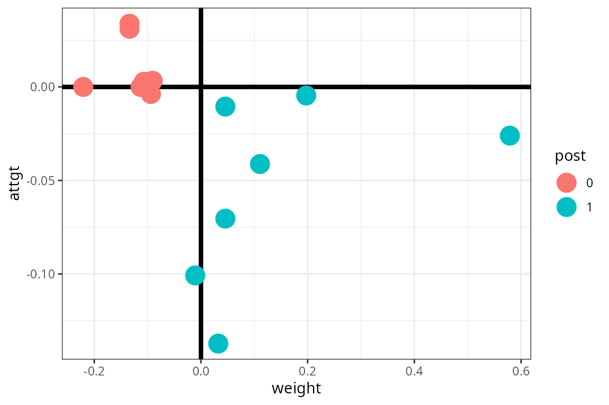
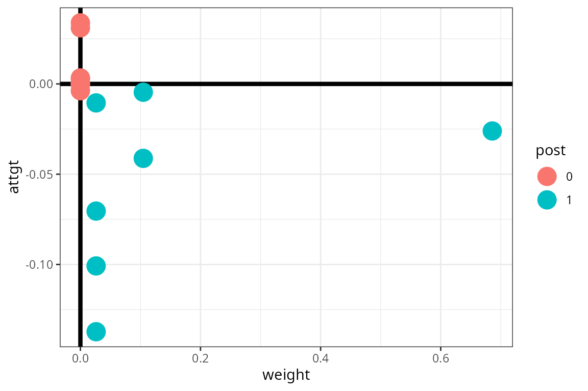

# TWFE Weights without Covariates

With staggered treatment adoption, the coefficient on the treatment
indicator from a two-way fixed effects (TWFE) regression,

``` math
Y_{it} = \theta_t + \eta_i + \alpha D_{it} + e_{it},
```

is a weighted sum of group-time average treatment effects, $`ATT(g,t)`$,
the average effect for units first treated in period $`g`$ (group $`g`$)
in period $`t`$ (de Chaisemartin and D’Haultfoeuille, 2020;
Goodman-Bacon, 2021). This vignette shows how to recover those weights
with [`twfe_weights()`](../reference/twfe_weights.md), and how to
compare them with the weights behind the overall average treatment
effects of Callaway and Sant’Anna (2021), from
[`attO_weights()`](../reference/attO_weights.md) and
[`att_simple_weights()`](../reference/att_simple_weights.md).

## Data and group-time average treatment effects

The example uses the county-level minimum wage data in the `did`
package: `lemp` is log teen employment, and `first.treat` is the year a
county’s state first raised its minimum wage (0 for counties never
treated in the sample).

``` r
library(twfeweights)
library(did)
data(mpdta, package = "did")
```

[`twfe_weights()`](../reference/twfe_weights.md) takes the output of
[`did::att_gt()`](https://bcallaway11.github.io/did/reference/att_gt.html).
Two choices matter. The comparison group must be the never-treated
group, and the base period must be `"universal"`: every $`ATT(g,t)`$,
including pre-treatment ones, is then measured relative to period
$`g-1`$, which is what makes the TWFE decomposition exact.

``` r
attgt <- att_gt(
  yname = "lemp", tname = "year", idname = "countyreal",
  gname = "first.treat", data = mpdta,
  control_group = "nevertreated", base_period = "universal",
  bstrap = FALSE, cband = FALSE
)
```

## TWFE weights

``` r
tw <- twfe_weights(attgt)
tw$weights_df
#>    group time.period      weight        attgt post
#> 1   2004        2003 -0.11307547  0.000000000    0
#> 2   2004        2004  0.04571981 -0.010503246    1
#> 3   2004        2005  0.04571981 -0.070423158    1
#> 4   2004        2006  0.03248687 -0.137258739    1
#> 5   2004        2007 -0.01085101 -0.100811363    1
#> 6   2006        2003 -0.09382154 -0.003769294    0
#> 7   2006        2004 -0.10705448  0.002750819    0
#> 8   2006        2005 -0.10705448  0.000000000    0
#> 9   2006        2006  0.19730313 -0.004594607    1
#> 10  2006        2007  0.11062737 -0.041224472    1
#> 11  2007        2003 -0.09057616  0.003306357    0
#> 12  2007        2004 -0.13391404  0.033813012    0
#> 13  2007        2005 -0.13391404  0.031087119    0
#> 14  2007        2006 -0.22058979  0.000000000    0
#> 15  2007        2007  0.57899403 -0.026054411    1
```

Each row is a group-time cell, with its TWFE weight, the estimated
$`ATT(g,t)`$, and whether the cell is post-treatment. The weighted sum
of the $`ATT(g,t)`$ reproduces the TWFE coefficient:

``` r
sum(tw$weights_df$weight * tw$weights_df$attgt)
#> [1] -0.03654894

mpdta$D <- 1 * (mpdta$year >= mpdta$first.treat & mpdta$first.treat > 0)
coef(fixest::feols(lemp ~ D | countyreal + year, data = mpdta))
#>           D 
#> -0.03654894
```

Three features of the weights are worth checking in any application.

**Post-treatment weights sum to one, but some can be negative.** Here
the cell for the 2004 group in 2007, its longest exposure, gets a
negative weight:

``` r
post <- tw$weights_df$post == 1
sum(tw$weights_df$weight[post])
#> [1] 1
tw$weights_df[post & tw$weights_df$weight < 0, ]
#>   group time.period      weight      attgt post
#> 5  2004        2007 -0.01085101 -0.1008114    1
```

**Pre-treatment cells get non-zero weight.** Under parallel trends (and
no anticipation), pre-treatment $`ATT(g,t)`$ are zero, so this part of
the TWFE estimate should be close to zero. When parallel trends fails in
pre-treatment periods, these terms feed directly into the TWFE estimate.

``` r
c(
  post_part = sum(tw$weights_df$weight[post] * tw$weights_df$attgt[post]),
  pre_part = sum(tw$weights_df$weight[!post] * tw$weights_df$attgt[!post])
)
#>    post_part     pre_part 
#> -0.027617574 -0.008931362
```

**The weights depend on the timing of treatment, not on how much each
cell matters for a target parameter.**
[`ggtwfeweights()`](../reference/ggtwfeweights.md) plots each cell’s
weight against its $`ATT(g,t)`$:

``` r
ggtwfeweights(tw)
```



## Weights behind overall average treatment effects

Callaway and Sant’Anna (2021) propose combining the $`ATT(g,t)`$ with
weights chosen to target a specific parameter.
[`attO_weights()`](../reference/attO_weights.md) gives the weights for
$`ATT^o`$, which averages each group’s post-treatment effects and then
averages across groups by group size;
[`att_simple_weights()`](../reference/att_simple_weights.md) gives the
weights for $`ATT^{simple}`$, which weights every post-treatment cell by
group size, so groups observed for more post-treatment periods count
more. Both put zero weight on pre-treatment cells, and their weights are
non-negative.

``` r
wo <- attO_weights(attgt)
ws <- att_simple_weights(attgt)

c(
  TWFE = sum(tw$weights_df$weight * tw$weights_df$attgt),
  ATT_o = sum(wo$weights_df$weight * wo$weights_df$attgt),
  ATT_simple = sum(ws$weights_df$weight * ws$weights_df$attgt)
)
#>        TWFE       ATT_o  ATT_simple 
#> -0.03654894 -0.03101828 -0.03995128
```

These match the `"group"` and `"simple"` aggregations in
[`did::aggte()`](https://bcallaway11.github.io/did/reference/aggte.html):

``` r
aggte(attgt, type = "group", bstrap = FALSE)$overall.att
#> [1] -0.03101828
aggte(attgt, type = "simple", bstrap = FALSE)$overall.att
#> [1] -0.03995128
```

Placing the weights side by side shows where the estimates differ: TWFE
puts less weight on long exposures, negative weight on some cells, and
non-zero weight on pre-treatment cells.

``` r
comparison <- data.frame(
  group = tw$weights_df$group,
  time.period = tw$weights_df$time.period,
  post = tw$weights_df$post,
  attgt = tw$weights_df$attgt,
  TWFE = tw$weights_df$weight,
  ATT_o = wo$weights_df$weight,
  ATT_simple = ws$weights_df$weight
)
comparison[comparison$post == 1, ]
#>    group time.period post        attgt        TWFE      ATT_o ATT_simple
#> 2   2004        2004    1 -0.010503246  0.04571981 0.02617801 0.06872852
#> 3   2004        2005    1 -0.070423158  0.04571981 0.02617801 0.06872852
#> 4   2004        2006    1 -0.137258739  0.03248687 0.02617801 0.06872852
#> 5   2004        2007    1 -0.100811363 -0.01085101 0.02617801 0.06872852
#> 9   2006        2006    1 -0.004594607  0.19730313 0.10471204 0.13745704
#> 10  2006        2007    1 -0.041224472  0.11062737 0.10471204 0.13745704
#> 15  2007        2007    1 -0.026054411  0.57899403 0.68586387 0.45017182
```

``` r
ggtwfeweights(wo)
```



## Sampling weights

If
[`did::att_gt()`](https://bcallaway11.github.io/did/reference/att_gt.html)
is called with `weightsname`, all three functions use the same sampling
weights by default, so [`twfe_weights()`](../reference/twfe_weights.md)
reproduces a weighted TWFE regression (e.g.,
`fixest::feols(..., weights = ~w)`).

## References

Callaway, Brantly and Pedro H. C. Sant’Anna. “Difference-in-Differences
with Multiple Time Periods.” *Journal of Econometrics* 225.2 (2021):
200-230.

de Chaisemartin, Clement and Xavier D’Haultfoeuille. “Two-Way Fixed
Effects Estimators with Heterogeneous Treatment Effects.” *American
Economic Review* 110.9 (2020): 2964-2996.

Goodman-Bacon, Andrew. “Difference-in-Differences with Variation in
Treatment Timing.” *Journal of Econometrics* 225.2 (2021): 254-277.
